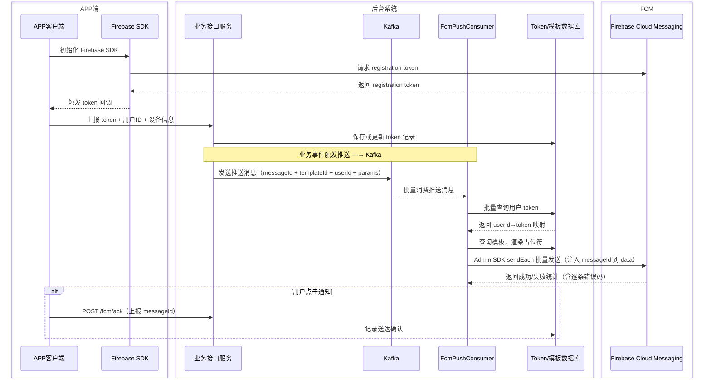
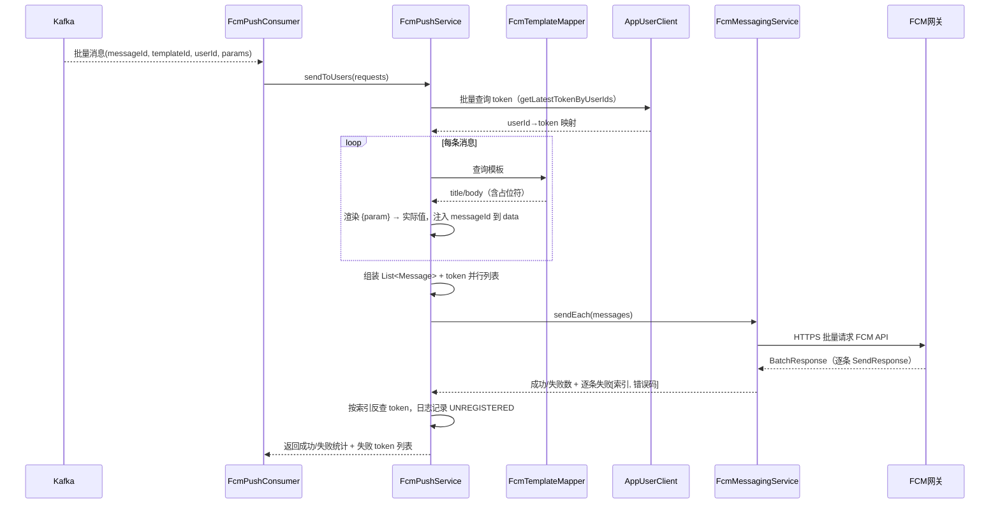
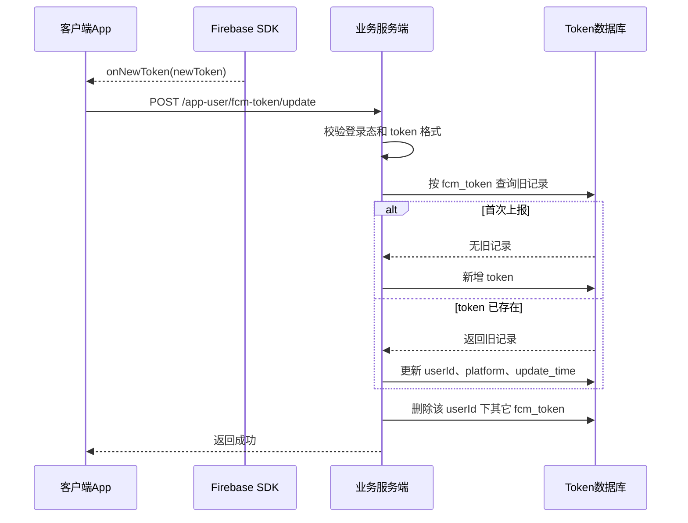
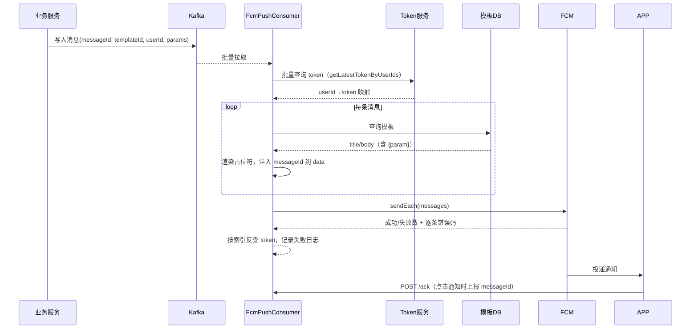
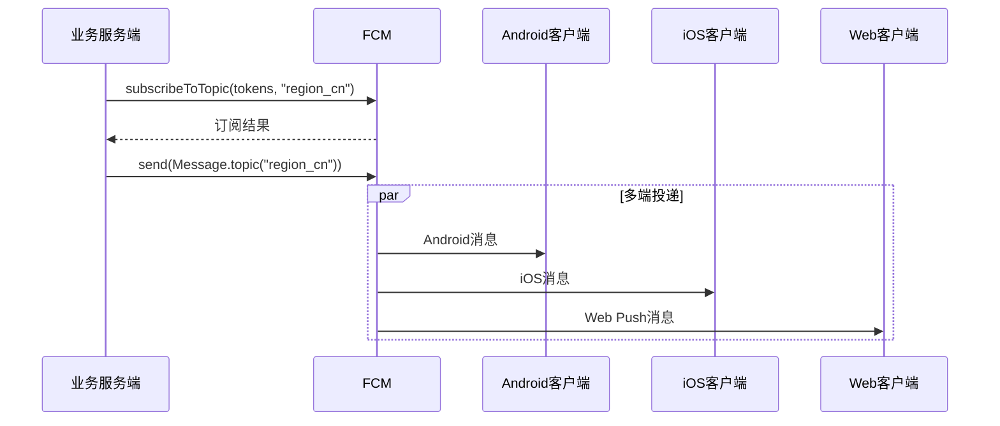
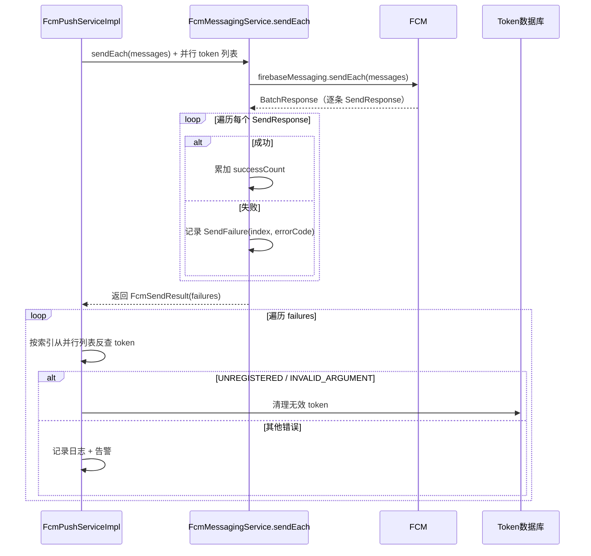
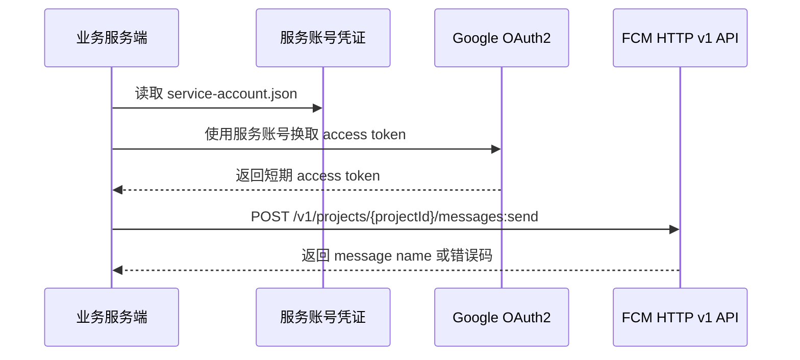

# FCM消息推送技术方案


## 一、什么是 Firebase Cloud Messaging

Firebase Cloud Messaging（简称 FCM）是 Google Firebase 提供的跨平台消息推送服务。服务端将消息发送给 FCM，FCM 再根据客户端的注册令牌（registration token）、Topic 或条件表达式把消息投递到 Android、iOS、Web 等客户端。

FCM 适合处理以下场景：

| 场景 | 说明 |
|------|------|
| 系统通知 | 订单状态、审核结果、告警、活动提醒 |
| 业务唤醒 | 后台消息提醒客户端拉取最新数据 |
| 分群推送 | 按语言、地区、版本、业务标签发送 Topic 消息 |
| 轻量数据下发 | 通过 `data` payload 传递业务参数，由客户端自行处理 |

FCM 不适合替代以下能力：

| 不适合场景 | 原因 |
|------------|------|
| 强实时链路 | FCM 不是 WebSocket / MQTT，不保证毫秒级实时到达 |
| 大数据传输 | 单条消息 payload 有大小限制，业务大数据应只发送 ID，再由客户端主动拉取 |
| 敏感明文传输 | FCM 链路加密但不是端到端加密，敏感数据需业务侧自行加密 |
| 必达消息系统 | 推送可能受设备离线、系统策略、Token 失效、平台限制影响 |

---

## 二、核心角色与消息流

| 角色 | 职责 |
|------|------|
| Firebase Project | FCM 所属项目，包含 Android / iOS / Web 应用配置 |
| 客户端应用 | 集成 Firebase SDK，获取并刷新 FCM registration token |
| 业务服务端 | 保存 token，按业务事件构造推送请求 |
| Firebase Admin SDK | 服务端推荐接入方式，封装鉴权和 FCM 发送 API |
| FCM Backend | Google 推送网关，负责路由、排队、平台适配 |
| APNs / Web Push | iOS / Web 推送的底层平台通道，由 FCM 适配 |

### 1. 整体接入流程



### 2. 推送链路分层



---

## 三、接入方式选择

服务端有两种主流接入方式。

| 方式 | 适用场景 | 优点 | 注意事项 |
|------|----------|------|----------|
| Firebase Admin SDK | Java / Node.js / Python / Go / C# 服务端 | 推荐方案；自动处理鉴权、对象模型清晰、支持单发/批量/Topic | 需要服务账号凭证；依赖 SDK 版本 |
| FCM HTTP v1 API | 非 SDK 语言、自定义网关、跨语言统一封装 | 协议直接，可完全控制 HTTP 请求 | 需要自行获取 OAuth2 access token，处理错误与重试 |

本项目建议优先使用 **Firebase Admin SDK for Java**。只有在服务端语言不支持 Admin SDK，或需要跨语言统一网关时，再使用 HTTP v1 API。

---

## 四、Firebase 控制台与运维配置

Firebase 项目创建、APNs 密钥、服务账号私钥的从零配置步骤与验证排障见同目录 [2.Firebase云端配置指南.md](./2.Firebase云端配置指南.md)。

### 1. Firebase Project 配置

运维或项目管理员需要先完成以下工作：

| 配置项 | 说明 |
|--------|------|
| 创建 Firebase Project | 每个环境建议独立项目，如 dev / staging / prod |
| 添加 Android App | 配置 package name，下载 `google-services.json` |
| 添加 iOS App | 配置 bundle id，上传 APNs Auth Key 或证书 |
| 添加 Web App | 配置 Web Push certificate / VAPID key |
| 启用 Cloud Messaging API | 在 Firebase 项目中启用 FCM HTTP v1 API |
| 创建服务账号 | 用于服务端 Admin SDK 鉴权 |

### 2. 服务账号凭证管理

服务账号 JSON 是高敏感凭证，不允许提交到 Git 仓库。推荐通过 Kubernetes Secret、Nacos 加密配置、Vault 或 CI/CD Secret 注入。

| 配置项 | 说明 | 示例 |
|--------|------|------|
| `fcm.enabled` | 是否启用 FCM 推送 | `true` |
| `fcm.project-id` | Firebase Project ID | `my-app-prod` |
| `fcm.credentials-path` | 服务账号 JSON 文件路径 | `/etc/secrets/firebase-service-account.json` |
| `fcm.dry-run` | 是否只校验不实际发送 | `false` |

---

## 五、Java / Spring Boot 服务端集成

### 1. 模块架构

推送链路分为四层，按模块拆分：

| 模块 | 职责 | 关键类 |
|------|------|--------|
| consumer | Kafka 批量消费推送消息 | `FcmPushConsumer` |
| service | 模板渲染 + token 查询 + 消息构建 | `FcmPushServiceImpl` |
| integration | Firebase Admin SDK 封装 | `FcmMessagingService`、`FcmMessageFactory` |
| repository | 模板和 token 数据访问 | `FcmTemplateMapper`、`FcmParamMapper` |

### 2. Maven 依赖

```xml
<!-- Firebase Admin SDK（integration 模块） -->
<dependency>
    <groupId>com.google.firebase</groupId>
    <artifactId>firebase-admin</artifactId>
    <version>9.9.0</version>
</dependency>

<!-- Spring Kafka（consumer 模块） -->
<dependency>
    <groupId>org.springframework.kafka</groupId>
    <artifactId>spring-kafka</artifactId>
</dependency>
```

### 3. 应用配置

```yaml
# application.yaml
spring:
  kafka:
    bootstrap-servers: ${KAFKA_BOOTSTRAP_SERVERS:localhost:9092}
    consumer:
      max-poll-records: ${KAFKA_MAX_POLL_RECORDS:500}
    listener:
      type: batch

fcm:
  enabled: ${FCM_ENABLED:false}
  project-id: ${FCM_PROJECT_ID:}
  credentials-path: ${FCM_CREDENTIALS_PATH:}
  dry-run: ${FCM_DRY_RUN:false}
  kafka:
    topic: ${FCM_KAFKA_TOPIC:fcm-push}
```

### 4. Firebase 初始化

```java
@Configuration
@EnableConfigurationProperties(FcmProperties.class)
@ConditionalOnProperty(name = "fcm.enabled", havingValue = "true")
public class FcmConfig {

    @Bean
    public FirebaseApp firebaseApp(FcmProperties properties) throws IOException {
        GoogleCredentials credentials = GoogleCredentials.fromStream(
                new FileInputStream(properties.getCredentialsPath()));
        FirebaseOptions options = FirebaseOptions.builder()
                .setCredentials(credentials)
                .setProjectId(properties.getProjectId())
                .build();
        return FirebaseApp.initializeApp(options);
    }

    @Bean
    public FirebaseMessaging firebaseMessaging(FirebaseApp firebaseApp) {
        return FirebaseMessaging.getInstance(firebaseApp);
    }
}
```

### 5. Kafka 消费者（批量消费 + 模板渲染 + 批量推送）

```java
@Slf4j
@Component
@ConditionalOnProperty(name = "fcm.enabled", havingValue = "true")
@RequiredArgsConstructor
public class FcmPushConsumer {

    private final FcmPushService fcmPushService;

    @KafkaListener(topics = "${fcm.kafka.topic:fcm-push}",
            groupId = "${spring.application.name}-fcm-push",
            batch = "true")
    public void consume(List<ConsumerRecord<String, String>> records) {
        log.info("Received FCM push batch, size: {}", records.size());
        List<FcmUserPushRequestDTO> requests = records.stream()
                .map(r -> JSONUtil.toBean(r.value(), FcmUserPushRequestDTO.class))
                .collect(Collectors.toList());
        FcmPushResponseDTO response = fcmPushService.sendToUsers(requests);
        log.info("FCM push batch completed, success: {}, fail: {}",
                response.getSuccessCount(), response.getFailureCount());
    }
}
```

Kafka 消息格式（JSON）：

```json
{
  "messageId": "msg-550e8400-e29b-41d4-a716-446655440000",
  "userId": 1001,
  "templateId": 1,
  "params": {"username": "张三"},
  "data": {"type": "ORDER_SHIPPED", "orderId": "123456"}
}
```

`messageId` 由生产者生成（UUID），服务端注入到 FCM 消息 data 中，APP 收到通知后通过 ACK 接口上报，实现端到端的送达追踪。

### 6. 推送服务（批量查 token + 模板渲染 + 失败追踪）

```java
@Slf4j
@Service
@ConditionalOnProperty(name = "fcm.enabled", havingValue = "true")
public class FcmPushServiceImpl implements FcmPushService {

    private final FcmMessagingService fcmMessagingService;
    private final FcmMessageFactory fcmMessageFactory;
    private final AppUserClient appUserClient;
    private final FcmTemplateMapper fcmTemplateMapper;

    @Override
    public FcmPushResponseDTO sendToUsers(List<FcmUserPushRequestDTO> requests) {
        if (requests == null || requests.isEmpty()) {
            return new FcmPushResponseDTO();
        }
        // 1. 批量查询 token（一次 Feign 调用）
        List<Long> userIds = requests.stream()
                .map(FcmUserPushRequestDTO::getUserId).distinct().collect(Collectors.toList());
        Map<Long, String> tokenMap = getTokenMap(userIds);

        // 2. 逐条构建 Message，维护并行 token 列表用于事后反查
        List<Message> messages = new ArrayList<>();
        List<String> messageTokens = new ArrayList<>();
        for (FcmUserPushRequestDTO req : requests) {
            try {
                String token = tokenMap.get(req.getUserId());
                Message message = buildMessage(req, token);
                if (message != null) {
                    messages.add(message);
                    messageTokens.add(token);
                }
            } catch (Exception e) {
                log.error("Failed to build FCM message for userId: {}", req.getUserId(), e);
            }
        }
        if (messages.isEmpty()) {
            return new FcmPushResponseDTO();
        }

        // 3. 批量发送，解析逐条失败原因
        try {
            FcmSendResult result = fcmMessagingService.sendEach(messages);
            if (result.getFailureCount() > 0) {
                for (FcmSendResult.SendFailure failure : result.getFailures()) {
                    String token = failure.getIndex() < messageTokens.size()
                            ? messageTokens.get(failure.getIndex()) : "unknown";
                    log.warn("FCM send failed: token={}, errorCode={}", token, failure.getErrorCode());
                }
            }
            return toResponse(result, messageTokens);
        } catch (Exception e) {
            throw new IllegalStateException("Failed to send FCM batch messages", e);
        }
    }

    private Message buildMessage(FcmUserPushRequestDTO requestDTO, String token) {
        if (!StringUtils.hasText(token)) {
            log.warn("No FCM token for userId: {}", requestDTO.getUserId());
            return null;
        }
        FcmTemplateEntity template = fcmTemplateMapper.selectById(requestDTO.getTemplateId());
        if (template == null) {
            log.warn("FCM template not found: {}", requestDTO.getTemplateId());
            return null;
        }
        String title = render(template.getTitle(), requestDTO.getParams());
        String body = render(template.getBody(), requestDTO.getParams());
        // 注入 messageId 到 data payload，供 APP 端取出后 ACK
        Map<String, String> data = new HashMap<>(safeData(requestDTO.getData()));
        if (requestDTO.getMessageId() != null) {
            data.put("messageId", requestDTO.getMessageId());
        }
        return fcmMessageFactory.createTokenMessage(token, title, body, data);
    }

    private String render(String text, Map<String, String> params) { /* 占位符替换逻辑 */ }
}
```

关键改进：
- **批量查 token**：一次 `getLatestTokenByUserIds(userIds)` 替代逐条 `getLatestTokenByUserId`
- **messageId 注入**：将 Kafka 消息中的 `messageId` 写入 FCM data，APP 可从通知 payload 提取
- **逐条失败追踪**：维护 `messageTokens` 并行列表，`sendEach` 返回失败索引 + 错误码后反查 token 记录日志

### 7. Firebase 批量发送适配（sendEach + 逐条失败解析）

```java
@Service
public class FcmMessagingService {

    private final FirebaseMessaging firebaseMessaging;
    private final FcmProperties properties;

    /** 批量发送不同内容到不同 token，解析逐条失败原因 */
    public FcmSendResult sendEach(List<Message> messages) throws Exception {
        if (messages == null || messages.isEmpty()) {
            return new FcmSendResult(0, 0, null, List.of(), List.of());
        }
        BatchResponse response = firebaseMessaging.sendEach(messages, properties.isDryRun());
        FcmSendResult result = new FcmSendResult();
        result.setSuccessCount(response.getSuccessCount());
        result.setFailureCount(response.getFailureCount());

        List<SendResponse> responses = response.getResponses();
        List<FcmSendResult.SendFailure> failures = new ArrayList<>();
        for (int i = 0; i < responses.size(); i++) {
            SendResponse sr = responses.get(i);
            if (!sr.isSuccessful()) {
                String errorCode = sr.getException() != null
                        ? sr.getException().getMessagingErrorCode().name()
                        : "UNKNOWN";
                failures.add(new FcmSendResult.SendFailure(i, errorCode));
            }
        }
        result.setFailures(failures);
        return result;
    }
}
```

`FcmSendResult.SendFailure` 包含消息索引(`index`)和 FCM 错误码(`errorCode`)。由于 `Message.getToken()` 在 Firebase Admin SDK 中非 public，外层 `FcmPushServiceImpl` 维护并行 token 列表，事后按索引反查 token 记录日志。

> FCM Admin SDK 单次 `sendEach` 调用最多传入 500 条 Message。Kafka consumer 的 `max-poll-records` 配置为 500，保证单批拉取的消息数不超过 FCM 限制。

---

## 六、客户端 Token 上报与服务端管理

### 1. Token 上报接口

客户端获取 FCM registration token 后，应调用业务服务端接口进行绑定。

- **`POST /app-user/fcm-token/update`**
- **用途**：绑定或刷新当前用户与 FCM token 的关系
- **认证方式**：用户登录态或设备认证

| 字段 | 类型 | 必填 | 说明 |
|------|------|------|------|
| `userId` | long | 是 | APP 用户 ID |
| `platform` | string | 是 | `ANDROID` / `IOS` / `WEB` |
| `fcmToken` | string | 是 | FCM registration token |

### 2. Token 刷新流程



### 3. Token 表设计

| 字段 | 说明 |
|------|------|
| `id` | 主键 |
| `user_id` | 用户 ID |
| `platform` | 平台：ANDROID / IOS / WEB |
| `fcm_token` | FCM registration token，唯一索引 |
| `create_time` | 创建时间，毫秒时间戳 |
| `update_time` | 更新时间，毫秒时间戳 |

### 4. Token 新鲜度策略

FCM 官方建议服务端主动维护 token 新鲜度。默认情况下，如果某个 app instance 超过 1 个月没有连接，FCM 会将其视为 stale token；Android 设备超过约 270 天未连接时，相关 token 会过期。实际项目可以根据业务活跃度调整窗口。

建议策略：

| 条件 | 处理 |
|------|------|
| 客户端每次启动或 token 刷新 | 上报 token，刷新 `update_time` |
| 同一用户存在多条 token | token 上报成功后删除该用户其它 token |
| 推送返回 `UNREGISTERED` | 删除 token，并停止继续发送 |
| 用户退出登录 | 可删除该用户当前 token |
| 用户关闭推送开关 | 由业务侧跳过该用户的推送 |

---

## 七、消息类型设计

FCM 支持两类核心消息：notification message 和 data message。

| 类型 | 特点 | 适用场景 |
|------|------|----------|
| Notification message | 包含 `notification.title`、`notification.body` 等预定义展示字段；后台时通常由 SDK 或系统通知栏自动展示 | 普通用户通知 |
| Data message | 只包含业务自定义 key-value，由客户端代码自行处理 | 静默刷新、业务动作、前台自定义展示 |
| Notification + Data | 同时有展示字段和业务参数 | 点击通知后打开指定页面、携带业务 ID |

### 1. 通知消息示例

```java
Message message = Message.builder()
        .setToken(token)
        .setNotification(Notification.builder()
                .setTitle("订单已发货")
                .setBody("你的订单已交给承运商")
                .build())
        .putData("type", "ORDER_SHIPPED")
        .putData("orderId", "123456")
        .build();
```

### 2. 数据消息示例

```java
Message message = Message.builder()
        .setToken(token)
        .putData("type", "SYNC_REQUIRED")
        .putData("resource", "ORDER")
        .putData("resourceId", "123456")
        .build();
```

### 3. 消息送达确认（ACK）

FCM 的服务端返回值只表示 FCM **接受**了消息，不保证设备实际收到。要追踪最终送达，需由客户端主动上报。

**Notification 消息的 ACK 时机：**

| 场景 | onMessageReceived | 能调 ACK？ |
|------|-------------------|-----------|
| APP 前台 | 触发 | 能 |
| APP 后台 | 不触发，系统托盘直接展示 | 不能 |
| 用户点击通知 | APP 被唤醒 | **能** ✓ |

由于当前消息为 notification 类型，APP 在后台时无法主动调 ACK。因此 ACK 的实际含义为**"用户已点击查看"**，比"送达"更有业务价值。

**ACK 接口：**

- **`POST /fcm/ack`**（liko-component-infra）
- **请求体**：`{"messageId": "msg-xxx", "userId": 1001}`

APP 从通知 data payload 中提取 `messageId`，在用户点击通知进入 APP 时上报。服务端当前记录日志，后续可扩展为落表做送达/查看率统计。

```java
@Slf4j
@RestController
@RequestMapping("/fcm")
public class FcmAckController {

    @PostMapping("/ack")
    public Response<Void> ack(@RequestBody @Valid FcmAckRequestDTO request) {
        log.info("FCM message acked, messageId: {}, userId: {}",
                request.getMessageId(), request.getUserId());
        return ResponseUtils.succeed();
    }
}
```

### 4. 平台差异

| 平台 | 注意事项 |
|------|----------|
| Android | 可设置 priority、channelId、collapseKey、TTL；后台通知通常进入通知栏 |
| iOS | 需要配置 APNs；静默推送依赖 `content-available`，受系统策略影响 |
| Web | 需要 Service Worker 和 Web Push 配置；浏览器权限由用户授予 |

---

## 八、发送目标设计

### 1. 单用户推送（Kafka + 模板）

业务服务将推送任务写入 Kafka，consumer 批量消费后，批量查询 token、加载模板并渲染占位符，通过 Firebase `sendEach` 批量发送。每条消息注入 `messageId`，APP 点击通知后通过 ACK 接口上报。



### 2. 模板与参数设计

**模板（fcm_template）** 定义推送内容的框架，title 和 body 中可使用 `{paramName}` 占位符。**参数（fcm_param）** 在需求评审阶段确定并入库，作为占位符的声明。

模板示例：

| 字段 | 值 |
|------|-----|
| templateName | 订单发货通知 |
| title | `尊敬的 {username} 用户您好` |
| body | `您的订单 {orderId} 已由 {carrier} 揽收` |

推送请求参数：

```json
{
  "messageId": "msg-550e8400-e29b-41d4-a716-446655440000",
  "userId": 1001,
  "templateId": 1,
  "params": {
    "username": "张三",
    "orderId": "PO20260604001",
    "carrier": "顺丰速运"
  },
  "data": {
    "type": "ORDER_SHIPPED",
    "orderId": "PO20260604001"
  }
}
```

渲染后 title 为 `尊敬的 张三 用户您好`，body 为 `您的订单 PO20260604001 已由 顺丰速运 揽收`。

**数据库表结构：**

```sql
CREATE TABLE infra_fcm_param (
    id BIGINT AUTO_INCREMENT PRIMARY KEY,
    param_name VARCHAR(64) NOT NULL UNIQUE COMMENT '占位符名称，如 username',
    description VARCHAR(255) COMMENT '参数说明',
    created_at BIGINT COMMENT '创建时间（毫秒）'
);

CREATE TABLE infra_fcm_template (
    id BIGINT AUTO_INCREMENT PRIMARY KEY,
    template_name VARCHAR(128) NOT NULL COMMENT '模板名称',
    title VARCHAR(255) NOT NULL COMMENT '标题，可含 {param} 占位符',
    body TEXT NOT NULL COMMENT '正文，可含 {param} 占位符',
    created_at BIGINT COMMENT '创建时间（毫秒）'
);
```

模板和参数通过内部的 Feign 接口管理（`FcmParamFeign`、`FcmTemplateFeign`），路径前缀 `/feign/fcm`。

### 3. Topic 推送

Topic 适合面向大规模群体的广播，如按语言、地区、订阅频道推送。



Topic 命名建议：

| 类型 | 示例 | 说明 |
|------|------|------|
| 语言 | `lang_zh_cn` | 按语言推送 |
| 地区 | `region_cn` | 按地区推送 |
| 业务订阅 | `topic_order_updates` | 按业务频道推送 |
| 版本 | `app_v2_5` | 灰度或版本定向 |

Topic 订阅建议由服务端统一维护，避免客户端任意订阅敏感 Topic。Admin SDK 单次订阅或取消订阅最多处理 1000 个 token，超过需要分批。

### 4. 条件推送

FCM HTTP v1 和 Admin SDK 支持 condition，适合简单 Topic 组合：

```java
Message message = Message.builder()
        .setCondition("'region_cn' in topics && 'lang_zh_cn' in topics")
        .setNotification(Notification.builder()
                .setTitle("系统公告")
                .setBody("今日 22:00 将进行维护")
                .build())
        .build();
```

条件推送表达式不宜过度复杂。复杂人群圈选应在业务侧计算目标 token，再批量发送。

---

## 九、错误处理、重试与 Token 清理

### 1. 发送错误分类

| 错误 | 含义 | 处理策略 |
|------|------|----------|
| `UNREGISTERED` / `messaging/registration-token-not-registered` | token 已失效、卸载、过期或项目不匹配 | 删除 token，不再发送 |
| `INVALID_ARGUMENT` / `messaging/invalid-argument` | 请求参数或 token 格式错误 | 若 payload 校验通过，可清理该 token；否则修正请求 |
| `SENDER_ID_MISMATCH` / `messaging/mismatched-credential` | token 与服务账号所属 Firebase Project 不匹配 | 检查环境配置和客户端项目配置 |
| `QUOTA_EXCEEDED` / `messaging/message-rate-exceeded` | 发送速率或配额超限 | 降速，使用指数退避 |
| `UNAVAILABLE` / `messaging/server-unavailable` | FCM 服务暂不可用 | 遵守 `Retry-After`，指数退避并加随机抖动 |
| `INTERNAL` / `messaging/internal-error` | FCM 内部错误 | 可重试，持续异常时检查 Firebase 状态页 |
| `THIRD_PARTY_AUTH_ERROR` / `messaging/invalid-apns-credentials` | APNs 或 Web Push 凭据异常 | 检查 iOS / Web 推送证书配置；最常见的根因是 Firebase 控制台只传了开发版 APNs 密钥、正式版槽位为空，案例见 [2.Firebase云端配置指南.md](./2.Firebase云端配置指南.md) 第九节 |

### 2. 批量发送失败清理流程



### 3. 重试策略

| 场景 | 是否重试 | 建议 |
|------|----------|------|
| token 失效 | 否 | 直接清理 |
| 参数错误 | 否 | 修正代码或 payload |
| 服务暂不可用 | 是 | 指数退避，遵守 `Retry-After` |
| 配额超限 | 是 | 降低发送速率，至少分钟级退避 |
| 凭证错误 | 否 | 配置问题，触发告警 |

建议不要在 HTTP 请求线程内同步做多轮重试。应写入延迟队列，由异步任务统一处理，避免阻塞业务接口。

---

## 十、HTTP v1 API 备选方案

如果不使用 Admin SDK，可以直接调用 FCM HTTP v1 API。

### 1. 请求格式

```http
POST https://fcm.googleapis.com/v1/projects/{projectId}/messages:send
Authorization: Bearer {accessToken}
Content-Type: application/json
```

```json
{
  "message": {
    "token": "FCM_REGISTRATION_TOKEN",
    "notification": {
      "title": "订单已发货",
      "body": "你的订单已交给承运商"
    },
    "data": {
      "type": "ORDER_SHIPPED",
      "orderId": "123456"
    }
  }
}
```

### 2. OAuth2 鉴权流程



HTTP v1 API 需要申请 `https://www.googleapis.com/auth/firebase.messaging` scope，并在请求头中使用 `Authorization: Bearer <access_token>`。

---

## 十一、安全与合规要求

| 要求 | 说明 |
|------|------|
| 服务账号凭证加密存储 | 不进 Git，不打印日志，不下发客户端 |
| 最小权限 | 服务账号只授予发送 FCM 所需权限 |
| 环境隔离 | dev / staging / prod 使用不同 Firebase Project 和凭证 |
| Token 脱敏 | 日志中只打印 token hash 或前后少量字符 |
| Payload 控制 | 不传身份证、手机号、访问令牌等敏感明文 |
| 用户授权 | 尊重客户端通知权限和业务退订开关 |
| 频率控制 | 防止活动推送、批量任务造成刷屏或被限流 |

---

## 十二、监控与审计

| 指标 | 说明 |
|------|------|
| 推送请求数 | 按业务类型、平台、Topic 统计 |
| 成功数 / 失败数 | 统计 Admin SDK 返回结果 |
| 失败错误码分布 | 重点关注 token 失效、凭证异常、配额超限 |
| token 数量 | 用户 token 总量、上报时删除的旧 token 数量 |
| 推送耗时 | Admin SDK 调用耗时和批量任务耗时 |
| 重试队列积压 | 观察 FCM 异常或限流影响 |
| messageId ACK 率 | 用户点击查看通知比例，评估推送有效性 |
| 用户退订率 | 评估推送策略是否过度打扰 |

推送日志建议包含：

| 字段 | 说明 |
|------|------|
| `request_id` | 单次推送请求 ID |
| `message_type` | 业务消息类型 |
| `target_type` | TOKEN / USER / TOPIC / CONDITION |
| `platform` | ANDROID / IOS / WEB / ALL |
| `success_count` | 成功数量 |
| `failure_count` | 失败数量 |
| `error_summary` | 错误码聚合 |
| `created_at` | 发送时间 |

---

## 十三、接入检查清单

### 1. Firebase 侧

- [ ] 已创建 Firebase Project，并按环境隔离
- [ ] Android / iOS / Web 应用配置已完成
- [ ] iOS APNs Auth Key 或证书已配置
- [ ] Web Push / VAPID 配置已完成
- [ ] Cloud Messaging API 已启用
- [ ] 服务账号已创建，凭证已安全注入服务端

### 2. 客户端侧

- [ ] Firebase SDK 初始化成功
- [ ] 能获取 registration token
- [ ] token 变化时能重新上报服务端
- [ ] 前台、后台、点击通知场景均已处理
- [ ] 用户关闭推送权限时有业务降级逻辑

### 3. 服务端侧

- [ ] Admin SDK 初始化成功
- [ ] token 上报接口完成鉴权和幂等更新
- [ ] token 表有 `uk_fcm_token` 唯一约束
- [ ] 单发、批量、Topic 推送均有封装
- [ ] 批量 token 按 500 个一批发送
- [ ] Topic 订阅按 1000 个 token 一批处理
- [ ] token 上报成功后会删除同一用户的其它 token
- [ ] `UNAVAILABLE`、`QUOTA_EXCEEDED` 使用异步重试和指数退避
- [ ] 日志不泄露完整 token 和服务账号凭证
- [ ] 关键指标已接入监控和告警

---

## 十四、官方参考

- Firebase Cloud Messaging 总览：https://firebase.google.com/docs/cloud-messaging
- 使用 Firebase Admin SDK 发送消息：https://firebase.google.com/docs/cloud-messaging/send/admin-sdk
- 使用 FCM HTTP v1 API 发送消息：https://firebase.google.com/docs/cloud-messaging/send/v1-api
- FCM 消息类型：https://firebase.google.com/docs/cloud-messaging/customize-messages/set-message-type
- FCM registration token 管理：https://firebase.google.com/docs/cloud-messaging/manage-tokens
- FCM Topic 订阅管理：https://firebase.google.com/docs/cloud-messaging/manage-topic-subscriptions
- FCM 错误码：https://firebase.google.com/docs/cloud-messaging/error-codes
- Firebase Admin Java SDK Maven Central：https://central.sonatype.com/artifact/com.google.firebase/firebase-admin
