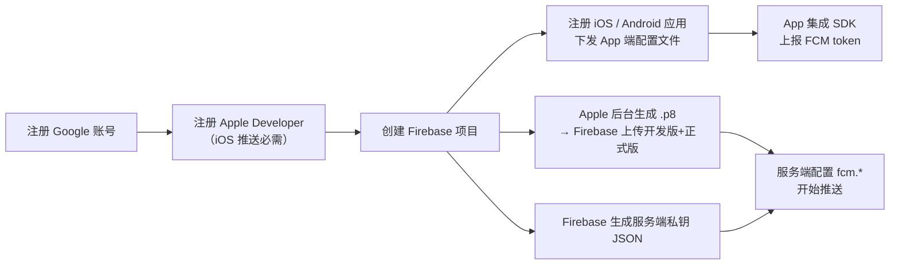
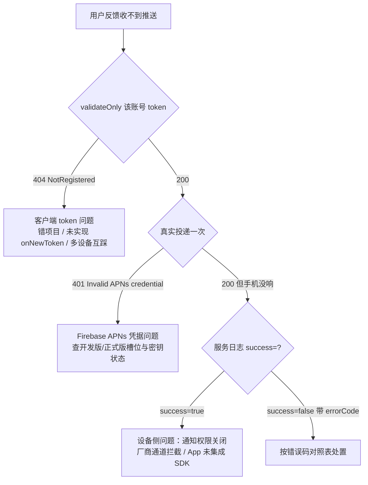

# Firebase 云端配置指南（从 0 开始）

> 本文只覆盖 **云端配置**：Google / Apple 账号、Firebase 项目、APNs 凭据、服务端密钥，以及配置完成后的验证与排障。
> 服务端代码链路（Kafka 消费、模板渲染、发送适配）见同目录 [1.FCM消息推送技术方案.md](./1.FCM消息推送技术方案.md)。
>
> 本文所有网址均为可点击的完整链接；带 `PROJECT_ID` 的链接替换成自己的 Firebase 项目 ID 即可，真实 ID 以 Firebase 控制台为准。

## 一、需要准备的东西总览

| 序号 | 账号 / 凭据 | 在哪获取 | 谁负责 | 关键注意 |
|------|--------------|----------|--------|----------|
| 1 | Google 账号 | [accounts.google.com](https://accounts.google.com/signup) | 任意同事 | 建议用公司邮箱注册，并加入公司组织 |
| 2 | Apple Developer 账号（团队） | [developer.apple.com/account](https://developer.apple.com/account) | App / iOS 同事 | iOS 推送必需；需要 Account Holder 或 Admin 角色才能创建密钥 |
| 3 | Firebase 项目 | [console.firebase.google.com](https://console.firebase.google.com/) | 有 Google 账号即可 | 测试与生产**必须分开项目** |
| 4 | APNs 身份验证密钥（`.p8`） | Apple 开发者后台生成 | iOS 同事 | **只能下载一次**；Firebase 上传时**开发版、正式版两个槽位都要传** |
| 5 | 服务账号私钥（`firebase-adminsdk` JSON） | Firebase 控制台生成 | 后端同事 | **绝不允许提交进 Git**，走挂载 / Secret 注入 |

整体流程：



---

## 二、注册 Google 账号

1. 打开 [https://accounts.google.com/signup](https://accounts.google.com/signup) 按提示注册。
2. 已有账号可直接登录 [https://accounts.google.com](https://accounts.google.com/)。
3. 建议把账号加入公司 Google Workspace 组织，方便后续把 Firebase 项目所有权归属公司（而不是个人）。

---

## 三、注册 Apple Developer 账号（iOS 推送必需）

FCM 给 iOS 设备发通知，最终要经过 Apple 的 APNs；连接 APNs 的凭据（.p8 密钥）只能在 Apple 开发者后台生成。

1. 打开 [https://developer.apple.com/account](https://developer.apple.com/account) 登录 Apple ID。
2. 没有开发者账号时走 [https://developer.apple.com/enroll/](https://developer.apple.com/enroll/) 注册（个人 $99/年；公司账号需要 D-U-N-S 编码）。
3. 注册完成后会获得一个 **Team ID**（10 位字母数字，文中记作 `<TEAM_ID>`），后续生成的每把 APNs 密钥都会绑定它。
4. 角色要求：**Account Holder 或 Admin** 才能创建 Keys；Member 角色看不到创建入口。公司账号先在成员列表确认角色：[https://developer.apple.com/account/resources/membership/roles](https://developer.apple.com/account/resources/membership/roles)。

---

## 四、创建 Firebase 项目

1. 打开 [https://console.firebase.google.com/](https://console.firebase.google.com/)，用 Google 账号登录，点击 **添加项目（Add project）**。
2. 项目 ID 创建后**不可修改**，会出现在所有配置文件和 API 路径里。
   - 环境划分：测试与开发可共用一个项目，生产必须单独一个。
3. Analytics 可以不开（只用 FCM 不需要）。
4. Firebase 项目同时对应一个 Google Cloud 项目，服务账号、配额等在 [https://console.cloud.google.com/](https://console.cloud.google.com/) 可见。

---

## 五、注册应用（下发 App 端配置文件）

Firebase 需要知道"给哪个 App 发"，每个平台的应用要在控制台注册，注册后下载对应配置文件交给 App 同事。

### 1. iOS 应用

1. 打开 [console.firebase.google.com/project/PROJECT_ID/settings/general/](https://console.firebase.google.com/project/PROJECT_ID/settings/general/)（把 `PROJECT_ID` 换成自己的项目 ID），页面底部 **您的应用** → 点 **iOS+**。
2. 填写 **Bundle ID**：必须与 Xcode target 的 Bundle Identifier **逐字符一致**（文中记作 `com.example.app.dev`），不一致会导致 token 与应用对不上。
3. 注册完成后下载 **`GoogleService-Info.plist`**，交给 iOS 同事：
   - 放进 Xcode 工程根目录（Copy items if needed），文件名保持不变；
   - Firebase SDK 读取该文件来确定 token 归属哪个项目。
4. 顺手记下页面上的 **Apple App ID / Team ID**，与下一步 APNs 配置保持一致。

### 2. Android 应用

1. 同一页面点 **Android+**，填写 **Android 包名**（文中记作 `com.example.app.sit`）。
2. 填写 **SHA-1 证书指纹**（debug 和 release 的都要注册）。查看方式：

   ```bash
   keytool -list -v -keystore ~/.android/debug.keystore -alias androiddebugkey -storepass android | grep SHA1
   # 正式 keystore 同理，换成自己的 keystore 路径和密码
   ```

3. 下载 **`google-services.json`** 交给 Android 同事，放到 `app/` 模块根目录。

---

## 六、APNs 配置（iOS 推送的命门）

### 1. 原理：FCM 怎么用 APNs 凭据

服务端只对接 FCM；FCM 拿着控制台里配置的 **APNs 凭据**代为连接 Apple 的 APNs。所以：

- APNs 凭据没配好 → iOS 推送 100% 失败，报 `THIRD_PARTY_AUTH_ERROR` / `Invalid APNs credential`（Android 不受影响）。
- iOS 设备的 token 分两种 **APNs 环境**：

| 安装方式 | APNs 环境 | Firebase 凭据槽位 |
|----------|-----------|-------------------|
| Xcode 直接安装（开发证书） | sandbox | **开发版**槽 |
| TestFlight / Ad Hoc / App Store | production | **正式版**槽 |

Firebase 控制台按上表**分槽位保存凭据**，发给哪种环境的 token 就去对应槽位取凭据。**只传开发版 = 所有正式签名包装出来的设备全部发不出去**（见第九节事故记录）。

### 2. 在 Apple 后台生成 APNs 身份验证密钥（.p8）

1. 登录 [https://developer.apple.com/account/resources/authkeys/list](https://developer.apple.com/account/resources/authkeys/list)（Certificates, Identifiers & Profiles → **Keys**）。
2. 点右上角 **+** 新建，Name 随意（如 `FirebaseAPNsKey`），服务勾选 **Apple Push Notifications service (APNs)**，Continue → Register。
3. 注册完成页点 **Download**，得到 `AuthKey_<KEYID>.p8`。

⚠️ **三条铁律**：

- **.p8 私钥只能下载这一次**，关掉页面就再也拿不到；文件务必交给专人保管（App 同事 / 密码管理器），丢了只能重新生成。
- **Revoke（撤销）不可逆**：撤销后所有用它签发的连接立即失效，Firebase 里已上传的槽位也要全部重传。
- 这把 key 是 **Team 级、通吃 Sandbox 和 Production** 的（Apple 页面上会显示 `Team scoped (All topics) [Sandbox & Production]`），**不需要**为两个环境生成两把；但 **Firebase 控制台的两个槽位都要上传这同一份文件**。

### 3. 上传到 Firebase（两个槽位都要传！）

1. 打开 [console.firebase.google.com/project/PROJECT_ID/settings/cloudmessaging/](https://console.firebase.google.com/project/PROJECT_ID/settings/cloudmessaging/)（Project settings → **Cloud Messaging**）。
2. 找到 **Apple 应用配置** 里注册的 iOS 应用（即上面填写的 Bundle ID）。
3. **APNs 身份验证密钥**区域：
   - "开发版 APNs 身份验证密钥" → 上传 `AuthKey_<KEYID>.p8`；
   - **"正式版 APNs 身份验证密钥" → 也上传同一个 `.p8` 文件**。
4. 两个槽位都显示已上传的密钥 ID 后，iOS 配置才算完成。

> **APNs 证书（.cer）方式**：同页面下方还有"APNs 证书"槽位，那是传统的证书方式（有效期 1 年、需每年续期），新接入一律用上面的 .p8 密钥方式即可，证书留空。

---

## 七、服务端密钥（firebase-adminsdk JSON）

### 1. 生成

1. 打开 [console.firebase.google.com/project/PROJECT_ID/settings/serviceaccounts/adminsdk](https://console.firebase.google.com/project/PROJECT_ID/settings/serviceaccounts/adminsdk)。
2. 点 **生成新的私钥（Generate new private key）**，确认后浏览器下载一个 JSON 文件（形如 `<PROJECT_ID>-firebase-adminsdk-xxxxx.json`）。
3. 该 JSON 内含服务账号私钥，**等价于推送系统的最高权限凭证**，泄露 = 任何人可冒充服务端给全体用户发推送。
4. 一个项目最多同时存在 10 个私钥；轮换时**先生成新 key 部署、再删除旧 key**，不要先删后加。

### 2. 密钥管理红线

- ❌ **禁止提交进 Git 仓库**（包括 `*-startup/src/main/resources/`）。技术方案文档本就规定"服务账号 JSON 是高敏感凭证，不允许提交到 Git"。
- ✅ 推荐注入方式（按优先级）：
  1. Kubernetes Secret 挂载为文件，服务以 `fcm.credentials-path: file:/etc/secrets/firebase.json` 读取；
  2. CI/CD（Jenkins Credentials）在部署时注入；
  3. Nacos 加密配置（次选）。
- ✅ 日志、聊天、工单里不要粘贴 JSON 内容；排障只贴 project_id 和错误码。

### 3. 服务中的配置项

配置位置：Nacos `liko-component-infra.yaml`（dev/test 的 dataId 相同），代码读取见 `FcmProperties` / `FcmConfiguration`。

| 配置项 | 说明 | 当前值 |
|--------|------|--------|
| `fcm.enabled` | 总开关；为 false 时 `FcmPushConsumer`、`FirebaseMessaging` Bean 都不加载 | `${FCM_ENABLED:true}` |
| `fcm.credentials-path` | 服务账号 JSON 位置，支持 `classpath:`、`file:`、裸路径三种写法 | `classpath:liko-firebase-test.json`（挂载文件，见下） |
| `fcm.dry-run` | true 时只校验不投递（排查用） | `${FCM_DRY_RUN:false}` |
| `fcm.kafka.topic` | 推送请求的 Kafka topic | `aiot_component_fcm_push` |

代码库现状（**待整改**）：`liko-component-infra-startup/src/main/resources/` 下放着 `liko-firebase-test.json` 和 `liko-firebase-pro.json`，**两个服务账号私钥都提交进了 Git**，需尽快移出仓库并轮换密钥。

---

## 八、配置完成后的验证

按三层顺序验证，逐层排除：

### 1. 第一层：token 是否属于本项目（validateOnly，不产生任何通知）

```bash
# 1) 用服务账号 JSON 换 access token
gcloud auth application-default print-access-token  # 或用 google-auth 库
# 2) 只校验、不投递（validateOnly=true 时即使 token 无效也只返回错误，不会打扰用户）
curl -s -X POST \
  -H "Authorization: Bearer $ACCESS_TOKEN" -H "Content-Type: application/json" \
  "https://fcm.googleapis.com/v1/projects/<PROJECT_ID>/messages:send" \
  -d '{"validateOnly": true, "message": {"token": "<FCM_TOKEN>",
       "notification": {"title": "diag", "body": "diag"}}}'
```

- 返回 `200` + `fake_message_id` → token 属于本项目且有效，问题不在 token。
- 返回 `404 NotRegistered` → token 不在本项目或已失效（见错误码表）。

### 2. 第二层：真实投递（会实际弹通知，选测试设备）

把上面的 `validateOnly` 去掉再发一次：

- 返回 `200` + `projects/<PROJECT_ID>/messages/0:xxx` → FCM 已接受投递，测试手机应收到通知。
- 返回 `401 "Invalid APNs credential."` / `THIRD_PARTY_AUTH_ERROR` → **APNs 凭据问题**（第九节事故即此）。

### 3. 第三层：业务链路

- 服务日志关键字：`FCM message push result: ... success=true/false, errorCode=...`（每条消息的最终结果）、`FCM inbound record received`（Kafka 消费入口）。
- 数据面：Mongo `event_message_outbox.status` 应为 `SENT`；Kafka 消费组 `liko-component-infra` 无积压。

### 错误码对照表

| HTTP / errorCode | 含义 | 处置 |
|------------------|------|------|
| `404` + `UNREGISTERED`（`NotRegistered`） | FCM 库里查无此 token：App 用了别的 Firebase 项目的配置文件，或 token 已轮换/卸载失效但没重新上报 | App 检查 `GoogleService-Info.plist`；实现 `onNewToken` 实时上报；服务端删除该 token |
| `401` + `THIRD_PARTY_AUTH_ERROR`，message 为 `Invalid APNs credential.` | Firebase 连 APNs 鉴权失败：正式版/开发版槽位缺密钥，或 .p8 已被撤销 | 对应槽位补传 .p8；确认密钥未被 Revoke |
| `400` + `INVALID_ARGUMENT`（token 格式） | 上传的根本不是 FCM token | 检查客户端是否把其他推送服务的 token 传了上来 |
| `429` / `UNAVAILABLE` | FCM 限流或瞬时不可用 | 服务端重试即可，属正常波动 |

### 排障决策树



---

## 九、事故记录与常见坑（真实案例）

### 案例：测试环境 iOS 推送大面积失败（2026-10-08 ~ 10-13）

- **现象**：测试环境 FCM 推送 7 天内约 1.2 万次失败，其中 71% 为 `THIRD_PARTY_AUTH_ERROR`；按账号呈两极分化——部分账号从第一天起 100% 失败（7000+ 次零成功），部分账号正常。
- **定位过程**：
  1. `validateOnly` 实测"全败账号"的 token → **200 有效**，排除客户端 token 问题；
  2. 真实投递 → 返回 `401 "Invalid APNs credential."`，抓到 APNs 腿故障；
  3. 按账号关联设备系统（App 请求头 `x-device-type`）→ 全败的都是 iPhone / 定制 Pad 设备，成功的都是 Android 或早期 Xcode 直装的 iOS 设备；
  4. Firebase 控制台 Cloud Messaging 页显示：**只有开发版 APNs 密钥，正式版槽位为空**。
- **根因**：TestFlight / 正式签名包装出来的设备 token 属于 production 环境，Firebase 发现正式版凭据槽为空，报 `Invalid APNs credential`。
- **修复**：把同一份 `.p8` 补传到"正式版 APNs 身份验证密钥"槽位；修复后 iOS 全类型设备投递立即恢复 200。
- **教训**：**.p8 在 Apple 侧通吃两个环境，但 Firebase 侧必须两个槽位都上传**。

### 其他高频坑

| 坑 | 现象 | 规避 |
|----|------|------|
| .p8 只能下载一次 | 找不到文件，页面 Download 灰掉 | 生成后立刻归档到密码管理器并登记 Key ID |
| 撤销密钥不可逆 | 撤销后所有环境立刻失效 | 撤销前必须先在 Firebase 两个槽位换成新密钥 |
| App 只在登录时上报 token | iOS 重装轮换 token 后，到下次登录前推送全部 `UNREGISTERED`（实测有账号 3 天轮换 8 次 token，出现多段失效窗口） | 实现 `FirebaseMessaging.onNewToken`，token 变化即时上报 |
| 同账号多设备互踩 | 两台设备交替登录，token 互相覆盖，只有最后上报的那台能收到 | 产品层面明确"推送只到最新设备"，或扩展表结构支持多 token |
| 服务端不清理死 token | `UNREGISTERED` 的 token 永远留在库里反复空发 | 发送失败回调里删除/标记该 token |
| 私钥提交进 Git | 仓库里能直接看到 `*-firebase-adminsdk-*.json` | 按第七节红线整改并轮换密钥 |
| Bundle ID 不一致 | 控制台注册的 Bundle ID 与 App 实际的对不上 | 注册前与 iOS 同事确认 target 的 Bundle Identifier |

---

## 十、项目云端配置现状速查（模板）

| 项 | 开发 / 测试环境 | 生产环境 |
|----|-----------------|----------|
| Firebase 项目 | 独立项目（dev/test 可共用） | 独立项目 |
| Firebase 控制台 | `console.firebase.google.com/project/<PROJECT_ID>/settings/cloudmessaging/` | 同左，换生产项目 ID |
| iOS 应用（Bundle ID） | `<bundle.id.dev>` | `<bundle.id.prod>` |
| Android 应用（包名） | `<package.name.sit>` | `<package.name.prod>` |
| APNs Team ID | `<TEAM_ID>`（Key ID `<KEY_ID>`，登记生成日期） | 同一 Team |
| 服务端配置位置 | Nacos `liko-component-infra.yaml` → `fcm.*` | 同左 |
| 凭据文件 | K8s Secret 挂载 `file:/etc/secrets/firebase.json`（❌ 不进 Git） | 独立 Secret |
| Kafka topic | `aiot_component_fcm_push` | 同左 |

每个环境的真实项目 ID、Bundle ID、Team ID / Key ID 登记在团队密码管理器或内部 Wiki，不写入本文件。
