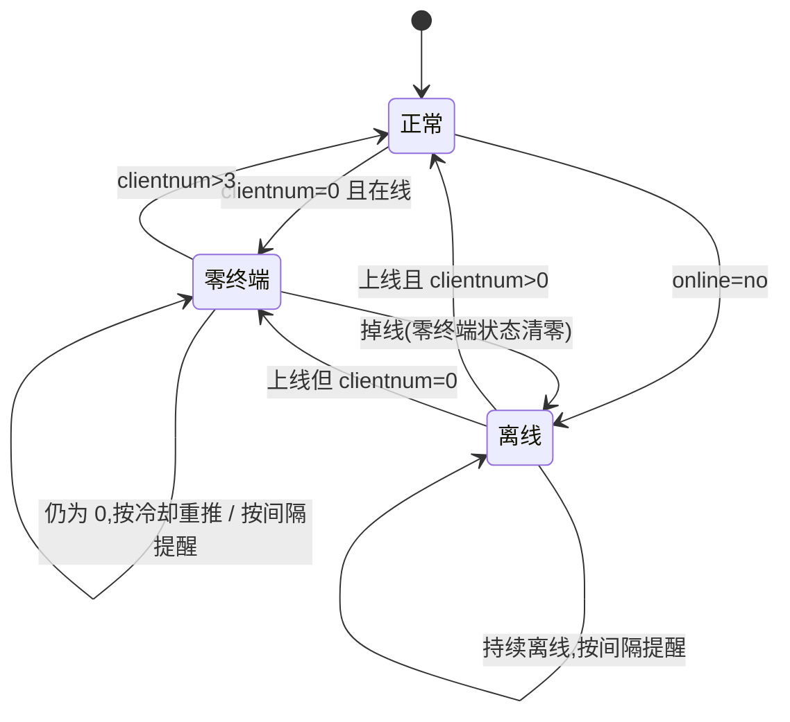

# 集客AC零终端与离线守护

- **部署**:2026-11-23 起在巡检机 systemd 常驻,300 秒一轮;AP 掉到 0 台终端或离线即推飞书卡片,恢复后自动解除。
- **设备**:3 台 N3000(ap-1 / ap-2 / ap-3),统一挂模板 `gsjh`(id `default`),AC 管理口 `http://<AC_IP>:8080`。
- **三种用法**:常驻守护(异常告警 + 自动重推)、`--inspect`(AC01–AC05 一次体检)、`--report`(每日 09:00 / 14:00 状态卡片)。
- **接口与巡检项**:登录链路、字段表、阈值与处置红线在[第 2 篇](2.接口与巡检项.md),本篇写运行方式、告警判定与部署。

## 一、运行方式

`ac_ap_guard.py` 单文件、只用标准库,三种用法共用同一套接口链路和登录会话:

| 用法 | 触发 | 产出 |
| --- | --- | --- |
| 常驻(不带模式参数) | systemd 常驻,`--interval 300` | 异常卡片 + 自动重推,状态写 `state.json` |
| `--inspect` / `--fix` | 手动或 cron | AC01–AC05 结果与退出码 0/1/2;`--fix` 授权后按模板重推 |
| `--report` | systemd timer,每日 09:00、14:00 | 每台 AP 在线状态与终端数的卡片 |

常驻模式每轮只拉一次 `apsearch`,只判 `online` 与 `clientnum` 两个字段;固件一致性、终端总数对账、退出码这些一次性体检项归 `--inspect`,不在常驻循环里做。

## 二、告警判定与处置

每台 AP 两套状态机,离线与零终端互斥:



| 条件 | 动作 | 卡片 |
| --- | --- | --- |
| 在线但 `uptime < 10 分钟` 且 `clientnum=0` | 跳过(终端回流窗口) | — |
| `online=no` | 告警,不下发配置 | 🔌 红色「AP 离线告警」,带最后一次上报时间 |
| 离线持续 ≥30 分钟 | 提醒 | ⏰ 橙色「AP 仍离线」 |
| 重新上线,`clientnum>0` | — | ✅ 绿色「AP 已恢复上线」 |
| 重新上线,`clientnum=0` | 下发 + 告警 | ⚠️ 橙色「已上线但仍无终端」 |
| 在线,`clientnum=0` | 下发 + 告警,5 分钟后复查 | 🚨 红色「AP 零终端告警」 |
| 持续为 0,距上次下发 ≥30 分钟 | 再下发一次 | — |
| 持续为 0,距上次告警 ≥30 分钟 | 提醒 | ⏰ 橙色「AP 仍无终端」 |
| `clientnum > 3` | 解除 | ✅ 绿色「终端数已恢复」 |

几个刻意的选择:

- **离线不重推**。对掉线的 AP 下发配置没有意义,AC 排队也未必生效,还可能在上线瞬间带来一次意外重载。
- **离线接管零终端**。离线 AP 的 `clientnum` 同样是 0,两条逻辑并行会让同一台 AP 收到两张卡。离线优先,零终端状态清零,上线后重新判定。
- **恢复阈值是 >3,不是 >0**。回升到 1~3 台说明无线服务没真正恢复,仍按异常处理。
- **刚重启的不算故障**。`uptime` 不足 10 分钟的 AP 终端数为 0 是正常回流过程,跳过告警与重推;离线告警已经覆盖了重启本身。窗口用 `--uptime-grace` 调,设 0 关闭。
- **一次只推一台**。`maclist` 精确到单台 AP,不整页重推。

## 三、每日状态推送

09:00 与 14:00 各推一张 AP 状态卡片:每台一行(🟢 在线 / 🔴 离线 + 终端数),下方汇总在线数与终端合计。全部在线时绿色,有离线转橙色。

```bash
# 手动推一张,也能用来临时看当前状态
AC_BASE_URL='http://<AC_IP>:8080' AC_PASSWORD='<管理密码>' ./ac_ap_guard.py --report
```

```ini
# conf/ac-ap-guard-report.timer
[Timer]
OnCalendar=*-*-* 09,14:00:00 Asia/Shanghai
Persistent=true
```

日历必须带 `Asia/Shanghai`:巡检机系统时区是 UTC,只写 `09,14:00:00` 会变成北京时间 17:00 与 22:00。`Persistent=true` 让停机错过的推送在开机后补一次。推送是独立 oneshot,和常驻守护互不依赖;每次推送会登录一次 AC,守护的 token 被顶掉后下一轮自动重登。

## 四、脚本与参数

| 文件 | 内容 |
| --- | --- |
| [ac_ap_guard.py](ac_ap_guard.py) | 单文件三种用法;只用标准库(urllib/hashlib/json) |
| [conf/ac-ap-guard.service](conf/ac-ap-guard.service) | 守护 unit,`TZ=Asia/Shanghai` 与状态文件路径写在这里 |
| [conf/ac-ap-guard-report.service](conf/ac-ap-guard-report.service) | 状态推送的 oneshot unit |
| [conf/ac-ap-guard-report.timer](conf/ac-ap-guard-report.timer) | 每日 09:00 / 14:00 触发,日历带时区 |
| [conf/ac-ap-guard.env.example](conf/ac-ap-guard.env.example) | 环境变量模板,真实值只放目标机 `/etc/ac-ap-guard/` |

地址、密码、webhook 全部走参数或环境变量,代码里没有默认值;缺了会直接报错退出,不会拿空值去连。

| 参数 | 环境变量 | 默认 | 说明 |
| --- | --- | --- | --- |
| `--base-url` | `AC_BASE_URL` | 必填 | 控制台地址 |
| `--password` | `AC_PASSWORD` | 必填 | 管理密码明文,脚本自己算摘要 |
| `--feishu-webhook` | `FEISHU_WEBHOOK` | 空 | 无 webhook 时卡片只打到日志 |
| `--feishu-secret` | `FEISHU_SECRET` | 空 | 机器人开了签名校验时填 |
| `--threshold` | `AC_THRESHOLD` | `3` | 终端数大于该值才算恢复;`--inspect` 下 `≤` 该值判 AC03 |
| `--uptime-grace` | `AC_UPTIME_GRACE` | `600` | 在线不足该秒数视为刚重启,零终端不作异常(设 0 关闭) |
| `--interval` | `AC_INTERVAL` | `300` | 复查间隔(秒) |
| `--reissue-cooldown` | `AC_REISSUE_COOLDOWN` | `1800` | 持续为 0 时重复下发的最小间隔 |
| `--remind` | `AC_REMIND` | `1800` | 持续异常时重复告警的间隔,`0` 只告一次 |
| `--ap` | `AC_AP_FILTER` | 空 | 只盯指定 AP,逗号分隔名称或 MAC |
| `--no-offline-alert` | `AC_OFFLINE_ALERT=0` | 开启 | 离线不发卡片(状态照记) |
| `--state-file` | `AC_STATE_FILE` | `ac_ap_guard_state.json` | 告警状态文件 |
| `--report` | — | — | 推一张 AP 状态卡片后退出,供定时任务调用 |
| `--inspect` / `--fix` | — | — | 跑一次 AC01–AC05 巡检 / 对 AC03 命中项重推(须授权) |
| `--once` / `--list` / `--dry-run` / `--test-card [alert\|offline]` | — | — | 守护单轮 / 只看列表 / 不下发不发卡 / 样例卡片 |

状态文件按 MAC 存,每台一条:`alerting`、`since`、`last_alert`、`last_reissue` 归零终端,`offline`、`offline_since`、`last_offline_alert` 归离线。脚本启动时补齐缺失字段,老状态文件直接能用。

## 五、部署

```bash
# 1. 代码与配置
install -d -m 755 /opt/ac-ap-guard
install -m 750 ac_ap_guard.py /opt/ac-ap-guard/
install -d -m 750 /etc/ac-ap-guard
install -m 600 ac-ap-guard.env /etc/ac-ap-guard/          # 按 env.example 填真实值
install -m 644 conf/ac-ap-guard.service conf/ac-ap-guard-report.service conf/ac-ap-guard-report.timer /etc/systemd/system/

# 2. 先手动验证链路,再交给 systemd
set -a; . /etc/ac-ap-guard/ac-ap-guard.env; set +a
python3 /opt/ac-ap-guard/ac_ap_guard.py --list           # 能列出 3 台 AP
python3 /opt/ac-ap-guard/ac_ap_guard.py --test-card      # 群里应收到红色样例卡
python3 /opt/ac-ap-guard/ac_ap_guard.py --report         # 群里应收到状态卡片

# 3. 常驻 + 定时推送
systemctl daemon-reload
systemctl enable --now ac-ap-guard
systemctl enable --now ac-ap-guard-report.timer
journalctl -u ac-ap-guard -f
```

`Environment=TZ=Asia/Shanghai` 是必需的:巡检机系统时区是 UTC,不固定 TZ 的话卡片和日志会比北京时间慢 8 小时;timer 的时区要另写在 `OnCalendar` 里,两者互相独立。状态文件由 `StateDirectory=ac-ap-guard` 创建在 `/var/lib/ac-ap-guard/`,`Restart=always` 兜住异常退出。

## 六、实测(2026-11-23)

- 登录链路:目标机到 AC 2ms,`getrandom` → `md5(random+密码)` → `sysauth` 换到 token,`apsearch` 返回 3 台 AP(15 / 17 / 22 台终端,全部在线)。
- 飞书:`--test-card`、`--test-card offline`、`--report` 三种卡片均返回 `{"code":0,"msg":"success"}`,群里可见。
- 服务:`systemctl enable --now` 后首轮正常,`NRestarts=0`,日志时间按北京时间输出,`state.json` 生成三台 AP 的初始状态。
- 状态机:用 mock 客户端跑完整序列——在线 5 台静默 → 掉线发 `offline` → 仍离线不重复 → 上线仍 0 台发 `online_zero` 并下发一次 → 仍 0 不重复 → 回到 5 台发 `recovery` → 再掉线发 `offline` → 上线 7 台发 `offline_recovery`,卡片序列与预期一致;`--no-offline-alert` 下不发卡但状态照记。
- 豁免窗口:mock 验证 `uptime=120` 不告警、`uptime=900` 正常告警;`--uptime-grace 0` 可关闭。
- `--dry-run --once`、`--inspect --fix --dry-run` 在工作站各跑一轮,确认只读路径不下发;目标机跑的是 `--list`、`--test-card`、`--inspect`、`--report`,没有触发真实下发。
- 线上事件(同日):ap-1 在 10:27 掉线,群内收到离线卡片;10:33 重新上线,10:37 发恢复卡片。期间网页端登录把守护 token 顶掉一次,日志出现 `LANG648` 后自动重登,没有丢轮次。
- 状态推送:timer 下次触发为 `14:00 CST`(`06:00 UTC`),时区换算正确;实发一张为 3/3 在线、终端合计 64。
- 同一时段的 AC01–AC05 巡检结果与终端清单见[第 2 篇](2.接口与巡检项.md)的「巡检记录」。

## 七、边界

- AP 从列表里被删除或改名时,脚本不会补发"恢复"卡片,旧状态留在文件里。
- 离线期间看不到真实终端数,所有终端数判断都停在上线之后。
- 终端数口径取 `apsearch` 的 `clientnum`,与页面"终端数"列一致;概览页的"在线用户"是另一套统计,两者对不上是正常的。
- AC 只保留一个有效 token:守护常驻时网页端登录会把它顶掉,下一轮自动重登;反过来它每轮登录也会让网页端列表变空,刷新重登即可。
