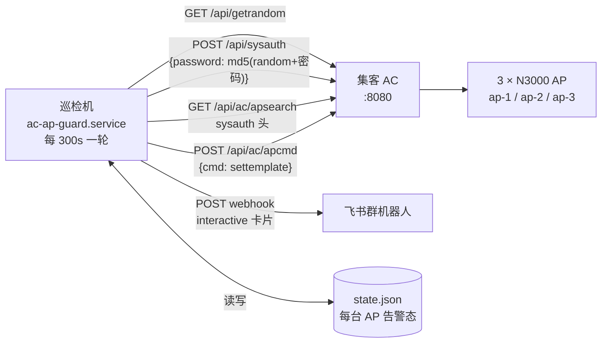

# 集客AC 零终端与离线守护

- **上线**:2026-11-23 起在巡检机 systemd 常驻,300 秒一轮;AP 掉到 0 台终端或直接离线,群里一分钟内能收到卡片。
- **设备**:3 台 N3000(ap-1 / ap-2 / ap-3),统一挂模板 `gsjh`(id `default`),AC 管理口 `http://<AC_IP>:8080`。
- **告警**:飞书群机器人卡片,零终端红、离线红、恢复绿;同一台 AP 的两类异常各自独立计时。
- **接口细节**:登录链路、`apsearch` 字段表、`apcmd` 载荷在 [inspect-ac 接口记录](../../skills/巡检/inspect-ac/references/api.md),本篇不重复

## 一、为什么另起一个守护

无线网最常见的故障不是 AC 挂了,是某台 AP 的终端数掉到 0:人散去了、AP 无线进程卡死、上联口闪断,AC 页面上的"终端数"变 0,而 AC 本身、交换机和另外两台 AP 一切正常,监控里没有任何指标会响。`inspect-ac` 是每天定点跑一遍的只读巡检,昨晚掉线要等到今早巡检才看得见。

守护脚本每 5 分钟拉一次 AP 列表,终端数为 0 且在线时按模板重推一次配置,异常推成飞书卡片并持续复查到恢复。它落在[巡检体系](../../skills/巡检/README.md)的实施层:Prometheus 没有集客 AC 的 exporter,AP 维度的状态只能从管理 API 取,属于补盲脚本。

## 二、判定与处置

每台 AP 两套状态机,离线与零终端互斥:

| 条件 | 动作 | 卡片 |
| --- | --- | --- |
| `online=no` | 告警,不下发配置 | 🔌 红色「AP 离线告警」,带最后一次上报时间 |
| 离线持续 ≥30 分钟 | 提醒 | ⏰ 橙色「AP 仍离线」 |
| 重新上线,`clientnum>0` | — | ✅ 绿色「AP 已恢复上线」 |
| 重新上线,`clientnum=0` | 下发 + 告警 | ⚠️ 橙色「已上线但仍无终端」 |
| 在线,`clientnum=0` | 下发 + 告警,5 分钟后复查 | 🚨 红色「AP 零终端告警」 |
| 持续为 0,距上次下发 ≥30 分钟 | 再下发一次 | — |
| 持续为 0,距上次告警 ≥30 分钟 | 提醒 | ⏰ 橙色「AP 仍无终端」 |
| `clientnum > 3` | 解除 | ✅ 绿色「终端数已恢复」 |

几个刻意的选择:

- **离线不重推**。对掉线的 AP 下发配置没有意义,AC 排队也未必生效,还可能在上线瞬间带来一次意外重载。
- **离线接管零终端**。离线 AP 的 `clientnum` 同样是 0,两条逻辑并行会让同一台 AP 收到两张卡。离线优先,零终端状态清零,上线后重新判定。
- **恢复阈值是 >3,不是 >0**。回升到 1~3 台说明无线服务没真正恢复,仍按异常处理。
- **一次只推一台**。`maclist` 精确到单台 AP,不整页重推。

## 三、接口

守护只用到四次调用,链路同 [inspect-ac 接口记录](../../skills/巡检/inspect-ac/references/api.md):`getrandom` 取随机数 → `md5(random + 明文)` → `sysauth` 换 token → 带 `sysauth` 头调 `apsearch` / `apcmd`。



| 阶段 | 组件 | 端口/协议 | 关键点 |
| --- | --- | --- | --- |
| 登录 | AC `getrandom` + `sysauth` | HTTP 8080 | 明文密码不上网络,只传 `md5(random+密码)`;token 30 分钟无操作过期 |
| 取数 | AC `apsearch` | HTTP 8080,头 `sysauth` | `numperpage=500` 一次拿全;判异只看 `clientnum` 与 `online` |
| 处置 | AC `apcmd` | HTTP 8080,JSON body | `cmd=settemplate`,成功判据 `ret==1`(`msg=LANG687`) |
| 告警 | 飞书自定义机器人 | HTTPS | `msg_type=interactive` 卡片,返回 `code=0` 才算成功 |
| 状态 | 本地 `state.json` | 文件 | 每台 AP 的告警态与时间戳,重启后不重复告警 |

## 四、脚本

| 文件 | 内容 |
| --- | --- |
| [ac_ap_guard.py](ac_ap_guard.py) | 守护主体,单文件,只用标准库(urllib/hashlib/json) |
| [conf/ac-ap-guard.service](conf/ac-ap-guard.service) | systemd unit,`TZ=Asia/Shanghai` 与状态文件路径写死在这里 |
| [conf/ac-ap-guard.env.example](conf/ac-ap-guard.env.example) | 环境变量模板,真实值只放目标机 `/etc/ac-ap-guard/` |

地址、密码、webhook 全部走参数或环境变量,代码里没有默认值;缺了会直接报错退出,不会拿空值去连。

| 参数 | 环境变量 | 默认 | 说明 |
| --- | --- | --- | --- |
| `--base-url` | `AC_BASE_URL` | 必填 | 控制台地址 |
| `--password` | `AC_PASSWORD` | 必填 | 管理密码明文,脚本自己算摘要 |
| `--feishu-webhook` | `FEISHU_WEBHOOK` | 空 | 无 webhook 时卡片只打到日志 |
| `--feishu-secret` | `FEISHU_SECRET` | 空 | 机器人开了签名校验时填 |
| `--threshold` | `AC_THRESHOLD` | `3` | 终端数大于该值才算恢复 |
| `--interval` | `AC_INTERVAL` | `300` | 复查间隔(秒) |
| `--reissue-cooldown` | `AC_REISSUE_COOLDOWN` | `1800` | 持续为 0 时重复下发的最小间隔 |
| `--remind` | `AC_REMIND` | `1800` | 持续异常时重复告警的间隔,`0` 只告一次 |
| `--ap` | `AC_AP_FILTER` | 空 | 只盯指定 AP,逗号分隔名称或 MAC |
| `--no-offline-alert` | `AC_OFFLINE_ALERT=0` | 开启 | 离线不发卡片(状态照记) |
| `--state-file` | `AC_STATE_FILE` | `ac_ap_guard_state.json` | 告警状态文件 |
| `--once` / `--list` / `--dry-run` / `--test-card [alert\|offline]` | — | — | 单轮巡检 / 只看列表 / 不下发不发卡 / 样例卡片 |

状态文件按 MAC 存,每台一条:`alerting`、`since`、`last_alert`、`last_reissue` 归零终端,`offline`、`offline_since`、`last_offline_alert` 归离线。脚本启动时补齐缺失字段,老状态文件直接能用。

## 五、部署

```bash
# 1. 代码与配置
install -d -m 755 /opt/ac-ap-guard
install -m 750 ac_ap_guard.py /opt/ac-ap-guard/
install -d -m 750 /etc/ac-ap-guard
install -m 600 ac-ap-guard.env /etc/ac-ap-guard/          # 按 env.example 填真实值
install -m 644 conf/ac-ap-guard.service /etc/systemd/system/

# 2. 先手动验证链路,再交给 systemd
set -a; . /etc/ac-ap-guard/ac-ap-guard.env; set +a
python3 /opt/ac-ap-guard/ac_ap_guard.py --list           # 能列出 3 台 AP
python3 /opt/ac-ap-guard/ac_ap_guard.py --test-card      # 群里应收到红色样例卡

# 3. 常驻
systemctl daemon-reload
systemctl enable --now ac-ap-guard
journalctl -u ac-ap-guard -f
```

`Environment=TZ=Asia/Shanghai` 是必需的:巡检机系统时区是 UTC,不固定 TZ 的话卡片和日志会比北京时间慢 8 小时。状态文件由 `StateDirectory=ac-ap-guard` 创建在 `/var/lib/ac-ap-guard/`,`Restart=always` 兜住异常退出。

## 六、实测(2026-11-23)

- 登录链路:目标机到 AC 2ms,`getrandom` → `md5(random+密码)` → `sysauth` 换到 token,`apsearch` 返回 3 台 AP(15 / 17 / 22 台终端,全部在线)。
- 飞书:`--test-card` 与 `--test-card offline` 两张卡片均返回 `{"code":0,"msg":"success"}`,群里可见。
- 服务:`systemctl enable --now` 后首轮正常,`NRestarts=0`,日志时间按北京时间输出,`state.json` 生成三台 AP 的初始状态。
- 状态机:用 mock 客户端跑完整序列——在线 5 台静默 → 掉线发 `offline` → 仍离线不重复 → 上线仍 0 台发 `online_zero` 并下发一次 → 仍 0 不重复 → 回到 5 台发 `recovery` → 再掉线发 `offline` → 上线 7 台发 `offline_recovery`,卡片序列与预期一致;`--no-offline-alert` 下不发卡但状态照记。
- `--dry-run --once` 在工作站各跑一轮,确认只读路径不下发;目标机跑的是 `--list` 与 `--test-card`,没有触发真实下发。

## 七、已知坑

| 现象 | 原因与处置 |
| --- | --- |
| 网页端列表突然变空,或脚本报 `LANG648` | AC 只保留一个有效 token,后登录者把前者踢掉;旧 token 调接口返回 `ret:-99`。脚本被踢后自动重登,反过来网页端再登录也会把脚本踢掉,下一轮自动恢复 |
| 拿编造的 MAC 调 `settemplate`,列表里多出一台空 AP | 接口会给未知 MAC 建记录(`name`/`ip` 为空、`online=no`)。用 `POST /api/ac/del_ap` body `{"maclist":"<mac>"}` 删掉,成功返回 `LANG675`;脚本只推 `apsearch` 返回的 MAC |
| 卡片时间差 8 小时 | 巡检机是 UTC,systemd unit 里固定 `Environment=TZ=Asia/Shanghai` |
| 登录后第一次查询拿到空 `aplist` 但 `ret=1` | 这是被顶掉的会话在某些固件上的表现之一;以 `ret=-99` / `LANG648` 为准,脚本据此重登 |

## 八、边界

- AP 从列表里被删除或改名时,脚本不会补发"恢复"卡片,旧状态留在文件里。
- 离线期间看不到真实终端数,所有终端数判断都停在上线之后。
- 终端数口径取 `apsearch` 的 `clientnum`,与页面"终端数"列一致;概览页的"在线用户"是另一套统计,两者对不上是正常的。
