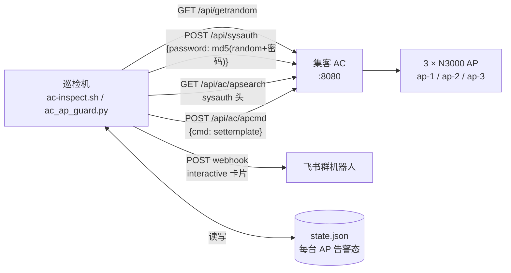

# 接口与巡检项

- **接口来源**:控制台前端 bundle(`/assets/index-*.js`)逆向 + curl 实测,AC 固件 `V2.2_202510151606`、AP 固件 `8.0_2024081000`
- **巡检项**:AC01–AC05 五项,编号不服复用、不跳号;阈值为单 AC + 个位数 AP 的园区网基线
- **脚本**:[ac-inspect.sh](ac-inspect.sh) 默认只读(退出码 0 健康 / 1 有 P0·P1 / 2 自身故障),`--fix` 是授权后的处置入口
- **持续监测**:终端数为 0 与 AP 离线的常驻告警见[第 1 篇](1.集客AC零终端与离线守护.md)

## 一、接口链路

控制台是 SPA,接口路径可以从登录后的 bundle 里 grep 出来;固件升级后如果字段对不上,重新抓一遍。四个接口串成一条链,均返回 `{ret, msg, ...}`,**`ret==1` 是唯一成功判据**,`msg` 常是 `LANGxxx` 码,界面靠内置字典翻译成中文。



| 阶段 | 组件 | 端口/协议 | 关键点 |
| --- | --- | --- | --- |
| 登录 | AC `getrandom` + `sysauth` | HTTP 8080 | 明文密码不上网络,只传 `md5(random+密码)`;token 30 分钟无操作过期 |
| 取数 | AC `apsearch` | HTTP 8080,头 `sysauth` | `numperpage=500` 一次拿全;`clientnum` 终端数、`online` 在线态 |
| 处置 | AC `apcmd` | HTTP 8080,JSON body | `cmd=settemplate`,成功判据 `ret==1`(`msg=LANG687`) |
| 清理 | AC `del_ap` | HTTP 8080,JSON body | 只用于删误建的空 AP 记录,成功 `LANG675` |
| 告警 | 飞书自定义机器人 | HTTPS | `msg_type=interactive`,返回 `code=0` 才算成功 |

### 1. 登录换 token

```bash
AC='http://<AC_IP>:8080'
random=$(curl -fsS "$AC/api/getrandom" | jq -er '.random')        # {"random":"1282","ret":1}
hash=$(printf '%s' "${random}<管理密码>" | md5sum | awk '{print $1}')
token=$(curl -fsS -X POST "$AC/api/sysauth" \
  -H 'Content-Type: application/json' -d "{\"password\":\"$hash\"}" | jq -er '.token')
# {"msg":"","ret":1,"token":"<token>"}
```

明文密码不进网络:服务端先发随机数,客户端算 `md5(random + password)` 只传哈希。密码错误返回 `LANG646`。token 前端口径 30 分钟无操作过期,脚本每轮现登,不依赖会话续期。

### 2. 拉全量 AP 列表

```bash
curl -s "$AC/api/ac/apsearch?pagenum=1&numperpage=500&groupid=all&_t=<毫秒时间戳>" \
  -H "sysauth: $token"
```

鉴权走请求头 `sysauth`(不是 cookie,浏览器里存的是 localStorage)。`numperpage=500` 是控制台自己在用的口径,超过 500 台才需要翻页。巡检要用的字段:

| 字段 | 示例 | 说明 |
| --- | --- | --- |
| `name` | `ap-2` | 设备名 |
| `mac` | `001122334455` | **12 位无冒号小写**,不是界面显示的 `00:11:...` 格式;下发接口也吃这个格式 |
| `ip` | `192.0.2.102` | 管理 IP |
| `clientnum` | `9` | 终端数,巡检判异字段 |
| `online` | `yes` / `no` | 在线状态 |
| `template` | `default` | 模板 **id**;界面显示的是模板名,下发接口传 id |
| `uptime` | `26329` | 在线时长(秒),判断"刚重启导致终端数为 0"时用 |

### 3. 异常 AP 重新下发配置

```bash
curl -s -X POST "$AC/api/ac/apcmd" \
  -H "sysauth: $token" -H 'Content-Type: application/json' \
  -d '{"cmd":"settemplate","maclist":"001122334455","template":"default"}'
# {"msg":"LANG687","ret":1,"param":null}
```

`maclist` 是逗号拼接的 12 位 mac 串,多台一次推;`template` 用各 AP 自己的 `template` 字段(空则按 `default`)。等价于界面「无线 AP」页勾选设备后点「重新下发配置」:同模板重推会保留各 AP 单独设置的信道/频宽(界面确认弹窗原文),AP 重载无线配置,不断电不重启。

界面那个按钮有个坑:**不勾选直接点,会把当前页全部 AP 都重推一遍**(确认弹窗原文也写明了)。所以巡检必须脚本按 mac 精确"勾选",别在界面上顺手点。

### 4. 删除 AP(误建记录时用)

```bash
curl -s -X POST "$AC/api/ac/del_ap" \
  -H "sysauth: $token" -H 'Content-Type: application/json' \
  -d '{"maclist":"001122334455"}'          # 要删的是空记录,示例 MAC 为编造
# {"msg":"LANG675","ret":1,"param":null}   LANG675 = 删除成功
```

`settemplate` 对**不存在的 MAC** 会真的建一条空 AP 记录(`name`/`ip` 为空、`online=no`),误探测后只能用这个接口删掉。

## 二、巡检项与阈值

```bash
# 只读巡检(退出码 0 健康 / 1 有 P0·P1 / 2 自身故障)
AC_BASE='http://<AC_IP>:8080' AC_PASS='<管理密码>' ./ac-inspect.sh

# 处置(须授权):对命中的 AP 按各自模板重推
AC_BASE='http://<AC_IP>:8080' AC_PASS='<管理密码>' ./ac-inspect.sh --fix
```

| 编号 | 巡检项 | 来源 | 默认阈值 P1 / P0 | 处置建议 |
| --- | --- | --- | --- | --- |
| AC01 | AC 服务可用(登录链路) | 接口 | — / 登录失败或接口不可达 | 查 AC 进程与宿主机,联动 inspect-server;AC 挂即全屋无线失控 |
| AC02 | AP 在线率 | 接口 | 任一离线 / 全部离线 | 单台查 POE 供电与网线、重电;全部离线先查 AC 与上联 |
| AC03 | AP 终端数异常 | 接口 | ≤3(在线 ≥10min)/ 0(非重启) | 按各自模板重推配置(须授权);复发转重启 AP 或查硬件 |
| AC04 | AP 固件版本一致性 | 接口 | —(P2)/ 低版本标记 | 低版本走升级流程,变更窗口执行 |
| AC05 | 终端总数对账 | 接口 | 差 > max(5, 20%)(P2)/ — | 两接口有取样时间差,持续偏差查假死终端 |

**AC01 服务可用**(getrandom → sysauth → apsearch 任一步失败即 P0)

```bash
random=$(curl -fsS "$AC/api/getrandom" | jq -er '.random')
hash=$(printf '%s' "${random}<管理密码>" | md5sum | awk '{print $1}')
token=$(curl -fsS -X POST "$AC/api/sysauth" \
  -H 'Content-Type: application/json' -d "{\"password\":\"$hash\"}" | jq -er '.token')
curl -fsS "$AC/api/ac/apsearch?pagenum=1&numperpage=500&groupid=all" \
  -H "sysauth: $token" | jq -e '.ret == 1'
```

**AC02 + AC03 + AC04**(一次 apsearch 全覆盖)

```bash
curl -fsS "$AC/api/ac/apsearch?pagenum=1&numperpage=500&groupid=all" \
  -H "sysauth: $token" | jq -r '.aplist[] | [.name,.ip,.clientnum,.online,.uptime,.version,.template] | @tsv'
# AC02: online != "yes" → P1
# AC03: online == "yes" 且 clientnum <= 3 且 uptime >= 600 → P1;uptime < 600 记豁免(刚重启,终端未回流)
# AC04: version 不唯一或 is_low_version == true → P2
```

**AC05 终端总数对账**

```bash
curl -fsS "$AC/api/status/overview?simplify=no" -H "sysauth: $token" | jq '.acstatus.client_num'
# |Σ apsearch.clientnum − overview.acstatus.client_num| > max(5, 20%·AC 侧值) → P2
```

`/api/status/gstatus` 在本固件返回 404(完整版实体 AC 才有),AC 在线与否以登录链路 + overview 可达为准。

## 三、处置手册与授权红线

巡检(包括 AI)只产出报告与处置建议。重推配置、重启 AP、重电 AP 都是处置动作,**必须在运维负责人明确指示后才启动**。脚本默认只读,`--fix` 即"负责人已授权本轮处置"的显式入口,不带 `--fix` 的运行永远不会下发任何命令。

### AC03 终端数异常 → 重新下发配置

确认该 AP `uptime` 大于豁免窗口(排除刚重启);对照同组其他 AP 的终端数,单台掉零多为 AP 无线服务假死,多台同时掉零先查 AC 侧与干扰源。

```bash
curl -fsS -X POST "$AC/api/ac/apcmd" \
  -H "sysauth: $token" -H 'Content-Type: application/json' \
  -d '{"cmd":"settemplate","maclist":"<12位mac,多台逗号拼接>","template":"<该AP的template字段>"}'
# ret==1 即受理成功;多模板分组逐组推送
```

验证以**下一轮巡检的 clientnum 回到基线**为准,不是接口返回。风险是 AP 重载无线配置、本 AP 上终端瞬断数秒。反复命中 AC03 的 AP 说明不是配置态问题,处置升级为重启 AP,仍复发查硬件。

### AC02 AP 离线

查 POE 交换机端口供电与网线(联动 inspect-datacenter)、AP 灯效与上联口流量。处置是重电 POE 口或冷启动 AP;仍不上线换线换口,再不行送检。AI 不执行任何物理动作与端口操作。

## 四、报告口径

- **先答两问**:①**是否有下发配置**——只读巡检必须明写"无下发",`--fix` 必须列出推送对象、模板与受理结果;②**逐台 AP 连接数**——每台一行(名称/管理 IP/连接数/在线状态),不聚合、不省略;入库时管理 IP 脱敏。
- 异常项置顶、按级别排序,每条含当前值、命中阈值、处置建议;豁免项单独列出并写明原因。
- [ac-inspect.sh](ac-inspect.sh) 已实现全部五项判定与退出码约定,输出为日志行,可重定向存档后按本节格式整理。
- 定时建议:每日早高峰前(终端已回流,数据才真实),如 `37 8 * * *`,密码放 root-only env 文件,避免进 crontab 明文。

## 五、已知坑

| 现象 | 原因与处置 |
| --- | --- |
| `msg` 全是 `LANG646`/`LANG687` 这类码 | 服务端返回 i18n key,以 `ret` 为判据;LANG646 = 密码错,LANG687 = 下发受理 |
| 先后登录两次,旧 token 调接口返回 `ret:-99`、`msg=LANG648`,查询类还附空 `aplist` | AC 只保留一个有效 token,后登录者生效。脚本被顶掉后重登一次即可,别做定时续期——会把正在用的网页端顶下线 |
| 给不存在的 MAC 调 `settemplate`,列表里多出一台空 AP | 接口会给未知 MAC 建记录,用上文的 `del_ap` 删掉;脚本只推 `apsearch` 返回的 MAC |
| 刚重启的 AP 被判异常(`clientnum=0`) | 终端还没关联回来,`uptime < 600` 记豁免;重推一次无害 |
| 离线 AP 出现在清单里 | 重推推不动,单独列出等人工上电;守护脚本另走离线告警 |
| mac 写成 `00:11:...` 格式导致下发无效 | 接口只认 12 位无冒号小写,界面展示格式是加过冒号的 |
| 固件升级后接口对不上 | 字段与路径逆向自前端 bundle,升级后重新 grep `/assets/index-*.js` 核对 |
| 密码哈希只有 md5(盐+明文) 一层 | 算法由固件定死改不了,这套接口只在内网用,管理口别暴露到公网/跨网段 |

## 六、巡检记录(2026-11-23)

10:20 只读巡检(`ac-inspect.sh`,未带 `--fix`,未下发任何命令),**AC01–AC05 全部健康,退出码 0,无异常项、无豁免项**:

| 编号 | 巡检项 | 当前值 | 阈值 | 结论 |
| --- | --- | --- | --- | --- |
| AC01 | AC 服务可用 | 登录链路成功(getrandom → sysauth → apsearch 全通) | — | ✅ |
| AC02 | AP 在线率 | 3/3 在线 | 0 台离线 | ✅ |
| AC03 | AP 终端数 | ap-2:19 / ap-3:16 / ap-1:21 | 在线 AP ≤3 判异常 | ✅ |
| AC04 | 固件版本一致性 | 单一版本 `8.0_2024081000`,无低版本标记 | 版本唯一 | ✅ |
| AC05 | 终端总数对账 | AP 侧 Σ=56 vs AC 侧 overview=56,差 0 | 差 > max(5, 20%) 判 P2 | ✅ |

全量清单:

| AP | 终端数 | 状态 | 版本 | 模板 |
| --- | --- | --- | --- | --- |
| ap-2 | 19 | yes | 8.0_2024081000 | default |
| ap-3 | 16 | yes | 8.0_2024081000 | default |
| ap-1 | 21 | yes | 8.0_2024081000 | default |

- AP 管理 IP 按入库脱敏要求未写入仓库,原始清单在巡检机日志里;
- 56 台终端全部走 5G(`client_num_2g=0`);
- AC 已连续运行 31 天,内存空闲 6378 MB / 7704 MB;
- 同一口径的持续监测由 [ac_ap_guard.py](ac_ap_guard.py) 承担,本记录只代表 10:20 这一刻。
