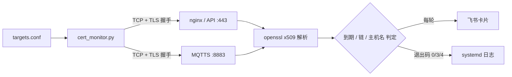

# SSL 证书监控方案

证书过期不会返回 5xx。TLS 握手阶段就失败,HTTP 探针看到的是连接错误,MQTT 接入侧看到的是整批设备掉线,和业务代码、网络、后端都没有关系。等用户或设备报上来再处理,留给换发与部署的时间通常只剩几小时。

dev/test 环境现在有五个对外 TLS 端点,分两类证书:三个 nginx/api 域名共用 Let's Encrypt 通配证书,MQTT 的 8883 用私有 CA 签发的一年期证书。这篇给出这两类证书的监控口径、阈值,以及一套探测脚本 + systemd timer + 飞书卡片的落地方式;告警直接走群机器人的 webhook,不依赖监控平台。

## 一、五个端点的实测基线

2026-11-25 从内网探测,结果如下:

| 端点 | 解析地址 | 证书 CN | 签发者 | 到期(UTC) | 剩余 | 链校验 |
| --- | --- | --- | --- | --- | --- | --- |
| `dev-nginx.example.com:443` | `<内网 IP>` | `*.example.com` | Let's Encrypt `YR1` | 2026-12-27 | 32 天 | 系统信任库通过 |
| `dev-api.example.com:443` | `<公网 IP>` | `*.example.com` | Let's Encrypt `YR1` | 2026-12-27 | 32 天 | 系统信任库通过 |
| `test-nginx.example.com:443` | `<公网 IP>` | `*.example.com` | Let's Encrypt `YR1` | 2026-12-27 | 32 天 | 系统信任库通过 |
| `dev-mqtt.example.com:8883` | `<公网 IP>` | `dev-mqtt.example.com` | `example.com IoT Intermediate CA` | 2027-08-06 | 254 天 | 需私有根证书 |
| `test-mqtt.example.com:8883` | `<公网 IP>` | `test-mqtt.example.com` | `example.com IoT Intermediate CA` | 2027-08-27 | 275 天 | 需私有根证书 |

五个端点协商的都是 TLS 1.3,证书链完整。三条需要单独说明:

1. **三个域名共用一张通配证书。** `*.example.com` 只匹配一级子域,`dev-nginx`、`dev-api`、`test-nginx` 都在覆盖范围内;未来出现 `a.b.example.com` 这种二级子域就不覆盖了。共用证书意味着一次续期、三处部署,任何一台漏了 reload,它还会继续吐旧证书。监控必须逐个端点探,不能只查一处。
2. **32 天正好卡在续期窗口上。** Let's Encrypt 证书 90 天有效期,通常剩 30 天时续期。2026-11-25 剩 32 天,11-27 前后续期任务就该跑。告警线如果设 30 天,会在续期前一天先报一次;设 28 天,给续期留两天宽限,过了才说明续期失败。
3. **MQTT 的链在系统信任库里必然失败。** 签发链是 `example.com Root CA` → `example.com IoT Intermediate CA`(有效期到 2036-05-30)→ 服务端证书。公共信任库没有这个根,`openssl s_client` 会报 `unable to get local issuer certificate`,这是预期行为,不是证书坏了。监控不挂私有根证书,就会每轮都红。

另外,`dev-nginx.example.com` 解析到内网 `<内网 IP>`。探测器放在公网只能得到 DNS 或连接超时,那时先查探针位置,不要先怀疑证书。

## 二、监控维度与阈值

证书监控要覆盖五件事,只看到期时间会漏掉一半问题:

| 维度 | 判据 | 默认阈值 | 漏掉会怎样 |
| --- | --- | --- | --- |
| 可达与握手 | TCP 连接 + TLS 握手成功 | 同一轮重试一次仍失败即严重 | 端口不通、协议不兼容被当成证书正常 |
| 叶子证书到期 | `notAfter - now` | 按证书寿命分档,见下表 | 到期当天才被动发现 |
| 信任链 | 按系统库或私有根校验证书链 | 失败即严重 | 换了自签证书、漏发中间证书,浏览器报警但监控不报 |
| 主机名 | SAN/CN 与探测主机名匹配 | 不匹配即严重 | 通配证书覆盖不到新子域,握手仍能成功 |
| 续期链路 | 定时任务、DNS-01 凭据、部署 reload | 单独检查 | 证书文件换了,进程还在用旧证书 |

到期阈值按证书寿命分,核心原则是**警告线不能早于续期触发点**:

| 证书类型 | 寿命 | 续期触发 | 警告 | 严重 |
| --- | --- | --- | --- | --- |
| Let's Encrypt 通配 | 90 天 | 剩 30 天 | 剩 28 天 | 剩 7 天 |
| 私有 CA 服务端 | 1 年 | 内部签发流程 | 剩 30 天 | 剩 14 天 |

7 天严重线对应的是“还来得及人工换发并部署”;14 天线用于私有 CA,因为设备侧可能还要重新分发或重启。根 CA 30 年、中间 CA 到 2036,都不单独监控到期;链校验通过就说明 CA 没断,CA 真过期时链校验会直接失败。

## 三、探测脚本 + systemd timer + 飞书

本目录的 `cert_monitor.py` 是单文件实现,只读探测,不碰远端配置。每轮对目标做一次 TCP + TLS 握手,失败时间隔 1 秒再试一次;用 `openssl x509` 解析叶子证书,再按系统信任库或指定根证书做一次链校验,结果推一张飞书卡片。



| 文件 | 作用 |
| --- | --- |
| [cert_monitor.py](cert_monitor.py) | 探测、阈值判定、飞书卡片 |
| [conf/cert-monitor.targets.example](conf/cert-monitor.targets.example) | 目标清单与每目标的阈值、CA、SNI |
| [conf/cert-monitor.env.example](conf/cert-monitor.env.example) | webhook、超时、默认阈值 |
| [conf/cert-monitor.service](conf/cert-monitor.service) | oneshot unit,加载 env 后跑一轮 |
| [conf/cert-monitor.timer](conf/cert-monitor.timer) | 周一至周五 10:00 触发 |

### 3.1 放脚本与配置

```bash
sudo install -d -m 755 /opt/cert-monitor
sudo install -m 755 cert_monitor.py /opt/cert-monitor/
sudo install -d -m 700 /etc/cert-monitor
sudo install -m 600 conf/cert-monitor.env.example /etc/cert-monitor/cert-monitor.env
sudo install -m 600 conf/cert-monitor.targets.example /etc/cert-monitor/targets.conf
```

脚本只用标准库,依赖系统里的 `openssl` 命令;Python 3.9 及以上。

MQTT 两行写了 `ca=/etc/cert-monitor/iot-root.crt`,这里说的是**监控探针自己的信任问题**,不是 MQTT 客户端或设备侧:探针连 8883 时也是一个 TLS 客户端,默认拿系统信任库验证服务端证书;私有 CA 的根不在系统库里,链就停在 `unable to get local issuer certificate`。服务端会把叶子证书和中间证书发下来,根证书通常不发,所以要单独给探针一份根证书。

```bash
sudo install -m 644 iot-root.crt /etc/cert-monitor/iot-root.crt
```

根证书是公开材料,不是私钥,可以安全拷贝;脚本只用它校验证书链,不修改系统信任库,也不需要客户端证书。根 CA 30 年、中间 CA 到 2036,不监控 CA 自己的到期——链校验通过就说明 CA 没断,真到期时链校验会直接失败。设备侧自己也要信任这个根才能连上 Broker,那是设备接入配置的一部分,和监控探针互不影响。

拿不到根证书时,可以先把 MQTT 两行的 `ca=...` 换成 `verify=none`,到期时间照常监控,链校验跳过;这只是临时降级,盲区要记在部署记录里。

### 3.2 配 env 与目标

`/etc/cert-monitor/cert-monitor.env` 至少填两项:`TARGETS_FILE` 和 `FEISHU_WEBHOOK`;机器人开了签名校验再加 `FEISHU_SECRET`。

webhook 从飞书群拿:群设置 → 群机器人 → 添加机器人 → 自定义机器人,起名如 `SSL 证书监控`,复制 webhook 地址;安全设置开「签名校验」时,把密钥填进 `FEISHU_SECRET`。机器人被移出群或 webhook 被重置后,旧地址立即失效,需要重新复制。

目标文件每行一个端点,`host` 默认 443,`host:port` 指定其他端口;选项用空格分隔的 `key=value`:

| 选项 | 含义 | 默认 |
| --- | --- | --- |
| `ca=<文件>` | 私有 CA 的根证书(可含中间证书),按其校验证书链 | 用系统信任库 |
| `verify=none` | 跳过链校验,只看到期 | `system` |
| `warn=<天>` | 叶子证书警告阈值 | 30 |
| `crit=<天>` | 叶子证书严重阈值 | 7 |
| `sni=<名>` | 握手 SNI | 主机名 |
| `name=<名>` | 表格与卡片显示名 | `host:port` |

三个 Let's Encrypt 域名用 `warn=28`,MQTT 两行用 `ca=... warn=30 crit=14`,与上一节的阈值表一致。

### 3.3 先跑一轮

```bash
sudo -i
set -a; . /etc/cert-monitor/cert-monitor.env; set +a
python3 /opt/cert-monitor/cert_monitor.py --dry-run       # 预览,不发
python3 /opt/cert-monitor/cert_monitor.py                 # 真发一张卡片,验证 webhook
```

`--dry-run` 不发飞书,表格打到 stderr,卡片 JSON 打到 stdout。表格里五个字段要重点看:剩余天数、链、主机名、TLS 版本、状态。

去掉 `--dry-run` 再跑一次,群里收到卡片即 webhook 通;之后由 timer 在每个工作日 10:00 自动推一张。链一列出现 `FAIL` 时,先看表格下方的 `!` 说明,再决定是补根证书还是查服务端。

脚本的退出码:

| 退出码 | 含义 |
| --- | --- |
| 0 | 全部正常 |
| 2 | 目标文件或 env 配置错误 |
| 3 | 有警告项 |
| 4 | 有严重项 |
| 5 | 飞书推送失败 |

### 3.4 装定时器

```bash
sudo install -m 644 conf/cert-monitor.service /etc/systemd/system/
sudo install -m 644 conf/cert-monitor.timer /etc/systemd/system/
sudo systemctl daemon-reload
sudo systemctl enable --now cert-monitor.timer
systemctl list-timers cert-monitor.timer
sudo systemctl start cert-monitor.service
journalctl -u cert-monitor -n 50 --no-pager
```

timer 是周一至周五 10:00 一轮。unit 里 `SuccessExitStatus=0 3 4`,所以证书进入警告或严重区间时,timer 不会把 unit 标成 failed——那是告警结果,不是脚本运行失败。

### 3.5 卡片内容

每轮跑完固定推一张,不做去重:工作日 10:00 一次,正常绿卡、有警告橙卡、有严重项或探测失败红卡。正文按 `dev` / `test` 分组,组头带组内状态计数;每个端点一行:状态图标、主机、到期时间与剩余天数。只有异常时才在行尾追加 `链失败`、`链未完成` 或 `主机名不匹配`,正常项不显示链与主机名。数据行用 `plain_text` 输出,主机名里的下划线和证书里的 `*` 都不会被 markdown 改写。

## 四、续期侧也要监控

到期告警只能说明“快过期了”,续期链路本身坏了,告警会一直响到过期。两类证书的续期机制不同:

**Let's Encrypt 通配证书**只能走 DNS-01,HTTP-01 签发不了通配。签发点必须能调 DNS 服务商 API,检查四件事:

```bash
certbot certificates                                   # 或 acme.sh --list
systemctl list-timers | grep -Ei 'certbot|acme'
tail -50 /var/log/letsencrypt/letsencrypt.log          # acme.sh 看 ~/.acme.sh/acme.sh.log
grep -r . /etc/letsencrypt/renewal-hooks/deploy/       # 续期后是否 reload nginx
```

DNS-01 的失败点通常在 API 凭据过期、域名解析商接口变更、签发机出网。续期成功但 nginx 没 reload,是另一个高频故障:证书文件已经是新的,进程还在用旧证书。监控逐个端点探,正好能抓住这种“文件新、服务旧”的状态。

**私有 CA 服务端证书**由内部签发服务出,走的是业务侧的证书申请与续期接口,见[自签 MQTTS 技术方案](../../技术方案/自签MQTTS技术方案/README.md)。这里要额外盯两件事:

- 中间 CA 有效期到 2036-05-30,根 CA 30 年;两者都不单独监控到期,链校验会兜底;
- 设备侧证书是另一套生命周期。服务端证书正常,不代表客户端证书没过期;mTLS 下设备证书过期会表现为握手失败,要去 Broker 或 LB 日志里搜 `certificate expired`、`bad certificate`、`unknown ca`。

监控机自身的时钟也要校时。`days_left` 是按本机时间算的,时钟漂移几小时对 30 天阈值影响不大,漂移几天就会让所有证书的剩余天数一起偏。

## 五、排障

| 现象 | 原因 | 处理 |
| --- | --- | --- |
| 三个 nginx/api 域名的 CN、到期日完全一样 | 共用 `*.example.com` 通配证书 | 预期行为;续期后逐台确认 reload |
| MQTT 链校验失败 `unable to get local issuer certificate` | 系统信任库没有私有根 CA | 配 `ca=` 指向私有根证书;不要长期用 `verify=none` 掩盖 |
| MQTT 链校验失败 `unable to get issuer certificate` | 只给了中间证书,根证书没进 CA 文件 | 把根证书一起放进 CA bundle |
| `dev-nginx` 探测超时或 DNS 失败 | 它解析到内网 `<内网 IP>`,探针在公网 | 把探针放到内网,或改 DNS 解析 |
| 剩 30 天就报警,续期任务其实还没跑 | 告警线早于续期触发点 | 90 天证书用 28 天警告线 |
| 卡片没收到 | webhook 未配、机器人被移出群、签名不匹配 | 先看 journal;`--dry-run` 能出卡片说明探测正常,再查 webhook;飞书 `code=19021` 查签名 |
| TLS 握手正常但 MQTT 设备连不上 | 证书监控只验 TLS,不验 MQTT CONNECT | 用 `mosquitto_pub` / 设备日志另测 Broker 与鉴权 |
| 换了新证书,监控还是报旧到期日 | 证书文件更新了,进程没 reload | `nginx -t` 后 reload,再跑一轮探测复验 |

## 六、实测记录

2026-11-25 笔者用 `cert_monitor.py --dry-run` 对五个端点跑了一轮,耗时均在 0.1 秒左右:

```text
目标                        IP         证书 CN                到期日      剩余    链    主机名  TLS      状态
--------------------------  ---------  ---------------------  ----------  ------  ----  ------  -------  ----
dev-nginx.example.com:443   <内网 IP>  *.example.com          2026-12-27  32.1d   OK    OK      TLSv1.3  OK
dev-api.example.com:443     <公网 IP>  *.example.com          2026-12-27  32.1d   OK    OK      TLSv1.3  OK
test-nginx.example.com:443  <公网 IP>  *.example.com          2026-12-27  32.1d   OK    OK      TLSv1.3  OK
dev-mqtt.example.com:8883   <公网 IP>  dev-mqtt.example.com   2027-08-06  254.4d  SKIP  OK      TLSv1.3  OK
test-mqtt.example.com:8883  <公网 IP>  test-mqtt.example.com  2027-08-27  275.5d  SKIP  OK      TLSv1.3  OK
```

MQTT 两行的 `SKIP` 是本地没有私有根证书时的预期结果;目标机上把 `ca=` 指到根证书文件后,链一列会变成 `OK` 或 `FAIL`。三个 Let's Encrypt 域名的链是 `YR1` → `Root YR` → `ISRG Root X1`,系统信任库校验通过。

另外用本地 mock webhook 验证了真实推送:卡片颜色、正文与 HTTP 返回都正常。

## 七、部署记录

2026-11-25 部署到 `<巡检机 IP>`(`<巡检机主机名>`,Ubuntu 24.04.3,Python 3.12.3,systemd 255):

- 脚本 `/opt/cert-monitor/cert_monitor.py`(755);配置 `/etc/cert-monitor/targets.conf`、`cert-monitor.env`(600 root);
- 巡检机没有私有根证书,MQTT 两行暂用 `verify=none`,卡片只保留主机与到期时间;根证书就位后改成 `ca=<路径>` 即可;
- 手动跑一轮与 systemd 首轮都推送成功,`ExecMainStatus=0`;
- 同日按反馈简化卡片:保留 dev / test 分组,每个端点一行,只显示主机与到期时间;异常时在行尾补链失败或主机名不匹配;已在巡检机上补发验证卡;
- `cert-monitor.timer` 已 enable,NEXT 为 2026-11-26 02:00 UTC(10:00 CST),之后每个工作日 10:00 推一张。

## 八、安全边界

- 脚本只做 TCP + TLS 握手和证书读取,不提交表单、不发 MQTT CONNECT、不改对端配置;
- 不需要私钥,私有 CA 只需要根证书,根证书是公开材料;
- webhook 与签名密钥只放目标机 `/etc/cert-monitor/cert-monitor.env`(600、root),不进仓库;卡片里只有主机名、到期日与状态,没有账号与内网口令。
