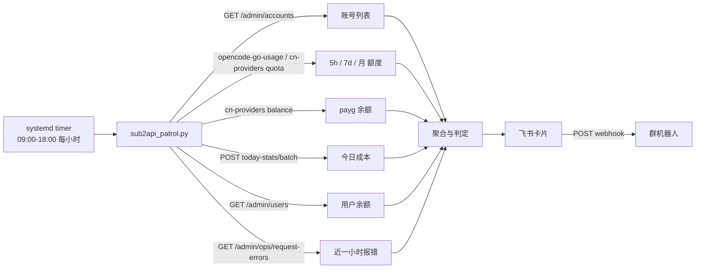

# 巡检项与接口

## 巡检对象

sub2api 的管理面 API,前缀 `/api/v1/admin`,鉴权头 `x-api-key: <管理员 API Key>`,响应统一为 `{code,message,data}`,`code=0` 表示成功。后台网页上能点的账号、用户、日志,这三块接口都能读。

## 采集链路

| 阶段 | 组件 | 接口或协议 | 关键点 |
| --- | --- | --- | --- |
| 触发 | systemd timer | `OnCalendar=*-*-* 09..18:00:00 Asia/Shanghai` | 带时区,UTC 机器不会偏移 |
| 采集 | `sub2api_patrol.py` | HTTPS + `x-api-key` | 账号、额度、用户、报错四类,失败项降级不中断 |
| 判定 | 脚本内聚合 | —— | 活跃账号、剩余额度、低额度用户、报错分组 |
| 通知 | 飞书群机器人 | `POST <FEISHU_WEBHOOK>` | `msg_type=interactive`;开签名校验时带 `timestamp`+`sign` |

## 三项巡检

### 账号管理:活跃账号与各自额度

**活跃账号**的判定是 `status=active` 且 `schedulable=true`。只判 `status` 会把停调度的账号算进来——这类账号凭据还在、只是不参与调度,单独计数更接近实际可用的池子。账号列表走 `GET /api/v1/admin/accounts?page=1&page_size=200`,按 `items` 长度判断翻页。

额度按平台取,上游给的都是**已用百分比**,卡片直接展示该值:

| 平台 | 接口 | 返回 |
| --- | --- | --- |
| `opencode_go` | `GET /api/v1/admin/accounts/:id/opencode-go-usage` | `snapshot.data.{rolling,weekly,monthly}.{percent,resets_at}`,对应 5h/7d/月 |
| `command_code` | `GET /api/v1/admin/cn-providers/accounts/:id/quota` | `tiers[]` 的 `window=5h/weekly/monthly` + `used_percent` + `reset_at`,另带 `balance` |
| `deepseek`/`kimi`/`zhipu`/`minimax` | `GET /api/v1/admin/cn-providers/accounts/:id/balance` | `balance`、`currency`、`balances[]`,payg 账号只报余额 |

opencode 的 GET 读的是缓存快照,`fetched_at` 超过 10 分钟才调 `POST /api/v1/admin/accounts/:id/opencode-go-usage/refresh` 主动刷新;刷新接口限制每 30 秒一次,撞限流时沿用缓存并在行尾标「快照 N 分钟前」。

余额响应可能同时带多币种(如 `CNY 2126` 与 `USD 0`),顶层 `balance/currency` 会跟着最近一次探测漂移,脚本取 `balances[]` 里最大的非零项,避免偶尔读到 USD 0。

当日成本仍取自 `POST /api/v1/admin/accounts/today-stats/batch`,只用 `cost` 字段做概览行;请求数、tokens 不进卡片。单账号的 `GET /admin/accounts/:id/usage` 在 0.2.x 上实测返回 `500 internal error`,不要用。

### 自动启停:按额度停用与恢复

任一窗口已用 ≥ `AUTO_SUSPEND_THRESHOLD`(默认 99%)时,脚本把账号置为不可调度:`POST /api/v1/admin/accounts/:id/schedulable`,`{"schedulable": false}`。被脚本停用过的账号,等所有窗口回落到 `AUTO_RESUME_THRESHOLD`(默认 90%)以下,自动改回 `true`。

停用与恢复之间留了 9 个点的缓冲:99% 停、90% 恢复,避免用量在 97–99 之间来回横跳。只对 `opencode_go` 与 `command_code` 生效——这两个平台有 5h/7d/月 窗口,其它平台只有余额,没有百分比可判。

判断依赖额度快照的新鲜度:opencode 的快照超过 90 分钟就不做停用或恢复,只保留判断结果,免得拿几天前的数据误停一个健康账号。快照过期时卡片行尾会带「快照 N 分钟前」。

**接管**:上线前已经停用、且额度仍在高位的账号,首次运行会写进状态文件(卡片显示「接管」),之后按同一套规则等它回落再自动恢复。2026-11-23 首轮接管了 `opencode-develop-kent`(7d 100%)与 `opencode-develop1`(月 98%,11-26 16:57 重置)。

状态文件默认 `/var/lib/sub2api-patrol/auto_suspend.json`,记录账号 id、名称、停用时间、原因(窗口 + 已用 + 重置时间)。只有文件里的账号会被自动恢复,手动停用且用量不高的账号不会被误开。

管理页的"停用"和自动停用共用 `schedulable` 字段,无法从接口区分。要长期停用某个账号(换 key、排障),把它从状态文件删掉并确认用量不高于恢复阈值即可;若用量仍高,下一轮会被重新接管。

### 用户管理:余额低于阈值的用户

`GET /api/v1/admin/users?page=1&page_size=100`,翻到最后一页为止。`items[].balance` 是浮点数,直接与阈值比较,展示时保留两位。

阈值默认 1000(美元),由环境变量 `LOW_BALANCE_THRESHOLD` 覆盖。`role=admin` 的账号也参与判断——后台账号同样可能挂 key 在用,卡片上标 `role/status` 供人工判断。

余额是计费扣减后的实时值,不是充值总额;充值记录在 `/admin/users/:id/balance-history`,巡检不取。

### 运维监控:最近窗口内的报错

`GET /api/v1/admin/ops/request-errors?start_time=<ISO8601>&page=1&page_size=200`,`start_time` 必须带时区(如 `2026-11-23T14:00:00+08:00`),否则按 UTC 解释。

取回字段里对巡检有用的是:`status_code`、`type`、`phase`、`message`、`requested_model`、`upstream_model`、`user_email`、`created_at`。脚本按 `(status_code, message 前 60 字)` 分组计数,再取最新 3 条做样例。

窗口默认 60 分钟,`ERROR_WINDOW_MINUTES` 可改。这张表只保留有限条数、会滚动覆盖,窗口拉到 24 小时反而拿不全,按小时巡检正好。

## 卡片结构

| 区块 | 内容 |
| --- | --- |
| 标题 | `sub2api 巡检 · MM-DD HH:MM` |
| 账号概览 | 活跃数 / 停调度数 / 带错误信息数 · 今日成本合计 |
| 自动启停 | 本轮停用/恢复/接管的账号及原因(窗口、已用、重置时间);无动作时不出现 |
| 平台分组 | 每平台一段,组名带活跃数;组内按「月已用」降序,用得最多的排前面 |
| 账号行 | `账号名｜5h X%｜7d Y%｜月 Z%`,百分比是已用;任一窗口已用 ≥90% 时行尾带该窗口的重置时间 |
| 余额 | 仅 payg 账号(DeepSeek 等)在行尾显示 `余额`,CommandCode 不显示 |
| 低额度用户 | 前 15 人,显示邮箱、余额、角色/状态 |
| 报错 | 近窗口条数;聚合与样例合计最多列 10 条,超出时补一行「其余 N 条未列出」 |
| 采集异常 | 有失败项才出现,列出失败接口 |
| 脚注 | 生成时间、用户总数、账号总数 |

平台分组固定顺序:`opencode`、`CommandCode`、`DeepSeek`,其余平台排在后面。组内按「月已用」降序,月额度用得最多的账号排在第一行。

标题颜色按严重程度选:

| 颜色 | 触发条件 |
| --- | --- |
| 红 | 出现 5xx 报错,或活跃账号为 0,或任一接口采集失败 |
| 橙 | 出现 4xx 报错,或存在低额度用户,或任一账号任一窗口已用 ≥90% |
| 绿 | 三项都正常 |

5xx 优先于 4xx:502/503 说明上游或调度真出问题,400 多为客户端请求内容问题。

## 接口清单

| 方法 | 路径 | 用途 | 关键字段 / 参数 |
| --- | --- | --- | --- |
| GET | `/api/v1/admin/accounts?page=&page_size=200` | 账号列表 | `items[].id/name/platform/status/schedulable/error_message` |
| GET | `/api/v1/admin/accounts/:id/opencode-go-usage` | opencode 额度快照 | `snapshot.fetched_at`;`snapshot.data.{rolling,weekly,monthly}` |
| POST | `/api/v1/admin/accounts/:id/opencode-go-usage/refresh` | 主动刷新 opencode 额度 | 限每 30 秒一次;返回同 GET |
| GET | `/api/v1/admin/cn-providers/accounts/:id/quota` | CommandCode 额度与余额 | `tiers[].window/used_percent/reset_at`、`balance` |
| GET | `/api/v1/admin/cn-providers/accounts/:id/balance` | payg 账号余额 | `balance/currency/balances[]` |
| POST | `/api/v1/admin/accounts/:id/schedulable` | 停用/恢复调度 | body `{"schedulable": false|true}` |
| POST | `/api/v1/admin/accounts/today-stats/batch` | 批量今日成本 | body `account_ids`;`data.stats.<id>.cost` |
| GET | `/api/v1/admin/users?page=&page_size=100` | 用户列表 | `items[].id/email/role/status/balance` |
| GET | `/api/v1/admin/ops/request-errors` | 报错列表 | `start_time`、`page`、`page_size`;`items[].status_code/message/requested_model/user_email/created_at` |
| POST | `<FEISHU_WEBHOOK>` | 发卡片 | `msg_type=interactive`、`card`;可选 `timestamp`+`sign` |

## 已知坑

| 现象 | 原因 | 处理 |
| --- | --- | --- |
| opencode 刷新返回 429 | 手动刷新限每 30 秒一次 | 先读缓存快照,`fetched_at` 超 10 分钟才刷新,撞限流沿用缓存 |
| 余额一会儿 CNY、一会儿 USD 0 | 顶层 `balance/currency` 随最近一次探测的币种漂移 | 取 `balances[]` 里最大的非零项 |
| 额度采集耗时 4–5 秒 | CommandCode 的 quota 每次实时查上游 | 单轮可接受;账号变多再考虑只查缓存 |
| `/admin/accounts/:id/usage` 返回 500 | 该版本接口内部报错 | 改用各平台专用接口与 `today-stats/batch` |
| 报错条数比实际少 | 错误表只保留有限条数,滚动覆盖 | 窗口保持 60 分钟;要留证就及时导出 |
| `status_code=503` 过滤不生效 | 参数未实现,返回全量 | 拉全量后本地聚合,脚本如此 |
| `/admin/ops/dashboard/error-distribution?hours=` 换小时数结果不变 | `hours` 参数未生效 | 不依赖它做趋势 |
| `start_time` 传了没效果 | 少了时区,被当 UTC | 用 `+08:00` 的 ISO8601 |
| 余额显示一长串小数 | 浮点计费 | 展示保留两位,比较用原始值 |
| 活跃账号数比后台首页多 | 首页按状态算,未排除停调度 | 本巡检加 `schedulable` 条件 |

## 接口实测记录

2026-11-23 对线上实例逐条验证,结论:

- `GET /admin/accounts` 返回分页结构,`page_size=200` 一页取完;
- `GET /admin/accounts/:id/opencode-go-usage` 返回 `rolling/weekly/monthly` 三个窗口;`POST .../refresh` 可主动刷新,连发两次会得到 `429 OPENCODE_GO_USAGE_REFRESH_RATE_LIMITED`(限 30 秒);
- `GET /admin/cn-providers/accounts/:id/quota` 返回 CommandCode 的 `5h/weekly/monthly` 三档与账户余额;
- `GET /admin/cn-providers/accounts/:id/balance` 返回 DeepSeek 的 CNY 余额,`balances[]` 同时带了一个 USD 0 条目;
- `POST /admin/accounts/today-stats/batch` 返回 `cost` 等字段,概览行的今日成本取自这里;
- `GET /admin/users` 返回 61 个用户,`page_size=100` 一页取完;
- `GET /admin/ops/request-errors` 带 `start_time` 可正常收窄时间范围;
- 单账号 `usage` 接口返回 500,各平台专用额度接口正常。

一轮完整采集(15 个活跃账号)在本机与巡检机上都跑通,耗时 4–5 秒。

网关版本 0.2.x,与 [部署相关/sub2api](../../部署相关/sub2api/README.md) 记录的基线一致。
