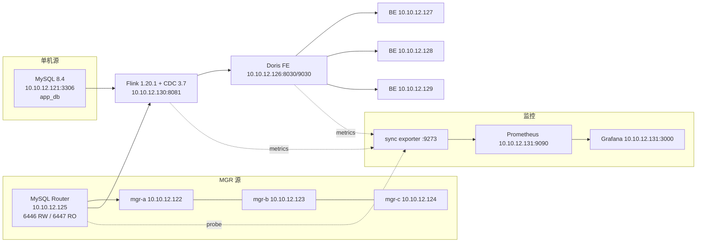

# 1. 方案与部署

目标是把 MySQL 的业务库实时同步到 Doris:MySQL 只负责 OLTP 写入,Doris 承接报表与多维分析。源端验证两种形态——单机 MySQL、三节点 MGR + MySQL Router;同步工具用 Flink CDC 直读 binlog,目标端 Doris 4.0.8。

## 版本与机器

| 组件 | 版本 | 说明 |
| --- | --- | --- |
| MySQL | 8.4.13(Ubuntu 26.04 apt) | 单机 1 台 + MGR 3 台 |
| MySQL Shell | 8.4.8(Ubuntu 26.04 apt) | 只用于 MGR 收编,Python 模式 |
| MySQL Router | 8.4.13(Ubuntu 26.04 apt) | MGR 读写入口 6446 / 只读 6447 |
| Doris | 4.0.8(官方 x64 二进制) | 1 FE + 3 BE,主键模型 |
| Flink | 1.20.1(官方 bin) | standalone,1 JM + 1 TM |
| Flink CDC | 3.7.0-1.20 | pipeline connector:mysql + doris |
| OS | Ubuntu 26.04 LTS | 全部虚机,PvE 模板 101 克隆 |

Doris 4.0.8 不在 Flink CDC Doris connector 的官方支持矩阵(1.2/2.x/3.x)里,本次实测可用;生产选型仍以官方矩阵为准,或等连接器显式声明 4.x。

## 选型:为什么是 Flink CDC

| 方案 | 链路 | 优点 | 本次不选的原因 |
| --- | --- | --- | --- |
| Flink CDC pipeline | MySQL binlog → Flink → Doris | 全量+增量一体、DDL 演进、无需 Kafka、社区维护 | 需要维护 Flink 集群 |
| Canal + Kafka + Routine Load | binlog → Canal → Kafka → Doris | 组件职责清晰,可复用 Kafka | 链路长;DDL 要自行处理,Routine Load 对表结构变更不友好 |
| Doris JDBC Catalog | Doris 直接查 MySQL | 零同步,接入最快 | 不是同步,复杂分析会把压力打回 MySQL |
| DataX / SeaTunnel 批同步 | 定时批量抽 | 简单 | 分钟级延迟,不满足实时 |

Flink CDC 3.x 的 pipeline 模式把 source/sink 做成 YAML,表结构变更由 `SchemaOperator` 转成 Doris 的 `ALTER TABLE`。本次重点验证的 DDL 演进、主键更新/删除、MGR 切换后的断点续传,都落在这条链路上。

## 拓扑



| VMID | 主机名 | IP | 角色 | 规格 |
| --- | --- | --- | --- | --- |
| 121 | mysql-single | 10.10.12.121 | MySQL 8.4 单机 | 4C/8G/40G |
| 122 | mgr-a | 10.10.12.122 | MGR 节点 / 初始主库 | 2C/4G/40G |
| 123 | mgr-b | 10.10.12.123 | MGR 节点 | 2C/4G/40G |
| 124 | mgr-c | 10.10.12.124 | MGR 节点 / 切换后主库 | 2C/4G/40G |
| 125 | mysql-router | 10.10.12.125 | Router 6446/6447 | 2C/2G/40G |
| 126 | doris-fe | 10.10.12.126 | Doris FE | 4C/8G/40G |
| 127–129 | doris-be1/2/3 | 10.10.12.127–129 | Doris BE | 4C/8G/40G |
| 130 | flink-cdc | 10.10.12.130 | Flink standalone + CDC CLI | 4C/8G/40G |
| 131 | monitor | 10.10.12.131 | Prometheus/Grafana/exporter | 2C/4G/40G |
| 132 | mysql-single-b | 10.10.12.132 | 多实例验证的第二套 MySQL(第 4 篇) | 4C/8G/40G |

基线 11 台虚机从 PVE 模板 101(Ubuntu 26.04,40G 盘)克隆,`qm clone 101 <vmid> --full --storage hddvm`;克隆后离线改 netplan 的静态 IP、hostname 和 machine-id。第 4 篇的多实例验证再克隆 132,共 12 台。所有节点统一:时区 `Asia/Shanghai`、`vm.max_map_count=2000000`、swap 关闭、`nofile=1048576`。

## MySQL 单机

配置见 [conf/mysql/zz-lab.cnf](conf/mysql/zz-lab.cnf),关键项:

| 参数 | 值 | 作用 |
| --- | --- | --- |
| `binlog_format` | `ROW` | Flink CDC 只认行格式 |
| `binlog_row_image` | `FULL` | 更新/删除要带完整前镜像 |
| `gtid_mode` / `enforce_gtid_consistency` | `ON` | 切换/重连按 GTID 续读 |
| `binlog_expire_logs_seconds` | `604800` | 留 7 天,给同步故障留追赶窗口 |
| `binlog_checksum` | `CRC32` | 单机可用;MGR 必须 `NONE` |
| `default-time-zone` | `+08:00` | 与 Flink `server-time-zone` 对齐 |

安装与建号:

```bash
apt-get install -y mysql-server mysql-client
cp conf/mysql/zz-lab.cnf /etc/mysql/mysql.conf.d/zz-lab.cnf
systemctl restart mysql

mysql <<'SQL'
CREATE USER 'cdc'@'%' IDENTIFIED BY '<CDC_PASSWORD>';
GRANT SELECT, RELOAD, SHOW DATABASES, REPLICATION SLAVE, REPLICATION CLIENT
  ON *.* TO 'cdc'@'%';
CREATE USER 'app'@'%' IDENTIFIED BY '<APP_PASSWORD>';
GRANT ALL PRIVILEGES ON app_db.* TO 'app'@'%';
SQL
```

`cdc` 的最小权限按 Flink CDC 文档给:`SELECT` 读快照,`RELOAD` 做一致性快照,`SHOW DATABASES` 发现库,`REPLICATION SLAVE` 拉 binlog,`REPLICATION CLIENT` 看位点。MySQL 8.4 的权限名仍是 `REPLICATION SLAVE`,`REPLICATION REPLICA` 只改了语句名。

验证位点:

```sql
SHOW BINARY LOG STATUS;
-- File              Position  Binlog_Do_DB  Binlog_Ignore_DB  Executed_Gtid_Set
-- mysql-bin.000001  1611860                 07e211d0-...:1-1595
```

业务库 `app_db` 用四张表 + 一张心跳表:`customers`、`products`、`orders`、`order_items`、`sync_heartbeat`,建表 DDL 见 [conf/mysql/app_schema.sql](conf/mysql/app_schema.sql)。`sync_heartbeat` 由 MySQL EVENT 每秒更新一次(单机场景没有主库切换,EVENT 够用):

```sql
CREATE TABLE app_db.sync_heartbeat (
  id TINYINT PRIMARY KEY,
  ts DATETIME(3) NOT NULL,
  seq BIGINT UNSIGNED NOT NULL
);
INSERT INTO app_db.sync_heartbeat VALUES (1, NOW(3), 1);
CREATE EVENT app_db.ev_heartbeat ON SCHEDULE EVERY 1 SECOND
  DO UPDATE app_db.sync_heartbeat SET ts=NOW(3), seq=seq+1 WHERE id=1;
```

## MGR + Router

三节点配置模板见 [conf/mysql/zz-mgr.cnf](conf/mysql/zz-mgr.cnf),每台只改 `server-id`、`report_host`、`group_replication_local_address`。相对单机多了:

| 参数 | 值 | 原因 |
| --- | --- | --- |
| `binlog_checksum` | `NONE` | MGR 要求 |
| `log_replica_updates` | `ON` | 从库也要把主库事务写进自己的 binlog |
| `plugin_load_add` | `group_replication.so` | 启动即加载插件 |
| `group_replication_group_seeds` | 三个 `IP:3306` | 组通信端口复用 SQL 端口 |
| `group_replication_ip_allowlist` | `10.10.12.0/24` | 限制组通信来源 |
| `report_host` | 节点 IP | mysql-shell 不接受解析到 127.0.1.1 的主机名 |

安装并起三节点:

```bash
apt-get install -y mysql-server mysql-client mysql-shell
# 每台替换 <SERVER_ID>/<NODE_IP>/<NODE1_IP>...
cp conf/mysql/zz-mgr.cnf /etc/mysql/mysql.conf.d/zz-mgr.cnf
systemctl restart mysql
mysql -e "CREATE USER 'admin'@'%' IDENTIFIED BY '<MGR_ADMIN_PASSWORD>';
          GRANT ALL PRIVILEGES ON *.* TO 'admin'@'%' WITH GRANT OPTION;"
```

Ubuntu 26.04 的 mysql-shell 8.4.8 **不带 JavaScript 引擎**,`mysqlsh --js` 直接报 `JavaScript is not supported.`;改用 Python 模式,方法名是 snake_case:

```bash
mysqlsh --uri admin:<MGR_ADMIN_PASSWORD>@10.10.12.122:3306 --py \
  -e 'dba.configure_instance()'

# 建组(会在交互里问是否继续,printf y 喂确认)
printf 'y\n' | mysqlsh --uri admin:<MGR_ADMIN_PASSWORD>@10.10.12.122:3306 --py \
  -e 'c=dba.create_cluster("mgr_lab"); print(c.status())'
# ... Cluster successfully created. Use Cluster.add_instance() ...

# 加第二、第三节点;新节点初始化时建过本地账号,带 errant GTID,
# 必须用 clone 物理覆盖,不能用 incremental。
printf 'y\n' | mysqlsh --uri admin:<MGR_ADMIN_PASSWORD>@10.10.12.122:3306 --py \
  -e 'c=dba.get_cluster("mgr_lab");
      c.add_instance("admin:<MGR_ADMIN_PASSWORD>@10.10.12.124:3306",
                     {"recoveryMethod":"clone"});'
```

`create_cluster` 会把 `group_replication_local_address` 改写成 `IP:3306`,同时把 `group_replication_start_on_boot` 置 1;配置文件里的 seeds 也要统一成 3306,不然新节点会去连不存在的 33061。三节点 ONLINE 后 `c.status()` 的 `status` 从 `OK_NO_TOLERANCE` 变为 `OK`,可容忍一台故障。

Router 用包管理器安装后没有 systemd unit,需要自己写一个(本次 exporter/心跳的 unit 见 [conf/systemd/](conf/systemd/),Router 的 unit 在部署时临时创建):

```bash
apt-get install -y mysql-router
useradd --system --home-dir /etc/mysqlrouter --shell /usr/sbin/nologin mysqlrouter
mysqlrouter --bootstrap admin:<MGR_ADMIN_PASSWORD>@10.10.12.122:3306 \
  --directory /etc/mysqlrouter --user=mysqlrouter --force
# 生成 6446 RW / 6447 RO / 6448-6449 X 协议 / 6450 读写分离
systemctl enable --now mysqlrouter
```

验证读写口:

```sql
-- 6446:当前主库,read_only=0
SELECT @@port, @@server_id, @@read_only, @@hostname;
-- 3306  122  0  mgr-a

-- 6447:只读从库,read_only=1
-- 3306  124  1  mgr-c
```

MGR 的业务库是 `app_mgr`,表结构与 `app_db` 相同,心跳表 `app_mgr.sync_heartbeat`。MGR 场景的心跳**不用 EVENT**:主库切换后,原主库上的 EVENT 在新主库上是 `REPLICA_SIDE_DISABLED`,不会自动执行;改用 monitor 机上的外部 writer 每秒经 Router 6446 更新,细节见第 3 篇。

## Doris 集群

FE/BE 用同一个 4.0.8 tar 包,但只解压各自角色,40G 盘省空间:

```bash
# FE 节点
tar xzf apache-doris-4.0.8-bin-x64.tar.gz -C /opt/doris --strip-components=1 \
  apache-doris-4.0.8-bin-x64/fe
# BE 节点
tar xzf apache-doris-4.0.8-bin-x64.tar.gz -C /opt/doris --strip-components=1 \
  apache-doris-4.0.8-bin-x64/be
```

前置:JDK 17(`openjdk-17-jdk-headless`)、`vm.max_map_count=2000000`、swap 关闭、`nofile` 放大。BE 的 `start_be.sh` 会检查 `ulimit -n`,低于 60000 直接退出,必须在该 shell 里 `ulimit -n 1048576` 再启动。

FE 追加配置见 [conf/doris/fe.conf.lab](conf/doris/fe.conf.lab),8G 虚机把默认 8G 堆下调到 4G;BE 见 [conf/doris/be.conf.lab](conf/doris/be.conf.lab)。

```bash
# FE
cd /opt/doris/fe && bin/start_fe.sh --daemon
curl -s http://10.10.12.126:8030/api/bootstrap

# BE(三台)
cd /opt/doris/be && bash -c 'ulimit -n 1048576; bin/start_be.sh --daemon'

# 注册 BE
mysql -h10.10.12.126 -P9030 -uroot
ALTER SYSTEM ADD BACKEND "10.10.12.127:9050";
ALTER SYSTEM ADD BACKEND "10.10.12.128:9050";
ALTER SYSTEM ADD BACKEND "10.10.12.129:9050";
SHOW BACKENDS;
```

`SHOW BACKENDS` 三台 `Alive=true`、`Version=doris-4.0.8-rc02` 后再建库。Doris 的库要**先手工建**,Flink CDC 的 Doris sink 不会自动建 database:

```sql
CREATE DATABASE app_db;
CREATE DATABASE app_mgr;
```

## Flink CDC

Flink 1.20.1 standalone,CDC 3.7.0 的 1.20 分发版;两个 connector 放到 CDC 的 `lib/`,MySQL JDBC 驱动放到 Flink 的 `lib/`(pipeline connector 不打包 GPL 驱动):

```bash
tar xzf flink-1.20.1-bin-scala_2.12.tgz -C /opt
ln -s /opt/flink-1.20.1 /opt/flink
tar xzf flink-cdc-3.7.0-1.20-bin.tar.gz -C /opt
ln -s /opt/flink-cdc-3.7.0-1.20 /opt/flink-cdc

cp flink-cdc-pipeline-connector-mysql-3.7.0-1.20.jar /opt/flink-cdc/lib/
cp flink-cdc-pipeline-connector-doris-3.7.0-1.20.jar /opt/flink-cdc/lib/
cp mysql-connector-java-8.0.27.jar /opt/flink/lib/
```

Flink 配置的三处改动见 [conf/flink/config.yaml.lab](conf/flink/config.yaml.lab):checkpoint 3s、TM 4 slots(两条 pipeline 各 2 并发)、REST 监听 `0.0.0.0`(外部的 exporter 要拉 8081)。`taskmanager.numberOfTaskSlots` 和 `parallelism.default` 在官方 `config.yaml` 里已有同名键,改原值,重复追加会导致 YAML `found duplicate key`。

两条 pipeline 的 YAML 见 [conf/flink-cdc/mysql-single.yaml](conf/flink-cdc/mysql-single.yaml) 与 [mysql-mgr.yaml](conf/flink-cdc/mysql-mgr.yaml)。几个关键项:

| 配置 | 值 | 原因 |
| --- | --- | --- |
| `server-id` | `5400-5404` / `5500-5504` | 两条链路各占一段,不能与 MySQL 集群现有 server-id 冲突 |
| `scan.binlog.newly-added-table.enabled` | `true` | 运行期 `CREATE TABLE` 后继续读新表的 DML |
| `jdbc.properties.allowPublicKeyRetrieval` | `true` | MySQL 8.4 caching_sha2 + 非 SSL(尤其经 Router) |
| `table.create.properties.light_schema_change` | `true` | Doris 侧 DDL 走轻量 schema change |
| `table.create.properties.replication_num` | `3` | 3 BE,三副本 |
| `pipeline.schema.change.behavior` | `evolve` | 默认 LENIENT 会忽略 TRUNCATE/DROP TABLE |

提交:

```bash
export JAVA_HOME=/usr/lib/jvm/java-17-openjdk-amd64
export FLINK_HOME=/opt/flink
/opt/flink-cdc/bin/flink-cdc.sh /opt/pipelines/mysql-single.yaml --flink-home /opt/flink
/opt/flink-cdc/bin/flink-cdc.sh /opt/pipelines/mysql-mgr.yaml   --flink-home /opt/flink
```

成功时 CLI 输出 `Pipeline has been submitted to cluster` 和 Job ID;Flink Web UI `http://10.10.12.130:8081` 能看到两个 `RUNNING` 作业,每个 2 并发、4 个 task。

## 部署顺序

1. 克隆 11 台虚机,统一 IP/hostname/时区/内核参数;
2. MySQL 单机:装包 → 配置 → 建 `app_db` → 建 `cdc`/`app` 账号 → 造数;
3. MGR 三节点:装包 → 配置 → `report_host` → mysql-shell 收编 → clone 加入 → Router bootstrap;
4. Doris:FE/BE 解包 → JDK/ulimit → 启动 → `ADD BACKEND` → 建 `app_db`/`app_mgr`;
5. Flink:解包 → 两处 config → 放 connector/JDBC → 启 cluster;
6. 提交两条 pipeline → 核对 Doris 表数量与心跳 → 进入第 2 篇的变更验证。

## 部署踩坑

| 现象 | 根因 | 处置 |
| --- | --- | --- |
| `SHOW MASTER STATUS` 语法错,作业反复 restart | Flink CDC 3.5 的 Debezium 还不识别 MySQL 8.4,8.4 已移除该语句 | 换 CDC 3.7.0-1.20;3.7 会按版本探测 `SHOW BINARY LOG STATUS` |
| `Public Key Retrieval is not allowed`(走 Router 时) | caching_sha2 全量认证 + 非 SSL | source 加 `jdbc.properties.allowPublicKeyRetrieval: true` |
| Flink 启动 `found duplicate key numberOfTaskSlots` | 官方 config.yaml 已有同名键,又追加了一份 | 改原值,不要重复追加 |
| BE 启动提示 `Set max number of open file descriptors...` | 当前 shell 的 nofile 只有 1024 | `bash -c 'ulimit -n 1048576; bin/start_be.sh --daemon'` |
| mysql-shell 报 `JavaScript is not supported.` | Ubuntu 的 mysql-shell 构建不带 JS 引擎 | `--py`,方法名改 snake_case |
| mysql-shell 报 `Cannot use host 'mgr-a' ... 127.0.1.1` | `/etc/hosts` 的 `127.0.1.1 mgr-a` 让主机名解析到回环 | MGR 配置加 `report_host=<节点IP>` |
| `add_instance` 报 errant GTID / `recoveryMethod=incremental` 不可用 | 新节点初始化时建过本地账号,GTID 与组内不一致 | 用 `{"recoveryMethod":"clone"}`,物理覆盖 |
| 运行期 `CREATE TABLE` 后 Doris 没表 | 默认不读新表的 binlog | source 加 `scan.binlog.newly-added-table.enabled: true` |
| `TRUNCATE`/`DROP TABLE` 不同步 | pipeline 默认 LENIENT,刻意忽略这两类事件 | `pipeline.schema.change.behavior: evolve` |
| MGR 切换后心跳不动 | 原主库的 EVENT 在新主库上是 `REPLICA_SIDE_DISABLED` | 外部 writer 经 Router 6446 写入,见第 3 篇 |
| `mysqlrouter` 装完没有 systemd unit | Ubuntu 包只给二进制和示例配置 | 自建 unit,`ExecStart=/usr/bin/mysqlrouter -c /etc/mysqlrouter/mysqlrouter.conf` |

