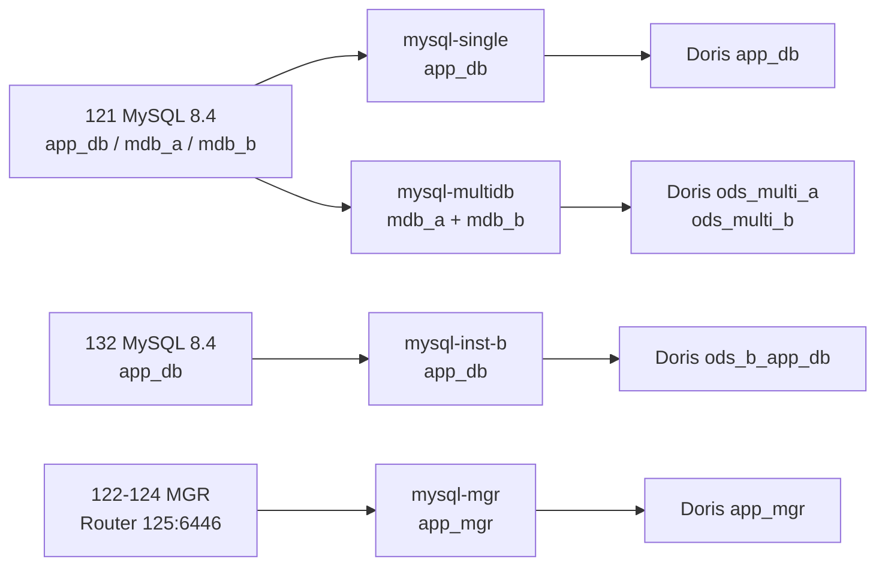

# 4. 多实例与多库扩展

在 11 台基线之外新增一台 132(`mysql-single-b`),同时给 121 增加 `mdb_a` / `mdb_b` 两个库,把“多库”和“多实例”拆开验证。结论:同一实例的多个库可以塞进一条 pipeline;多个 MySQL 实例必须一条 pipeline 一个实例;用 `route` 把同名库/表隔到不同 Doris database,两个实例都有的 `app_db.orders` 不会互相覆盖。

## 拓扑



| pipeline | 源 | 源库 | Doris 目标 | route | server-id |
| --- | --- | --- | --- | --- | --- |
| mysql-single-to-doris | 121:3306 | app_db | app_db | 默认同名 | 5400-5404 |
| mysql-mgr-to-doris | Router 125:6446 | app_mgr | app_mgr | 默认同名 | 5500-5504 |
| mysql-multidb-to-doris | 121:3306 | mdb_a、mdb_b | ods_multi_a、ods_multi_b | `mdb_a.\.*` → `ods_multi_a.<>`;`mdb_b.\.*` → `ods_multi_b.<>` | 5600-5604 |
| mysql-inst-b-to-doris | 132:3306 | app_db | ods_b_app_db | `app_db.\.*` → `ods_b_app_db.<>` | 5700-5704 |

四条 pipeline 同时写一个 Doris 集群,四个 Flink job 全部 `RUNNING`。

## 同一实例多库:一条 pipeline

`mdb_a` / `mdb_b` 各有一张 `orders` 和一张 `sync_heartbeat`,各灌 100 行。DDL 见 [conf/mysql/multi_source_schema.sql](conf/mysql/multi_source_schema.sql),pipeline 见 [conf/flink-cdc/mysql-multidb.yaml](conf/flink-cdc/mysql-multidb.yaml)。

```yaml
source:
  type: mysql
  hostname: 10.10.12.121
  port: 3306
  tables: mdb_a.\.*, mdb_b.\.*
  server-id: 5600-5604
  scan.binlog.newly-added-table.enabled: true
  jdbc.properties.allowPublicKeyRetrieval: true

route:
  - source-table: mdb_a.\.*
    sink-table: ods_multi_a.<>
    replace-symbol: <>
  - source-table: mdb_b.\.*
    sink-table: ods_multi_b.<>
    replace-symbol: <>
```

Doris 目标库先建:

```sql
CREATE DATABASE ods_multi_a;
CREATE DATABASE ods_multi_b;
```

实测结果:

| 检查 | 结果 |
| --- | --- |
| `ods_multi_a.orders` / `ods_multi_b.orders` | 101 / 100 |
| 两库心跳 | 都持续更新 |
| `mdb_a` INSERT + UPDATE id=5001 | Doris `ods_multi_a` 出现 `5001 / 56.78` |
| `mdb_a.orders ADD COLUMN note` | Doris `ods_multi_a.orders.note` 为 `varchar(96)`(MySQL `VARCHAR(32)` 的 3 倍) |
| `mdb_b` 新建 `ddl_multi` | Doris 自动出现 `ods_multi_b.ddl_multi`,两行数据 |
| `mdb_b.ddl_multi` TRUNCATE / DROP | Doris 表先清空再删除 |
| `ods_multi_b.orders` 计数 | 始终 100,没有被 `mdb_a` 的写入影响 |

`route` 的 `replace-symbol: <>` 只替换**表名**,库名由 `sink-table` 的库部分决定;所以 `mdb_a.orders` 和 `mdb_b.orders` 这两张同名表能落到两个 Doris 库。`route` 默认 `ALL_MATCH`,规则有重叠时在 `pipeline` 下设 `route-mode: FIRST_MATCH`。`replace-symbol` 不能和正则捕获组同时用;要按库名/表名做复杂替换,用 `$1`/`$2` 捕获组,例如 `source-table: (.*)\.(.*)`、`sink-table: ods.$1_$2`。

## 多实例:一条 pipeline 一个实例

132 是从模板 101 克隆的新虚机(4C/8G/40G,MySQL 8.4.13),建一个简化版 `app_db`:`orders` 1000 行 + `sync_heartbeat`。它和 121 的库名一样都叫 `app_db`,用来验证同名库的隔离。pipeline 见 [conf/flink-cdc/mysql-inst-b.yaml](conf/flink-cdc/mysql-inst-b.yaml)。

```yaml
source:
  type: mysql
  hostname: 10.10.12.132
  port: 3306
  tables: app_db.\.*
  server-id: 5700-5704

route:
  - source-table: app_db.\.*
    sink-table: ods_b_app_db.<>
    replace-symbol: <>
```

Doris 侧:

```sql
CREATE DATABASE ods_b_app_db;
```

实测结果:

| 检查 | 结果 |
| --- | --- |
| `ods_b_app_db.orders` | 1000 行,与 132 源库一致 |
| INSERT + UPDATE id=5001 | Doris 出现 `5001 / 33.33` |
| `app_db.orders ADD COLUMN remark` | Doris `ods_b_app_db.orders.remark` 为 `varchar(96)` |
| `app_db` 新建 `ddl_b` | Doris `ods_b_app_db.ddl_b` 两行 |
| `ddl_b` TRUNCATE / DROP | Doris 表清空/删除 |
| 121 的 `app_db.orders` | 仍是 1,010,000 行,没有被 132 的 `app_db` 影响 |

两个实例的源库都叫 `app_db`,表都叫 `orders`;因为 route 到不同的 Doris database,主键没有互相覆盖。132 的 binlog、server-id、GTID 都是独立的,121 的 MGR/单机链路不受影响。

## Flink 资源

原来 1 个 TaskManager、4 个 slot,两条 pipeline 各 2 并发,正好占满。新增两条后需要 4 个 slot:

```bash
/opt/flink/bin/taskmanager.sh start
# /overview: taskmanagers=2, slots-total=8, slots-available=4, jobs-running=2
```

第二个 TM 起来后总数变成 2 TM / 8 slot,四条 pipeline 各 2 并发,`slots-available` 回到 0。生产里按 `sum(parallelism)` 预留,再留 20–30% 余量;关键实例单独 Flink 集群或单独 TM,避免一个 TM 故障影响所有源。

## 监控扩展

exporter 原来写死两条 pipeline,现在每条带一个 `dbs` 列表(见 [conf/exporter/sync_exporter.py](conf/exporter/sync_exporter.py)):

```python
MYSQL_MULTIDB = ("10.10.12.121", 3306, "cdc", CDC_PASSWORD, ["mdb_a", "mdb_b"], "mysql-multi")
MYSQL_INST_B = ("10.10.12.132", 3306, "cdc", CDC_PASSWORD, ["app_db"], "mysql-inst-b")

PIPELINES = [
    {"name": "single",   "job": "mysql-single-to-doris",  "mysql": MYSQL_SINGLE},
    {"name": "mgr",      "job": "mysql-mgr-to-doris",     "mysql": MYSQL_MGR},
    {"name": "multi-db", "job": "mysql-multidb-to-doris", "mysql": MYSQL_MULTIDB},
    {"name": "inst-b",   "job": "mysql-inst-b-to-doris",  "mysql": MYSQL_INST_B},
]
```

指标变化:

| 指标 | 标签 | 说明 |
| --- | --- | --- |
| `mysql_doris_flink_job_state` | `pipeline` | 四条 pipeline 各一个 1 |
| `mysql_doris_heartbeat_lag_seconds` | `pipeline`,`db` | 单机/MGR 各 1 条,multi-db 两条,inst-b 一条,共 5 条 |
| `mysql_doris_heartbeat_lag_doris_seconds` | `pipeline`,`target_db` | Doris 时钟口径的交叉检查 |
| `mysql_doris_binlog_total_bytes` | `instance` | 121 被 single 和 multi-db 各查一次,数值相同;MGR/132 各一条 |

实测稳定值:

```text
mysql_doris_flink_job_state: 4 条全部 1
heartbeat_lag_seconds: single 0.14s / mgr 0.52s / multi-db.mdb_a 0.43s /
                       multi-db.mdb_b 0.46s / inst-b 0.41s
heartbeat_lag_doris_seconds: 0.64–2.86s(含 3s checkpoint 的批量提交)
```

Grafana 的心跳面板图例改成 `{{pipeline}}/{{db}}`,9 个面板不变;告警规则仍然按 `pipeline` 标签匹配,`HeartbeatLagHigh` / `HeartbeatStalled` 的注释里补了 `db`。仪表盘 JSON 见 [conf/grafana/doris-sync-dashboard.json](conf/grafana/doris-sync-dashboard.json),规则见 [conf/prometheus/doris-sync-rules.yml](conf/prometheus/doris-sync-rules.yml)。

## 扩展规则

1. **一个 MySQL 实例一条 pipeline**。source 只有一组 `hostname/port`,不能把多个实例塞进一个 source;
2. 同一实例的多个库可以共用一条 pipeline,`tables` 用逗号分隔多个正则;要隔离故障就拆成多条,但同一实例上的 `server-id` 段不能重叠;
3. 每条 pipeline 用 `route` 给 Doris 目标库加实例/库命名空间,目标 database **先手工建**;
4. 同名库/表跨实例时,不要直接写到同一个 Doris 表;除非是有意的分库分表合并,且主键全局唯一、schema 完全一致;
5. `server-id` 在同一个 MySQL 集群内必须唯一;不同实例可复用,但建议按 pipeline 分段,排障时好对;
6. 多条 pipeline 首次启动会同时做快照,MySQL、网络、Doris Stream Load 都会被打;分批次启动或错峰;
7. Doris 表数 = 源表数 × 实例数,注意 tablet/FE 元数据;大表预建并指定分桶,小表别用默认大桶数;
8. 监控按 `pipeline + db` 存心跳,一个源库一张心跳表,别用一个库的心跳代表整条 pipeline;
9. MySQL 8.4 + Router 的 `allowPublicKeyRetrieval`、CDC 3.7 的 `scan.binlog.newly-added-table.enabled`、`schema.change.behavior: evolve` 在每条 pipeline 上都要有。

## 边界

- 本次是 2 个独立实例 + 1 个 MGR 集群,不是几十个实例的规模测试;slot、Doris tablet、快照并发的上限要按实际规模压测;
- 每条 pipeline 独立 checkpoint/恢复,没有跨实例事务;两个实例之间的数据一致性是最终一致,不是分布式事务;
- DDL 仍然按 pipeline 各自演进;分库分表合并到一张 Doris 表时,DDL 冲突和主键冲突要单独治理;
- Doris sink 的 `TwoPhaseCommit=false` 与非主键表重复风险与第 2 篇相同,不因多实例而改变。
