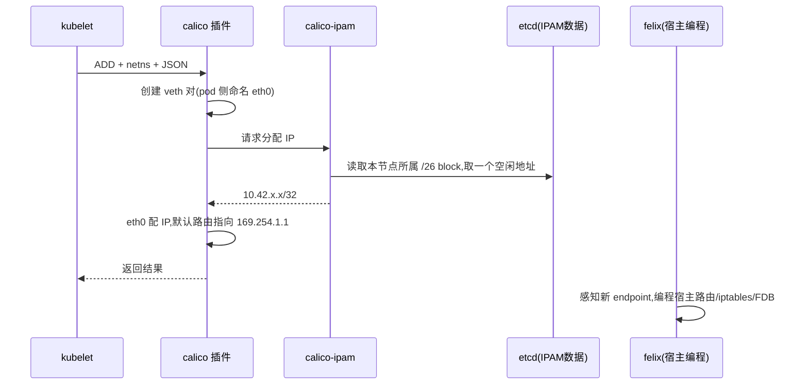
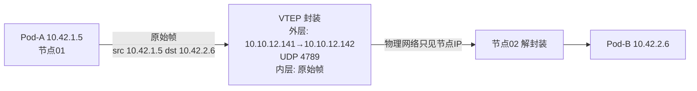

# CNI 插件原理

CNI(Container Network Interface)是 CNCF 的一纸规范:容器运行时通过 **exec 调用插件二进制**完成 Pod 网络的创建与销毁。这篇把"插件被调用的瞬间发生了什么""数据面三大流派的原理""主流插件各自怎么实现"讲透,选型对比在 [第 3 篇](3.网络模型与CNI选型.md),不在本篇重复;管理面板的落地见 [第 11 篇](11.管理面板-Rancher.md)。

## 一、CNI 规范:一次调用约定了一切

CNI 没有常驻进程——它是"调用约定"。kubelet 创建 Pod 沙箱时,按 `/etc/cni/net.d/` 目录里**字典序第一个** `.conf`/`.conflist` 文件的声明,exec 对应的二进制:

```
stdin  ←  JSON 网络配置(mtu、ipam、插件参数)
环境变量:
  CNI_COMMAND     = ADD | DEL | CHECK
  CNI_CONTAINERID = <沙箱ID>
  CNI_NETNS       = /proc/<pid>/ns/net
  CNI_IFNAME      = eth0
  CNI_PATH        = 插件二进制所在目录
stdout →  JSON 结果(分配到的 IP、路由等)
```

三个直接推论,都能在 RKE2 上验证:

1. **插件就是普通可执行文件**。本集群路径 `/var/lib/rancher/rke2/data/v1.35.6-rke2r1-7a33eeffe5c4/bin/`,里面有 `calico`、`calico-ipam`、`loopback`、`portmap` 等——换 CNI 版本 = 换目录里的二进制 + 配置文件。
2. **配置目录按字典序生效**,第一个匹配的赢。canal 事故里残留配置能干扰网络的文件层原因就在这:谁排在前面谁接管。
3. **conflist 是插件链**:一个 Pod 网卡可以串行过多个插件——`calico`(建网卡+IPAM)→ `portmap`(宿主端口映射)→ `tuning`(sysctl)。链式设计是 CNI 生态的粘合剂。

## 二、一块 Pod 网卡的一生(calico VXLAN,本集群实测路径)



两个初见必懵的细节,都在本集群可复现:

**① Pod 里的默认网关是 169.254.1.1**——一个 link-local 地址,根本不在任何网段。这是 calico 的经典手法:Pod 内 `default via 169.254.1.1 dev eth0`,宿主侧对 veth 开启 `proxy_arp`,任何发往 169.254.1.1 的 ARP 都由宿主代答。好处:一条 veth 两端不需要 L2 同网段,`/32` 地址直接上路由,配合 `route_reflector` 能把路由协议做纯三层。

**② IP 是从"块"里来的,不是从池子里顺序发的**。calico 把 cluster-cidr(本集群 10.42.0.0/16)按 **/26 切成 64 地址的块**,每块通过 blockAffinity 绑定到一个节点;节点上的 Pod 只从自己名下的块里取地址。这就是 [第 7 篇](7.容灾实测.md) 里"IPAM 块拓扑错位"能拖垮全集群的结构性原因——块与节点的绑定关系散在 etcd 里,恢复 etcd 就恢复了块表,而现场节点的路由/FDB 要重新对齐。

## 三、数据面三大流派

CNI 插件千千万,数据面只有三种本质:**封装、路由、eBPF**。

### 流派一:Overlay 封装(flannel、calico VXLAN/IPIP 模式)

跨节点流量打一个"信封"再出门:



- **VXLAN**:MAC in UDP/4789。每个节点一个 VTEP 设备(calico 的 `vxlan.calico`、flannel 的 `flannel.1`),动态维护 FDB(远端 VTEP MAC 表)与 ARP 代答表——表的来源就是 etcd 里的 IPPool/blockAffinity。VXLAN 有独立的三层网段(VTEP IP),**跨二层也能跑**。
- **IPIP**:IP in IP(协议号 4,无端口),头开销比 VXLAN 小(20 字节 vs 50 字节),但外层也是 IP——只能同三层域内,穿不了 NAT/公网。
- **代价实测**(本集群):MTU 从 1500 降到 **1450**(50 字节封装),TCP MSS 被钳制;iperf3 跨节点 Pod 流量 ~1.4 Gbps,为宿主裸速 5.28 Gbps 的 1/4-2/3,且重传活跃(封装后分片与 offload 失效的代价,见 [第 3 篇](3.网络模型与CNI选型.md))。

### 流派二:三层路由(calico BGP / flannel host-gw)

不打信封,直接让"每个节点知道所有 Pod 网段怎么走":

- calico 把每个节点名下的 block 以 **BGP 路由**宣告出去(node-to-node mesh,节点多时换 Route Reflector);bird 进程负责跑协议。宿主路由表长出 `10.42.2.0/24 via 10.10.12.142` 这样的纯三层路由。
- **零封装、零 MTU 损失、路径最短**——对带宽敏感负载(Kafka 同步复制、ES)的首选形态。
- 代价:underlay 必须**三层可达**(同二层直连,或物理网络愿意学/传 BGP);云上 VPC 普遍不给 BGP,所以云上默认回到 VXLAN(本集群 `installation` 对象实测即 `encapsulation: VXLAN`)。
- flannel 的 `host-gw` 是同思想的极简版:直接写静态路由,不跑 BGP,要求节点同二层。

### 流派三:eBPF 数据面(Cilium)

前两派都在"内核网络栈既有设施"上做文章(路由表、iptables、conntrack);Cilium 换了引擎:把转发逻辑编译成 **eBPF 程序**挂到 veth/tc 钩子,以及 socket 层:

- **Service 转发在 socket 层完成**(connect-time LB):应用 `connect(ClusterIP)` 的瞬间就被重定向到真实 Pod IP——kube-proxy 的 iptables 规则整条链路被绕开,这就是 `kubeProxyReplacement=true` 的字面意思。本集群 kube-proxy 仍是 iptables 模式(实测静态 Pod 参数),Cilium 是唯一能把它也接管的插件。
- 策略/观测在内核态完成:L3-L7 策略基于 bpf map,不经过 iptables 规则堆叠;Hubble 把每个流的可视化直接从 map 里读出来。
- 代价:内核版本敏感(5.10+ 才舒服)、agent 复杂度高、排障从"看 iptables"变成"读 bpf"——能力换复杂度。

## 四、与 kube-proxy 的分工(容易混的一对)

| 流量 | 归属 | 本集群实测 |
| --- | --- | --- |
| Pod → Pod(东西向,直接 IP) | **CNI** | calico VXLAN,4789/udp |
| Service ClusterIP/NodePort/LB 的 DNAT | **kube-proxy** | iptables 模式(静态 Pod 参数实测) |
| LoadBalancer 的 IP 分配与 ARP/BGP 宣告 | **MetalLB**(云上是 CCM) | metallb L2,见 plugins/metallb |

三层各自独立、各自可替换:CNI 换成 Cilium 可以顺带接管第二层;LoadBalancer 永远是第三层的事(没有 ServiceLB 的 v1.35 里,这层必须自建)。

## 五、主流插件架构速览

**flannel**:单一职责的 overlay。etcd 存网段分配,`flannel.1`(VXLAN)/`host-gw`(路由)二选一;不做 NetworkPolicy——所以有了 **canal** = flannel(组网)+ calico policy(策略)的组合拳。RKE2 的默认 CNI 就是 canal。

**calico**: felix(每节点,编程路由 + iptables + endpoint 管理)、bird(BGP)、confd(把 etcd 配置渲染给 bird)、typha(大规模时汇聚 Felix 对 apiserver 的压力)。部署形态两种:manifest 直装(老资料里的 `kube-system -l k8s-app=calico-node` 查法)与 **tigera-operator**(RKE2 采用,组件在 `calico-system`,镜像 `rancher/mirrored-calico-*`)——排障命令跟着形态走,别混。

**Cilium**:agent(每节点,编译/装载 bpf)、operator(集群级,IPAM 与资源管理)、Hubble(观测)。数据面能力上限最高,L7 策略、service mesh 替代(金丝雀按 header 分流)、带宽管理(BandwidthManager)都在内核态完成。

## 六、换 CNI 的正确姿势与故障归因

- **建集群时定死**。运行中换 CNI = 全量重建 Pod 网络与 IPAM,生产上等同于重建集群——canal 与 calico 两套 chart 并存的互删事故([第 7 篇](7.容灾实测.md))就是"集群里同时存在两种 CNI 的意志"的下场。
- 真要换:配置改 `cni:` → **所有 server 一致** → 清掉旧 CNI 的节点级残留(flannel.1 设备、路由、CNI 配置文件)→ 滚动重启全部 Pod。
- 故障归因速查:Pod 起不来卡沙箱 → CNI/IPAM 层(查 IPPool/blockAffinity);Pod 之间不通但各自健康 → 数据面(查封装端口、路由表);Service 不通但 Pod IP 通 → kube-proxy 层。分层归因的完整方法见 [第 8 篇](8.日常运维与排障.md)。
