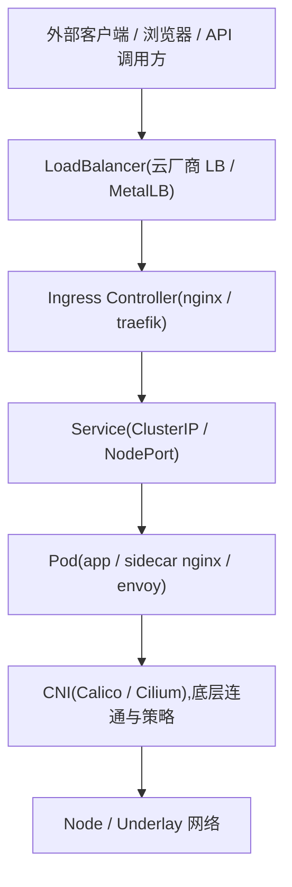

# K8s 网络模型与 CNI 选型

> 配套:[第 1 篇](1.安装部署-单节点.md) 记录集群安装与 config.yaml;入口与外部暴露在 [第 4 篇](4.入口与暴露.md);存储在 [第 5 篇](5.存储方案.md)。

CNI 插件的调用规范、数据面三大流派(封装/路由/eBPF)与实现原理,单独成篇:[第 10 篇](10.CNI插件原理.md)。本篇聚焦模型与选型。

## 一、这套集群的网络底座

RKE2 三节点集群:k8s-server-01/02/03(10.10.12.141-143,PVE 虚机各 4C/8G/60G,Ubuntu 26.04 LTS),RKE2 v1.35.6+rke2r1(Kubernetes v1.35.6),containerd 2.2.5-k3s2。config.yaml 里网络只写了一行 `cni: calico`。RKE2 默认 CNI 是 Canal(flannel 负责组网、Calico 只负责策略),显式指定 calico 之后,部署形态换成 tigera-operator 管理;加入节点时三台 config 的 `cni` 必须一致,否则 canal/calico 两套 chart 互删(事故实录见 [第 7 篇](7.容灾实测.md)):

```bash
kubectl get pods -n tigera-operator
kubectl get pods -n calico-system
```

2026-10-10 实测:tigera-operator 独占 `tigera-operator` 命名空间,Calico 组件 Pod 全在 `calico-system`,镜像为 `docker.io/rancher/mirrored-calico-*` v3.32.0,全部 Running。旧笔记里 `kubectl get pods -n kube-system -l k8s-app=calico-node` 这类验证命令对应的是 manifest 直装年代,在 RKE2 下查不到任何东西。

网段:Pod 网段 10.42.0.0/16(cluster-cidr),Service 网段 10.43.0.0/16(service-cidr),均为 RKE2 默认值。封装模式已实测(2026-10-11,三节点):`installation default` 的 ipPools 为 `encapsulation: VXLAN`——RKE2 的 calico v3.32 默认走 VXLAN 而非 IPIP,防火墙放行的是 4789/udp,不是 IP 协议 4:

```bash
kubectl -n calico-system get installation default \
  -o jsonpath="{.spec.calicoNetwork.ipPools[0].encapsulation}"   # 实测输出: VXLAN
```

这条改写了"calico 默认 IPIP"的常见说法:manifest 直装年代的默认与 RKE2 chart 的默认不同,以 installation 对象为准。

## 二、分层:谁在哪一层

Calico、Service LoadBalancer、Ingress、sidecar nginx 经常被放在一起讨论,但不在同一层。层次不分,会出现四种典型误认:把 LoadBalancer 当成网关本身;把 Ingress 当成所有暴露方式的总称;把 sidecar nginx 当成 Pod 内版 Ingress;把 Calico / Cilium 当成对外流量入口组件。

按流量路径把组件排开:



四类组件、两类流量:

| 分类 | 组件 | 职责 |
| --- | --- | --- |
| 底层网络 | Calico / Cilium | Pod IP 分配、跨节点可达性、NetworkPolicy |
| 服务抽象 | Service | 一组 Pod 的稳定虚拟 IP 与负载均衡 |
| 集群入口 | LoadBalancer / Ingress | 外部流量引入、七层路由 |
| Pod 内局部代理 | sidecar nginx | 单个应用的反向代理与包装 |

- 东西向(East-West):集群内部互访,Pod A → Pod B、Pod A → Service → Pod B;
- 南北向(North-South):外部进集群,浏览器 → LB → Ingress → Service → Pod。

判断口径:凡解决 Pod 之间怎么互通的问题,在东西向;凡解决外部请求怎么进来的问题,在南北向。

## 三、东西向:CNI 承担的部分

东西向是基础盘。这层不通,后面的 Service、Ingress、Gateway 都只是逻辑对象,流量到不了 Pod。

### 3.1 Pod 到 Pod

```text
 Pod A (Node 1)                                Pod B (Node 2)
 10.42.1.15                                    10.42.2.23
     |                                             ^
     v                                             |
   [veth]                                        [veth]
     |                                             ^
     v                                             |
 [Node 1 网络栈] ---- Underlay / Overlay ---- [Node 2 网络栈]
            \                                      /
             +---------- Calico / Cilium ---------+
                    路由、封装、策略、转发
```

CNI 在这层的职责:

- 为 Pod 分配 IP(这套集群来自 10.42.0.0/16);
- 建立节点之间 Pod 网段的可达性;
- 决定走原生路由还是 Overlay(VXLAN、Geneve、IPIP);
- 执行 NetworkPolicy;
- 部分场景下接管 Service 负载均衡,替掉 kube-proxy。

### 3.2 Pod 访问 Service

```text
Pod A
  |
  v
Service VIP (ClusterIP)
  +----> Pod B1
  +----> Pod B2
  +----> Pod B3
```

调用方只看到一个稳定的 ClusterIP,底层要解决三件事:谁来把 VIP 映射到真实后端;后端跨不跨节点;回包路径是否可达、会不会绕路。这部分传统上由 kube-proxy 写 iptables / IPVS 规则完成;Cilium 可以由 eBPF 直接在内核完成,Calico 也提供 eBPF 数据面作为可选项。

### 3.3 Service 与 CNI 的分工

Service 解决"该访问哪个逻辑服务",CNI 解决"流量到底怎么到那个 Pod"。推论两条:Cilium / Calico 不是公网入口,也不是"替代 Ingress 的一般答案";Service 本身不是网络插件,它是抽象,真正让流量跑起来的是 CNI 与节点数据面。

## 四、南北向:LoadBalancer、Ingress、Service 的接力

### 4.1 主链路

```text
Client -> Public IP / VIP -> LoadBalancer -> Ingress Controller -> Service -> Pod
```

链路里每层解决的问题不同:LB 负责"流量进得来",Ingress 负责"进来之后按业务规则分发",Service 负责后端组抽象,Pod 承载应用。

### 4.2 LoadBalancer:四层入口

本质是把集群服务暴露到集群外部,通常偏四层。常见实现:云厂商的 SLB / ELB / NLB;裸机上的 MetalLB,通过 BGP 或二层公告把 VIP 广播出去。

它负责:分配集群外可访问的 IP / VIP,把流量送到某个节点或某组后端,提供基础四层转发。它通常不负责:按域名路由、按 URL 路径路由、TLS 终止与复杂七层规则。

### 4.3 Ingress:七层分发规则

```text
                   +-------------------------------+
Client ---> LB --->| Ingress Controller            |
                   |                               |
                   | host=a.example.com ----------> Service A -> Pod A
                   | host=b.example.com ----------> Service B -> Pod B
                   | path=/api -------------------> Service C -> Pod C
                   +-------------------------------+
```

Ingress 是 API 对象,真正干活的是 Ingress Controller。能力范围:域名转发、路径转发、TLS 终止、URL 重写,以及限流、鉴权、灰度等扩展。API 与实现的分野、2026 年的选型状态,集中在 [第 4 篇](4.入口与暴露.md) 讨论。

### 4.4 Service 在链路中的位置

看到 Client → Ingress → Pod 就以为 Ingress 直指 Pod,通常中间还有一层:Ingress Controller → Service → Pod。Service 在这里维护后端 Pod 组、解耦入口配置与 Pod 生命周期,Ingress Controller 不必感知每个 Pod 的增减。

### 4.5 三种暴露方式对照

| 方式 | 层次 | 作用 |
| --- | --- | --- |
| NodePort | 暴露方式 | 在每个节点打开固定端口,把流量送进 Service |
| LoadBalancer | 外部入口 | 分配对外 IP / VIP,做四层转发 |
| Ingress | 七层路由 | 按域名、路径、TLS 把入口流量分发到不同 Service |

### 4.6 常见部署形态

```text
形态一(云上):Internet -> Cloud LoadBalancer -> Ingress Controller -> Service -> Pod
形态二(裸机):Internet -> MetalLB / BGP VIP -> Ingress Controller -> Service -> Pod
形态三(直挂):Client -> LoadBalancer Service -> Pod
```

形态三适合只有一个服务要对外、不需要域名/路径复用、不需要复杂七层规则的场景,直接 `type: LoadBalancer` 更省事。裸机环境比云上多一道题:没有托管 LB,VIP 公告与流量引入得自己解决。这套 PVE 单节点落在形态二与形态三之间——入口暂由节点上的 rke2-ingress-nginx 承接,外部尚无 LB 层,取舍见 [第 4 篇](4.入口与暴露.md)。

## 五、sidecar nginx:Pod 内局部代理

它容易被误当成入口,纯粹因为名字里也有 nginx。

```text
Pod
 +-------------------------------------------------+
 |                                                 |
 |  nginx sidecar:80  --->  app container:8080     |
 |       |                    ^                    |
 |       +------ localhost ---+                    |
 |                                                 |
 +-------------------------------------------------+
```

sidecar 与业务容器共享同一个 Pod 网络命名空间,转发走 localhost。它解决的是单个 Pod 内部的局部代理:给老应用补反向代理、静态资源由 nginx 直接返回、gzip / 缓存 / header 处理、简单路径改写、对单个应用做局部访问控制。它的视角是"这个应用该怎么被包装",不是"集群入口流量该怎么调度"。

| 维度 | sidecar nginx | Ingress nginx |
| --- | --- | --- |
| 所在位置 | Pod 内 | 集群入口层 |
| 服务范围 | 单个 Pod / 单个应用 | 多服务、多域名、多路径 |
| 主要职责 | 局部代理、兼容、包装 | 统一入口、路由、TLS、治理 |
| 配置影响面 | 局部 | 全局 |

适用边界:单应用有特殊代理定制需求、老系统难以改造只能 Pod 内补代理,值得加;只是想统一入口控制、只是需要 TLS 或域名路由,应该去入口层解决。给每个服务机械加 sidecar 的后果是每个 Pod 多一个进程和配置文件、链路变长、故障点增加,排障时先得分清问题在 Ingress、Service 还是 sidecar。

## 六、排障:按层定位

排障别一上来翻 Ingress 日志,按链路从上往下过。

外部访问失败:

```text
1. LoadBalancer IP / VIP 是否可达
2. Ingress Controller Pod 是否正常
3. Ingress 规则是否命中
4. Service endpoints 是否存在
5. 后端 Pod 是否就绪
6. Pod 所在节点之间网络是否正常
```

集群内部服务调用失败:

```text
1. DNS 是否解析到正确的 Service(本集群 CoreDNS 已实测解析 kubernetes.default.svc 正常)
2. Service endpoints 是否存在
3. NetworkPolicy 是否拦截
4. Pod 到 Pod 跨节点网络是否可达
5. CNI 数据面是否异常(看 calico-system 命名空间的 Pod)
```

顺序背后的思路:先看上一层逻辑对象是否正确,再看下一层底层连通是否正常;别把所有问题都归因给 Ingress 或 CNI。

## 七、CNI 选型:Calico 与 Cilium

### 7.1 两种数据面思路

**Calico** 走传统网络工程路线:三层路由模型,依赖路由表、iptables、BGP;Overlay 可选(IPIP / VXLAN),原生路由成熟;NetworkPolicy 实现成熟。优点是稳定、与传统网络概念对齐,运维能沿着路由表和策略链排查;代价是规则量大之后 iptables 的维护与排查成本上升,可观测性、L7 策略、内核内加速弱于 Cilium。

**Cilium** 走内核数据面编程路线:基于 eBPF,转发、策略、负载均衡都在内核完成;Hubble 提供全链路可观测(服务依赖图、流量日志);策略可扩展到 L7(HTTP、gRPC、Kafka)与 DNS。优点是策略执行路径短、性能高、可观测强,大规模微服务场景优势明显;代价是强依赖内核 eBPF 能力(社区推荐 5.10+),运维要接受"不再只看路由表和 iptables"的排障方式。

### 7.2 能力对照

| 维度 | Calico | Cilium |
| --- | --- | --- |
| 数据面 | Linux 路由 + iptables(eBPF 模式可选) | eBPF / XDP |
| 路由模式 | BGP 原生路由;Overlay:IPIP / VXLAN | 原生路由;Overlay:VXLAN / Geneve |
| Service 负载均衡 | 由 kube-proxy 承担(eBPF 模式可接管) | eBPF kubeProxyReplacement 可整体替掉 kube-proxy |
| 策略层级 | L3 / L4,完整 NetworkPolicy | L3 / L4 + L7(HTTP、gRPC、Kafka)+ DNS 策略 |
| 可观测性 | Felix 日志、Prometheus 指标 | Hubble,服务级依赖图与流量日志 |
| 内核要求 | 标准 Linux 网络能力即可 | 依赖 eBPF,推荐 5.10+ |
| 非 K8s 环境 | 支持(宿主机、OpenStack、裸金属) | 社区版支持有限 |
| 安装 | 简单,标准 CNI | 中等,需先确认内核能力 |

口径备注:iptables 在 Calico 里用于策略执行,IPVS 则是 kube-proxy 的一种转发模式,不属于 Calico 的组成部分——不少对比资料把两者混在 Calico 一栏,查资料时留意。

### 7.3 性能口径

社区基准的自述口径:eBPF 数据面包转发率比 iptables 高一个量级(常见引用 8M+ pps 对 1–2M pps),策略在内核内执行的开销更低。这组数字摘自社区基准文章,笔者未在本文档环境复测;Calico 启用 eBPF 模式后差距会收窄。把它当量级参考即可,真要定论得在目标环境压测。

### 7.4 场景推荐与这套集群的决策

| 场景 | 倾向 |
| --- | --- |
| 传统生产环境,团队熟悉路由 / BGP / iptables | Calico |
| 大规模微服务,重可观测性与 L7 策略 | Cilium |
| 稳定性优先,运维经验以传统网络为主 | Calico |
| 已确定走 eBPF 一体化(入口 + 策略 + 观测) | Cilium |
| 需要原生路由打通现有网络 / 混合云 | Calico |

这套集群的决策:**Calico**,经 config.yaml `cni: calico` 固化。理由:单节点负载用不上 eBPF 的规模收益;Calico 在 RKE2 是打包组件,镜像走 `rancher/mirrored-*` 通道;传统网络模型排障路径清楚。验证状态:2026-10-10 实测 v3.32.0 全部 Running,Service 链路连通。日后若入口要迁 Gateway API 且想网络栈一体化,再评估 Cilium——那时内核版本与运维成本才真正计入。

两套都装、拿 Calico 做路由底层加 Cilium 做策略的老混搭,社区已不作为支持路径,不考虑。

## 七、跨节点带宽实测(2026-10-11,iperf3)

| 路径 | 配置 | 结果 |
| --- | --- | --- |
| 宿主机裸速(节点间) | 8 流,2M 窗口 | 5.28 Gbits/sec |
| Pod 间跨节点(calico VXLAN) | 同参数 | 0.6-1.8 Gbits/sec,平均 ~1.4G,重传活跃 |
| Pod 间同节点(veth 直连) | 同参数 | 7.33 Gbits/sec |

结论:VXLAN 封装 + MTU 1450 的实际代价约为裸速的 1/4-2/3,且重传明显——对带宽敏感的中间件(Kafka/ES 同步复制)要么接受,要么切 BGP 直接路由模式消除封装。单流小窗口时数字更低(590M),iperf3 参数(-P 8 -w 2M)对结果影响巨大,对比测试必须同参数。
