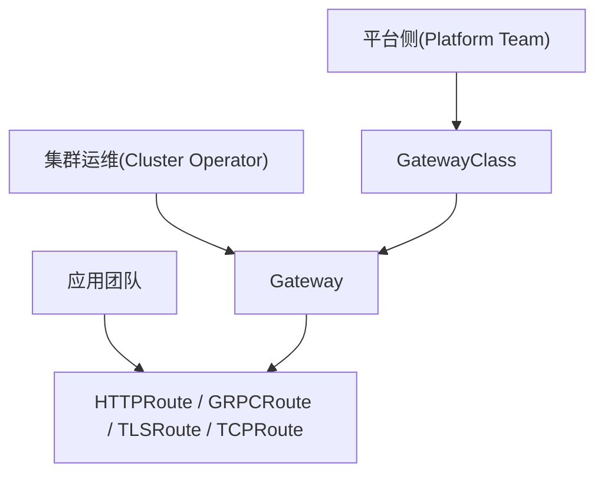

# K8s 入口与暴露

RKE2 三节点集群(k8s-server-01/02/03,10.10.12.141-143,RKE2 v1.35.6+rke2r1)的入口组件目前是集群内置的 rke2-ingress-nginx:默认安装、Pod Running、位于 kube-system。它的上游 ingress-nginx 已于 2026-03 退役,Ingress API 的官方口径是保留但冻结、新项目优先 Gateway API——本篇一部分记录现状,一部分记录去向。实测结论出自 2026-10-10/11 的单节点与三节点验证。

## 一、Service 的四种类型与 kube-proxy

### 1.1 四种类型

| 类型 | 行为 | 典型用途 |
| --- | --- | --- |
| ClusterIP(默认) | 分配仅集群内可达的虚拟 IP | 服务间互访 |
| NodePort | 在每个节点开固定端口(默认 30000-32767),转给 ClusterIP | 调试、内网短期暴露、给外部 LB 当后端 |
| LoadBalancer | 在 NodePort 之上向外部 LB 申请一个可达 IP | 集群外直接访问某个服务 |
| ExternalName | DNS 层返回 CNAME,不产生转发规则 | 把外部服务映射成集群内名字 |

前三种的转发规则都出自 kube-proxy,ExternalName 不经过它。

### 1.2 kube-proxy 在数据面写的什么

kube-proxy 监听 Service 与 EndpointSlice 的变化,把"ClusterIP:端口 → 某个具体 Pod"的转发规则写进每个节点。RKE2 默认 iptables 模式;规则量大后可切 IPVS(`kube-proxy-arg: proxy-mode=ipvs`);换 Cilium 并启用 kubeProxyReplacement 后,这一整段可由 eBPF 接管(见 [第 3 篇](3.网络模型与CNI选型.md))。实测(2026-10-11):kube-proxy 以静态 Pod 运行,启动参数带 `--proxy-mode=iptables`,未改任何默认值。

东西向 Service 链路已在单节点实测打通:CoreDNS 解析 kubernetes.default.svc 正常,Service ClusterIP TCP 连通;rke2-metrics-server 在跑,`kubectl top` 可用。集群还内置 rke2-coredns 与 rke2-snapshot-controller,同样处于 Running。

## 二、入口能力的演进

### 2.1 NodePort → LoadBalancer → Ingress

```text
NodePort:     Client -> NodeIP:NodePort -> Service -> Pod
LoadBalancer: Client -> LB IP/VIP -> Service -> Pod
Ingress:      Client -> LB -> Ingress Controller -> Service -> Pod
```

NodePort 是最原始的暴露:无需额外组件,但端口管理粗糙,多域名多路径无从谈起,外部通常还得再套一层 LB。LoadBalancer 补上"稳定的对外入口 IP",但仍偏四层,把流量带进来之后不管分发。等需求变成多站点共用入口、按域名 / 路径转发、统一 TLS 终止,就有了 Ingress:应用团队用 Kubernetes API 声明七层路由,多个服务共享同一个入口。

### 2.2 先分清 API 和实现

Ingress 是 Kubernetes API 对象,Gateway API 同样是一套标准 CRD;真正处理流量的是 controller / 数据面实现。ingress-nginx、Traefik、HAProxy、Cilium、AWS Load Balancer Controller 都是实现。"怎么声明规则"与"谁把规则变成可工作的流量转发"分开看,选型才不会绕晕。

### 2.3 2026 年的三个时间点事实

- Ingress API 保留,但已冻结,不再加功能;官方文档建议新项目优先 Gateway API(截至 2026-05 的口径);
- ingress-nginx(Kubernetes 社区维护的 Ingress-NGINX)于 2026-03 退役,不再发布 bugfix 与安全更新(官方声明见文末参考);
- Ingress-NGINX 与 NGINX Ingress Controller 不是同一个项目——后者是 F5 / nginx org 维护的另一个实现。口头讨论常年混用这两个名字,选型时按仓库和文档对号。

对选型的直接含义:Ingress 不是不能用,但新设计不应再把 ingress-nginx 当默认选项;要同时想"现在怎么接入"和"将来怎么迁 Gateway API"。

### 2.4 Ingress 的边界与 Gateway API 的模型

Ingress 的边界:规则表达力有限;高级能力大量依赖各 controller 的私有 annotation,同一份 YAML 换个实现经常要重写;平台、运维、应用三方的权限边界在 API 里没有承载点。

Gateway API 对此的解法是拆资源、分角色:



谁决定入口类型、谁决定监听器、谁挂自己的路由,边界可以用 RBAC 和平台流程收住;超时、重写、流量切分这类常用能力进了标准,不再靠堆 annotation。注意它是 Ingress 的后继而非自动兼容层,迁移要做一次显式的资源转换。

### 2.5 实现横评

| 方案 | 定位 | 现状 | 适用 |
| --- | --- | --- | --- |
| ingress-nginx | 历史最普及的 Ingress controller | 2026-03 退役 | 存量过渡,不建议新上 |
| Traefik | 代理 + K8s 入口控制器 | 活跃;Ingress / 私有 CRD / Gateway API 三套用法并存 | 中小到中大型,重易用与动态配置 |
| HAProxy Kubernetes Ingress | 基于 HAProxy 的入口控制器 | 活跃;经典 Ingress 与 Gateway API 双支持 | 稳定优先、显式配置 |
| Cilium Ingress / Gateway | 与 CNI 一体的入口能力 | 活跃 | 已用 Cilium,想统一网络栈 |
| Gateway API | 下一代标准接口 | 官方主推 | 新项目;需配一个具体实现落地 |

Traefik 有一处典型特征:从标准 Ingress 滑向它自家的 IngressRoute / Middleware 私有 CRD 很容易,大量使用后迁移就不再是无痛切换。Cilium 的入口层则与 eBPF、网络策略、源地址可见性整合得深,东西向与南北向的观测、策略模型统一;目标只是"找个简单入口控制器"的话,它不算最轻的答案。

短判断:新项目从 Gateway API + 活跃实现想起;已用 Cilium 优先评估自家 Gateway;要通用易用看 Traefik,要稳定和显式控制看 HAProxy;ingress-nginx 只做存量。

## 三、这套集群的取舍

### 3.1 入口:先用内置 rke2-ingress-nginx

RKE2 把 ingress-nginx 作为打包组件内置(命名空间 kube-system),实测默认安装。占用 80/443 的方式已实测(2026-10-11):**DaemonSet + hostPort**,每台节点直接监听 80/443,没有任何 LoadBalancer/NodePort Service——流量从任意节点 IP 进来,由 Host 头路由到后端。业务验证:`curl -H "Host: demo.k8s.lab" http://<任一节点IP>/` 命中后端(应用示例见 [第 6 篇](6.应用部署实战.md))。

决策:单节点负载继续用内置 ingress-nginx 承接 Ingress 规则,不额外引入入口组件;上游退役的风险先记在"RKE2 chart 后续是否跟进"上,这一点待观察。新入口规则暂仍走 Ingress API——Gateway API 在本集群还没有实现,为少量规则先装一套新入口栈不划算。

### 3.2 LoadBalancer:ServiceLB 还是 MetalLB

LoadBalancer 型 Service 需要有人应答"对外 IP 从哪来"。实测(2026-10-11):RKE2 v1.35 **不再内置 ServiceLB**——集群里没有 rke2-servicelb chart、没有 svclb DaemonSet,建 LoadBalancer 型 Service 会一直 Pending 无人认领。结论:要 LoadBalancer 就必须自装 MetalLB(IP 池可管理,加节点不用换方案,待实测)。

两者取舍:

| | ServiceLB(klipper-lb) | MetalLB |
| --- | --- | --- |
| 部署 | v1.35 起不再内置 | 需自行安装 |
| 对外地址 | 直接用节点 IP | 从 IP 池分配,L2(ARP/NDP)或 BGP 公告 |
| 限制 | 同一端口全集群只能落在一个 LoadBalancer Service | 无此限制 |
| 适用 | 单节点、对外服务少 | 需要 VIP 漂移、多服务共用入口 |

决策:这套集群暂不依赖 LoadBalancer 型 Service,外部访问收敛在 ingress-nginx 一个入口上;真要加,单节点场景倾向 MetalLB——IP 池可管理,日后加节点不用换方案。两者目前都未部署,均待实测。

### 3.3 Gateway API:路径清楚,暂不落地

RKE2 不默认安装 Gateway API CRD。落地 = 安装 CRD + 选一个实现:已用 Cilium 走 Cilium Gateway;通用代理选 Traefik 或 HAProxy(支持情况见 2.5 的横评表);云上跟随厂商 controller。本集群未部署,待实测。先不落地的理由与 3.1 相同:规则量小、实现未定,当下 Ingress 够用;到多站点 / 多团队分工那天,Gateway API 的角色分层才开始值钱,届时优先选 conformance 达标程度高的实现,避免再走一轮私有 annotation。

## 四、参照:云上 ALB 直连 NodePort(AWS)

"外部 LB 直接打到节点端口"在 AWS 是正路而非偏方。AWS Load Balancer Controller 的 instance 模式(默认)做的正是这件事:ALB 注册 worker 节点,流量走 ALB → NodeIP:NodePort → kube-proxy / Service → Pod。不少在"用 Ingress"的团队,数据路径底层就是 ALB → NodePort。

代价同样明确:链路多一跳,某些情况会跨节点二次转发;健康检查打在 NodePort 上,"目标健康"只代表这条 NodePort 路径通,不等于 Pod 自身的健康状态;Fargate 与 Hybrid Nodes 只支持 ip target。EKS 最佳实践当前更推荐 ip target:直送 Pod,链路更短,健康检查更直接,监控排障更简单。结论:可行,instance 模式本来就是默认做法;追求短路径与清晰健康检查时,优先评估 ip target。

这套 PVE 环境没有云 LB,同构问题是"外部硬件 LB / 反代直连节点端口"。单节点上 ingress-nginx 已在节点层听入口,再垫一层属于堆叠,未采用;日后多节点做高可用入口时,再在"外部 LB → NodePort"与 MetalLB VIP 之间选。

## 五、常见误区

- Ingress 等于 ingress-nginx:Ingress 是 API,ingress-nginx 只是实现之一,且已退役;
- Gateway API 能直接替换现有 Ingress YAML:不能,资源模型不同,迁移要显式转换;
- 上了云 LB 就不用懂集群入口:流量进了集群仍要过 Service、NodePort、健康检查,排障绕不开;
- 私有 annotation 越多方案越强:annotation 越多,与具体实现绑得越深,迁移成本越高;
- 入口层无限堆叠(硬件 LB → 云 LB → Ingress → sidecar → app):每层职责说不清,证书配在哪、真实客户端 IP 丢在哪、超时重试归谁管、故障查哪层,就全说不清。

## 六、参考

- Kubernetes Ingress:<https://kubernetes.io/docs/concepts/services-networking/ingress/>
- Gateway API 介绍:<https://gateway-api.sigs.k8s.io/docs/introduction/>
- Ingress-NGINX 退役声明:<https://kubernetes.io/blog/2026/01/29/ingress-nginx-statement/>
- Traefik Kubernetes Gateway Provider:<https://doc.traefik.io/traefik/providers/kubernetes-gateway/>
- HAProxy Kubernetes Ingress Controller:<https://www.haproxy.com/documentation/kubernetes-ingress/overview/>
- Cilium Gateway API:<https://docs.cilium.io/en/latest/network/servicemesh/gateway-api/gateway-api/>
- Amazon EKS 负载均衡最佳实践:<https://docs.aws.amazon.com/eks/latest/best-practices/load-balancing.html>
