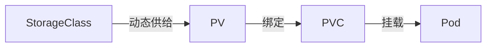
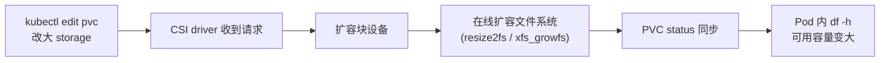

# 存储方案

环境锚点:单节点 RKE2(RKE2 v1.35.6+rke2r1,Kubernetes v1.35.6,Ubuntu 26.04 LTS,PVE 虚机 k8s-server-01 / 10.10.12.141),数据盘 local-lvm thin 60G。笔者在这个集群上实测 `kubectl get storageclass` 的输出是空的——RKE2 v1.35 默认不装 local-path-provisioner,集群没有任何预置 StorageClass。旧版笔记"local-path 开箱即用"的说法已过时,装 local-path 本身是明确的安装步骤(见第四节)。一个利好:RKE2 内置 rke2-snapshot-controller,VolumeSnapshot CRD 已就绪,Longhorn 等依赖它做快照的插件不用再补装。helm 可用,安装见 [第 2 篇](2.安装部署-集群.md)。

## 一、三种存储形态

| 形态 | K8s 访问模式 | 代表方案 | 典型用途 |
| --- | --- | --- | --- |
| 块存储 | RWO(ReadWriteOnce) | local-path、OpenEBS LocalPV、Longhorn、Mayastor | 数据库、消息队列、ES 数据目录——一个卷同一时刻只挂到一个节点 |
| 文件存储 | RWX(ReadWriteMany) | NFS、Longhorn RWX 卷 | 多个 Pod 跨节点共享同一目录:上传文件、静态资源、多副本 Web 共用数据 |
| 对象存储 | 不走 PV/PVC,应用直连 S3 HTTP API | MinIO(自建)、公有云桶 | 备份数据、镜像仓库、日志归档 |

RWO 卷由 kubelet + CSI 挂到运行 Pod 的节点,Pod 漂移卷跟着走,但同一时刻只在一个节点上。RWX 靠服务端(NFS server,或 Longhorn 内置的 share-manager)让多节点同时挂载,代价是性能与运维复杂度。对象存储在 K8s 卷体系之外:CSI 形式的 s3 驱动(基于 FUSE)能把它伪装成卷,高 IO 场景不适用,应用直连 S3 API 才是常态。笔者已有的对象存储实践单独成篇,见[对象存储篇](../../技术方案/对象存储/1.优雅的使用对象存储.md)。

## 二、PV / PVC / SC / CSI

Kubernetes 把存储的提供和使用解耦,由三个对象协作:



### 1. PV(PersistentVolume)

集群里的实际存储资源。一块磁盘、一个 NFS 共享目录、一个云盘,都是 PV。

- 独立于任何 Pod 存在,Pod 删了 PV 还在。
- 可以静态创建(管理员手工建),也可以动态创建(由 StorageClass 驱动 provisioner 自动生成)。

### 2. PVC(PersistentVolumeClaim)

应用发出的存储请求。"要 5Gi、ReadWriteOnce 的存储"就是一个 PVC。

- PVC 创建后,K8s 找匹配的 PV 绑定。
- 绑定后,Pod 通过 PVC 引用这个卷。

### 3. SC(StorageClass)

动态供给模板,定义"用什么后端、什么参数"。PVC 引用 SC 后自动创建 PV,不需要管理员手工建。以 Longhorn 的 SC 为例:

```yaml
apiVersion: storage.k8s.io/v1
kind: StorageClass
metadata:
  name: longhorn
provisioner: driver.longhorn.io
allowVolumeExpansion: true    # 是否允许在线扩容
reclaimPolicy: Delete         # PV 释放后是删除还是保留
volumeBindingMode: Immediate  # 立即创建 PV,还是等 Pod 调度后再创建
parameters:
  numberOfReplicas: "3"
  fsType: "ext4"
```

### 4. 生命周期

```
创建 SC → 创建 PVC(引用 SC)→ provisioner 自动创建 PV → PV 绑定 PVC → Pod 挂载 PVC
```

| 阶段 | 谁在做 | 做了什么 |
|------|--------|----------|
| SC 定义 | 管理员 | 声明后端 provisioner 和参数(副本数、盘类型等) |
| PVC 创建 | 用户/开发者 | 声明容量、访问模式、引用哪个 SC |
| PV 创建 | provisioner | 按 SC 参数在后端创建实际存储卷,生成 PV 对象 |
| 绑定 | K8s controller | 把 PV 和 PVC 一对一绑定 |
| 挂载 | kubelet + CSI | 把卷挂到 Pod 所在的节点上 |

### 5. 相关名词

| 名词 | 说明 |
|------|------|
| **PV / PVC / SC** | 实际存储资源 / 存储申请 / 动态供给策略模板 |
| **CSI** | Container Storage Interface,存储插件标准接口(Longhorn、OpenEBS 都通过 CSI 接入) |
| **provisioner** | CSI driver 中负责根据 SC 自动创建 PV 的组件 |
| **accessModes** | 卷访问模式全集:RWO / ROX(ReadOnlyMany)/ RWX / RWOP(ReadWriteOncePod,v1.22+ alpha 起步) |
| **VolumeSnapshot** | 卷快照 CRD,可基于 PVC 创建快照,也可从快照恢复新 PVC |
| **VolumeSnapshotContent** | 快照对应的实际存储数据 |
| **VolumeSnapshotClass** | 快照供给策略,类似 SC 之于 PV |
| **hostPath** | 直接挂载节点本地路径,Pod 漂移则数据不在,仅用于开发/测试 |
| **emptyDir** | Pod 生命周期内的临时存储,Pod 删除即销毁 |
| **configMap / secret** | 配置文件/密钥以只读卷形式挂载到 Pod |
| **topology** | 存储拓扑感知,让卷和 Pod 调度到同一个 zone/node |
| **WaitForFirstConsumer** | SC 的 volumeBindingMode,等 Pod 调度后再创建 PV,避免跨可用区挂载 |
| **reclaimPolicy** | PV 释放后的处理:Delete(删除)/ Retain(保留);旧文档里的 Recycle 已废弃,新集群不用考虑 |

## 三、扩容

### 1. 唯一入口是 PVC

前置条件:StorageClass 设置了 `allowVolumeExpansion: true`。确认:

```bash
kubectl get sc <sc-name> -o jsonpath='{.allowVolumeExpansion}'
# 期望输出: true
```

只有从 PVC 端发起扩容,K8s 才会通知 CSI driver 执行实际扩容。绕过 PVC 直接动存储后端(比如 Longhorn Web UI),不会增加 Pod 可用容量。

```bash
kubectl edit pvc <pvc-name>
# 把 spec.resources.requests.storage 改大,例如 10Gi → 20Gi
```

保存后流程全自动,无需重启 Pod:



在 Longhorn Web UI 上改 Volume 大小是错误方式:只改了底层块设备,不同步到 PVC,也不扩文件系统。

| 组件 | 状态 |
|------|------|
| Longhorn Volume | 显示新大小 |
| PVC `spec.resources.requests.storage` | 仍是旧值 |
| 文件系统 | 未扩容 |
| Pod 内 `df -h` 可用容量 | 不变 |

### 2. 扩容限制

| 限制 | 说明 |
|------|------|
| 只能扩大不能缩小 | PVC 扩容后不支持缩容,`spec.resources.requests.storage` 不能改小 |
| 存储后端容量必须充足 | 节点磁盘空间不够,扩容会失败 |
| 扩容过程不可中断 | 在线编辑 PVC 后马上删掉,可能导致数据丢失 |
| RWO 卷在线扩容 | ReadWriteOnce 卷扩容时 Pod 不需要重启 |
| 部分 accessMode 不支持在线 | ReadOnlyMany 卷的在线扩容行为取决于具体 CSI 实现 |

### 3. Local PV 的扩容能力差别很大

| Local PV 类型 | 支持在线扩容 | 原因 |
|---------------|:----------:|------|
| **static local PV**(sig-storage-local-static-provisioner) | 否 | 只是静态发现本地盘的 provisioner,没有 CSI controller 处理 resize |
| **OpenEBS HostPath** | 否 | 基于目录,没有块设备层,不具备 resize 能力 |
| **OpenEBS Device** | 否 | 独占裸盘直接给 Pod,不经过 LVM/ZFS 等可 resize 的卷管理层 |
| **OpenEBS Rawfile** | 否 | 文件模拟块设备,定位上不支持扩容 |
| **OpenEBS LVM LocalPV** | **是** | 底层是 LVM Logical Volume,CSI driver 可在线扩 LV + 文件系统 |
| **OpenEBS ZFS LocalPV** | **是** | 底层是 ZFS dataset,CSI driver 可在线扩 dataset + 文件系统 |
| **LVM CSI**(如 metal-stack) | **是** | 跟 OpenEBS LVM 同理,LV 天然支持在线扩容 |

规律:底层是 LVM 或 ZFS 这类有卷管理能力的,支持扩容;底层是目录或裸盘的,不支持。

支持扩容的引擎,同样从 PVC 入口改。前提是 SC 开了 `allowVolumeExpansion`,且 VG / ZFS pool 里有剩余空间。以 OpenEBS LVM 为例:

```yaml
apiVersion: storage.k8s.io/v1
kind: StorageClass
metadata:
  name: openebs-lvm
allowVolumeExpansion: true   # 必须开启
parameters:
  storage: lvm
  volgroup: openebs-vg
provisioner: local.csi.openebs.io
```

不支持扩容的引擎没有捷径,本质是一次数据迁移:

```
备份数据 → 删除 PVC + PV → 创建更大的 PV(或更大的目录/磁盘)→ 创建新 PVC → 恢复数据 → 重建 Pod
```

具体步骤取决于所用 Local PV 类型和备份恢复方式。例如 OpenEBS HostPath 的数据存在节点目录里,先 `rsync` 一份,换到大路径后 `rsync` 回去。

### 4. 状态检查与排查

```bash
# 查看所有 StorageClass 及是否支持扩容
kubectl get sc

# 查看特定 SC 详情(含 allowVolumeExpansion)
kubectl describe sc <sc-name>

# 看 PVC 容量是否已更新
kubectl get pvc <pvc-name>

# 看 PVC 详情,Conditions 会反映扩容状态
kubectl describe pvc <pvc-name>

# 查看 PVC 关联的 PV
kubectl get pv | grep <pvc-name>

# Longhorn 侧卷信息(装了 Longhorn 才有)
kubectl -n longhorn-system get volumes

# 进入 Pod 验证实际可用容量
kubectl exec -it <pod-name> -- df -h /mount-path
```

正常情况下 `kubectl edit pvc` 保存后几十秒内扩容完成。PVC 一直处于 `Resizing` 状态不消失,按序检查:

1. 对应 CSI 组件(longhorn-system / openebs namespace 下)是否正常运行
2. 节点磁盘空间是否足够
3. `kubectl describe pvc` 的 Events 中是否有错误信息

## 四、选型

| 方案 | 形态 / 访问模式 | 跨节点副本 | 快照/克隆 | 在线扩容 | 前置条件 | 适用场景 |
|------|----------------|:---:|:---:|:---:|---------|---------|
| local-path | 块,RWO(节点本地目录) | 无 | 无 | 否 | RKE2 v1.35 需手动安装 | 开发/测试、可重建的低价值数据,资源开销最小 |
| [OpenEBS LocalPV](plugins/openebs/README.md) | 块,RWO | 无 | 仅 LVM/ZFS 引擎 | 仅 LVM/ZFS | HostPath 无;LVM/ZFS 需节点预建 VG / ZFS pool | 应用自带高可用(DB 主从、ES、Cassandra),要本地盘性能 |
| [Longhorn](plugins/longhorn/README.md) | 块 RWO + 文件 RWX | 有(多节点) | 有(依赖 snapshot-controller,RKE2 已内置) | 是 | 每节点装 open-iscsi;数据目录用独立盘 | 存储层要高可用、快照、备份、Web UI 运维 |
| [NFS](plugins/nfs/README.md) | 文件,RWX | 取决于 NFS server | 无 | 否(server 端扩) | 已有 NFS export | 多 Pod 共享目录、下载/媒体等大文件低频 IO |

单节点集群的硬约束:副本无处可放,任何方案都给不出真正的跨节点冗余。Longhorn 在单节点上副本只能设 1,价值剩下快照、备份到外部 target(NFS/S3)和运维 UI——数据保护靠备份,不靠副本。Mayastor 等 Replicated 引擎需要多节点独占盘,单节点直接排除。

### 安装 local-path(RKE2 v1.35 的显式步骤,已实测)

manifest 方式安装,2026-10-11 实测版本 v0.0.37,master 分支 manifest 可直连:

```bash
kubectl apply -f https://raw.githubusercontent.com/rancher/local-path-provisioner/master/deploy/local-path-storage.yaml
kubectl patch storageclass local-path \
  -p '{"metadata":{"annotations":{"storageclass.kubernetes.io/is-default-class":"true"}}}'
```

manifest 默认把数据目录设在 `/opt/local-path-provisioner`(由同名 namespace 下的 ConfigMap 控制),数据盘场景把它改成挂载点路径。实测验证:provisioner Pod 约 1-2 分钟 Running;PVC 用 `WaitForFirstConsumer` 模式,Pod 调度后才 Bound;同 PVC 的多副本全部钉在卷所在节点(RWO 语义,实测见 [第 6 篇](6.应用部署实战.md)第 4 节):

```bash
kubectl -n local-path-storage get pods
kubectl get sc local-path
```

### 镜像源

这些插件的镜像散布在 docker.io / quay.io / ghcr.io / registry.k8s.io,内网或离线集群先核对镜像地址是否被 mirror 覆盖,配置见 [conf/registries.yaml](conf/registries.yaml)。

## 存储性能基准(2026-10-11,1GB 直写,持续补充)

| StorageClass | 顺序写(direct) | 备注 |
| --- | --- | --- |
| local-path | **108.8 MB/s** | 节点本地盘 thin |
| openebs-hostpath | 54.2 MB/s | 同为本地目录,路径/宿主负载不同即有差异 |
| openebs-lvm | 首测通过(供给/挂载/扩容),controller 多轮重启后 attach 回归,待排查 | 已知问题 |
| openebs-zfs / nfs / mayastor | 待补测 | 方法:dd 1G oflag=direct |

4K 随机读写与延迟的 fio 矩阵测试待做。
