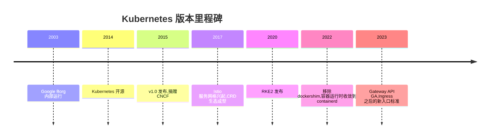

# Kubernetes 部署与运维(kubernetes)

> - **版本基线**:RKE2 v1.35.6+rke2r1(Kubernetes v1.35.6,containerd 2.2.5-k3s2),CNI 为 calico(tigera-operator 形态,v3.32.0 镜像),高可用入口为 kube-vip v1.2.4。安装走 rancher-mirror.rancher.cn,系统镜像走 DaoCloud/kubesre mirror(见 [conf/registries.yaml](conf/registries.yaml))。
> - **实测环境**:PVE 虚机 k8s-server-01/02/03(10.10.12.141-143,4C/8G/60G,vmbr1,网段 10.10.12.0/24)+ 集群 VIP 10.10.12.140,Ubuntu 26.04 LTS,2026-10-10。**实测覆盖**:单节点安装、证书轮换、kube-vip 静态 Pod 化、两台 server 经 VIP 加入、etcd 三成员、VIP 漂移(完整停机 20 秒内切换)。
> - **配置资产**:[conf/](conf/) 收 config-server/config-agent/registries/kubevip 四份在跑模板。

## 文章索引

| 编号 | 文章 | 内容 | 状态 |
| --- | --- | --- | --- |
| 1 | [安装部署-单节点](1.安装部署-单节点.md) | 最短路径拉起单 server,含系统前置/镜像加速/验证 | ✅ 已实测 |
| 2 | [安装部署-集群](2.安装部署-集群.md) | 证书轮换、kube-vip、server/agent 加入、etcd 验证、漂移实测 | ✅ 已实测 |
| 3 | [网络模型与CNI选型](3.网络模型与CNI选型.md) | 分层/流量拓扑、calico vs cilium | 已迁移,随集群复核 |
| 4 | [入口与暴露](4.入口与暴露.md) | Service/kube-proxy、ingress-nginx、ServiceLB/MetalLB、Gateway API | 已迁移,随集群复核 |
| 5 | [存储方案](5.存储方案.md) | 三种形态、PV/PVC/CSI、扩容、选型(v1.35 无预置 SC) | 已迁移,随集群复核 |
| 6 | [应用部署实战](6.应用部署实战.md) | Deployment/PVC/Ingress 全链路,local-path 安装,探针坑 | ✅ 已实测 |
| 7 | [容灾实测](7.容灾实测.md) | IPPool 事故复盘、快照全量恢复、对端重加入 | ✅ 已实测 |
| 8 | [日常运维与排障](8.日常运维与排障.md) | 体检清单、证书/升级/节点维护、排障字典 | ✅ 已实测 |
| 9 | [监控与告警](9.监控与告警.md) | kube-prometheus-stack 安装验证、关键对象、告警 | ✅ 已实测(告警外发待接) |
| 10 | [CNI插件原理](10.CNI插件原理.md) | CNI 规范、网卡的一生、数据面三流派、与 kube-proxy 分工 | ✅ 已实测 |
| 11 | [管理面板-Rancher](11.管理面板-Rancher.md) | v2.15.2 安装实录、三处部署修复、bootstrap 流程 | ⭐ 安装链已实测(首启等 catalog 拉取,选型弃 KubeSphere/kk) |

## 插件目录(plugins/)

单个插件的安装/验证/卸载;选型对比在第 5 篇与第 4 篇。

| 插件 | 用途 | 状态 |
| --- | --- | --- |
| [longhorn](plugins/longhorn/README.md) | 分布式块存储(RWO,跨节点副本) | ✅ 已实测(安装/供给/多副本拓扑;副本收敛依赖干净集群,本集群已卸载) |
| [openebs](plugins/openebs/README.md) | HostPath/LVM/ZFS/Mayastor 四引擎 | ✅ 已实测(Mayastor 含跨节点复制;LVM 含在线扩容) |
| [nfs](plugins/nfs/README.md) | NFS provisioner(RWX) | ✅ 已实测(跨节点读写) |
| [loki](plugins/loki/README.md) | 日志聚合(loki+promtail→Grafana) | ✅ 已实测 |
| [metallb](plugins/metallb/README.md) | LoadBalancer 实现(v1.35 已无 ServiceLB,要用必须装) | ✅ 已实测(含 10 万级 TCP 压测) |
| [cert-manager](plugins/cert-manager/README.md) | 证书签发(ingress/Rancher 前置) | ✅ 已实测 |
| [metrics-server](plugins/metrics-server/README.md) | kubectl top 数据源 | ✅ RKE2 内置(实测) |

## 阅读路径

从零搭:1(单节点)→ 2(集群化)→ 5(存储,业务上线前)→ 6 → 7;接手在跑的集群:8 → 3 → 4。

## 组件介绍

2014 年夏天,Google 把内部跑了十年的 Borg 集群管理经验开源成 Kubernetes——名字取自希腊语 kybernetes(舵手),Logo 是七辐船舵;Joe Beda、Brendan Burns、Craig McLuckie 三人以 Go 语言实现,2015 年发布 1.0 并捐给新成立的 CNCF,此后成为容器编排的事实标准。RKE2 是 Rancher 出品的 K8S 发行版(2020 年起):内置 containerd、CNI、etcd,默认配置按 CIS 基线收紧,以 systemd 服务与静态 Pod 组装控制面——组件都是上游原物,发行版只负责把它们按安全基线装好、管好证书与升级。

RKE2 与"裸 kubeadm"的差别集中在这几处,排查时按 RKE2 的形态找:控制面组件全部是静态 Pod(`kubectl get pods -n kube-system` 可见 etcd/apiserver 等),CNI 以 tigera-operator + HelmChart 交付(calico 组件在 `calico-system` 命名空间),ingress-nginx/metrics-server/snapshot-controller/coredns 为内置组件,系统组件镜像统一带 `rancher/mirrored-` 前缀。v1.35 起 local-path-provisioner 不再内置,集群默认没有 StorageClass。
