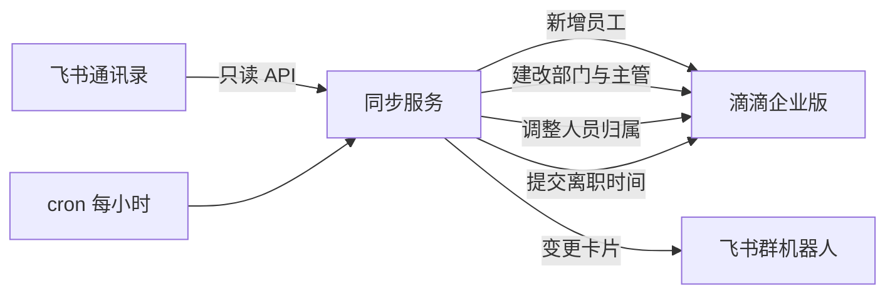
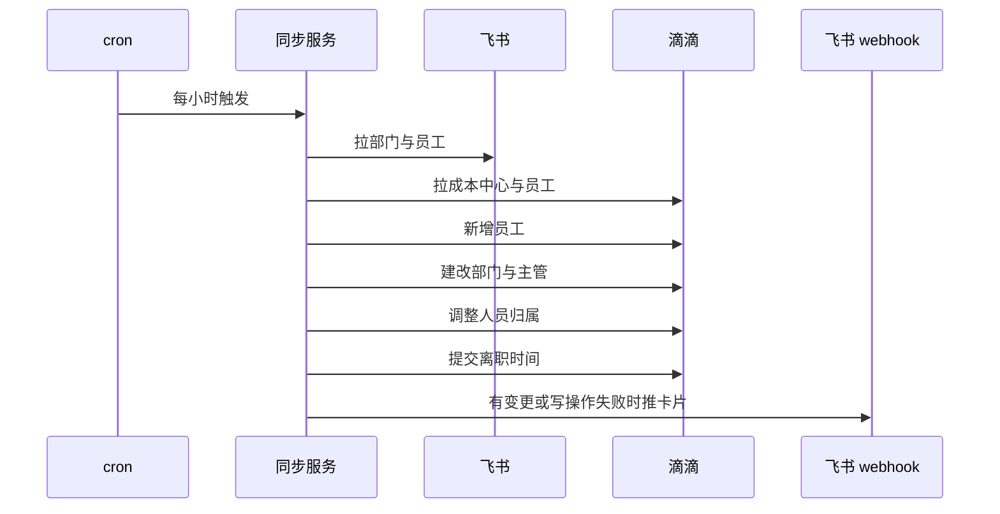

# 飞书到滴滴组织架构同步部署与运维

飞书通讯录是人员与部门的主数据源，滴滴企业版负责用车与商旅。服务每小时把飞书的新增员工、部门树、部门负责人、人员归属和离职状态同步到滴滴；写操作只做新增、修改和设置离职时间，不调用删除接口。

## 一、架构



| 阶段 | 组件 | 接口或端口 | 关键点 |
| --- | --- | --- | --- |
| 拉取飞书 | 企业自建应用 | `open.feishu.cn` HTTPS | 只读，路径白名单；通讯录权限范围全员 |
| 拉取滴滴 | 开放平台企业内部应用 | `api.es.xiaojukeji.com` HTTPS | IP 白名单；SHA256 签名，失败回退 MD5 |
| 中转服务 | Python 程序 | 本机进程，无监听端口 | 无数据库；状态文件落 `state/` |
| 定时触发 | root crontab | 每小时整点 | `flock` 防重叠 |
| 变更通知 | 飞书群机器人 | `FEISHU_WEBHOOK` | 有变更或写操作失败才推卡片 |



## 二、运行环境

- 飞书：企业自建应用，通讯录权限范围设为全员；至少需要 `contact:department.base:readonly`、`contact:user.base:readonly`、`contact:user.employee_id:readonly`、`contact:user.phone:readonly`。权限变更后要创建并发布新版本，管理员审批通过才生效。
- 滴滴：开放平台创建「企业内部应用」，类型选正式应用，没有测试环境；应用提交审核并上线后 `client_id` 才可用。服务器出口 IP `<PUBLIC_EGRESS_IP>` 要加入开放平台「开发配置 → 安全设置 → IP 白名单」。
- 服务器：`<SYNC_SERVER_IP>`，Python 3.14.4，部署目录 `/opt/lark2didi`；出口 IP 与滴滴白名单一致。
- 代码仓库：独立的私有仓库 `lark2didi`；`conf/.env` 随私有仓库管理，本文只写占位符。

## 三、配置

配置模板见 [conf/env.example](conf/env.example)，复制为 `/opt/lark2didi/conf/.env`，权限 `600`。

```dotenv
app_id="<FEISHU_APP_ID>"
app_secret="<FEISHU_APP_SECRET>"

DIDI_Client_ID="<DIDI_CLIENT_ID>"
DIDI_Client_Secret="<DIDI_CLIENT_SECRET>"
DIDI_Sign_Key="<DIDI_SIGN_KEY>"
DIDI_Company_ID="<DIDI_COMPANY_ID>"

# 可选：不填则不推卡片
FEISHU_WEBHOOK="<FEISHU_WEBHOOK_URL>"
```

- 飞书 `app_id` / `app_secret` 来自企业自建应用。
- 滴滴凭证来自开放平台应用详情：Client ID、Client Secret、Sign Key、Company ID；签名算法在平台安全设置里，客户端默认先试 SHA256，失败自动回退 MD5。
- 当前未启用 AES 传输加密；如果开放平台改成 AES128/AES256，客户端需要补加密逻辑。
- `FEISHU_WEBHOOK` 是群机器人地址，属于密钥，不写日志、不进文档。

## 四、部署

代码从仓库根目录同步到服务器，保留虚拟环境和运行状态目录：

```bash
rsync -az --exclude '.git' --exclude '.venv' \
  --exclude '__pycache__' --exclude '.pytest_cache' \
  --exclude '*.pyc' --exclude 'state' \
  ./ root@<SYNC_SERVER_IP>:/opt/lark2didi/
```

首次部署装依赖：

```bash
ssh root@<SYNC_SERVER_IP>
cd /opt/lark2didi
python3 -m venv .venv
.venv/bin/pip install httpx python-dotenv
chmod 600 conf/.env
```

部署后建议把目录改成 root 属主，避免 root cron 执行普通用户可改的脚本：

```bash
chown -R root:root /opt/lark2didi
find /opt/lark2didi -type d -exec chmod 755 {} \;
find /opt/lark2didi -type f -name '*.py' -exec chmod 644 {} \;
chmod 755 scripts/hourly.sh
chmod 600 conf/.env state/*.json logs/*.jsonl logs/*.log 2>/dev/null || true
```

crontab 只留一条入口：

```cron
0 * * * * /usr/bin/flock -n /tmp/lark2didi.lock /opt/lark2didi/scripts/hourly.sh
```

`scripts/hourly.sh` 按顺序执行三个命令：

```sh
.venv/bin/python -m lark2didi.apply_plan --apply
.venv/bin/python -m lark2didi.sync_departments --apply --move-members
.venv/bin/python -m lark2didi.sync_departures --apply
```

## 五、每小时任务

### 新增员工

`apply_plan` 拉取飞书与滴滴员工，按手机号做主键，工号和姓名做辅助匹配。飞书有、滴滴无的人进入新增计划；部门名含「外包」或没有工号的人不同步。新员工先创建在滴滴企业根成本中心，随后由部门同步移到飞书主部门。

滴滴返回 50202（员工已存在）时不再每小时重试：服务把手机号写入 `state/ignored_creates.json`，后续按「自动忽略」跳过，管理员需要时在滴滴后台手动添加。接口返回「已存在于其他企业」时也会带引导链接，但自动流程只记录，不强推。

### 部门与主管

`sync_departments` 用飞书 `open_department_id` 作为滴滴 `out_budget_id`，重复执行不会重复建部门。一级部门挂在公司根成本中心下，二级部门按飞书层级挂载；部门负责人写入成本中心 `leader_id`。

| 飞书变化 | 滴滴动作 |
| --- | --- |
| 新增部门 | 创建部门，挂到对应上级 |
| 部门改名 | 更新 `name` |
| 调整上级 | 更新 `parent_id` |
| 更换负责人 | 更新 `leader_id` |
| 负责人被移除 | 清空 `leader_id` |
| 负责人不在滴滴 | 保留原主管并报告，等负责人进入滴滴后下一轮更新 |
| 员工主部门变化 | 移动 `budget_center_id` |
| 飞书删除部门 | 不删除滴滴部门，保留并报告 |

员工移动超过 `max(20, 在职人数 × 30%)` 时，本轮只同步部门和主管，人员移动暂停并推橙色卡片；确认后手动加 `--allow-mass` 补跑。

### 离职停用

`sync_departures` 只设置离职时间，不删除员工。首次运行建立基线，不处理任何人；之后只处理基线里出现过、现在连续缺席的滴滴在职员工。默认连续缺席 3 轮（约 3 小时）才提交，`--grace-runs` 可调。

提交时调用 `POST /river/Member/edit`，写入 `set_dismiss_time`，时间取当前时间 +5 分钟；滴滴在下一次定时任务里转离职，延迟不超过 15 分钟。单轮候选超过 `max(10, 在职人数 × 20%)` 时中止并推橙色卡片；已是离职状态的员工跳过。

### 变更通知

配置 `FEISHU_WEBHOOK` 后，有实际变更或写操作失败才推卡片：

- 绿色：新增员工；
- 蓝色：部门新建/改名/调上级/换主管、员工部门调整；
- 橙色：离职停用、人员迁移超过上限未执行；
- 红色：写操作失败。

没有变更不推送。手动测试：

```bash
cd /opt/lark2didi
.venv/bin/python -m lark2didi.notify "lark2didi 测试" "Webhook 已接通"
```

## 六、安全边界

- 飞书侧只读：客户端只允许三个 GET 路径，唯一 POST 是换取 `tenant_access_token`；没有飞书写入或删除方法。
- 滴滴侧不删除：写入客户端只有新增员工、移动部门、设置离职时间、创建/修改成本中心；没有 `Member/del` 或 `BudgetCenter/del`。
- 所有写命令默认 dry-run；`--apply` 才写。创建间隔不低于 150ms，修改和移动间隔 250ms。
- 离职有基线、连续缺席阈值和单轮人数上限；部门迁移有单轮人数上限；写操作失败会推红色卡片。
- 状态文件与审计日志权限 600；`.env` 权限 600；webhook URL 不打印。
- 飞书通讯录权限范围必须是全员。范围缩小会让范围外的人被判为缺席，连续 3 轮后会进入离职候选；部门迁移的批量上限只能兜住大批量误判。

## 七、运维命令

以下命令在 `/opt/lark2didi` 下执行，写操作前先跑不带 `--apply` 的 dry-run。

| 命令 | 作用 |
| --- | --- |
| `.venv/bin/python -m lark2didi.probe` | 飞书鉴权、部门、员工、权限探针 |
| `.venv/bin/python -m lark2didi.probe_didi` | 滴滴鉴权、成本中心、员工现状 |
| `.venv/bin/python -m lark2didi.probe_plan` | 飞书到滴滴的 dry-run 清单 |
| `.venv/bin/python -m lark2didi.apply_plan` | 新增员工 dry-run |
| `.venv/bin/python -m lark2didi.apply_plan --apply` | 新增员工 |
| `.venv/bin/python -m lark2didi.sync_departments` | 部门/主管/归属 dry-run |
| `.venv/bin/python -m lark2didi.sync_departments --apply` | 只建部门、设主管 |
| `.venv/bin/python -m lark2didi.sync_departments --apply --move-members --allow-mass` | 同时迁移人员 |
| `.venv/bin/python -m lark2didi.sync_departures` | 离职 dry-run |
| `.venv/bin/python -m lark2didi.sync_departures --apply` | 提交离职时间 |
| `.venv/bin/python -m lark2didi.notify "标题" "内容"` | 发一张测试卡片 |
| `.venv/bin/python -m pytest` | 单元测试 |

## 八、日志与状态

| 路径 | 内容 | 权限 |
| --- | --- | --- |
| `logs/cron.log` | 每小时任务输出 | 600 |
| `logs/apply-YYYYMMDD.jsonl` | 新增员工审计 | 600 |
| `logs/departments-YYYYMMDD.jsonl` | 部门创建/修改审计 | 600 |
| `logs/member-moves-YYYYMMDD.jsonl` | 员工部门迁移审计 | 600 |
| `logs/departures-YYYYMMDD.jsonl` | 离职停用审计 | 600 |
| `state/departures.json` | 离职基线与连续缺席计数 | 600 |
| `state/ignored_creates.json` | 50202 自动忽略名单，按手机号 | 600 |

`state/` 不入 git；服务器重建后首次运行会重新建立离职基线，不会批量停用。

## 九、已知坑

| 现象 | 原因与处理 |
| --- | --- |
| 授权返回 `errno=400 非法的client_id` | 滴滴应用还在审核中或未上线；提交审核并上线后再试 |
| 返回 `errno=10002` | 服务器出口 IP 不在开放平台白名单；把 `<PUBLIC_EGRESS_IP>` 加进去 |
| 返回 `errno=19999 签名失败` | Sign Key 或签名算法不一致；客户端已自动试 SHA256/MD5，仍失败就核对开放平台安全设置 |
| 部门 `name` 全为 `None` | 飞书应用缺 `contact:department.base:readonly`；加权限、发版本、管理员审批 |
| 新增返回 50202 | 手机号已存在于滴滴或属于其他企业；自动忽略，管理员手动处理 |
| 新增返回 50223 | 员工已不是正常状态；离职流程跳过，不重试 |
| 部门迁移提示超过上限 | 单轮人员移动超过 20 人或 30%；确认后手动 `--allow-mass` |
| 没有收到卡片 | 检查 `FEISHU_WEBHOOK`、群机器人是否启用；用 `notify` 命令发测试卡 |
| 飞书范围缩小后有人被停用 | 通讯录权限范围被改小；把范围恢复全员，检查 `state/departures.json` 的连续计数 |
| 滴滴部门比飞书多 | 飞书删除部门时滴滴保留；查 `sync_departments` 输出的「飞书已删除、滴滴保留」 |

## 十、当前状态与已知限制

2026-11-23 的快照：

| 项目 | 数据 |
| --- | --- |
| 飞书部门 | 12 个，2 层；研发部下 4 个二级部门 |
| 滴滴成本中心 | 13 个（公司根 + 12 个部门） |
| 滴滴员工 | 50+ 人；在职人员全部归入部门，离职人员保留在根成本中心 |
| 部门主管 | 12/12 已设置，全部匹配到滴滴成员 |
| 新增与跳过 | 新增 2 人；1 人因手机号属于其他企业自动忽略；2 人因外包/无工号跳过 |

已知限制：

- 再入职未处理：滴滴状态 4 的员工重新出现在飞书时不会自动恢复，需要人工或补恢复逻辑。
- 现有员工的手机号、姓名、工号变更不同步；只同步部门归属。手机号变更会影响登录身份，需要单独定策略。
- 多部门员工只同步主部门，兼岗 `con_department_ids` 未处理。
- 只同步部门负责人到成本中心 `leader_id`；每个员工的直属上级 `immediate_superior_*` 未同步。
- 飞书删除部门时滴滴保留，孤儿部门需要人工清理；没有自动归档或删除。
- 新部门按 `budget_cycle=0`、`total_quota=0` 创建，没有部门预算；用车制度、审批流和限额是否按部门变化，需要业务侧抽查确认。
- 没有回滚脚本；迁移记录在审计日志里，回滚靠人工按日志反向操作。
- 单机运行，无 HA；cron 停止或拉取阶段失败没有告警，只有写操作失败时的红色卡片。
- `hourly.sh` 的退出码取最后一条命令；前面失败时可能仍返回 0，需要看日志或卡片。
- 部门改名、主管清空、离职停用的写路径有单元测试，尚未在真实变更中全部跑过；上线后第一次真实变更要盯一轮。
- 规模按当前 50+ 人设计；上千人时逐部门拉用户、O(n²) 部门匹配和全量日志会成为瓶颈。
- 部署靠 rsync，没有 CI/CD；服务器与仓库可能漂移。

## 十一、变更记录

- 2026-11-06：飞书只读拉取、滴滴 create-only 新增上线；创建 2 名新员工。
- 2026-11-06：12 个部门、12 个主管、在职人员归属迁移完成；部门同步接入每小时任务。
- 2026-11-06：离职停用上线，首次基线建立，`set_dismiss_time` 不删除员工。
- 2026-11-23：50202 改为自动忽略，不再维护人工名单；部门变更自适应；飞书 webhook 变更卡片与写失败卡片上线。
