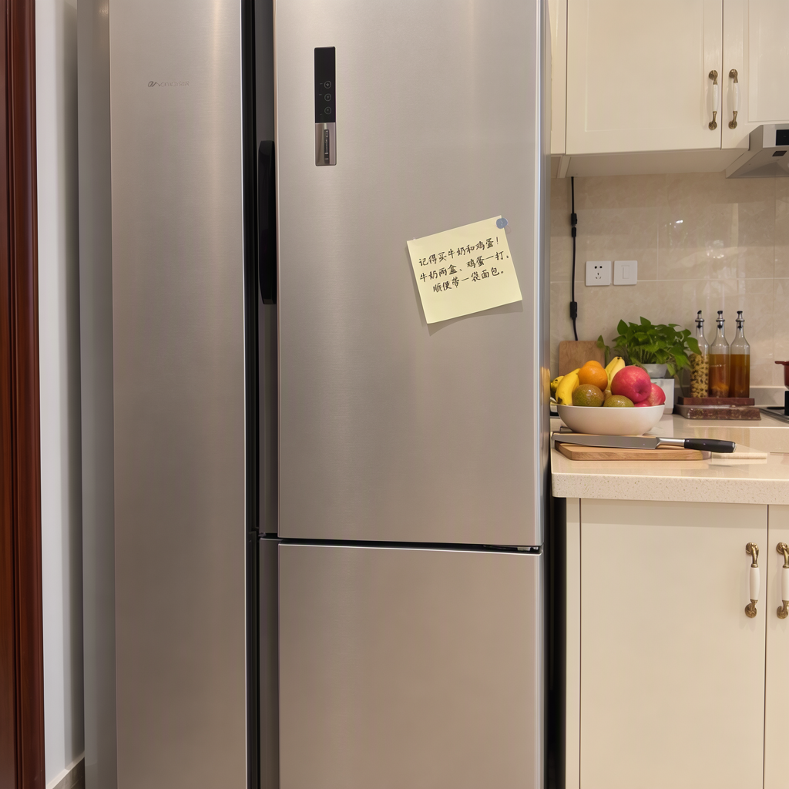

# MOSS-Image-SFT 部署与 fp16 调优

MOSS-Image-SFT 是 OpenMOSS 团队 5B 文生图模型的 SFT 版本,底座 MOSS-Image-Base,权重 27.23GB。目标机 2080ti22g 只有一张 22G 的 2080 Ti,权重装不进显存,靠 CPU offload 跑起来;模型卡要求的 bf16 在 Turing 上是 fp32 模拟,换 fp16 后单图快 3.7 倍。服务跑在 7860 端口,命令行脚本在 `/root/moss/moss_gen.py`。

## 一、权重构成与显存账

| 组件 | 规模 | 体积(bf16) | 作用 |
| --- | --- | --- | --- |
| text_encoder | Qwen3.5-9B,32 层,hidden 4096 | 16.78GB,4 个 shard | 提示词编码 |
| transformer | 5B,dim 3072,42 层,24 头 | 10.16GB,3 个 shard | 扩散主干 |
| vae | AutoencoderKLFlux2,FLUX.2 small decoder | 0.25GB | latent ↔ 像素,跑 fp32 |
| 合计 | | 27.23GB | |

22G 卡放不下 27.23GB,diffusers 的 `enable_model_cpu_offload()` 按 `model_cpu_offload_seq = 'text_encoder->transformer->vae'` 逐个搬运:编码提示词时文本编码器上卡,峰值 16.4GB;编码完退回内存,transformer 再上卡采样,10.6GB。空闲时显存 0.4GB,只剩 CUDA context。

每张图多约 20s 的权重搬运;offload 的 27GB 权重还全部常驻内存,服务 RSS 约 36GB,unit 里用 `MemoryMax=48G` 兜底。

采样形状:1024×1024 经 VAE(16 倍下采样)得到 64×64×128 latent,patch 2×2 后是 1024 个 token;CFG 3.0 意味着每步两次 transformer 前向,负分支跳过第 22 层(`uncond_skip_layers=[22]`)省一部分算力。

## 二、dtype 取舍:bf16 在 Turing 上是 fp32 模拟

模型卡给的是 `torch_dtype={"default": torch.bfloat16, "vae": torch.float32}`,这套配置面向 Ampere 及以后的卡。2080 Ti 是 sm_75,没有 bf16 张量核心,cublas 的 bf16 GEMM 退回 fp32 模拟。按模型实际的矩阵形状(2×1024 token 的 CFG 批)实测:

| GEMM 形状 | bf16 | fp16 |
| --- | --- | --- |
| 2048×3072×16384 | 28.77ms / 7.17 TFLOPS | 3.64ms / 56.69 TFLOPS |
| 2048×3072×3072 | 5.12ms / 7.55 TFLOPS | 0.74ms / 52.28 TFLOPS |
| 2048×8192×3072 | 13.86ms / 7.44 TFLOPS | 1.93ms / 53.51 TFLOPS |

fp16 走张量核心,52~57 TFLOPS 已在 2080 Ti 的 fp16 峰值区间(公版标称 53.8 TFLOPS,这张魔改卡 SM 频率上限 2100MHz);bf16 卡在 7.2~7.5 TFLOPS,即 fp32 模拟的上限。注意力同方向:同形状 SDPA bf16 6.26ms、fp16 1.05ms,bf16 在 sm_75 上没有 flash/mem-efficient 后端,退到 math 实现。

端到端落到 1024×1024 的单步:bf16 18.5s(第 3 步)、fp16 5.05s(第 4 步,频率爬升后稳态约 3.2s)。按这个单步折算,50 步从 15 分钟降到实测 178.8s。

加载时把默认 dtype 换成 fp16,VAE 保持 fp32:

```python
pipe = DiffusionPipeline.from_pretrained(
    "/root/models/MOSS-Image-SFT",
    custom_pipeline="pipeline_moss_image",
    trust_remote_code=True,
    torch_dtype={"default": torch.float16, "vae": torch.float32},
    local_files_only=True,
)
pipe.scheduler = type(pipe.scheduler).from_config(pipe.scheduler.config)
pipe.enable_model_cpu_offload()
```

文本编码器同样跑 fp16。Qwen3.5 的线性注意力层在 fp16 下没有溢出,50 步出的中文手写便签笔画可读,样图见文末。

## 三、部署实测

### 3.1 权重下载

HF 直连实测 0.35MB/s(12 秒只拉到 4.2MB),ModelScope 单流 35MB/s,差 100 倍。两个源的文件结构一致,直接按魔搭的直链拉:

```bash
BASE="https://www.modelscope.cn/api/v1/models/openmoss/MOSS-Image-SFT/repo?Revision=master&FilePath="
curl -sSL -C - -o "$DEST/$p" "$BASE$p"
```

8 个 safetensors shard 开 4 并发,27GB 约 4 分钟下完,`-C -` 断点续传,`assets/*` 跳过。

坑:`hf download --exclude "*.git*"` 会把 `*.git*` 当成要下载的文件名,报 `File not found ... %2A.git%2A`。只想跳过示例图就只写 `--exclude "assets/*"`。

### 3.2 Python 环境

系统 Python 是 3.14,torch 还没有对应 wheel。用 uv 拉一个 3.12,再装依赖:

```bash
uv venv --python 3.12 /root/moss/.venv
uv pip install --python /root/moss/.venv/bin/python \
  --index-url https://mirrors.aliyun.com/pypi/simple \
  torch "diffusers>=0.38" "transformers>=5.3" "accelerate>=1.10" \
  "safetensors>=0.6" "Pillow>=10" gradio
```

| 包 | 版本 |
| --- | --- |
| Python | 3.12.16 |
| torch | 2.15.0+cu132(arch list 含 sm_75) |
| diffusers | 0.42.1 |
| transformers | 5.22.1 |
| accelerate | 1.15.0 |
| safetensors | 0.8.0 |
| gradio | 6.31.0 |

第一次按模型卡建议走 `--index-url https://download.pytorch.org/whl/cu128`,该索引把 `nvidia-*` 依赖指到 pypi.nvidia.com,这个域名重试 3 次、每次 126s 全部超时。换阿里云镜像后 66MB/s,7GB 依赖半分钟拉完。pypi.tuna 对无浏览器 UA 的请求返回 403,脚本里不能只写 tuna。

`causal_conv1d` 与 `flash-linear-attention` 没有安装,transformers 启动时会打印两条回退警告,文本编码器走 PyTorch 参考实现。这两个包要编 CUDA 扩展,而编码每张图只跑一次,不在关键路径上。

### 3.3 服务化

`/etc/systemd/system/moss-image.service`:

```ini
[Unit]
Description=MOSS-Image-SFT text-to-image Gradio UI
After=network-online.target

[Service]
Type=simple
WorkingDirectory=/root/moss
Environment=MOSS_MODEL=/root/models/MOSS-Image-SFT
Environment=MOSS_OUTDIR=/root/moss/outputs
Environment=MOSS_DTYPE=fp16
Environment=MOSS_HOST=0.0.0.0
Environment=MOSS_PORT=7860
Environment=GRADIO_ANALYTICS_ENABLED=False
ExecStart=/root/moss/.venv/bin/python /root/moss/app.py
Restart=on-failure
RestartSec=5
TimeoutStopSec=30
MemoryMax=48G

[Install]
WantedBy=multi-user.target
```

Gradio 6 移除了 `launch(show_api=...)`,照旧写法直接 `TypeError: Blocks.launch() got an unexpected keyword argument 'show_api'`。单卡只能串行,`demo.queue(default_concurrency_limit=1, max_size=8)`,生成函数写成生成器每 2s yield 一次计时,避免三分钟没有任何反馈。

命令行出图:

```bash
/root/moss/.venv/bin/python /root/moss/moss_gen.py \
  --prompt "一张木质书桌上摊开的手账,旁边一杯拿铁" \
  --steps 30 --width 1024 --height 1024 --seed 42 \
  --out /root/moss/outputs/note.png
```

参数:`--negative` 负面提示词、`--cfg`(默认 3.0)、`--skip-layers`(默认 22,空字符串关闭)、`--bf16` 切回 bf16(仅作对照)、`--no-offload` 全量上卡(需要 >27GB 显存,本机不可用)。脚本默认就是 fp16,与网页服务一致。

## 四、性能实测

| 场景 | 耗时 | 说明 |
| --- | --- | --- |
| 服务启动到可访问 | 19~21s | 权重延迟加载,offload 到用时才搬 |
| 1024×1024 / 30 步 | 122.6s | 网页默认档 |
| 1024×1024 / 50 步 | 178.8s | 模型卡默认档,稳态约 3.2s/步 |
| 512×512 / 4 步 | 41.3s | 冒烟测试,含约 20s 搬运 |
| 显存峰值 | 16.4GB | 文本编码阶段 |
| 采样阶段显存 | 10.6GB | transformer + VAE |
| 空闲显存 | 0.4GB | 只剩 CUDA context |
| 内存占用 | 约 36GB | offload 的 27GB 权重常驻内存 |

每张图额外的约 20s 是 offload 的固定开销:文本编码器 16.8GB 上卡再退回,transformer 10.2GB 上卡。批量出图时这部分摊薄,单张交互时占总时长约六分之一。

## 五、与同机服务的资源共存

同机原本跑着 `coder390.service`(llama.cpp 承载 Qwen3.8-27B-Coder,常驻 20.7GB 显存),22G 卡上两者只能选一个。部署 MOSS 时已把 coder390 `stop` 并 `disable`,恢复用 `systemctl enable --now coder390`,恢复后 MOSS 会因显存不足 OOM。

ComfyUI(8188)空闲只占 156MB,可以和 MOSS 共存。ComfyUI 出图前先 `systemctl stop moss-image`,否则 MOSS 采样期的 10.6GB 会让它分配失败。

内存同样装不下两份:网页服务常驻约 36GB,命令行脚本单跑约 28GB,两者同时加载是 64GB,超过这台机器的 60GB。实测同时跑会触发系统 OOM killer,内存占用大的那个进程先死——第一次测试时 OOM killer 把服务一起杀了。`moss_gen.py` 启动时会检查 `systemctl is-active moss-image`,服务在跑就打印警告;命令行出图前先 `systemctl stop moss-image`,跑完再 `start`。

## 六、已知坑速查

| 症状 | 原因 | 处理 |
| --- | --- | --- |
| HF 下载只有 0.35MB/s | 国内直连限速 | 换 ModelScope,单流 35MB/s |
| `File not found ... %2A.git%2A` | `--exclude "*.git*"` 把通配符当文件名 | 只写 `--exclude "assets/*"` |
| `nvidia-cufile-cu12` 下载超时 | download.pytorch.org 的索引指向 pypi.nvidia.com | 换阿里云镜像 |
| tuna 镜像返回 403 | 无浏览器 UA | 用 uv/curl 默认 UA,或换阿里云 |
| `TypeError: ... unexpected keyword argument 'show_api'` | Gradio 6 移除了该参数 | 删掉 `show_api` |
| 启动日志 `Expected types for transformer: (...)` | diffusers 对 custom_pipeline 的类型检查提示 | 无害 |
| `torch_dtype is deprecated` FutureWarning | diffusers 0.42 改用 `dtype` | 无害 |
| `causal_conv1d / flash-linear-attention ... falling back` | 未装编译扩展 | 每张图多几秒编码,可忽略 |
| 方阵微基准显示 bf16 比 fp16 快 | cublasLt 对 2048³ 方阵选了另一套算法 | 用模型实际形状测,结论相反 |
| CLI 与网页服务同时跑,进程被 Killed | 两份权重约 64GB,超过 60GB 内存 | 先 `systemctl stop moss-image`,脚本启动时会警告 |

## 七、文件位置清单

| 路径 | 内容 |
| --- | --- |
| `/root/models/MOSS-Image-SFT` | 权重 26GB,含 tokenizer 与 custom pipeline 代码 |
| `/root/moss/.venv` | Python 3.12 环境 |
| `/root/moss/app.py` | Gradio 服务 |
| `/root/moss/moss_gen.py` | 命令行出图 |
| `/root/moss/outputs` | 出图结果 |
| `/etc/systemd/system/moss-image.service` | systemd 单元 |
| `/root/moss/README.md` | 目标机上的运维速查 |

## 八、样图

1024×1024、30 步,中文手写文字渲染:


1024×1024、50 步,冰箱便签,模型卡自带的示例提示词:


