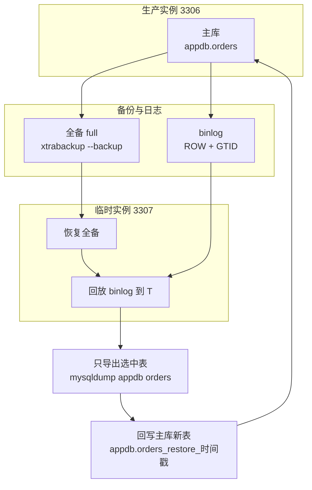
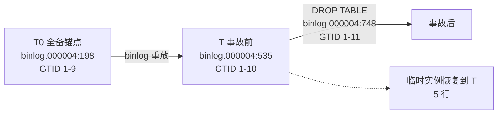

# 4. 备份与恢复

## 增量备份链(实测,2026-10-09)

```
全备(full2) → 业务写入 3 行 → 增量(inc1,--incremental-basedir=full2)
→ prepare --apply-log-only 全备 → prepare --incremental-dir 合并 → 恢复验证
```

```bash
X() { docker run --rm --network host --user 0:0 \
  -v /data/mysql/data:/var/lib/mysql -v /data/mysql/backup/inc:/backup \
  percona/percona-xtrabackup:8.4 xtrabackup "$@" --user=root --password='***' --host=127.0.0.1; }

X --backup --target-dir=/backup/full2                       # ① 全备
X --backup --target-dir=/backup/inc1 --incremental-basedir=/backup/full2   # ② 增量
X --prepare --apply-log-only --target-dir=/backup/full2     # ③ 全备只重放 redo 不回滚
X --prepare --target-dir=/backup/full2 --incremental-dir=/backup/inc1      # ④ 合并增量
# 实测:④ 后 full2/xtrabackup_checkpoints 变为 backup_type = full-prepared
```

**恢复验证(纪律:恢复演练才算数)**:prepared 目录挂给独立容器(`-p 3307:3306`,不占生产 3306)直接起库,`SELECT COUNT(*) FROM appdb.orders` = 基线 10 + 增量 3 = **13,inc-1/2/3 三行全在** ✅。

**实测发现(易误判)**:增量备份的 `xtrabackup_checkpoints` 里 `from_lsn = to_lsn`(两值相同)——因为 3 行 INSERT 的页还在 buffer pool 没刷盘,数据页 LSN 没动;但变更在增量备份的 redo 日志(xtrabackup_logfile)里被捕获,prepare 合并时重放,数据一点不少。**结论:判断增量有没有内容,别只看 LSN 相不相等,恢复验证才是唯一标准。**

**多轮增量的纪律**:`--apply-log-only` 只用于"全备和中间增量"的 prepare;最后一次 prepare(合并完最后一个增量)**不带** apply-log-only,让它完成回滚,目录才可起库。

## 策略总览

| 层 | 工具 | 频率 | 保留 | 用途 |
| --- | --- | --- | --- | --- |
| 物理全备 | xtrabackup 8.4(容器) | 每日 | ≥3 份 | 整机恢复,分钟级 |
| binlog | 服务自身(第 2 篇已开) | 实时 | 7 天(`binlog_expire_logs_seconds`) | 全备之后任意时间点恢复 |
| 库表级 PITR | xtrabackup 全备 + binlog + 临时实例 + mysqldump | 按需 | 随全备/binlog 保留期 | 误删单表/单库,恢复到 T,新表回写 |
| 逻辑备份 | mysqldump(镜像自带) | 按需 | — | 单库迁移、小库、跨版本导出 |

**binlog 保留期 = 可恢复窗口**。第 2 篇基线 7 天,意味着最坏丢 7 天前的历史(有更早日全备);要恢复到任意历史点,拉长保留期并算好磁盘(联动巡检 M07/M09)。

## 工具准备

物理备份用 Percona 官方镜像(版本必须 ≥ 服务器版本,8.4 对 8.4):

```bash
docker pull percona/percona-xtrabackup:8.4
```

**实测发现:官方 `mysql:8.4` 镜像里没有 `mysqlbinlog`**(只有 mysql/mysqladmin/mysqldump/mysqlsh)。binlog 相关操作全部用 percona 镜像,它带 mysqlbinlog 8.4.11。

## 物理全备(docker 版实测命令)

```bash
# 全备:三个 docker 专属参数都是实测踩出来的
#   --network host + --host=127.0.0.1 : 默认走 /var/lib/mysql/socket 连不上,必须 TCP
#   --user 0:0                        : 数据目录属主是容器内 mysql(uid 999),默认用户读不了
time docker run --rm --network host --user 0:0 \
  -v /data/mysql/data:/var/lib/mysql \
  -v /data/mysql/backup:/backup \
  percona/percona-xtrabackup:8.4 \
  xtrabackup --backup --target-dir=/backup/full \
  --user=root --password='Root@2026' --host=127.0.0.1
# 实测:Backup size 76.83 MiB,15 秒,completed OK

# prepare(让备份达到一致性,可随时启库)
docker run --rm --user 0:0 -v /data/mysql/backup:/backup \
  percona/percona-xtrabackup:8.4 \
  xtrabackup --prepare --target-dir=/backup/full
# 实测:completed OK;目录 122M

# 备份位点(binlog 文件/位置/GTID 集)——PITR 的锚点:
cat /data/mysql/backup/full/xtrabackup_binlog_info
# 实测输出:binlog.000006   198    a14d964e-bccc-11f1-aa2e-d2e29d323d2f:1-26
```

## 恢复实录:删库 → 恢复 → 重放到删库前一刻


**事故现场**(实测操作序列):

```sql
INSERT INTO appdb.orders(note) VALUES ('after-backup-1'),('after-backup-2');  -- 备份之后的新数据
SHOW BINARY LOG STATUS;   -- 8.4 新语法(原 SHOW MASTER STATUS);实测:binlog.000006 | 517 | gtid 1-27
DROP DATABASE appdb;      -- 事故
```

**第一步:用备份把库拉回备份时刻**

```bash
docker stop mysql
mv /data/mysql/data /data/mysql/data.before-drop   # 旧目录不要删!binlog 还在里面
mkdir -p /data/mysql/data
cp -a /data/mysql/backup/full/. /data/mysql/data/
chown -R 999:999 /data/mysql/data                  # 容器内 mysql 的 uid(宿主机上 999 显示为别的用户名,别被骗)
docker start mysql
# 实测:healthy;SELECT COUNT(*) FROM appdb.orders → 3(回到备份时刻)
```

**第二步:重放 binlog 到删库前一刻**

```bash
# --start-position 用备份位点 198,--stop-position 用事故前记录的 517(DROP 的事件被精确排除)
docker run --rm --user 0:0 -v /data/mysql/data.before-drop:/old \
  percona/percona-xtrabackup:8.4 \
  sh -c "mysqlbinlog --start-position=198 --stop-position=517 /old/binlog.000006" > /tmp/replay.sql

docker exec -i mysql mysql -uroot -p'Root@2026' < /tmp/replay.sql
```

**实测终验**:

```sql
SELECT id, note FROM appdb.orders ORDER BY id;   -- 5 行全回:
-- 1 pre-backup-1 / 2 pre-backup-2 / 3 pre-backup-3 / 4 after-backup-1 / 5 after-backup-2
SELECT @@global.gtid_executed;                   -- a14d964e-...:1-27(DROP 的 gtid 28 被排除)
```

要点:
- `--stop-position` 是**删库语句开始前的位点**(事故前 `SHOW BINARY LOG STATUS` 抄下来的),不是误以为的"DROP 语句的位置";
- 旧数据目录是 binlog 唯一来源,恢复时**先挪开保留**,确认恢复成功后再清理;
- GTID 集是自检手段:重放后 `gtid_executed` 应恰好是位点文件的 GTID 集 + 重放的事务,不多不少。

## 库表级时间点恢复(实测)

**场景**:误删单表(或单库),要求恢复到误操作前的时间点,原表保留、新表并存。下面的流程不把生产库整体回滚:全备恢复到 3307 临时实例,回放 binlog 到 T,只导选中表,再以新表名写回 3306。

本次验证在 PVE 克隆机(4C/4G/40G,Ubuntu 26.04)上完成,MySQL 8.4.11,xtrabackup 8.4 容器;数据与备份目录沿用 `/data/mysql/data`、`/data/mysql/backup`。MGR 拓扑下的差异见本节末尾。

**流程**



**① 全备并 prepare**

```bash
X() { docker run --rm --network host --user 0:0 \
  -v /data/mysql/data:/var/lib/mysql -v /data/mysql/backup:/backup \
  percona/percona-xtrabackup:8.4 xtrabackup "$@" --user=root --password='Root@2026' --host=127.0.0.1; }

X --backup --target-dir=/backup/full
X --prepare --target-dir=/backup/full
cat /data/mysql/backup/full/xtrabackup_binlog_info
# 实测:binlog.000004   198   4e65f8cd-cb8d-11f1-8abd-bc2411e830ee:1-9
```

备份锚点用 `xtrabackup_binlog_info` 的 file/position/GTID,不要用备份前的 `SHOW BINARY LOG STATUS`:xtrabackup 过程中 binlog 可能已经轮转(本次从 binlog.000003 切到了 binlog.000004)。全备 6.20 秒,备份目录 121M。

**② 备份后写入,记录 T 锚点,再制造事故**

```sql
INSERT INTO appdb.orders(note) VALUES ('after-backup-1'),('after-backup-2');
SHOW BINARY LOG STATUS;   -- 实测:binlog.000004 | 535 | 4e65f8cd-...:1-10
DROP TABLE appdb.orders;  -- 事故
```

`SHOW BINARY LOG STATUS` 的 position 是 DROP 语句开始前的位点,回放时用它作 `--stop-position`;DROP 自身的事件在这个位点之后,不会被重放。

**③ 全备恢复到临时实例 3307**

```bash
docker rm -f mysql-restore 2>/dev/null || true
mkdir -p /data/mysql/restore-data
rm -rf /data/mysql/restore-data/*
cp -a /data/mysql/backup/full/. /data/mysql/restore-data/
chown -R 999:999 /data/mysql/restore-data
docker run -d --name mysql-restore --network host \
  -e MYSQL_ROOT_PASSWORD='Root@2026' \
  -v /data/mysql/restore-data:/var/lib/mysql \
  mysql:8.4 --port=3307 --server-id=2 --socket=/tmp/mysql-restore.sock \
  --skip-log-bin --gtid-mode=OFF --enforce-gtid-consistency=OFF \
  --mysqlx=0 --admin-port=33063
# 实测:2.81 秒起库;COUNT(*)=3(回到备份时刻)
```

临时实例关 binlog、关 GTID,是为了让后面的 `mysqlbinlog --skip-gtids` 直接应用;开着 GTID 会撞已执行 GTID 或 `GTID_PURGED`。`--mysqlx=0` 和独立的 `--admin-port` 用来避开主实例在 host 网络里占用的 33060/33062。root 密码沿用备份里的密码。

等待就绪不要用 `mysqladmin ping`:初始化阶段的临时 server 也会返回成功。用真实 SQL 认证:

```bash
for i in $(seq 1 30); do
  docker exec mysql-restore mysql -h127.0.0.1 -P3307 -uroot -p'Root@2026' \
    -Nse "SELECT 1" >/dev/null 2>&1 && break
  sleep 1
done
```

**④ 重放 binlog 到 T**

```bash
docker run --rm --user 0:0 -v /data/mysql/data:/old \
  percona/percona-xtrabackup:8.4 \
  sh -c "mysqlbinlog --no-defaults --skip-gtids \
    --start-position=198 --stop-position=535 /old/binlog.000004" > /tmp/replay.sql
docker exec -i mysql-restore mysql -h127.0.0.1 -P3307 -uroot -p'Root@2026' < /tmp/replay.sql
# 实测:replay.sql 2140 字节/47 行;COUNT(*)=5;CHECKSUM=4130897312
```

`--start-position` 用备份锚点,`--stop-position` 用事故前记录的位点,`--skip-gtids` 与临时实例的 `gtid-mode=OFF` 配套。

如果按时间点而不是位点,`--stop-datetime` 的边界是"该秒开始之前":本次 INSERT 事务的时间戳是 `07:19:35 UTC`,传 `--stop-datetime='2026-10-19 07:19:35'` 只回 3 行,传 `07:19:36` 才回 5 行。percona 镜像没有 tzdata,`TZ=Asia/Shanghai` 不生效,`--stop-datetime` 实际按 UTC 解释;实例的 `default-time-zone=+08:00` 不会改变这一点。要按本地时间选点,先换算成 UTC,或者直接用 position/GTID。

**⑤ 只导选中表,回写新表**

```bash
docker exec mysql-restore mysqldump -h127.0.0.1 -P3307 -uroot -p'Root@2026' \
  --single-transaction --set-gtid-purged=OFF appdb orders > /tmp/orders.sql
docker exec mysql mysql -uroot -p'Root@2026' -e 'CREATE DATABASE IF NOT EXISTS restore_tmp;'
docker exec -i mysql mysql -uroot -p'Root@2026' restore_tmp < /tmp/orders.sql
docker exec mysql mysql -uroot -p'Root@2026' -e \
  'RENAME TABLE restore_tmp.orders TO appdb.orders_restore_20261019_1000;'
# 实测:dump 0.11 秒/2181 字节,import 0.14 秒;新表 5 行,CHECKSUM=4130897312
```

回写不覆盖原表:原表如果还在,新表与原表并存,业务比对后再切换;本次是 DROP 场景,原表已不存在,新表就是恢复结果。回写本身会写主库 binlog(本次最终 GTID 1-18),新表在当前位置,不会抹掉 DROP 事件;下一次 PITR 仍需要同一条全备+binlog 链。`CHECKSUM TABLE` 在同版本实例之间比对才有意义。

`mysqldump` 默认带触发器,外键也随 `CREATE TABLE` 一起走(这两点未在本节复测);只恢复单表时,关联表不在新库会留下悬空外键或导入失败。要么把关联表一起恢复,要么先处理外键/触发器。云产品的库级回档明确不导外键、check 约束、触发器、存储过程、用户视图、Event,两条路线的边界不同。

**时间轴**



**实测数据**

| 项 | 实测 |
| --- | --- |
| 全备 | 6.20 秒,76.67 MiB(备份目录 121M) |
| prepare | 6.28 秒 |
| 临时实例恢复 | 2.81 秒,回到备份时刻的 3 行 |
| 回放 SQL 生成 / 应用 | 1.44 秒 / 0.11 秒,2140 字节 |
| 回放后 | 5 行,CHECKSUM 4130897312 |
| 导表 / 回写 | 0.11 秒 / 0.14 秒,2181 字节 |
| 新表 | 5 行,CHECKSUM 4130897312 |

**与云产品回档的对应关系**

这套流程对应腾讯云 CDB 的"普通回档":全备 + 全量 binlog 回放到 T,再从临时实例里提取选中库表。云产品的"快速/极速"模式额外按库/表过滤 binlog,减少无关事件的重放;代价是跨库/跨表事务必须把关联对象一起选,否则事务不完整。本地用 `mysqlbinlog` 没有表级过滤,要做极速等价物,需要按 `Table_map` 解析行事件(如 `my2sql`/`binlog2sql`),本文未实测。

云产品要求"待回档表先存在",和它的按表过滤回放实现有关;本文的"全实例回放 + 导表"路线不要求表预先存在,只要 `CREATE TABLE` 的 DDL 在 binlog 覆盖范围内。这是两条实现路线的差异,不是数据恢复能力的差异。腾讯云的官方说明见 [回档数据库](https://cloud.tencent.com/document/product/236/7276)。

**适用范围**

- 本次验证是单机 Docker MySQL 8.4;MGR 下把全备放到 secondary 上做,备份锚点改用 GTID(各节点 file/pos 不同),回放前要处理组复制事件。MGR 的这套组合本次未复测,先在单机上把流程跑通。
- 全备 + 增量链也可以用于本流程:把全备和增量 prepare 合并后,用最后一份增量对应的 `xtrabackup_binlog_info` 作锚点。增量链本身已在开头"增量备份链"节实测。
- xtrabackup 的 `--tables` 部分备份 + `--export` 可传输表空间是另一条单表恢复路线,解决"恢复到备份时刻的单表",不能单独完成 PITR;命令与实测见[第 7 篇](7.xtrabackup备份深入.md)。
- 生产环境还要把 binlog 归档到异机/对象存储;否则宿主机或数据盘故障时,备份和 binlog 一起丢,PITR 只剩逻辑误删这一种场景可用。

## 逻辑备份(mysqldump)

镜像自带,适合单库/小库/迁移:

```bash
docker exec mysql mysqldump -uroot -p'Root@2026' \
  --single-transaction --set-gtid-purged=OFF appdb > /data/mysql/backup/appdb.sql

# 恢复(实测:恢复到新库 appdb_restored,count=5):
docker exec mysql mysql -uroot -p'Root@2026' -e 'CREATE DATABASE appdb_restored;'
docker exec -i mysql mysql -uroot -p'Root@2026' appdb_restored < /data/mysql/backup/appdb.sql
```

`--single-transaction`(InnoDB 一致性快照,不锁表)、`--set-gtid-purged=OFF`(避免恢复时干扰 GTID)是默认搭配。

## 定时与保留

```bash
# /etc/cron.d/mysql-backup 示例:每天 02:00 全备,保留 7 份
0 2 * * * root /data/mysql/backup/backup.sh >> /data/mysql/backup/backup.log 2>&1
```

backup.sh 骨干(全备命令如上 + 日期目录 + `find -mtime +7 -exec rm -rf` 轮转 + 失败告警)。**备份脚本改动的验收标准不是"跑成功了",而是"恢复演练通过"**——每次改备份策略,按上面的恢复实录或库表级 PITR 流程走一遍。

## 已知坑

1. **官方 mysql 镜像没有 mysqlbinlog**,binlog 工具用 percona 镜像;
2. xtrabackup 容器默认连 socket:必须 `--network host` + `--host=127.0.0.1` 走 TCP;
3. 数据目录权限:备份要 `--user 0:0`,恢复后要 `chown -R 999:999`;
4. 宿主机 apt 安装可能被 `unattended-upgrades` 卡 dpkg 锁(实测),重试即可——这也是工具容器化的理由;
5. ~~增量备份本文未实测~~ → **已实测(2026-10-09)**,见"增量备份链"节;注意恢复验证别只看 LSN。
6. **临时实例的 GTID/binlog 冲突**:3307 实例要 `--skip-log-bin --gtid-mode=OFF --enforce-gtid-consistency=OFF`,回放加 `--skip-gtids`;否则会撞已执行 GTID 或 `GTID_PURGED`。
7. **`mysqlbinlog --stop-datetime` 的时区**:按运行环境时区解释;percona 镜像没有 tzdata,`TZ=Asia/Shanghai` 不生效,实际按 UTC。实例的 `default-time-zone=+08:00` 不改变这一点;用 position/GTID 最稳。
8. **等 MySQL 就绪别用 `mysqladmin ping`**:初始化阶段的临时 server 也会返回成功,用 `mysql -e 'SELECT 1'` 做真实认证。
9. **回写会写主库 binlog**:新表在当前位置,不会抹掉 DROP 事件;下一次 PITR 仍需要同一条全备+binlog 链。
10. **外键/触发器边界(未在本节复测)**:`mysqldump` 默认带触发器,外键随 `CREATE TABLE` 一起走;只恢复单表时关联表不在新库,会留下悬空外键或导入失败。云产品库级回档不导这些对象,边界不同。

## 互链

- binlog 保留期与磁盘 → [第 2 篇](2.参数基线与配置模板.md)、巡检 M07/M09
- xtrabackup 的备份链、部分备份、压缩/加密 → [第 7 篇](7.xtrabackup备份深入.md)
- MGR 新节点用 clone plugin 从存量节点克隆(不走备份) / MGR 拓扑与节点角色 → [第 5 篇](5.MGR集群.md)
- 恢复演练属于第 8 篇[日常运维](8.日常运维与排障.md)的周期项
