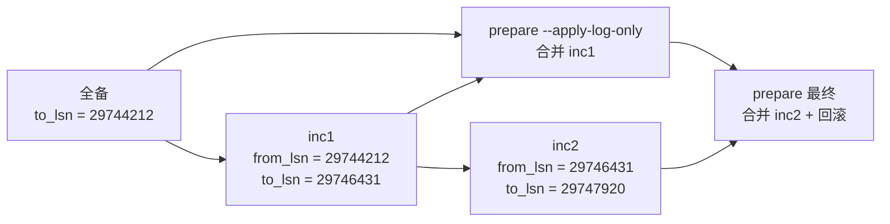

# 7. XtraBackup 备份深入

XtraBackup 8.4 是 Percona 的 InnoDB 物理热备工具:直接复制数据文件,备份期间不长时间锁表,prepare 阶段用 redo 把备份推到一致点。第 4 篇给的是全备/增量/PITR 的 runbook;本篇讲工具本身——备份链的 LSN、`--copy-back`、两级增量合并、`--tables` 部分备份与可传输表空间、压缩/加密,以及 Docker 里跑它的固定参数。

验证环境:PVE 克隆机 4C/4G/40G,Ubuntu 26.04,MySQL 8.4.11,`percona/percona-xtrabackup:8.4` 镜像(xtrabackup 8.4.0-7,基于 MySQL 8.4.0),Docker 29.1.3。数据目录 `/data/mysql/data`,备份目录 `/data/mysql/backup`;测试表 `xtra.orders`,10 行基线,两级增量后 15 行。命令里的密码按实际环境替换。

## 工具定位与版本

- **物理备份**:复制 `.ibd`、`ibdata1`、undo、redo 等文件,不是 `mysqldump` 的 SQL 导出。恢复速度按文件拷贝算,不按 SQL 重放算。
- **热备**:InnoDB 表备份期间不长时间加全局读锁;MyISAM 等非事务表仍要锁,备份前先确认表引擎。
- **版本对齐**:镜像里的 xtrabackup 是 8.4.0-7(基于 MySQL 8.4.0),服务端是 8.4.11,8.4 系列实测可用。跨大版本(8.0 备份恢复到 8.4)不在本文范围,按 Percona 的版本矩阵单独确认。
- **镜像分工**:官方 `mysql:8.4` 镜像没有 `xtrabackup`,也没有 `mysqlbinlog`;备份和 binlog 工具都用 `percona/percona-xtrabackup:8.4`。

## 工作模型

XtraBackup 的备份目录不是一个可以直接启动的数据目录,要经过 `--prepare`:

1. `--backup` 复制数据文件,同时持续复制 redo log;备份结束时记录一个 LSN 区间和 binlog 锚点。
2. `--prepare` 在备份目录上重放 redo,把数据文件推到一致点;默认会回滚未提交事务,让目录达到可启动状态。
3. 增量备份只复制自基准备份以来变化的页;prepare 时按 LSN 顺序把增量合并进全备。
4. 最后一份 prepare 不能带 `--apply-log-only`;前面的全备/中间增量要带,否则会把还没合并完的 redo 回滚掉。



两级增量的 checkpoint 在实测里首尾相接:inc1 的 `to_lsn` = inc2 的 `from_lsn`,inc2 的 `to_lsn` = 合并后全备的 `to_lsn`。这条链对不上,先检查 `--incremental-basedir` 是不是指错了。

差异备份和增量备份共用 `--incremental-basedir`,区别在基线:每次都指向同一份全备就是差异,指向上一次增量就是增量。本文实测的是后者;差异备份没有单独跑。

## 全备与 --copy-back(实测)

备份和 prepare 用同一个容器函数,后面的增量、部分备份、压缩、加密都复用它:

```bash
X() { docker run --rm --network host --user 0:0 \
  -v /data/mysql/data:/var/lib/mysql -v /data/mysql/backup:/backup \
  percona/percona-xtrabackup:8.4 xtrabackup "$@" --user=root --password='Root@2026' --host=127.0.0.1; }

X --backup --target-dir=/backup/xtra-full
X --prepare --target-dir=/backup/xtra-full
cat /data/mysql/backup/xtra-full/xtrabackup_binlog_info
# 实测:binlog.000006   198   4e65f8cd-...:1-22
```

实测:全备 6.08 秒,目录 122M,prepare 5.55 秒。恢复用 `--copy-back`:

```bash
docker rm -f mysql-copyback 2>/dev/null || true
rm -rf /data/mysql/copyback-data
mkdir -p /data/mysql/copyback-data
docker run --rm --user 0:0 \
  -v /data/mysql/backup:/backup -v /data/mysql/copyback-data:/restore \
  percona/percona-xtrabackup:8.4 \
  xtrabackup --copy-back --target-dir=/backup/xtra-full --datadir=/restore
chown -R 999:999 /data/mysql/copyback-data

docker run -d --name mysql-copyback --network host \
  -e MYSQL_ROOT_PASSWORD='Root@2026' \
  -v /data/mysql/copyback-data:/var/lib/mysql \
  mysql:8.4 --port=3310 --server-id=5 --socket=/tmp/mysql-copyback.sock \
  --skip-log-bin --gtid-mode=OFF --enforce-gtid-consistency=OFF \
  --mysqlx=0 --admin-port=33164
# 用 SELECT 1 等就绪,再查 COUNT(*)/CHECKSUM TABLE
```

实测 copy-back 2.68 秒,起库后 `xtra.orders` 10 行,`CHECKSUM TABLE` = 2054548913,与源库一致。

`--copy-back` 要求目标 datadir 为空。往已有文件的目录再跑一次,报错原文:

```text
[Note] [MY-011825] [Xtrabackup] Original data directory /restore is not empty!
```

`--move-back` 是另一种恢复方式:把备份文件移动到 datadir,速度快,但备份目录会被搬空,不能再次使用。本文只实测了 `--copy-back`。

## 增量备份与 prepare 链(实测)

两级增量的顺序:

```bash
# 全备作基线,先 prepare 但不回滚
X --backup --target-dir=/backup/inc-full
X --prepare --apply-log-only --target-dir=/backup/inc-full

# 写 3 行,inc1 基于全备
X --backup --target-dir=/backup/inc1 --incremental-basedir=/backup/inc-full
X --prepare --apply-log-only --target-dir=/backup/inc-full --incremental-dir=/backup/inc1

# 再写 2 行,inc2 基于 inc1,不是全备
X --backup --target-dir=/backup/inc2 --incremental-basedir=/backup/inc1

# 最后一次 prepare 不带 apply-log-only,完成合并和回滚
X --prepare --target-dir=/backup/inc-full --incremental-dir=/backup/inc2
```

实测 checkpoint:

```text
== inc-full ==
backup_type = full-prepared
to_lsn = 29747920
last_lsn = 29747972

== inc1 ==
backup_type = incremental
from_lsn = 29744212
to_lsn = 29746431
last_lsn = 29746483

== inc2 ==
backup_type = incremental
from_lsn = 29746431
to_lsn = 29747920
last_lsn = 29747972
```

inc1/inc2 的 `from_lsn` 与上一份的 `to_lsn` 对齐;合并后全备的 `to_lsn` 等于 inc2 的 `to_lsn`。实测耗时:全备 5.36 秒,inc1 4.40 秒,inc2 6.48 秒,最终 prepare 6.12 秒。`--copy-back` 到临时实例后,`xtra.orders` 15 行,`CHECKSUM TABLE` = 3804344880,与源库一致。

注意:增量 checkpoint 里 `from_lsn = to_lsn` 不等于"没有数据"——变更可能还在 redo 里,页还没刷盘;恢复验证才算数(第 4 篇有同样的实测案例)。

## 部分备份与可传输表空间(实测)

`--tables` 做的是按表过滤的备份,备份目录仍会带 `ibdata1`、undo、`mysql.ibd` 和系统元数据,不是只拷一个 `.ibd`;它的单表恢复价值在 `--prepare --export` 生成 `.cfg`,再导入另一个实例。

```bash
X --backup --tables='^xtra\.orders$' --target-dir=/backup/xtra-partial
X --prepare --export --target-dir=/backup/xtra-partial
find /data/mysql/backup/xtra-partial/xtra -maxdepth 1 -type f
# 实测:orders.ibd / orders.cfg
```

实测:部分备份 4.69 秒,日志体积 75.12 MiB;`--prepare --export` 4.81 秒。备份目录里系统表空间仍占大头,所以体积和全备接近,不能按"单表文件大小"估算。

导入另一个实例。目标实例可以用第 4 篇的临时实例命令起(本次端口 3312、server-id 7;新数据目录初始化约 25 秒),再建同名库表:

```bash
# 目标实例先建同名库表和空表,结构按源库 SHOW CREATE TABLE
docker exec mysql-import mysql -h127.0.0.1 -P3312 -uroot -p'Root@2026' -e "
  CREATE DATABASE xtra;
  CREATE TABLE xtra.orders (
    id BIGINT UNSIGNED NOT NULL AUTO_INCREMENT PRIMARY KEY,
    note VARCHAR(64) NOT NULL,
    created_at TIMESTAMP NOT NULL DEFAULT CURRENT_TIMESTAMP
  ) ENGINE=InnoDB;
  ALTER TABLE xtra.orders DISCARD TABLESPACE;"

# 复制 .ibd 和 .cfg,改权限,再导入
cp -a /data/mysql/backup/xtra-partial/xtra/orders.ibd /data/mysql/import-data/xtra/
cp -a /data/mysql/backup/xtra-partial/xtra/orders.cfg /data/mysql/import-data/xtra/
chown -R 999:999 /data/mysql/import-data/xtra
docker exec mysql-import mysql -h127.0.0.1 -P3312 -uroot -p'Root@2026' \
  -e "ALTER TABLE xtra.orders IMPORT TABLESPACE;"
```

实测导入 0.51 秒,`xtra.orders` 15 行,`CHECKSUM TABLE` = 3804344880,与源库一致。


限制:

- 源和目标要同版本(8.4 对 8.4);跨版本不走这条。
- 目标表结构要匹配,至少列、类型、索引一致;结构不一致时导入会失败或留下不可用表。
- 目标表要先 `DISCARD TABLESPACE`,再复制 `.ibd`/`.cfg`;`.cfg` 由 `--prepare --export` 生成,导入时和 `.ibd` 一起复制,缺 `.cfg` 导入会失败或元数据不匹配。
- 依赖 `innodb_file_per_table=ON`(8.4 默认),目标表不能正在被业务写入;有外键/分区时先处理依赖。
- 部分备份只能恢复到备份时刻的单表;要恢复到时间点 T,仍然要 binlog 回放,流程在第 4 篇。

## 压缩与加密(实测)

压缩备份:

```bash
X --backup --compress --compress-threads=4 --target-dir=/backup/xtra-compressed
docker run --rm --user 0:0 -v /data/mysql/backup:/backup \
  percona/percona-xtrabackup:8.4 \
  xtrabackup --decompress --compress-threads=4 --target-dir=/backup/xtra-compressed
X --prepare --target-dir=/backup/xtra-compressed
```

实测:备份 5.06 秒,目录 4.6M,日志压缩比 18.35x;解压 3.03 秒,prepare 4.46 秒。8.4 镜像不指定算法时产物是 `.zst`(zstd),不是老版本常见的 qpress `.qp`;`--decompress` 直接处理 `.zst`,不需要 `qpress`。恢复后 15 行,校验和 3804344880。

加密备份:

```bash
KEY='0123456789abcdef0123456789abcdef'   # 32 字节示例 key,生产不要这样写
X --backup --encrypt=AES256 --encrypt-key="$KEY" --target-dir=/backup/xtra-encrypted
docker run --rm --user 0:0 -v /data/mysql/backup:/backup \
  percona/percona-xtrabackup:8.4 \
  xtrabackup --decrypt=AES256 --encrypt-key="$KEY" --target-dir=/backup/xtra-encrypted
X --prepare --target-dir=/backup/xtra-encrypted
```

实测:备份 8.66 秒,目录 78M,生成 135 个 `.xbcrypt` 文件;解密 4.30 秒,prepare 4.81 秒。恢复后 15 行,校验和 3804344880。

- AES256 的 key 是 32 字节;生产用 `--encrypt-key-file` 或 secret 注入,不要把 key 写进命令历史/仓库。本文实测的是 `--encrypt-key` 内联,只作流程验证。
- 解密要在 prepare 之前;压缩+加密组合使用时同样先解压/解密再 prepare,本文没有组合实测。
- key 丢了备份就打不开,key 要和备份分开保管。
- 流式备份(`--stream=xbstream`)把备份写到 stdout,适合直接管道到对象存储;恢复时先 `xbstream -x`,再 `--decompress`/`--decrypt`/`--prepare`。本次没有实测流式管道,只列入口,不要把本地 `--target-dir` 命令直接套到流式场景。

## 实测汇总

| 场景 | 耗时 | 体积 | 恢复验证 |
| --- | --- | --- | --- |
| 全备 + `--copy-back` | 备份 6.08s / prepare 5.55s / copy-back 2.68s | 目录 122M | 10 行,CHECKSUM 2054548913 |
| 两级增量 | 全备 5.36s / inc1 4.40s / inc2 6.48s / 最终 prepare 6.12s | — | 15 行,CHECKSUM 3804344880 |
| 部分备份 + 可传输表空间 | 备份 4.69s / export prepare 4.81s / import 0.51s | 75.12 MiB | 15 行,CHECKSUM 3804344880 |
| 压缩备份 | 备份 5.06s / 解压 3.03s / prepare 4.46s | 4.6M,压缩比 18.35x | 15 行,CHECKSUM 3804344880 |
| 加密备份 | 备份 8.66s / 解密 4.30s / prepare 4.81s | 78M,135 个 `.xbcrypt` | 15 行,CHECKSUM 3804344880 |

以上是 10→15 行的小表测得的时间,不代表大库的绝对值;体积和耗时随数据量、磁盘、压缩/加密线程数变化。

## 限速、并行与一致性

这组参数本次只从 `--help` 确认语义,没有在并发 DDL/副本上做性能对照:

| 参数 | 作用 | 用法 |
| --- | --- | --- |
| `--parallel=#` | 并行拷贝数据文件的线程数 | 提升备份吞吐;不要和 `--throttle` 同时无脑拉满 |
| `--throttle=#` | 限制每秒 IO 操作对数 | 在主库/生产盘上保护业务 IO;值越小越慢 |
| `--compress-threads=#` | 压缩线程数 | 压缩备份 |
| `--encrypt-threads=#` | 加密线程数 | 加密备份 |
| `--safe-slave-backup` | 备份前停 SQL 线程,等一致点 | 副本备份;会延迟复制 |
| `--slave-info` | 记录源库 binlog 位点 | 副本备份 + PITR |
| `--lock-ddl` / `--lock-ddl-per-table` | 备份期间锁 DDL | 有 DDL 时用 |
| `--no-lock` | 关闭 DDL 锁和表锁 | 只在确认无 DDL、无非事务表写入时用 |

MGR/主从下,备份放到 secondary 上做,配合 `--safe-slave-backup`/`--slave-info`;锚点用 GTID,不要用各节点不同的 file/pos。这部分本文是单机实测,MGR 组合未复测。

## 校验与监控

- `xtrabackup_checkpoints`:`backup_type`、`from_lsn`、`to_lsn`、`last_lsn`、`flushed_lsn`。全备是 `full-backuped`/`full-prepared`,增量是 `incremental`。
- `xtrabackup_binlog_info`:备份锚点的 binlog file/position/GTID。PITR 用这个,不要用备份前的 `SHOW BINARY LOG STATUS`;xtrabackup 过程中 binlog 可能已经轮转(本次全备从 binlog.000005 切到了 binlog.000006)。
- `xtrabackup_info`:工具版本、备份类型、起止时间、LSN、数据量;排障先看它。
- `--backup --check-privileges`:先检查备份账号权限再备份;本次 root 通过。单独跑 `--check-privileges` 没有操作上下文,只会打印用法。备份账号的最小权限见第 3 篇。
- 日志里的 `completed OK!`、`Backup size`、`Compression ratio`、`Transaction log of lsn ... was copied` 是验收点;错误信息常见 `Original data directory ... is not empty!`、`Cannot open ...`、LSN 不连续。
- 最终验收不是"备份跑完了",而是恢复演练:起临时实例,查行数/`CHECKSUM TABLE`;同版本实例之间比校验和才有意义。

## Docker 运行清单

| 项 | 写法 | 原因 |
| --- | --- | --- |
| 网络 | `--network host` + `--host=127.0.0.1` | 容器内默认 socket 连不上宿主 mysqld |
| 用户 | `--user 0:0` | 数据目录属主是容器内 mysql(uid 999),默认用户读不了 |
| datadir | `-v /data/mysql/data:/var/lib/mysql` | xtrabackup 读数据文件 |
| 备份目录 | `-v /data/mysql/backup:/backup` | `--target-dir` 落盘 |
| 恢复 | `-v ...:/restore` + `--datadir=/restore` | `--copy-back` 目标 |
| 权限回正 | `chown -R 999:999 <datadir>` | 恢复后容器 mysql 要能读写 |
| 空目录 | 目标 datadir 必须为空 | 非空时报 `Original data directory ... is not empty!` |
| 版本 | 镜像 8.4 对 MySQL 8.4 | 跨大版本不混用 |
| 临时实例 | `--skip-log-bin --gtid-mode=OFF --mysqlx=0 --admin-port=...` | 避免和主实例端口/GTID 冲突,详见第 4 篇 |

`--backup` 的 `--target-dir` 也要空目录;脚本里先 `rm -rf` 再跑,避免旧文件混进新备份。

## 已知坑

1. **`--copy-back` 目标非空**:报 `Original data directory /restore is not empty!`;先清空 datadir,或确认是不是要恢复到别处。
2. **最后一次 prepare 带了 `--apply-log-only`**:目录会停在"还有未合并 redo"的状态,不能直接启动;全备/中间增量带,最后一次不带。
3. **`--incremental-basedir` 指错**:inc2 要基于 inc1,不是基于全备;checkpoint 的 `from_lsn/to_lsn` 对不上就是信号。
4. **`from_lsn = to_lsn` 误判为空**:增量改动可能还在 redo 里,页没刷盘;恢复验证才算数(第 4 篇有实测)。
5. **部分备份体积误判**:`--tables` 仍带系统表空间/undo,75M 级不奇怪;单表恢复靠 `--prepare --export` + `IMPORT TABLESPACE`,不是直接起库。
6. **可传输表空间条件**:同版本、同表结构、`innodb_file_per_table=ON`、目标表先 `DISCARD`、`.cfg` 要一起复制;有外键/分区先处理依赖。
7. **压缩算法**:8.4 镜像 `--compress` 默认产物是 `.zst`(zstd),不是 qpress `.qp`;先解压再 prepare。
8. **加密顺序/key**:先 `--decrypt` 再 `--prepare`;AES256 key 32 字节,生产用 key file/secret,key 丢了备份不可恢复。
9. **`--check-privileges` 要配操作**:单独跑没有操作上下文,只会打印用法;配 `--backup`(或 `--prepare`)才会真正检查。备份账号权限见第 3 篇。
10. **限速/并行不是一回事**:`--throttle` 限每秒 IO 对数,`--parallel` 是数据文件传输线程;两者混用要压测,不要凭感觉调。
11. **Docker 权限/路径**:`--user 0:0`、`--network host`、`--host=127.0.0.1`、恢复后 `chown 999:999`;少一个就可能连不上或读不了数据目录。
12. **版本混用**:8.4 镜像对 8.4 服务端;8.0 的备份不要直接拿到 8.4 上恢复,按 Percona 版本矩阵确认。

## 互链

- 全备/增量/PITR/库表级恢复的完整 runbook → [第 4 篇](4.备份与恢复.md)
- binlog、GTID、双1 参数基线 → [第 2 篇](2.参数基线与配置模板.md)
- 备份账号最小权限(`--check-privileges` 的对象) → [第 3 篇](3.账号与安全.md)
- MGR 拓扑与 secondary 备份源 → [第 5 篇](5.MGR集群.md)
- 恢复演练的周期项 → [第 8 篇](8.日常运维与排障.md)
