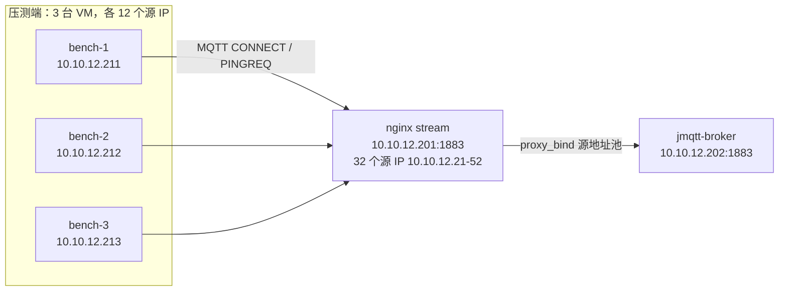

# nginx stream 代理 MQTT：80 万长连接实测与调优

生产环境的 MQTT 接入用 nginx `stream` 把 1883 代理到 EMQX，连接数到几十万时出现下行 CONNACK 丢失：broker 侧日志已写出，客户端收不到；连接数少时正常。扩虚拟 IP 没有缓解，最后切回云 LB。为了判断问题在 nginx、broker 还是宿主，笔者在 PVE 上按同一拓扑重建了链路，用自研 [jmqtt-broker](../jmqtt/README.md) 和 jmqtt-bench 做纯长连接压测，逐项调 OS、nginx 与 virtio 参数。

结论先摆出来：**nginx stream 的转发路径没有复现 CONNACK 丢失**；80 万连接下 nginx 与 broker 的用户态 CPU 合计不到 1.5 核，真正的上限是宿主处理心跳包的软中断算力。生产侧的现象与「AWS 安全组 conntrack 实例级上限 / ENA PPS 额度超限后静默丢包」一致，但未能在生产账号内验证。

## 一、拓扑与口径



| 阶段 | 组件 | 端口 / 协议 | 关键点 |
| --- | --- | --- | --- |
| 接入 | nginx stream | 1883 / TCP | 每条客户端连接再开一条到 broker 的连接，nginx 上共 2N 条 socket |
| 转发 | nginx → broker | 1883 / TCP | `proxy_bind` 从 32 个源 IP 中选源地址，突破单 IP 6.4 万源端口 |
| 承载 | jmqtt-broker | 1883 / TCP | Netty epoll；纯连接模式只处理 CONNECT / SUBSCRIBE / PING |
| 加压 | jmqtt-bench | MQTT 3.1.1 | Go 单二进制，每连接一个 goroutine；纯连接模式不发业务消息 |

单条链路的两个 TCP：


测试口径：`baseline: false`、`echo: false`、`clean_session: true`，只有 `connect + soak`，每台 bench 只发 CONNECT/SUBSCRIBE 与 PINGREQ，不发任何业务消息。keepalive 120 与 300 各测一轮，PING 间隔为 keepalive 的一半。

| 角色 | VM | 规格 | 软件 |
| --- | --- | --- | --- |
| nginx | 201 `nginx-lab` | 8C / 56G / 40G | nginx 1.28.3（Ubuntu），`libnginx-mod-stream` |
| broker | 202 `jmqtt-broker` | 10C / 36G / 40G | OpenJDK 21.0.13，jmqtt-broker 0.1.0-SNAPSHOT，24G 堆 |
| bench | 211-213 `bench-1..3` | 5C / 12G / 40G | Go 1.26 编译的 `mqtt-bench` |
| 宿主 | PVE 10.10.10.44 | E5-2698B v3 16C/32T / 251G | PVE 9.2.2，虚机 Ubuntu 26.04 / 内核 7.0.0-27 |

## 二、nginx stream 配置

完整模板见 [conf/nginx-stream.conf](conf/nginx-stream.conf)。核心部分：

```nginx
worker_processes auto;
worker_rlimit_nofile 4194304;

events {
    worker_connections 524288;   # 每 worker；客户端与上游连接都计数
    multi_accept on;
}

stream {
    split_clients "${remote_addr}:${remote_port}" $src_addr {
        3.12% 10.10.12.21;
        # ... 共 31 条 3.12% ...
        *     10.10.12.52;
    }

    upstream jmqtt {
        server 10.10.12.202:1883;
    }

    server {
        listen 1883 backlog=65535 reuseport;
        proxy_bind $src_addr;
        proxy_connect_timeout 5s;
        proxy_timeout 30m;
        proxy_buffer_size 2k;
        proxy_socket_keepalive on;
        access_log off;
        proxy_pass jmqtt;
    }
}
```

| 指令 | 取值 | 依据 |
| --- | --- | --- |
| `worker_connections` | 524288 | 默认 512；stream 里客户端与上游连接都占额度。80 万客户端 = 160 万 socket，8 worker 各 20 万，留一倍余量 |
| `worker_rlimit_nofile` | 4194304 | 登录会话默认 soft 1024，必须先由 systemd `LimitNOFILE=8388608` 抬起硬限，再由本指令设到进程 |
| `split_clients` + `proxy_bind` | 32 个源 IP | 单源 IP 对单个 `broker IP:1883` 只有约 6.4 万源端口。80 万 / 32 ≈ 2.5 万，150 万 / 32 ≈ 4.7 万，都在端口上限内 |
| `proxy_buffer_size` | 2k | 默认 16k，每个会话两个方向各一个。4k 降到 2k 后每会话省约 3.8KB，10 万会话约 390MB |
| `proxy_timeout` | 30m | 必须大于 MQTT keepalive 的 1.5 倍；keepalive 300 时 broker 在 450s 判死 |
| `listen backlog` | 65535 | 实际值受 `net.core.somaxconn` 约束，两边要一起抬 |
| `access_log` | off | 百万连接下访问日志本身是负担 |

两个版本细节：`split_clients` 的百分比最多两位小数，写 `3.125%` 会报 `invalid percent value`；stream 版的 `split_clients` 从 1.11.3 起提供，`proxy_bind` 支持变量从 1.11.2 起。Ubuntu 的 stream 模块是动态的，装 `libnginx-mod-stream` 后由 `modules-enabled/*.conf` 加载。

## 三、内核与虚拟化

完整 sysctl 见 [conf/99-nginx-mqtt.conf](conf/99-nginx-mqtt.conf)；通用内核基线（文件描述符三层限制、conntrack、过时参数黑名单）在[内核参数与百万连接](../linux/2.内核参数与百万连接.md)。

| 参数 | 取值 | 作用 |
| --- | --- | --- |
| `net.core.somaxconn` | 65535 | accept 队列上限；nginx 的 `backlog` 不能超过它 |
| `net.ipv4.tcp_max_syn_backlog` | 262144 | 半连接队列，建连风暴时兜底 |
| `net.core.netdev_max_backlog` | 262144 | 网卡收包 backlog |
| `net.ipv4.ip_local_port_range` | 1024 65535 | 客户端角色源端口从 2.8 万扩到 6.4 万 |
| `net.ipv4.tcp_tw_reuse` | 1 | 重连复用 TIME_WAIT；依赖 timestamp，新内核默认开 |
| `net.ipv4.tcp_max_tw_buckets` | 2000000 | 主动关闭侧 TIME_WAIT 额度 |
| `net.ipv4.tcp_max_orphans` | 1048576 | 孤儿 socket 上限 |
| `net.ipv4.tcp_mem` | 1048576 2097152 4194304 | 单位是页（×4KB），即 4G/8G/16G 水位；默认值按小内存机给，百万 socket 会先撞它 |
| `net.ipv4.tcp_rmem` / `wmem` | 4096 16384 4194304 | 空闲 MQTT 连接用小缓冲，上限 4M 兜底 |
| `net.core.optmem_max` | 65536 | 辅助缓冲上限 |
| `net.ipv4.tcp_slow_start_after_idle` | 0 | 长空闲后不重置拥塞窗口 |
| `vm.swappiness` | 0 | 不发生换页 |

文件描述符：`fs.file-max` 与 `fs.nr_open` 在 26.04 出厂已等效无限，不用改；真正要动的是 systemd 服务的 `LimitNOFILE=8388608`，手工启动的 broker/bench 在启动 shell 里 `ulimit -Hn 8388608`。

虚拟化层的关键项是 **virtio 多队列**。模板克隆出来的网卡默认 `Combined: 1`，每个 VM 的收发包压在一个 vhost 线程上：

```bash
# 宿主上，VM 需关机；<VM_MAC> 换成 qm config <vmid> 里 net0 的 MAC
qm set 201 -net0 virtio=<VM_MAC>,bridge=vmbr1,queues=8
qm set 202 -net0 virtio=<VM_MAC>,bridge=vmbr1,queues=8

# guest 内验证
ethtool -l ens18     # Current hardware settings -> Combined: 8
```

单队列时 87.5 万到顶；8 队列后到 97.5 万（+11%）。`queues` 不超过 vCPU 数：nginx 8、broker 8、bench 4。

## 四、阶梯实测

| 轮次 | 客户端连接 | keepalive | virtio 队列 | nginx socket | nginx RSS | broker RSS | 宿主 |
| --- | --- | --- | --- | --- | --- | --- | --- |
| 30 万 | 300,000 | 120 | 1 | 60 万 | 3.5G | 4.8G | 正常 |
| 87.5 万 | 874,891 | 120 | 1 | 175 万 | 6.8G | 7.2G | 96%，load 37 |
| 97.5 万 | 约 975,000 | 120 | 8 | 195 万 | 7.2G | 5.8G | 96%（43% us + 53% sy），load 36 |
| 80 万 | 800,000 | 300 | 8 | 160 万 | 6.34G | 5.35G | 建连峰值 24.2，soak 稳态 13.5 |

80 万这一轮是干净的：三台 bench 各 266,666 / 266,666 / 266,668，合计 800,000，300 秒 soak 内连接数不动；建连阶段每台有约 300~400 次 `read i/o timeout`，被压测端退回队列重试，最终净失败 0。达成后 nginx CPU 0.4~0.7 核、broker 0.4~0.8 核、每台 bench 0.2~0.45 核。

内存按会话增量算更准：nginx 空载 RSS 约 1.8G（8 worker），`proxy_buffer_size 2k` 时每会话约 5.7KB；80 万会话的 6.34G 里，约 4.5G 是连接相关。broker 的 RSS 受 JVM 堆按需增长影响，不同轮次不完全可比，80 万时 5.35G。

## 五、成本模型：为什么“只保持连接”也吃 CPU

**连接数被放大。** 80 万 MQTT 客户端在链路上市 80 万（bench）+ 160 万（nginx，每客户端两条 TCP）+ 80 万（broker），约 320 万个 socket 端点；97.5 万时约 390 万。每个 socket 都有控制块、epoll 节点、定时器和缓冲，跨 4 个 VM 反复创建与访问。

**心跳是持续的包处理。** keepalive=120 时每 60 秒一条 PINGREQ：

```text
97.5 万客户端 / 60s ≈ 1.6 万 PING/s
每次 PING = PINGREQ（client→nginx→broker）+ PINGRESP（broker→nginx→client）
            + TCP ACK，约 8 个包
≈ 13 万 pps；每个包过两次 virtio 和一次网桥
≈ 宿主 40 万次包处理/秒
```

实测 97.5 万时宿主 `43% us + 53% sy`，17 个线程耗在软中断上。同规模下 keepalive=120 的 80 万档宿主 load 已到 24~30 并继续爬；keepalive 拉到 300（PING 间隔 150 秒）后，80 万的 PING 量降到 5,333/s，soak 稳态 load 是 **13.5** —— 这是整轮实验里最大的单一变量。

**压测端自己也不便宜。** bench 每连接一个 goroutine + 读循环 + 定时器，80 万 goroutine、每秒数千次定时器到期；每 26.7 万连接约 3.28G RSS，折合 12.3KB/连接。broker 侧 80 万 session + 80 万订阅（bench 每连接 SUBSCRIBE 一次），还要按 1.5 倍 keepalive 判死。

**虚拟化税。** 每个包从 guest 到 vhost、过网桥、再进另一个 guest，没有零拷贝；单队列时这条路径是串行的。多队列只把负载摊开，不增加总算力。

**硬件代际。** E5-2698B v3 是 2014 年的 16C/32T，全核 2.4GHz，单核与内存带宽都不是为百万连接设计的。同等连接数在新一代 64 核 EPYC 上余量会大得多。

## 六、踩坑记录

| 现象 | 原因与处理 |
| --- | --- |
| broker 在 2 万 / 10 万连接时 Netty 全停：68 线程 sleeping、CPU 0%，Tomcat API 仍活 | 同一 clientId 重连触发“连接接管”后事件循环停摆，是 jmqtt-broker 的缺陷；每轮开跑前把 broker 重启到 `connections: 0`、避免上一轮残留 clientId，慢速爬坡不触发时不出现 |
| 连接爬到某个数后进程退出、连接数瞬间归零 | bench 的 `connect` 步时长按 `connect_rate` 推算；实际速率更低时，时间线到点直接结束进程。把 `duration` 设到覆盖完整爬坡，或降 `connect_rate` |
| 建连速率给到 15k/s 后压测端反而越跑越慢 | bench 每实例最多 1024 个并发建连，且任意失败就把速率乘 0.6；超时后自适应节拍会崩到 30/s。大规模用 1.5k~3k/s 总量慢爬 |
| 采样器卡住几分钟 | `ls /proc/<pid>/fd` 在百万 fd 时极慢，SSH 会挂住；改读 `/proc/sys/fs/file-nr` |
| nginx 报 `invalid percent value "3.125%"` | `split_clients` 百分比最多两位小数，改 `3.12%` |
| `qm set -net0 ...` 报 duplicate key | 必须给完整 spec 且 VM 关机；从 `qm config` 取 MAC 时别把 `,bridge` 一起切进去 |
| 单 IP 连接数卡在 6.4 万 | 这是客户端角色对单个 `目的 IP:端口` 的源端口上限；给代理机加辅助 IP，用 `proxy_bind` 分散 |
| 4k `proxy_buffer_size` 内存偏高 | 每会话两个方向的缓冲都按它分配；MQTT 报文小，2k 足够，10 万会话省约 390MB |

## 七、结论

- **nginx stream 转发没有问题。** 30 万、80 万、97.5 万三档都未复现 CONNACK 丢失；转发路径上 nginx 的用户态 CPU 始终很低。生产侧的下行丢失与 AWS 安全组 conntrack 实例级上限、ENA PPS 额度超限后的静默丢包一致，但那是宿主/云平台层，不是 nginx 逻辑。
- **多 IP 只解决端口空间，不解决算力。** 32 个源 IP 让 150 万的源端口账成立；AWS 的 conntrack/PPS 额度是 per instance，加 IP 不会增加，所以生产上要么放大实例，要么水平拆。
- **这台 32 线程宿主的天花板约 100 万**（keepalive=120）。把 keepalive 拉到 300 后，80 万稳态 load 只有 13.5；按线性外推，150 万稳态约 27，但建连峰值可能到 40，需要更多核、把压测端移出宿主，或拆成两台 nginx + 两台 broker。
- 生产容量规划的顺序：先看 keepalive 与真实心跳量，再看宿主的 `sy` 与 conntrack/PPS 额度，最后才是 nginx 参数；`worker_connections`、fd、`proxy_buffer_size` 这些是入场券，不是瓶颈本身。

## 相关阅读

- [内核参数与百万连接](../linux/2.内核参数与百万连接.md)：文件描述符三层限制、conntrack 截胡、十万连接实测
- [jmqtt 部署与运维](../jmqtt/README.md)：被测 broker 的配置与排障
- 配置模板：[conf/nginx-stream.conf](conf/nginx-stream.conf)、[conf/99-nginx-mqtt.conf](conf/99-nginx-mqtt.conf)
