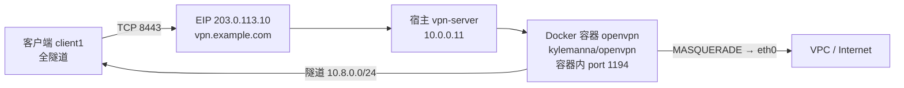

# 1. OpenVPN 服务端 Docker 部署与出口 IP

2026-11-25,在海外 VPC 的 `vpn-server`(10.0.0.11)上部署一台 OpenVPN 服务端,给客户端 `client1` 提供全隧道出口:客户端所有流量经 TCP 8443 进入隧道,在容器内做 MASQUERADE 后从 EIP 203.0.113.10 出网。服务端用 kylemanna/openvpn 镜像运行,隧道网段 10.8.0.0/24,不做 ccd/iroute。文中域名、IP、客户端名均为示例值。

## 一、部署形态



| 组件 | 端口/协议 | 关键点 |
| --- | --- | --- |
| 客户端 | TCP 8443 出站 | 导入 `client1.ovpn`;全隧道,默认路由改走隧道 |
| EIP | TCP 8443 入站 | 云安全组放行 8443;域名解析到 203.0.113.10 |
| 宿主 | 8443 → 1194 | Docker 端口映射;ufw 保持关闭 |
| 容器 | TCP 1194 | `kylemanna/openvpn`,privileged,`restart=always` |
| 隧道 | 10.8.0.0/24 | net30,服务端 10.8.0.1,客户端 10.8.0.6/.10 |
| NAT | 10.8.0.0/24 → eth0 | 容器内 MASQUERADE,出口 203.0.113.10 |

示例参数:

| 项 | 值 |
| --- | --- |
| 宿主 | `vpn-server`(10.0.0.11),Ubuntu 26.04 LTS |
| 域名 / EIP | `vpn.example.com` / 203.0.113.10 |
| 镜像 | `kylemanna/openvpn:latest`,OpenVPN 2.4.9 + OpenSSL 1.1.1g(2020-04-20 构建) |
| 容器 | `openvpn`,`--privileged --restart=always -p 8443:1194/tcp`,数据卷 `/data/openvpn` |
| 隧道 | 10.8.0.0/24,net30 |
| DNS | 10.0.0.2、10.0.0.3(VPC 内网 DNS) |
| 客户端 | `client1`,nopass |

## 二、服务端部署

### 2.1 前置检查

```bash
docker --version
ls -l /dev/net/tun
ss -lntp | grep -E ':8443|:1194'
sysctl net.ipv4.ip_forward
getent hosts vpn.example.com
```

`/dev/net/tun` 必须存在;8443 不能被占用;`ip_forward` 为 1(Docker 宿主通常已开,容器内的 `ovpn_run` 也会设)。云安全组放行 TCP 8443,域名解析到 EIP。

`/data/openvpn` 已有数据时先备份或挪走。`ovpn_genconfig` 会覆盖 `openvpn.conf` 和 `ovpn_env.sh`(同目录留 `.bak`),`ovpn_initpki` 在已有 PKI 时会要求确认删除。

### 2.2 生成服务端配置

```bash
mkdir -p /data/openvpn
docker run --rm -v /data/openvpn:/etc/openvpn kylemanna/openvpn \
  ovpn_genconfig \
  -u tcp://vpn.example.com:8443 \
  -s 10.8.0.0/24 \
  -N \
  -n 10.0.0.2 \
  -n 10.0.0.3 \
  -p "redirect-gateway def1 bypass-dhcp"
```

参数逐项:

- `-u tcp://域名:8443`:客户端配置里的 remote 地址与协议;genconfig 会拆出 host/port,但服务端配置固定写 `port 1194`,靠 Docker 映射到 8443。
- `-s 10.8.0.0/24`:隧道网段;生成 `server 10.8.0.0 255.255.255.0`。
- `-N`:容器内做 NAT;`ovpn_run` 会为隧道网段(以及默认的 192.168.254.0/24)加 MASQUERADE,并设置 `ip_forward=1`。
- `-n`:要推送的 DNS,重复写;不写时镜像默认推 8.8.8.8/8.8.4.4。
- `-p "redirect-gateway def1 bypass-dhcp"`:任意 push 配置;这里让客户端走全隧道。

生成的 `/data/openvpn/openvpn.conf` 见 [conf/openvpn.conf](conf/openvpn.conf),关键行:

```conf
server 10.8.0.0 255.255.255.0
port 1194
proto tcp
push "redirect-gateway def1 bypass-dhcp"
push "dhcp-option DNS 10.0.0.2"
push "dhcp-option DNS 10.0.0.3"
```

`port 1194` 是容器内端口,宿主 8443 由 `-p 8443:1194/tcp` 映射;客户端配置里的 remote 端口是 8443。两者不要混。

### 2.3 初始化 PKI

```bash
docker run --rm -e EASYRSA_BATCH=1 \
  -v /data/openvpn:/etc/openvpn \
  kylemanna/openvpn ovpn_initpki nopass
```

`nopass` 表示 CA 私钥不加密,签发客户端证书时不需要口令;这是安全取舍,适合临时出口场景。`EASYRSA_BATCH=1` 用于非交互环境:不加时 `easyrsa build-ca` 会停在 CA Common Name 提示上,读到 EOF 后报 `Failed to build the CA`。失败后删掉 `/data/openvpn/pki` 重来。

产物在 `/data/openvpn/pki`:CA、服务端证书 `vpn.example.com.crt`、`dh.pem`、`ta.key`;CRL 同时放在 `/data/openvpn/crl.pem`(644)与 `pki/crl.pem`(600)。

### 2.4 启动容器

```bash
docker run -d \
  --name=openvpn \
  --privileged \
  --restart=always \
  -p 8443:1194/tcp \
  --cap-add=NET_ADMIN \
  -v /data/openvpn:/etc/openvpn \
  kylemanna/openvpn
```

`--privileged` 与 `--cap-add=NET_ADMIN` 有重叠,保留是为了和镜像文档一致;真正需要的是创建 tun 设备与容器内写 iptables 的权限。

验证:

```bash
docker ps --filter name=openvpn
ss -lntp | grep 8443
docker logs --tail 20 openvpn
docker exec openvpn ip -4 addr show tun0
docker exec openvpn iptables -t nat -S POSTROUTING | grep 10.8.0
```

正常输出包含 `Initialization Sequence Completed`、`0.0.0.0:8443->1194/tcp`、`tun0` 上的 `10.8.0.1 peer 10.8.0.2/32`,以及 `-A POSTROUTING -s 10.8.0.0/24 -o eth0 -j MASQUERADE`。

## 三、客户端签发与使用

### 3.1 签发

```bash
docker run --rm -e EASYRSA_BATCH=1 -v /data/openvpn:/etc/openvpn \
  kylemanna/openvpn easyrsa build-client-full client1 nopass

docker run --rm -v /data/openvpn:/etc/openvpn \
  kylemanna/openvpn ovpn_getclient client1 > /root/client1.ovpn

chmod 600 /root/client1.ovpn
```

`ovpn_getclient` 导出的文件是内联格式:`<key>`、`<cert>`、`<ca>`、`<tls-auth>` 都在同一个文件里,末尾 `key-direction 1`;remote 行是 `remote vpn.example.com 8443 tcp`。文件含客户端私钥,用 scp 传输,不要放进仓库。

### 3.2 客户端配置结构

非密钥部分:

```conf
client
nobind
dev tun
remote-cert-tls server
remote vpn.example.com 8443 tcp
key-direction 1
```

服务端 push 的 `redirect-gateway`、DNS 和 `block-outside-dns` 在连接时下发,不需要手写进客户端配置。

### 3.3 验证

客户端连上后:

```bash
ip -4 addr show tun0          # 10.8.0.6
ping -c 3 10.8.0.1            # 服务端隧道地址
curl -s https://api.ipify.org # 203.0.113.10
```

服务端看状态:

```bash
docker exec openvpn cat /tmp/openvpn-status.log
```

连接建立后 `CLIENT_LIST` 与 `ROUTING TABLE` 会出现客户端记录。本次用临时容器加载 `client1` 配置实测:客户端地址 10.8.0.6,ping 10.8.0.1 零丢包,出口 IP 203.0.113.10。

## 四、运维

- 重启/停止:`docker restart openvpn`、`docker stop openvpn`、`docker start openvpn`;配置和数据都在 `/data/openvpn`,容器删了也能重建。
- 日志:`docker logs -f openvpn`;状态文件在容器内 `/tmp/openvpn-status.log`。
- 加客户端:重复 3.1 的 `build-client-full <CN>` 与 `ovpn_getclient <CN>`。
- 吊销客户端:

```bash
docker run --rm -e EASYRSA_BATCH=1 -v /data/openvpn:/etc/openvpn \
  kylemanna/openvpn easyrsa revoke <CN>
docker run --rm -e EASYRSA_BATCH=1 -v /data/openvpn:/etc/openvpn \
  kylemanna/openvpn easyrsa gen-crl
cp /data/openvpn/pki/crl.pem /data/openvpn/crl.pem
docker restart openvpn
```

镜像生成的 `openvpn.conf` 默认没有 `crl-verify`,吊销要生效需在 `/data/openvpn/openvpn.conf` 加一行 `crl-verify /etc/openvpn/crl.pem` 再重启。`crl.pem` 用 644 权限,容器以 `nobody` 运行时才能在每次连接时读到。

- 备份:`tar czf /root/openvpn-data-$(date +%F).tgz -C /data openvpn`,文件里有 CA 私钥和所有客户端私钥,权限 600,不要放仓库。
- 升级镜像:`docker pull kylemanna/openvpn`,删容器后用同样的 `docker run` 重建,`/data/openvpn` 不动。

## 五、坑表

| 坑 | 现象 | 处理 |
| --- | --- | --- |
| `ovpn_genconfig` 不带 `-u` 裸跑 | 直接重生成 `openvpn.conf`/`ovpn_env.sh`,旧配置被覆盖(同目录留时间戳 `.bak`) | 命令必须带 `-u`;生产容器里不要裸跑;执行前先备份 `/data/openvpn` |
| `ovpn_initpki nopass` 在非交互 shell 里 | `build-ca` 停在 CA CN,EOF 后 `Failed to build the CA` | 加 `-e EASYRSA_BATCH=1`;失败后删 `pki` 重来 |
| 共享宿主上 ufw 名义 active、规则未生效 | 直接 `ufw disable && ufw --force enable` 后只放行管理端口,80/443 被 DROP,同机站点外部访问中断 | 不要动 ufw;端口交给云安全组;必须启用时先盘完整 allow 清单与业务端口,挑低峰操作 |
| 海外区 apt 源指向国内内网镜像 | `apt install` 全部超时 | 临时换官方源或就近镜像,备份原 sources;装完还原 |
| 端口映射写错 | 客户端连 8443 但容器内部监听 1194;写成 `-p 8443:8443` 或改 host 网络后连不上 | 容器内 `port 1194`,宿主 `-p 8443:1194/tcp`,客户端 remote 8443;改 host 网络时同步改 `port` |
| 默认 net30 | 客户端拿到 10.8.0.6/.10,不是 10.8.0.2/.3 | 按 net30 规划地址;要 subnet 拓扑在 `openvpn.conf` 加 `topology subnet` 并重启,客户端地址会变成 .2/.3 这类 |
| Linux 命令行客户端不应用 push DNS | `dhcp-option DNS` 只在 Windows/macOS 客户端自动生效;Linux CLI 不会改 resolv.conf | 用 NetworkManager 导入,或配 `update-resolv-conf`/systemd-resolved 脚本;也可以手动指定 DNS |
| `block-outside-dns` 在 Linux 客户端 | 日志报 `Unrecognized option ... block-outside-dns (2.4.9)`,连接继续 | 非致命;Windows 客户端按预期阻止隧道外 DNS |
| 默认没有 `crl-verify` | `easyrsa revoke` 后旧证书仍能连接 | 在 `openvpn.conf` 加 `crl-verify /etc/openvpn/crl.pem`,更新 `crl.pem`,重启容器 |
| 镜像停在 2.4.9 | OpenVPN 2.4 分支已停止安全维护 | 临时出口可用;长期使用换 2.6+ 镜像或宿主原生包 |
