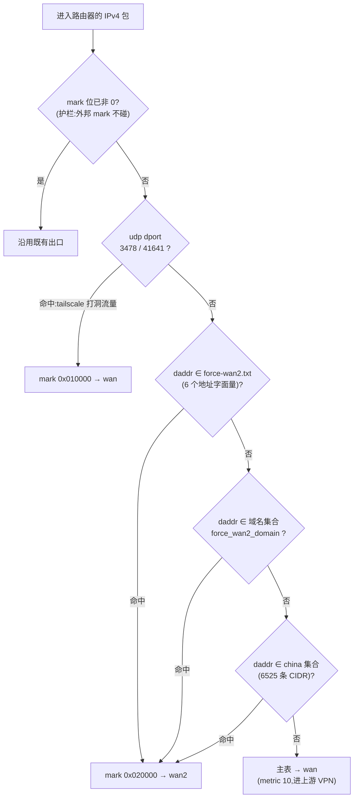
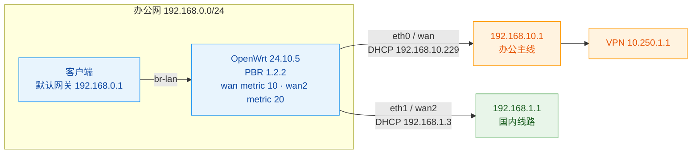
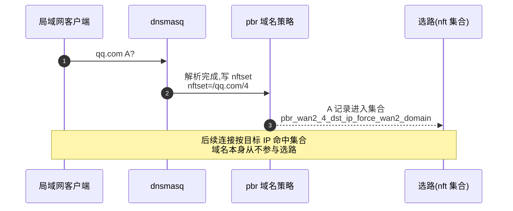
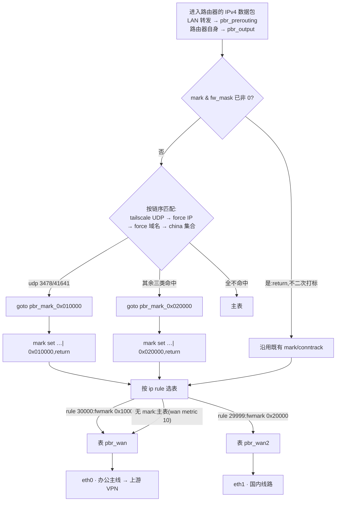
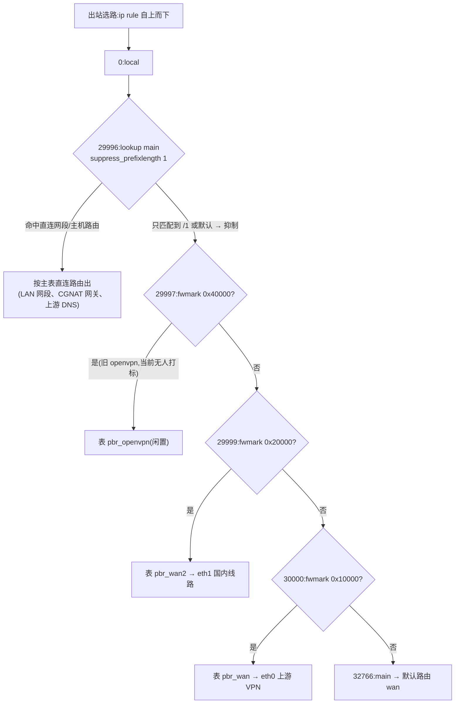
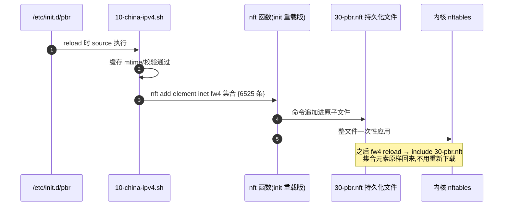
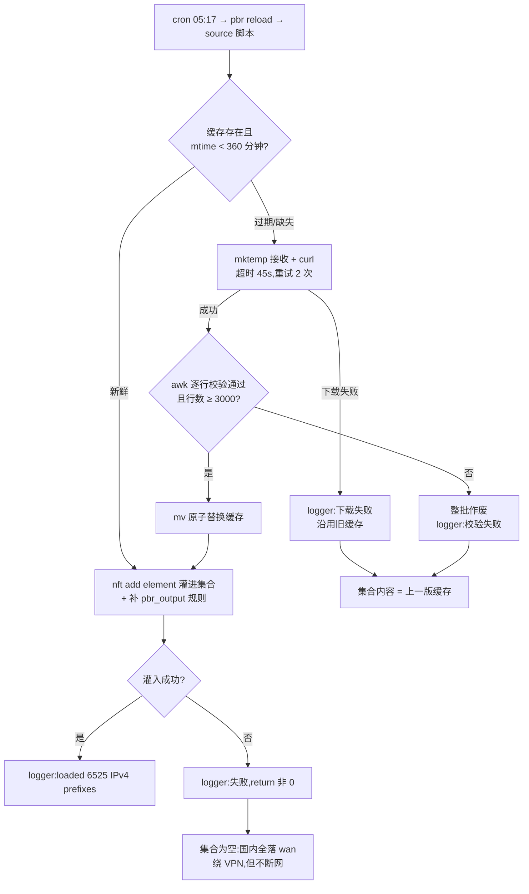
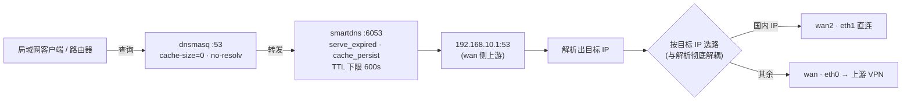
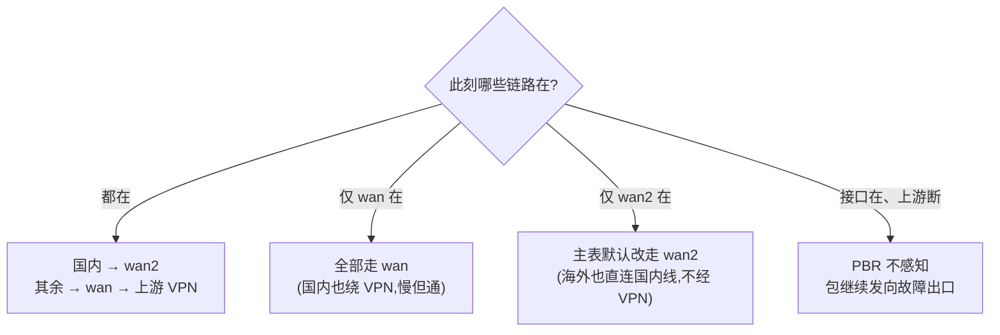

# OpenWrt 双 WAN:按目标 IPv4 分流

办公网关是一台 x86 的 OpenWrt 24.10.5,双出口:wan 接办公主线,上游自带 VPN;wan2 另接一条线路,专门跑国内目标。国内 IPv4 走 wan2,其余走 wan 再进上游 VPN,局域网客户端和路由器自身用同一套规则。

选路交给 nft 集合:6525 条国内 CIDR 灌进 fw4 的 `pbr_wan2_4_dst_ip_user`,命中的包打上 mark `0x20000`,ip rule 把它送进 `pbr_wan2` 表、从 eth1 出去;不命中的落回主表,主表里 wan 的 metric 是 10、wan2 是 20,默认出口仍然是 wan。

路由路径(2026-10-27):

```text
traceroute 223.5.5.5  → 192.168.1.1(wan2) → 14.155.232.1
traceroute 8.8.8.8    → 192.168.10.1(wan) → 10.250.1.1(VPN) → 50.154.110.1
```

## 一、哪些目标走哪条线

按目标分四类,外加一条端口例外:

| 目标 | 出口 | 判定依据 |
| --- | --- | --- |
| 国内 IPv4,6525 条 CIDR | **wan2 / eth1** | 集合 `pbr_wan2_4_dst_ip_user` |
| `force-wan2.txt` 里的 6 个地址 | **wan2 / eth1** | 规则里的地址字面量 |
| `force-wan2-domain.txt` 里 3 个域名解析出的 IP | **wan2 / eth1** | 集合 `pbr_wan2_4_dst_ip_force_wan2_domain` |
| tailscale 的 UDP 3478 / 41641 | **wan / eth0** | 按端口强制到 wan |
| 其余 IPv4 | **wan / eth0** → 上游 VPN | 主表默认路由 |

覆盖范围有两类:局域网客户端从 br-lan 转发,进 `pbr_prerouting`;路由器自己发起的更新、测速、命令行,走 `pbr_output` 里补的那条规则(见 5.2)。

四条策略按固定顺序匹配,先命中先赢,顺序会影响结果:



IPv6 没做。`ip -6 route` 里只有 ULA `fd1d:3626:20b5::/48` 和 link-local,两条 WAN 都没有可用的公网 v6 地址或默认路由,`pbr.config.ipv6_enabled=0`。

## 二、接口与地址



> 两条 WAN 都是 DHCP,地址随续租变化;策略只认逻辑接口 `wan`、`wan2`,网关由 PBR 运行时向 netifd 取。

| 逻辑接口 | 设备 | 协议 | 地址(2026-10-27) | 网关 | metric | 用途 |
| --- | --- | --- | --- | --- | --- | --- |
| `wan` | eth0 | DHCP | `192.168.10.229/24` | `192.168.10.1` | 10 | 默认出口,上游 VPN |
| `wan2` | eth1 | DHCP | `192.168.1.3/24` | `192.168.1.1` | 20 | 国内直连出口 |
| `lan` | br-lan | 静态 | `192.168.0.1/24`,另挂 `10.10.9.1`、`10.10.10.1` | 本机 | - | 内网 |
| `openvpn` | tun0 | none | `10.10.5.10/32`,peer `10.10.5.9` | - | - | 只承载 `10.60.0.0/16` 的显式路由 |

地址和网关一行都不写进脚本。8 月这套策略建好时 wan2 还在 `192.168.0.x` 网段,10 月再看已经换成了 `192.168.1.x`。策略只认逻辑接口 `wan`、`wan2`,网关让 PBR 运行时从 netifd 取。

`network.sg` 和 `network.openvpn` 两个旧接口留着没删:前者是停在 `auto=0` 的 WireGuard,后者是 `proto=none` 的 tun0。PBR 启动时照样给它们建表建链(259 号表里挂着一条 `default via 10.10.5.9 dev tun0`),但没有任何规则给流量打 `0x40000`,集合是空的、计数器全 0,等于闲置。要清掉得先确认这两条隧道不会再启,再删接口配置 reload,所以先留着。

## 三、为什么用 PBR

需求是按目标 IPv4 静态选一条出口,链路断了能退,不要求按质量动态切换。

6525 条 CIDR 写成静态路由,每条都要经 netifd 下发,配置、重载、排障全被这份表拖着;交给 PBR 就是一个 nft 集合加一条 `goto`。mwan3 做的是多链路负载和健康检查,拿它切"国内/国外"会写出一堆 rule 和 iptables 链,每次换列表还得重载整套规则。

兜底交给 metric:主表 wan 10、wan2 20,策略命中才走 wan2,不命中自然回落到 wan。

探测、带宽聚合、按应用分流都没有启用,相关表现见「十二、故障行为」。

## 四、策略配置

策略都写在 `/etc/config/pbr`,生成的 nft 规则落在 `inet fw4` 的 `pbr_*` 链里。

### 4.1 全局参数

```text
config pbr 'config'
	option enabled '1'
	option fw_mask '00ff0000'
	option uplink_mark '00010000'
	option uplink_interface 'wan'
	option uplink_ip_rules_priority '30000'
	option strict_enforcement '0'
	option ipv6_enabled '0'
	option nft_rule_counter '1'
	option nft_set_auto_merge '1'
	option nft_set_flags_interval '1'
	option nft_set_policy 'performance'
	option resolver_set 'dnsmasq.nftset'
	list lan_device 'br-lan'
```

`fw_mask` 圈出 mark 的 `0x00ff0000` 给 PBR 用,`uplink_mark` 是默认出口的基准,后面每个接口依次占一位(wan `0x010000`、wan2 `0x020000`);低位 mark 留给 QoS,两边不打架。

`strict_enforcement '0'` 是特意关的:策略出口不可用时不丢包,继续查主表,流量能出去,只是出口可能不是想要的那条。可用性优先,后果见「十二、故障行为」。

`nft_rule_counter '1'` 打开每条规则的计数器。策略有没有命中,只看这个。

### 4.2 中国地址集合

国内这份清单没走 UCI,交给一个 include 脚本灌进 `pbr_wan2_4_dst_ip_user`:

```text
/etc/pbr.d/10-china-ipv4.sh
/etc/pbr-china/china-ipv4.txt      # 6525 行
```

PBR 会自动执行 `/etc/pbr.d/` 下的脚本,脚本输出的 nft 命令会被它捕获进持久化文件(见「七、nft 集合与持久化」)。

### 4.3 强制走 wan2 的 IP

```text
config policy 'force_wan2'
	option name 'Force overseas targets via WAN2'
	option interface 'wan2'
	option dest_addr 'file:///etc/pbr-china/force-wan2.txt'
	option enabled '1'
```

有几个海外目标走国内线路更快更稳,单独列进 `force-wan2.txt`,当前 6 个,一行一个。清单短,PBR 直接把地址内联进规则,不建集合:

```nft
ip daddr { 144.34.187.180, 223.254.128.189, 47.237.119.102,
           65.49.220.18, 8.219.199.142, 8.219.206.74 } \
    counter goto pbr_mark_0x020000 comment "Force overseas targets via WAN2"
```

### 4.4 按域名强制走 wan2

```text
config policy 'force_wan2_domain'
	option name 'domain via domestic WAN2'
	option interface 'wan2'
	option dest_addr 'file:///etc/pbr-china/force-wan2-domain.txt'
	option enabled '1'
```

还有 3 个域名必须落在 wan2。域名本身不参与选路,靠 `resolver_set 'dnsmasq.nftset'` 让 dnsmasq 解析完顺手把 A 记录写进 `pbr_wan2_4_dst_ip_force_wan2_domain`,后续连接再按目标 IP 命中集合。

这条链路有三段,少配一段就静默失效:

1. `/etc/config/dhcp` 里 dnsmasq 的 `addnmount '/var/run/pbr.dnsmasq'`,让 jail 能写到 PBR 的目录;
2. PBR 在 dnsmasq 的 conf-dir 里挂符号链接 `/tmp/dnsmasq.cfg01411c.d/pbr → /var/run/pbr.dnsmasq`;
3. 规则形如 `nftset=/qq.com/4#inet#fw4#pbr_wan2_4_dst_ip_force_wan2_domain`。

集合只增不减,靠 PBR reload 清空重建。三个域名累积到现在约 1560 条,里面混着 `127.0.0.1`、`0.0.0.1` 这类解析残留,不碍事,但说明这个集合不做校验。



### 4.5 tailscale 的 UDP 例外

```text
config policy
	option name 'tailscale direct via wan'
	option interface 'wan'
	option dest_port '3478 41641'
	option proto 'udp'
	option enabled '1'
```

tailscale 的 STUN 探测和 disco 走 UDP 3478/41641,靠出口映射打洞。目标 IP 落进国内集合,包就被分到 wan2,出口地址一换,映射全散。这两个端口的 UDP 钉死在 wan,打洞才稳。组网本身见[办公网到 10.61 组网迁移](../tailscale/1.办公网到10.61组网迁移(WG转tailscale).md)。

## 五、包的处理路径



> nft 只负责打 mark,选哪张表由 ip rule 决定;两者解耦,所以加一条策略不用动路由表,改路由也不用碰 nft。

### 5.1 局域网客户端

局域网客户端的包从 br-lan 进来,先在 firewall4 的 `mangle_prerouting` 跳到 `pbr_prerouting`,做完集合匹配和打标再回 netfilter;选表交给 ip rule,出接口定下来,最后在 `POSTROUTING` 做 masquerade。实际看到的链长这样(计数器抓于 2026-10-27,reload 后归零):

```nft
chain pbr_prerouting {
    udp dport { 3478, 41641 } counter packets 8699 bytes 626854 goto pbr_mark_0x010000 comment "tailscale direct via wan"
    ip daddr { 8.219.199.142, ... } counter packets 32983 bytes 2501912 goto pbr_mark_0x020000 comment "Force overseas targets via WAN2"
    ip daddr @pbr_wan2_4_dst_ip_force_wan2_domain counter packets 2113024 bytes 209868581 goto pbr_mark_0x020000 comment "domain via domestic WAN2"
    ip daddr @pbr_wan2_4_dst_ip_user counter packets 2591943 bytes 277603549 goto pbr_mark_0x020000
    # 其后是 wan/wan2/sg/openvpn 的空集合规则,计数器全为 0
}
```

规则顺序就是匹配顺序,命中即 `goto` 到标记链,后面的规则不再看。标记链只改写 mark 的 `0x00ff0000` 字节,再 return 回 PBR 之外,交给 ip rule 选表:

```nft
chain pbr_mark_0x020000 {
    counter meta mark set (meta mark & 0xff00ffff) | 0x020000
    return
}
```

### 5.2 路由器自身

`pbr_prerouting` 挂在 `mangle_prerouting` 上,只管转发。路由器自己发起的包走 `mangle_output`,而 PBR 挂上去的 `pbr_output` 默认没有业务规则,所以 8 月落地时在脚本末尾补了一条:

```nft
ip daddr @pbr_wan2_4_dst_ip_user counter goto pbr_mark_0x020000
```

它现在位于 `pbr_output` 第二条,前面有一条"mark 已非 0 就 return"的护栏,避免二次打标:

```nft
chain pbr_output {
    counter packets 2961354 bytes 337894283 meta mark & 0x00ff0000 != 0x00000000 return
    ip daddr @pbr_wan2_4_dst_ip_user counter packets 246708 bytes 23004640 goto pbr_mark_0x020000
}
```

链名里的 mark 取 PBR 运行时提供的 `mark_wan2` 变量,脚本里写的 `0x020000` 只是回退值。将来加接口、mark 编号变了,这条规则也不会指错链。

### 5.3 已建立的连接

conntrack 会记住已建立连接的 mark,后续数据包直接沿用原出口。改策略或 reload 之后,老会话可能还走旧线路,直到连接关闭或条目过期。改完策略一律建新连接验证,不刷新长连接,也不靠 `ping` 下结论。

## 六、路由表与 ip rule

这台机器上的规则:

```text
0:      from all lookup local
29996:  from all lookup main suppress_prefixlength 1
29997:  from all fwmark 0x40000/0xff0000 lookup pbr_openvpn
29999:  from all fwmark 0x20000/0xff0000 lookup pbr_wan2
30000:  from all fwmark 0x10000/0xff0000 lookup pbr_wan
32766:  from all lookup main
32767:  from all lookup default
```

| 表号 | 名字 | 内容 |
| --- | --- | --- |
| 256 | `pbr_wan` | `default via 192.168.10.1 dev eth0` |
| 257 | `pbr_wan2` | `default via 192.168.1.1 dev eth1` |
| 258 | `pbr_sg` | 空 |
| 259 | `pbr_openvpn` | `default via 10.10.5.9 dev tun0`,无流量命中 |

一个包从上到下过一遍 rule:



29996 那条是最关键的一条:`suppress_prefixlength 1` 让主表里的本地和直连网段先于默认路由生效,同时把默认路由暂时压掉,带 mark 的公网流量才有机会进到下面的 PBR 规则。没有它,访问 WAN 网关、本地网段和 LAN 地址的包会被送错出口。

表号由 PBR 从 `rt_tables` 申请,不保证永远 256/257。查表一律用名字,不记数字。

## 七、nft 集合与持久化

集合长这样:

```text
family: inet
table: fw4
set: pbr_wan2_4_dst_ip_user
type: ipv4_addr
flags: interval
auto-merge: enabled
policy: performance
```

`interval` + `auto-merge` 把相邻 CIDR 合并成区间:6525 行文本进内核后是 4474 个元素。查询命中的也是合并后的区间,`nft get element ... '{ 223.5.5.5 }'` 返回 `223.0.0.0/12`,不是 `223.5.5.5` 本身。比在主表里挂几千条静态路由紧凑,查表还由集合自己完成。

持久化靠这个文件:

```text
/usr/share/nftables.d/ruleset-post/30-pbr.nft      # 112659 字节
```

firewall4 完整重载时会包含它,规则和集合元素都不会只活在内存里。确认过,文件里既有链与规则的定义,也有加载脚本输出的 `add element inet fw4 pbr_wan2_4_dst_ip_user { ... }`:PBR 生成规则时把 include 脚本的输出一起捕获了,国内清单被写进了这份文件,`fw4 reload` 之后不用重新下载。这条链路画成时序:



域名集合是例外,元素由 dnsmasq 解析时写入,不进这份文件,只活在运行时。PBR reload 之后清空,等下一次解析重新填充。

## 八、国内地址库的日常更新

清单来自这两个地址:

```text
https://github.com/gaoyifan/china-operator-ip
https://gaoyifan.github.io/china-operator-ip/china.txt
```

缓存放在 `/etc/pbr-china/china-ipv4.txt`,加载脚本是 `/etc/pbr.d/10-china-ipv4.sh`,PBR 每次 reload 都会执行它。脚本按这个顺序判断:

1. 缓存存在且 mtime 小于 360 分钟,跳过下载;
2. 否则 `curl` 拉取:连接超时 10 秒、总超时 45 秒、失败重试 2 次;
3. 用 `mktemp` 建临时文件接收,不碰旧缓存;
4. `awk` 逐行校验:必须以 `/` 分出 5 段,每段是数字,前四段 ≤ 255,前缀 ≤ 32;
5. 任一行不合法,整批作废,不更新缓存;
6. 有效行数必须 ≥ 3000,防止错误页或截断内容被灌进去;
7. 校验通过后 `mv` 原子替换缓存;
8. 把整份缓存拼成一条 `nft add element` 灌进集合;
9. 追加 `pbr_output` 里那条路由器自身流量的规则;
10. 更新成功、下载失败、拿不到有效清单这几个节点写 `logger -t pbr-china`;无可用清单时返回非 0。

十步逻辑的决策树:



日志:

```sh
logread -e pbr-china
logread -e pbr
```

定时任务在 `/etc/crontabs/root`:

```cron
17 5 * * * /etc/init.d/pbr reload >/dev/null 2>&1
```

每天 05:17 reload 一次。reload 会重跑脚本,缓存超过 6 小时才真的下载,也就是说每天实际做的是重装一次,列表过期了才顺手刷新。下载或校验失败时,集合里灌的还是上一版缓存;连缓存都没有(比如全新安装),脚本返回非 0,集合为空,国内目标全落到 wan,不断网,但都绕进了 VPN。降级后网络仍然可用,只是慢,不会断。

## 九、DNS 的位置

```text
局域网客户端 / 路由器
  → dnsmasq :53
  → smartdns 127.0.0.1:6053
  → 192.168.10.1:53(wan 侧)
```

dnsmasq 这边把缓存让给了 smartdns:`cache-size=0`、`no-resolv=1`、`server=127.0.0.1#6053`;TTL 和持久化都在 smartdns 里(`serve_expired`、`cache_persist` 开着,TTL 下限 600 秒)。上游只配了 `192.168.10.1` 一个,走 UDP。

解析和选路是两个阶段:先解析出 IP,再按 IP 选出口。



- 域名解析到国内 IP,连接走 wan2;解析到海外 IP,连接走 wan 和上游 VPN。
- 客户端自己用 DoH/DoT 不会绕过分流,连接照样经过路由器,照样按目标 IP 判;但域名策略会失效,dnsmasq 没解析,`pbr_wan2_4_dst_ip_force_wan2_domain` 就不会新增元素,只有集合里的历史 IP 还生效。
- 上游 DNS `192.168.10.1` 属于 wan 的直连网段,直连路由优先于 PBR 的默认路由,解析请求本身不会被送进 wan2。换线或 DHCP 网段变化后要重新确认它可达,否则整网 DNS 一起坏。

`ip rule` 里的 `suppress_prefixlength 1` 保护的正是这一类:直连网段的包不会因为某条策略被送错出口。

## 十、验证

下面这些命令都在网关本机跑过,不需要改任何配置。

### 10.1 接口与规则

```sh
ifstatus wan | jsonfilter -e '@.up' -e '@.l3_device'
ifstatus wan2 | jsonfilter -e '@.up' -e '@.l3_device'
ip -br -4 addr
ip -4 rule show
/etc/init.d/pbr status
```

`pbr status` 会打印完整的生成规则。排查"规则为什么没生效",先看它的 "Uplink (IPv4)" 一行,确认 PBR 认的是哪个接口。

### 10.2 表与标记

```sh
ip -4 route show table pbr_wan
ip -4 route show table pbr_wan2
ip route get 223.5.5.5 mark 0x20000
ip route get 8.8.8.8 mark 0x10000
```

预期输出:

```text
223.5.5.5 via 192.168.1.1 dev eth1 table pbr_wan2 src 192.168.1.3 mark 0x20000
8.8.8.8   via 192.168.10.1 dev eth0 table pbr_wan src 192.168.10.229 mark 0x10000
```

### 10.3 集合

```sh
nft get element inet fw4 pbr_wan2_4_dst_ip_user '{ 223.5.5.5 }'
nft get element inet fw4 pbr_wan2_4_dst_ip_user '{ 8.8.8.8 }'
```

第一条返回 `elements = { 223.0.0.0/12 }`;第二条返回 `Could not process rule: No such file or directory`,这是报错,不是空结果。nftables 用报错表达"元素不存在"。

### 10.4 计数器

```sh
nft list chain inet fw4 pbr_prerouting
nft list chain inet fw4 pbr_output
```

访问几个国内站点后,`pbr_wan2_4_dst_ip_user` 那条规则的 packet 计数应该上涨。2026-10-27 抓的一组:国内集合 2 591 943 个包、域名策略 2 113 024 个包、IP 白名单 32 983 个、tailscale 8 699 个;路由器自身 246 708 个。

### 10.5 实际路径

```sh
traceroute -n -m 4 223.5.5.5
traceroute -n -m 4 8.8.8.8
```

第一跳的网关就说明走的是哪条线。网关地址会变,判断时只看第一跳落在哪个 wan 的网段,不记具体 IP。

### 10.6 firewall 与 DNS

```sh
fw4 check
/etc/init.d/dnsmasq status
/etc/init.d/smartdns status
nslookup openwrt.org 127.0.0.1
```

## 十一、改动与回滚

给某个海外目标开 wan2,一般这么加:

```sh
echo '1.2.3.4' >> /etc/pbr-china/force-wan2.txt
/etc/init.d/pbr reload
```

给某个域名开 wan2:

```sh
echo 'example.com' >> /etc/pbr-china/force-wan2-domain.txt
/etc/init.d/pbr reload
nslookup example.com 127.0.0.1     # 触发一次解析,把地址写进集合
```

改完加载脚本,固定跑这三条:

```sh
/bin/ash -n /etc/pbr.d/10-china-ipv4.sh
/etc/init.d/pbr reload
fw4 check
```

`ash -n` 只查语法,不校验逻辑;真正的验证在 reload 日志里,`logread -e pbr-china` 应该看到 `loaded 6525 IPv4 prefixes into pbr_wan2_4_dst_ip_user`。

临时停掉整套分流:

```sh
uci set pbr.config.enabled='0'
uci commit pbr
/etc/init.d/pbr stop
fw4 reload
```

停用后回到普通主备路由:wan metric 10、wan2 metric 20,海外照旧走 VPN,国内也全部走 VPN。

重新启用:

```sh
uci set pbr.config.enabled='1'
uci commit pbr
/etc/init.d/pbr restart
```

笔者在 2026-08-24 动手前把三份配置备份在路由器上:

```text
/root/network.before-pbr-20260824-153926
/root/firewall.before-pbr-20260824-153926
/root/dhcp.before-pbr-20260824-153926
```

这些备份笔者不会整体覆盖回去,除非确认备份之后的网络改动(tun0 的路由、lan 的静态路由、tailscale 相关)都不要了。

## 十二、故障行为

| 状态 | 实际行为 |
| --- | --- |
| 两条都在线 | 国内 IPv4 走 wan2,其余走 wan 和上游 VPN |
| wan2 接口或 DHCP 路由消失 | 国内目标回落到 wan,绕 VPN |
| wan 接口或默认路由消失 | 主表默认改走 wan2,海外流量也回落到 wan2,绕过 VPN |
| 接口在线但上游断网 | PBR 不感知,包继续往故障出口发 |
| 刚改完策略 | 已建立连接沿用旧出口,直到 conntrack 条目过期 |

回落关系画成图:



> `strict_enforcement=0` 加 wan2 metric 20,取的是可用性优先:任一条线断了,流量自动兜到剩下那条。代价是海外流量在 wan 故障时绕过 VPN。如果 VPN 是安全边界,别照这个配,要么把策略改成严格模式,要么在上游加 kill switch。

这套配置没有主动 ICMP/HTTP 探测,PBR 依据的是 netifd 的接口、地址和网关状态,接口有地址不等于互联网可用。链路质量的毛病通常表现成"没断但慢",这种情况先看计数器分布和 traceroute。

## 十三、已知边界

- 地址库来自 BGP/ASN 数据分析,项目说明里承认有少量遗漏和分类变化;`china.txt` 也不区分运营商。
- 分流只按目标 IPv4,域名、应用、用户都不参与;例外只有 `force-wan2-domain.txt` 里那几个域名,而且依赖 dnsmasq 解析。
- CDN、Anycast 和动态 DNS 会让同一域名在不同时间解析到不同归属的 IP,出口随之变化。这种抖动在预期之内。
- 域名集合只增不减,三个域名累积约 1560 条,里面还有 `127.0.0.1` 这类残留。长期跑要定期 reload,否则集合越来越大。
- 新增公网 IPv6 之后必须单独导入 `china6.txt` 并打开 `ipv6_enabled`,否则 v6 完全不受这套策略控制。
- 换线后 DHCP 网段和网关会变(wan2 就从 `192.168.0.x` 换到了 `192.168.1.x`),一律用 `ifstatus` 重新确认拓扑,顺带看上游 DNS 是否还可达。
- 现有连接可能因 conntrack 或流量卸载继续走旧出口,验证一律用新连接。
- `pbr_sg`、`pbr_openvpn` 两张表是旧隧道留下的,当前没有流量命中;清不清理,取决于那两条隧道还会不会重启。

## 十四、参考资料

- china-operator-ip:<https://github.com/gaoyifan/china-operator-ip>
- 国内 IPv4 列表:<https://gaoyifan.github.io/china-operator-ip/china.txt>
- PBR 文档:<https://docs.openwrt.melmac.ca/pbr/1.2.2/>
- PBR 源码:<https://github.com/openwrt/packages/tree/master/net/pbr>
- 同一台网关上的 tailscale 组网:[办公网到 10.61 组网迁移](../tailscale/1.办公网到10.61组网迁移(WG转tailscale).md)
- 同一套 PBR 思路的家用单 WAN + 香港隧道版:[家用OP路由器外网访问并分流](./2.家用OP路由器外网访问并分流.md)

路由器上的 `/root/dual-wan-target-ip-routing.md` 是 8 月写的旧版:地址、列表行数、"没有本地 VPN 隧道"这几处都对不上了,别照它改配置。
