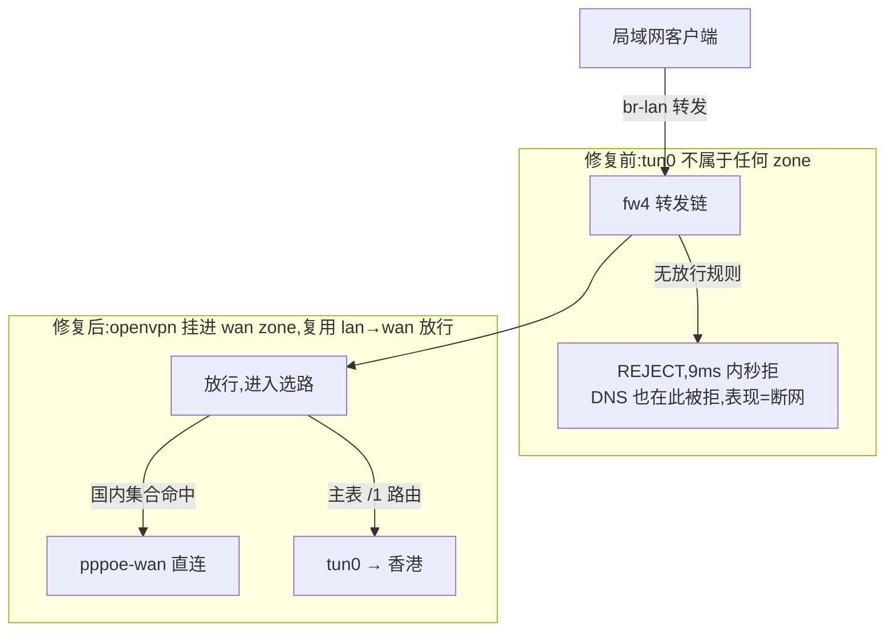
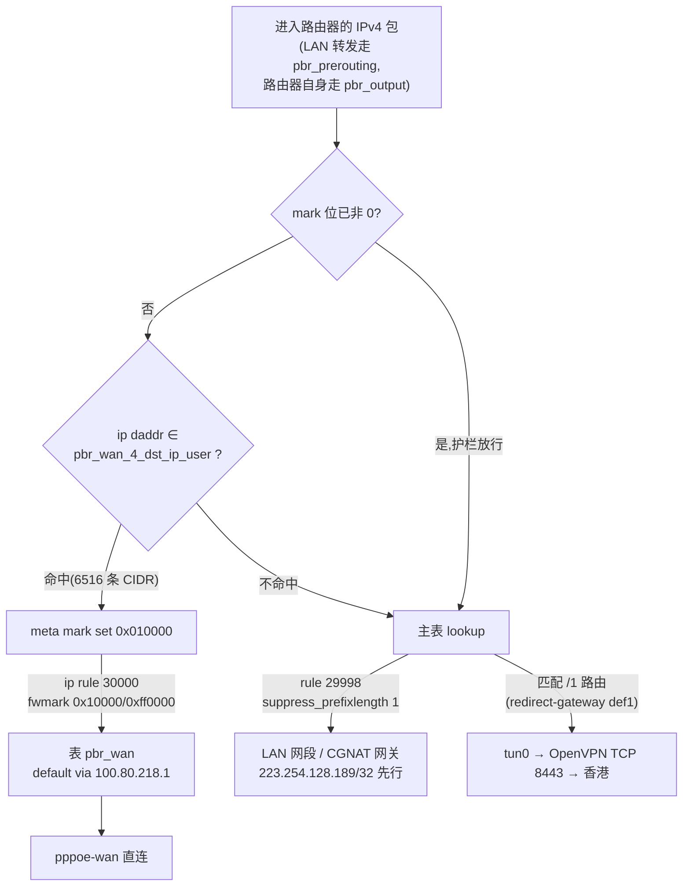
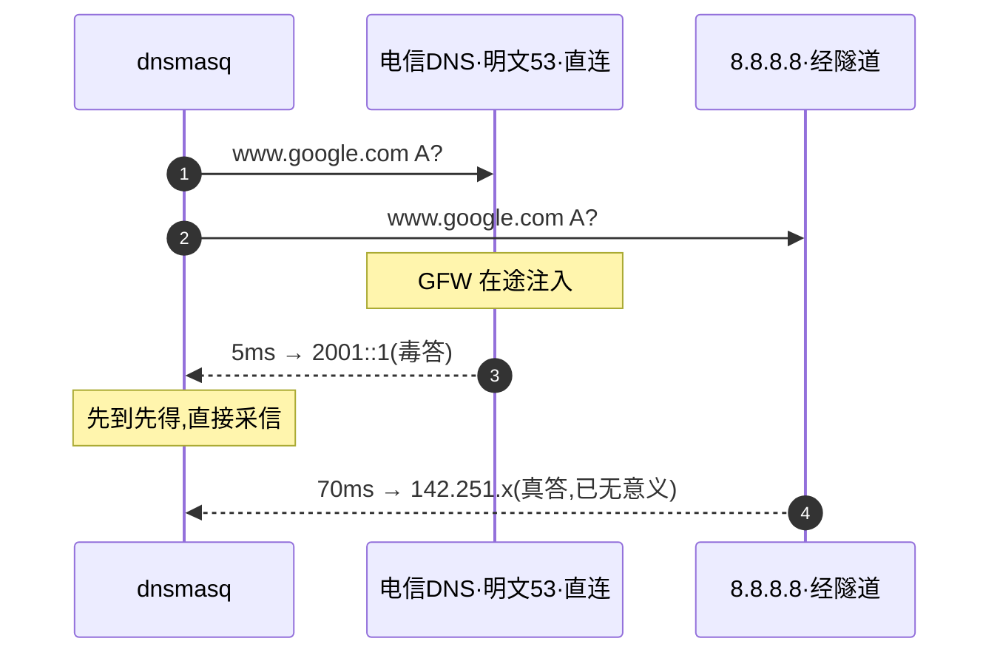
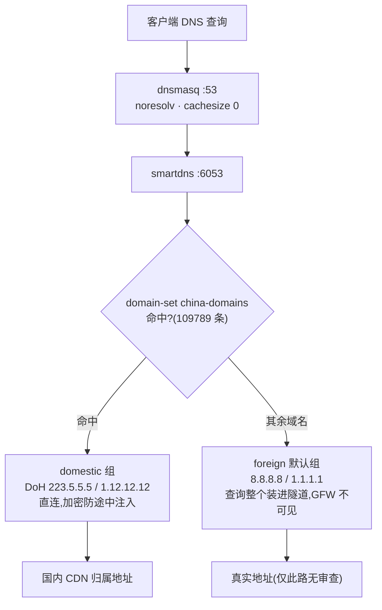
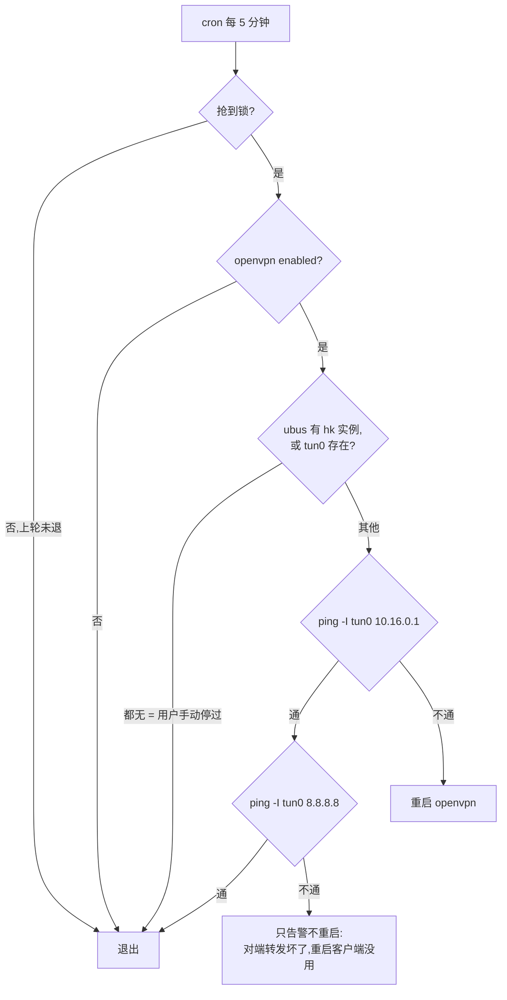
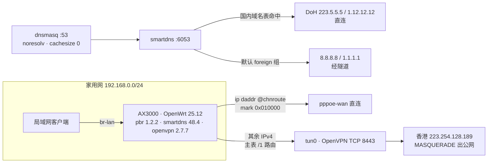

# 家用OP路由器外网访问并分流

> 2026-10-31 注:文中的 OpenVPN 隧道已于当晚拆除,境外出口迁移到 tailnet 里 hk-1 的 exit node,现状见[第 3 篇](3.微软边缘直连与境外出口迁移(tailscale-exit).md)。PBR 结构、DNS 分组与集合维护流程仍然有效。

家用网是一台移动 AX3000(MT7981,512MB 内存),跑 OpenWrt 25.12,接了一条香港的 OpenVPN 隧道。国内 IPv4 走 pppoe-wan 直连,其余 IPv4 从隧道出去;DNS 分两组,国内域名交给国内的 DoH 上游,其余交给隧道里的国外上游。

路由和 DNS 的判定方向正好相反:路由默认走香港,命中国内集合才切直连;DNS 默认走隧道上游,命中域名表才切国内。

## 一、现状与目标

### 1.1 机器与线路

| 角色 | 设备/地址 | 说明 |
| --- | --- | --- |
| 家用网关 | OpenWrt 25.12-SNAPSHOT(kwrt),mediatek/filogic,aarch64 | 495MB 内存,NAND overlay 45.4M(装完还剩 42M) |
| WAN | `pppoe-wan`,`100.80.218.206`,CGNAT 大内网 | 深圳电信,上游 DNS `202.96.134.33` / `202.96.128.86`,另有 `wan_6` DHCPv6 |
| LAN | `br-lan`,`192.168.0.1/24` | 拨号从 4 月活到现在,pppd 日志零掉线 |
| 香港服务器 | `openvpn.ipuff.online` = `223.254.128.189`,归属地 HK | docker 跑 `kylemanna/openvpn`,host 网络,TCP 8443,网段 `10.16.0.0/24`,tls-auth,现有若干客户端按需路由使用 |
| 笔者工作机 | `192.168.0.206` | 全程 SSH 免密直连两台机器,所有操作零接触路由器面板 |

服务端 `openvpn.conf` 里没有 push redirect-gateway,只 push 了 DNS 和 comp-lzo;`route 10.16.0.0/24`、`route 10.10.12.0/24` 两条显式路由是给既有客户端的站点互联用的。隧道默认只承载显式路由,所以改造成默认出口只能在客户端侧动手,服务端一行不用改,其他客户端也不受影响。

### 1.2 目标

| 流量 | 出口 | 判定 |
| --- | --- | --- |
| 国内 IPv4(6516 条 CIDR) | **wan / pppoe-wan 直连** | nft 集合 `pbr_wan_4_dst_ip_user` |
| 其余 IPv4 | **OpenVPN 隧道 → 香港** | 主表 /1 默认路由 |
| 国内域名 | 国内加密 DNS(直连) | dnsmasq-china-list 域名表 |
| 其余域名 | 隧道内 8.8.8.8 / 1.1.1.1 | smartdns 默认组 |
| IPv6 | 不分流 | 见「已知边界」 |

原本不打算做域名分流,最后还是在 DNS 层分了组,因为不依赖域名表的路子都走不通(见第六节)。

## 二、为什么是 OpenVPN TCP + PBR

隧道协议没什么可选的:服务器上现成一套 kylemanna 的 OpenVPN 在跑 mesh,加一张客户端证书就完事。WireGuard 吞吐更好(MT7981 内核态轻松 400M+),但那等于另起炉灶。OpenVPN TCP 8443 有两个已知毛病,TCP-in-TCP 和单进程用户态加密,预期也就一两百兆,家用分流能接受。先用起来,嫌慢再迁。

选路交给 PBR,理由和[办公网关那篇](./1.OpenWrt双WAN按目标IPv4分流.md)一样:六千多条 CIDR 不可能写成静态路由喂给 netifd;mwan3 的健康检查和带宽聚合一个都不要;PBR 就是一个 nft 集合加一条 goto,断线回落交给 metric 兜底。

## 三、服务端:签发客户端证书

kylemanna 镜像的 easyrsa 流程,唯一的问题是 CA 私钥带口令,`build-client-full` 会卡在签名那步报 `Failed to sign`。口令用 `--passin` 传进去,有效期按仓库惯例拉到 100 年:

```sh
docker exec -e EASYRSA_CERT_EXPIRE=36500 openvpn \
    easyrsa --passin=pass:******** --batch build-client-full openwrt nopass
docker exec openvpn ovpn_getclient openwrt > /data/openvpn/openwrt.ovpn
```

笔者签之前核对了服务端的转发条件:

- `iptables -t nat` 里有 `-A POSTROUTING -s 10.16.0.0/24 -o eth0 -j MASQUERADE`,`ip_forward=1`;
- FORWARD 链策略 ACCEPT,ufw 未启用,rp_filter 是宽松模式(2);
- tailscale 的 `ts-forward` 链只对源 `100.64.0.0/10` 做 DROP,`10.16.0.0/24` 不受影响。

`ovpn_getclient` 生成的客户端配置自带一行 `redirect-gateway def1`(OVPN_DEFROUTE=1 的产物),末尾又补了 `mssfix 1350` 防隧道内分片。这份 `.ovpn` 推到路由器 `/etc/openvpn/hk.ovpn`,uci 注册实例,再建一个 `proto=none` 的 netifd 接口,让 PBR 和 ifstatus 能看到 tun0:

```sh
uci set openvpn.hk=openvpn
uci set openvpn.hk.enabled='1'
uci set openvpn.hk.config='/etc/openvpn/hk.ovpn'
uci set network.openvpn=interface
uci set network.openvpn.proto='none'
uci set network.openvpn.device='tun0'
```

tun0 起来,`ping -I tun0 10.16.0.1` 是 62ms。这时路由表里多了 `0.0.0.0/1` 和 `128.0.0.0/1` 两条,主表默认事实上已经切进隧道。

## 四、拉起隧道,全屋断网

隧道起来两分钟,屋里所有设备都没网了。笔者第一反应是 PPPoE 掉了,但 `logread` 里 pppd 从 4 月拨号以来一条掉线记录都没有,WAN 是好的。断的是转发:

```text
路由器本机:curl --interface tun0  → 通
局域网客户端:curl                 → 9ms 内秒拒
```

tun0 不在任何 firewall zone 里,fw4 对 lan→tun0 的转发没有放行规则,直接 REJECT。路由器自己的流量走 output 链,所以在路由器上怎么测都是通;笔者当时在路由器后面查了半天,没往 zone 上想。修复只有一行:

```sh
uci add_list firewall.@zone[1].network='openvpn'   # wan zone
uci commit firewall && /etc/init.d/firewall reload
```

修复前后的包路径,断点在防火墙,不在路由:



> OpenWrt 上新增 tun 类接口,第一件事是挂进 zone。PBR 打 mark 只解决选哪张路由表,fw4 的放行是另一层,缺哪层都是全断。当时 DNS 查询也被卷进隧道,域名叫不应,表现和断网一样。

路由器上还有一条早前加的静态路由 `223.254.128.189 via 100.80.218.1 dev pppoe-wan`,正是香港服务器的公网 IP,把隧道传输层钉死在 WAN 上防回环,和 openvpn 自带的 server 路由保护算双保险,没动。

## 五、PBR 与国内地址库

### 5.1 全局参数

参数照办公网关那套抄,两边一致:

```text
config pbr 'config'
	option enabled '1'
	option fw_mask '00ff0000'
	option uplink_mark '00010000'
	option uplink_interface 'wan'
	option uplink_ip_rules_priority '30000'
	option strict_enforcement '0'
	option ipv6_enabled '0'
	option nft_rule_counter '1'
	option nft_set_auto_merge '1'
	option nft_set_flags_interval '1'
	option nft_set_policy 'performance'
	option resolver_set 'dnsmasq.nftset'
	list lan_device 'br-lan'
```

`strict_enforcement '0'` 依旧是可用性优先:隧道挂了,国外流量回落 WAN 直连,不至于断网,代价是裸奔(见第九节)。生成的 ip rule 和办公网关同款,只是少了一条策略表:

```text
29998:  from all lookup main suppress_prefixlength 1
30000:  from all fwmark 0x10000/0xff0000 lookup pbr_wan
32766:  from all lookup main
```

29998 那条护栏管的是:本地网段、CGNAT 网关、还有那条 `223.254.128.189/32` 静态路由,靠它抢在默认路由之前生效。

包的处理路径和办公网关那篇第五节相比,少两条策略表,多一条 /1 回落:



### 5.2 国内地址库:办公网关的脚本原样移植

这台机器的 PBR 同样是 1.2.2,include 机制一模一样:脚本被 `/etc/init.d/pbr` source 进去执行,里面的 `nft` 调的是 init 重载过的 shell 函数,输出会被捕获进 `/usr/share/nftables.d/ruleset-post/30-pbr.nft`(110080 字节),fw4 重载后集合不丢;脚本里还能直接读运行时变量 `mark_wan`。`/etc/pbr.d/10-china-ipv4.sh` 只改了两处:集合名 `pbr_wan_4_dst_ip_user`,goto 链 `pbr_mark_${mark_wan:-0x010000}`。

清单仍是 `gaoyifan/china-operator-ip` 的 china.txt,6516 条,缓存 360 分钟,awk 逐行校验、不足 3000 行整批作废、原子替换、`logger -t pbr-china` 埋点,一处没改。每天 05:17 的 `pbr reload` 会重跑脚本,缓存没过期就不真下载。

还有一点:`china.txt` 的下载走默认路由,也就是隧道本身。全新安装时第一次下载发生在隧道起来之后,顺序天然是对的。反过来说,如果哪天隧道和缓存同时没了,脚本返回非 0、集合为空,国内流量全落默认路由直连出去,不断网,只是不分流,和办公网关的降级行为一致。

## 六、DNS:三次尝试都错了

路由通了之后 google 还是打不开。笔者 nslookup 一看,`www.google.com → 2001::1`,是典型的 GFW 投毒特征。下面三次尝试都不行。

**尝试一:给 dnsmasq 加 8.8.8.8 并发上游。** 失败。dnsmasq 默认问所有上游取最快应答,电信的毒答 5ms 就回来了,隧道里的真答要 70ms,毒答总是先到,直接被采信。



**尝试二:smartdns `speed-check-mode ping,tcp:443` 可达性校验。** 失败。GFW 投的毒是 Facebook 段的 IP(`www.youtube.com → 31.13.92.37`),这些 IP 从国内直连确实不通,但从香港隧道出去是通的,TCP 握手成功,假 IP 反而被校验放行。可达性校验的前提是探测路径和业务路径一致,隧道把这两条路劈开了。

**尝试三:国内公共 DNS 上 DoH。** 失败。`https://223.5.5.5/dns-query` 加密确实防住了 GFW 途中注入,但返回的还是 `2001::1`。国内公共 DNS 是在解析器层面自己过滤的,传输加密管不了上游自审。

三次都错,只剩一条路:国外域名必须由不审查的国外上游解析,而国外上游必须走隧道才查得到,"哪些域名走哪个上游"就得有人判。答案只能是域名表,smartdns 的 domain-set 分组正合适:

```text
# /etc/smartdns/custom.conf
domain-set -name china-domains -file /etc/smartdns/domain-set/china-domains.txt
domain-rules /domain-set:china-domains/ -nameserver domestic
```

上游分两组:

```text
server-https https://223.5.5.5/dns-query  -group domestic -exclude-default-group
server-https https://1.12.12.12/dns-query  -group domestic -exclude-default-group
server 8.8.8.8:53  -group foreign
server 1.1.1.1:53  -group foreign
```

命中国内域名表走 domestic 组(DoH 直连,CDN 归属最优),其余域名落默认组 foreign,由隧道里的 8.8.8.8/1.1.1.1 解析。和路由侧的判定同构:默认走香港,命中国内集合才直连。




域名表取 dnsmasq-china-list 的 accelerated-domains 加 apple/google 两个补充表,合并去重 109789 条,每周更新一次。

还要注意 smartdns 的持久化缓存会把投毒期的答案存下来。`rr-ttl-min 600` 加 `cache-persist`,分组配置改完重启,毒答照样从磁盘回来,配置看着完全正确但解析结果照旧,`rm /etc/smartdns/smartdns.cache` 之后才恢复正常。改 DNS 相关配置,先清缓存再验证。

解析正常后 google 返回的是 IPv6 真地址,可这台没有 v6 分流,LAN 的 v6 走 WAN 直连,照样被墙。客户端拿到 AAAA 先试,超时才回落 v4。v6 隧道短期不做,于是 `force_aaaa_soa '1'` 一刀切,AAAA 一律回 SOA,所有流量收进 v4,由分流规则全权接管。代价是 domestic v6 加速没了,不过 v4 CDN 的速度可以接受。

## 七、定时维护

```cron
17 5 * * * /etc/init.d/pbr reload >/dev/null 2>&1
*/5 * * * * /root/ovpn-watchdog.sh >/dev/null 2>&1
23 6 * * 1 /etc/smartdns/update-china-domains.sh >/dev/null 2>&1
```

看门狗分四种情况处理:

- 进程在、`ping -I tun0 10.16.0.1` 通、`ping -I tun0 8.8.8.8` 不通:只告警不重启。这是服务端转发坏了,重启客户端没用;
- 对端都不通:重启 openvpn;
- 用户手动 `/etc/init.d/openvpn stop` 过(ubus 里无实例且 tun0 消失):不打扰;
- `/etc/init.d/openvpn enabled` 为假:退出。

决策树:



`update-china-domains.sh` 与 chnroute 脚本同一套骨架:jsdelivr/raw 双源、域名数不足 50000 整批作废、原子替换。4MB 的表走隧道下载,晚高峰 42KB/s,`--max-time 300` 是实测下来够用的值。

## 八、最终形态



2026-10-29 凌晨从 LAN 客户端实测的一组数:

| 目标 | 结果 | 路径 |
| --- | --- | --- |
| `api.ip.sb` | 出口 `223.254.128.189` | 隧道 |
| `myip.ipip.net` | `183.23.92.218 广东深圳电信` | 直连 |
| `baidu` | 200,54ms;DNS namelookup 1.4ms | 直连 |
| `google generate_204` | **204,772ms** | 隧道 |
| `youtube / github / instagram` | 全 200 | 隧道 |

排查命令沿用办公网关那套,原样可用:`ip route get 223.5.5.5 mark 0x10000`(应走 pppoe-wan 表)、`ip route get 8.8.8.8`(应经 tun0)、`nft get element inet fw4 pbr_wan_4_dst_ip_user '{ 223.5.5.5 }'`、`nft list chain inet fw4 pbr_prerouting` 看计数器。停机前国内集合已匹配 37 万包。

## 九、故障行为

| 状态 | 实际行为 |
| --- | --- |
| 隧道正常 | 国内 IPv4 直连,其余走香港,国内域名国内解析,其余域名隧道解析 |
| 隧道进程死 | /1 路由消失,国外流量回落 WAN 直连;看门狗 5 分钟内拉起 |
| 隧道在、服务端转发坏 | 国外域名解析失败(8.8.8.8 不可达)、国外连接失败;看门狗只告警 |
| WAN 断 | 全部中断 |
| `strict_enforcement='0'` 的代价 | 隧道挂掉的窗口期,国外流量裸奔跑直连。家用场景取可用性,代价如此。要更严格就开 strict 模式或在上游加 kill switch |
| 刚改完策略 | 已建立连接沿用旧出口,conntrack 过期前不切换,验证一律新建连接 |

## 十、已知边界

- **吞吐**:晚高峰实测隧道下载 42KB/s。TCP-in-TCP 叠加跨境拥塞,小流量无感(google 204 只要 0.77 秒),大文件没法看。两个备选项:白天跑,或者换 WireGuard(服务端另起一个 UDP 端口即可,PBR 侧零改动)。
- **IPv6 完全不在分流范围内**。`force_aaaa_soa` 只是把 DNS 层的 v6 收掉了,拿字面 IPv6 地址直连的流量依然直出 WAN。哪天电信 v6 出口也做分流,记得导入 `china6.txt` 并打开 `ipv6_enabled`,smartdns 的 AAAA SOA 一起回退。
- **国外域名解析依赖隧道**:隧道挂掉时,smartdns 的 foreign 组不可达,serve-expired 会拿过期缓存顶一阵,顶不住就是解析失败。
- **投毒缓存有残留窗口**:`rr-ttl-min 600` 意味着一次污染事故的答案最长存活 10 分钟,排障时先 `rm /etc/smartdns/smartdns.cache`。
- kwrt 固件的 pbr init 在某些路径会刷 `shift: shift count out of range`,不影响功能;dnsmasq 的 `resolvfile` 被指到 `/dev/null`(smartdns 的 resolv 腿必须断,否则明文电信上游永远在组里),这个改动藏在 uci 里,重装 smartdns 后记得核对。

## 十一、改动清单

| 位置 | 内容 |
| --- | --- |
| 服务器 `/data/openvpn/` | `openwrt.ovpn`(100 年证书),PKI 新增 openwrt 节点;`openvpn.conf` 零改动 |
| 路由器 `/etc/openvpn/hk.ovpn` | 客户端配置(redirect-gateway def1 + mssfix 1350) |
| 路由器 `/etc/pbr.d/10-china-ipv4.sh` | chnroute 加载脚本,缓存 `/etc/pbr-china/china-ipv4.txt` |
| 路由器 `/etc/smartdns/custom.conf` | 域名分组规则;域名表 `domain-set/china-domains.txt`,更新脚本同目录 |
| 路由器 `/root/ovpn-watchdog.sh` | 隧道看门狗 |
| 路由器 uci | `openvpn.hk` 实例;`network.openvpn`;wan zone 挂 `openvpn`;`pbr.config` 十三项;dnsmasq 切 smartdns |
| 路由器 `/etc/crontabs/root` | 三条定时任务(见第七节) |

以上改动笔者在 2026-10-28 一次做完。动手前的 network/firewall/dhcp/wireless 备份在 `/root/backup-before-ovpn-*/`,crontab 原件在 `/etc/crontabs/root.before-ovpn`。要回滚整套分流:`pbr.config.enabled='0'` 加 `/etc/init.d/pbr stop`,回到纯隧道全量模式。

## 十二、参考资料

- PBR 文档:<https://docs.openwrt.melmac.ca/pbr/1.2.2/>
- 国内 IPv4 列表:<https://gaoyifan.github.io/china-operator-ip/china.txt>
- 国内域名表:<https://github.com/felixonmars/dnsmasq-china-list>
- smartdns:<https://github.com/pymumu/smartdns>
- kylemanna/openvpn:<https://github.com/kylemanna/docker-openvpn>
- 同一套 PBR 思路的双 WAN 版:[OpenWrt 双 WAN 按目标 IPv4 分流](./1.OpenWrt双WAN按目标IPv4分流.md)

办公网关那篇里靠 dnsmasq 解析写集合的域名策略,在这台机器上换成了 smartdns 的 domain-set,两台的 DNS 栈由此不同:办公网只需要国内解析,家用要抗污染。
