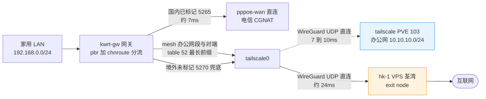

# OpenWrt 分流(openwrt)

> - **设备与版本**:办公网关 x86 OpenWrt 24.10.5;家用移动 AX3000(MT7981,kwrt 25.12-SNAPSHOT)。两台都是 PBR 1.2.2 + firewall4(nftables),分流判定同源。
> - **数据时间**:双 WAN 篇的计数器与 traceroute 抓于 2026-10-27;家用篇的隧道与 DNS 链路在 2026-10-28 落地,客户端实测于 2026-10-29 凌晨;第 3 篇的 bing 直连与出口迁移实测于 2026-10-29 晚至 10-31 上午。文中命令与输出均取自这两台机器。
> - **出口形态**:办公网关是双 WAN,wan 进上游 VPN、wan2 走国内线路;家用原本是单 WAN 加一条到香港的 OpenVPN 隧道,**2026-10-31 起隧道拆除**,境外出口迁移到 tailnet 里 hk-1 的 exit node(WireGuard UDP),国内照旧 pppoe-wan 直连。

## 文章索引

| 编号 | 文章 | 内容 | 状态 |
| --- | --- | --- | --- |
| 1 | [OpenWrt 双 WAN 按目标 IPv4 分流](1.OpenWrt双WAN按目标IPv4分流.md) | 6525 条 CIDR 灌 nft 集合、四条策略的链序、`pbr_output` 补规则、集合持久化与地址库日常更新 | ✅ 已实测 |
| 2 | [家用 OP 路由器外网访问并分流](2.家用OP路由器外网访问并分流.md) | OpenVPN 客户端接入、fw4 zone 漏配导致全断、smartdns 分国内/国外两组上游、隧道看门狗 | ✅ 已实测(隧道部分已被第 3 篇取代) |
| 3 | [微软边缘直连与境外出口迁移(tailscale-exit)](3.微软边缘直连与境外出口迁移(tailscale-exit).md) | bing 秒级延迟定位、`/etc/pbr.d/` 额外直连钩子、exit node 替代 OpenVPN、pbr 纳管 tailscale0 的网关冲突、双层自愈 | ✅ 已实测 |

## 阅读路径

- **先在办公网做双出口**:1(策略、集合、持久化)→ 2 的第五节(同一套 PBR 换到单 WAN + 隧道);
- **只关心 DNS**:2 的第六节,三次失败的尝试和最终的 domain-set 分组;
- **家用出口要换 tailscale**:3(定位 → 直连修复 → exit 迁移 → 根因与自愈),tailnet 侧配套见 [tailscale 目录](../tailscale/README.md)的第 3 篇;
- **排障**:1 的第十节,接口、路由表、集合、计数器四层验证;3 的第四节,pbr 与 tailscale0 的冲突链。

## 家用网关当前的链路

出口形态对照:境外未标记流量走 hk-1 的 WireGuard UDP(约 24ms 起),办公室网段走 PVE 直连(7~10ms),国内已标记流量回 pppoe-wan(约 7ms);打洞退化时 mesh 部分回落 DERP(hk) 中继。

三条路径互不抢道:国内已标记流量在 5265 抢在 tailscale 兜底之前回 pppoe-wan;mesh 目标按 table 52 的最长前缀进 tailscale0 打直连;其余未标记流量由 5270 兜底交给 hk-1 出境。OpenVPN 隧道已于 10-31 拆除,不再出现在链路里。

## 两台的差别

判定都落在"目标 IP 属于国内集合"上,差别在默认出口和 DNS:

- 办公网关:默认 wan 进上游 VPN,wan2 只跑国内;DNS 只有一个上游 `192.168.10.1`,走 UDP。
- 家用:境外默认出口 2026-10-31 起是 tailscale0(经 hk-1 exit node),国内集合命中才回 pppoe-wan。家用要抗污染,国外域名交给国外上游,所以 DNS 分成 domestic / foreign 两组,再加一张国内域名表。

## 参考资料

- PBR 文档:<https://docs.openwrt.melmac.ca/pbr/1.2.2/>
- PBR 源码:<https://github.com/openwrt/packages/tree/master/net/pbr>
- 国内 IPv4 列表:<https://gaoyifan.github.io/china-operator-ip/china.txt>
- 国内域名表:<https://github.com/felixonmars/dnsmasq-china-list>
- smartdns:<https://github.com/pymumu/smartdns>
- kylemanna/openvpn:<https://github.com/kylemanna/docker-openvpn>
