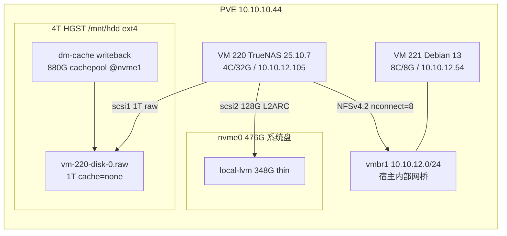

# TrueNAS NFS 性能实验(ARC / L2ARC / 机械盘)

> - **实验机**:PVE 9.2.2(kernel 7.0.2-6-pve),Xeon E5-2698B v3(32 线程),251G 内存,2026-11-27 至 11-28 实测。
> - **被测**:TrueNAS SCALE 25.10.7 虚机,4C/32G;数据盘为 hddvm 上的 1T raw 文件(4T HGST HUS724040ALA640),缓存盘为 local-lvm 上的 128G LV(系统 NVMe),做 ZFS L2ARC。
> - **客户端**:Debian 13 云镜像虚机,8C/8G,NFSv4.2 `nconnect=8`;两台虚机同在宿主内部网桥 vmbr1(10.10.12.0/24,无上行),不经过物理网卡。
> - **结论先行**:NFS 服务端自己的处理路径就是天花板——同一挂载点导 tmpfs 能到 730 MiB/s,换成 ZFS ARC 只剩 350–545 MiB/s,而 TrueNAS 本机读 ARC 是 1.4 GB/s。L2ARC 在这条链路上看不出收益,机械盘档才是真正的台阶。

## 一、拓扑与资源



| 阶段 | 组件 | 端口/协议 | 关键点 |
| --- | --- | --- | --- |
| 存储后端 | hddvm = LVM ext4 + dm-cache writeback | 块层 | 4T 盘全部容量都在 dm-cache 后面,880G NVMe 做 64K chunk 的 writeback 缓存 |
| 数据盘 | VM 220 scsi1 = hddvm 上 1T raw 文件 | virtio-scsi | `cache=none` + iothread,文件是稀疏的,写入按需分配 |
| 缓存盘 | VM 220 scsi2 = local-lvm 128G LV | virtio-scsi | 系统 NVMe 上的 thin LV,做 ZFS cache vdev |
| 池 | `tank`:data=1T(sdb)+ cache=128G(sdc) | ZFS | 单盘只能 stripe;mirror/RAIDZ 需要第二块盘 |
| 数据集 | `tank/nfs`(1M 记录)、`tank/rnd`(8K 记录) | ZFS | 压缩 `off`、`atime=off`、`sync=standard` 起步 |
| 共享 | `/mnt/tank/nfs`、`/mnt/tank/rnd` | NFSv4.2 / 2049 | `maproot=root`,nfsd 线程数调到 16 |
| 客户端 | VM 221 Debian 13 | NFSv4.2 | `nconnect=8`、`rsize/wsize=1M`、`hard`、`noatime` |

宿主 32 线程的硬顶和 hddvm 的 dm-cache 结构见 [README](README.md) 与 [3.LVM缓存迁移与实测](3.LVM缓存迁移与实测.md);dm-cache 参数矩阵见 [4.盘参数性能实测](4.盘参数性能实测.md)。

## 二、装 TrueNAS 与建池

**ISO。** 官方源是 Storj,单线程只有 ~350KB/s,2.34G 要下 30 分钟以上。用 aria2 分段后稳定在 ~1.9MB/s,20 分钟下完:

```bash
cd /var/lib/vz/template/iso
aria2c -x16 -s16 -k1M --file-allocation=none \
  -o TrueNAS-SCALE-25.10.7.iso \
  https://download.truenas.com/TrueNAS-SCALE-Goldeye/25.10.7/TrueNAS-SCALE-25.10.7.iso
sha256sum -c <(curl -sS https://download.truenas.com/TrueNAS-SCALE-Goldeye/25.10.7/TrueNAS-SCALE-25.10.7.iso.sha256)
```

**虚机。** 装系统时只挂系统盘,数据盘和缓存盘等装完再热加,避免安装器把 1T 盘列进候选:

```bash
qm create 220 --name truenas --cores 4 --memory 32768 --cpu host \
  --scsihw virtio-scsi-single --ostype l26 --machine pc --bios seabios \
  --net0 virtio,bridge=vmbr1,queues=4 --agent enabled=1 \
  --serial0 socket --vga std --scsi0 local-lvm:32,iothread=1 --onboot 0
qm set 220 --ide2 local:iso/TrueNAS-SCALE-25.10.7.iso,media=cdrom --boot order='ide2;scsi0'
qm start 220
```

安装器是文本菜单,没有无人值守入口,用 `qm sendkey` 配合 `qm monitor` 的 `screendump` 逐步驱动。screen dump 出来是 PPM,用一段纯 Python 转 PNG 后看图确认每一步:

```bash
echo "screendump /tmp/s.ppm" | qm monitor 220
python3 /root/ppm2png.py /tmp/s.ppm /tmp/s.png   # 脚本见附录
qm sendkey 220 ret        # 1) Install/Upgrade
qm sendkey 220 spc        # 在磁盘列表里空格选中 sda
qm sendkey 220 ret        # 确认擦除
```

关键选择只有两处:管理员用户选 `truenas_admin` 并当场设密码;`Allow EFI boot?` 选 **No**(虚机是 SeaBIOS 传统引导)。装完点 OK,把引导顺序改成 `scsi0` 并摘掉光盘,重启:

```bash
qm set 220 --boot order=scsi0 --delete ide2
qm reset 220
```

**热加数据盘与缓存盘。** 1T 文件在 hddvm 上,缓存盘在 local-lvm:

```bash
qm set 220 --scsi1 hddvm:1024,format=raw,cache=none,iothread=1,serial=TNHDD0001
qm set 220 --scsi2 local-lvm:128,iothread=1,serial=TNL2ARC01
```

首启后 TrueNAS 在 vmbr1 上拿到 DHCP 地址 `10.10.12.105`,Web UI 直接可用。SCALE 默认禁 root SSH,后续全部走 REST API(`http://10.10.12.105/api/v2.0`,basic auth `truenas_admin`),需要在来宾里跑命令时用 `qm guest exec 220 -- ...`(qemu-guest-agent 自带,`qm guest cmd 220 ping` 可测)。

**建池与共享。** 25.10 的拓扑类型标签换了:单盘用 `STRIPE`,`DISK` 会报 `Input tag 'DISK' does not match`。cache vdev 同样只能是 `STRIPE`:

```bash
API=http://10.10.12.105/api/v2.0
AUTH='-u truenas_admin:<TRUENAS_PASS>'

curl -s $AUTH -H 'Content-Type: application/json' -X POST $API/pool -d '{
  "name":"tank","encryption":false,
  "topology":{
    "data":[{"type":"STRIPE","disks":["sdb"]}],
    "cache":[{"type":"STRIPE","disks":["sdc"]}]}}'

curl -s $AUTH -H 'Content-Type: application/json' -X POST $API/pool/dataset \
  -d '{"name":"tank/nfs","compression":"OFF","recordsize":"1M","atime":"OFF"}'

curl -s $AUTH -H 'Content-Type: application/json' -X POST $API/sharing/nfs \
  -d '{"path":"/mnt/tank/nfs","enabled":true,"maproot_user":"root","maproot_group":"root"}'
```

NFS 服务默认 4 个 nfsd 线程,4 vCPU 上读大块时不够,调到 16 并设为开机启动:

```bash
curl -s $AUTH -H 'Content-Type: application/json' -X PUT $API/nfs -d '{"servers":16}'
curl -s $AUTH -X PUT $API/service/id/9 -d '{"enable":true}' -H 'Content-Type: application/json'
curl -s $AUTH -X POST $API/service/start -d '{"service":"nfs"}' -H 'Content-Type: application/json'
```

客户端挂载与 fio 口径:

```bash
mount -t nfs -o vers=4.2,nconnect=8,rsize=1048576,wsize=1048576,noatime,hard \
  10.10.12.105:/mnt/tank/nfs /mnt/nfs

fio --name=seq --filename=/mnt/nfs/hot8g --size=2G --offset_increment=2G \
  --rw=read --bs=1M --ioengine=libaio --direct=1 --iodepth=16 --numjobs=4 \
  --group_reporting --eta=never
```

所有数字都带 `--direct=1`,否则客户端页缓存会把 NFS 读变成读本地内存。

## 三、三档基准

先给结论表,单位 MiB/s / IOPS,4 并发、1M 块顺序读与 4K 随机读:

| 档位 | 顺序读 | 4K 随机读 | 说明 |
| --- | --- | --- | --- |
| **内存 ARC**(NFS,4C) | 333–358 | 25.4K(5.0ms) | 纯命中:测试前后 `misses`、`l2_*` 增量都是 0 |
| **NVMe L2ARC**(NFS) | 318 | 23.5K(5.5ms) | `l2_size` 64.8 GiB,预热阶段命中率 99.6% |
| **机械盘**(裸盘 O_DIRECT) | 63–83 | 70–74(14ms) | 直接在 `/dev/sda` 上读,不经过池与 NFS |

对照口径,同一台客户端、同一挂载参数:

| 路径 | 顺序读 |
| --- | --- |
| TrueNAS 本机 `dd` 读 ARC(不过网络) | **1.4 GB/s** |
| VM 之间裸 TCP(Python 单流、8M 缓冲) | **946 MiB/s** |
| 同一挂载点导出的 tmpfs(纯内存、不过 ZFS) | **730 MiB/s** |
| ZFS ARC 经 NFS | 333–545 |

三档里只有机械盘是真正的台阶,ARC 与 L2ARC 在 NFS 上几乎重合。原因不是内存慢:本机读 ARC 有 1.4 GB/s,同一个 NFS 栈导 tmpfs 也能到 730。把这两个数放在一起,瓶颈就定位在 TrueNAS 的 NFS 服务端处理路径上——每 1M 请求的 CPU 成本把 4 个 vCPU 吃满,ARC 命中时 `mpstat` 显示四个核 95% 系统态、`nfsd` 与软中断占满。

为了让这个结论更硬,又做了两组单变量:

| 变更 | 顺序读 |
| --- | --- |
| 4 vCPU → 8 vCPU | 358 → 380 MiB/s |
| 4 流读同一个文件 → 4 流各读一个文件 | 380 → 483 MiB/s |

加核几乎无效,说明不是核数不够。单文件换四文件涨 27%,是 ZFS 单文件预取/锁上的串行化。剩下的 ARC 与 tmpfs 差距(545 vs 730)是 ZFS 读路径本身的成本。

L2ARC 的建立过程正常:把 `zfs_arc_max` 压到 8G、`l2arc_noprefetch=0`、`l2arc_write_max` 提到 512M 后读 32G 文件两遍,`l2_size` 涨到 64.8 GiB,`l2_hits` 2,126,044 / `l2_misses` 8,290。但经 NFS 读的时候它和 ARC 一样被服务端上限压平,所以"NVMe 缓存档"这条在本文环境里测不出独立收益。

## 四、参数矩阵

`sync=standard, cache=none` 的写入被 ZIL 拖住,4G 级文件只有 82–231 MiB/s,而且随 dm-cache 积压状态波动。把数据集改成 `sync=disabled`(不安全:掉电丢最近写入)后重跑,4 文件 × 1G、4 并发:

| recordsize / 压缩 | sync | 写 MiB/s | 读 MiB/s |
| --- | --- | --- | --- |
| 1M / off(初始) | standard | 82–231 | 358–483 |
| 128K / off | disabled | 329 | 509 |
| 128K / lz4 | disabled | 360 | 501 |
| **1M / lz4** | **disabled** | 349 | **545** |
| 1M / lz4 + PVE `cache=unsafe` | disabled | 358 | 538 |
| 128K / lz4 + PVE `cache=unsafe` | disabled | 362 | 514 |

- `sync=disabled` 是唯一有明显收益的开关:写从 100 量级翻到 330–360,读不受影响。
- recordsize 128K 与 1M、压缩 off 与 lz4 之间差 ±8%,1M + lz4 读最好。这组数据是随机内容的 fio 文件,lz4 实际压不动,收益主要来自块大小与请求数。
- PVE 侧把数据盘从 `cache=none` 换成 `cache=unsafe` 几乎没有变化(写 358 vs 349、读 538 vs 545),说明瓶颈不在宿主页缓存,而在来宾里的 NFS+ZFS 路径。
- mirror / RAIDZ / dRAID 无法测试:只有一块 4T 盘,且 sda 已被 dm-cache 的 origin 全量占用(`vgs` 里那 6.25G 空闲落在 nvme1 的 PV 上,不在机械盘)。

## 五、机械盘档为什么只能在裸盘上测

池的 data vdev 是 hddvm 上的 1T raw 文件,而整个 `/mnt/hdd` 都在 880G NVMe 的 dm-cache writeback 后面。池的每次写入先被 NVMe 吸收,之后读"冷数据"命中的仍是 NVMe,不是磁头。实测印证:读刚写完的 3G 文件时 `sda` 读吞吐为 0,而 NFS 报 324 MiB/s。

要拿真正的裸盘数字只有绕过 dm-cache。这个内核(7.0.2-6-pve)的 dm-cache `set_mode` 消息不可用:

```text
device-mapper: cache: bad config value for set_mode: passthrough
```

试过的 `passthrough` / `writethrough` / `P` / `pt` / 数字全部被拒。退而求其次,先把设备切到 `writethrough` 让缓存变干净,再用 `dmsetup reload` 以构造函数特性 `metadata2 passthrough` 重载表,suspend/reload/resume 成功切到了 passthrough:

```bash
dmsetup suspend hdd-data
dmsetup reload hdd-data --table "0 7814029312 cache 252:5 252:4 252:6 128 2 metadata2 writethrough smq 0"
dmsetup resume hdd-data
# 等 dirty 归零,再重复一次把 writethrough 换成 passthrough
```

**代价是宿主硬崩。** 切到 passthrough 后写冷数据约五分钟,宿主直接失联,`last -x` 显示上一次启动以 `crash` 结束,`journalctl -b -1` 没有正常关机记录。重启后 LVM 按元数据把 dm-cache 恢复成 writeback,`/mnt/hdd` 正常挂载、无 ext4 报错,`tank` 池 ONLINE、零错误。崩溃与这次操作有时间相关性,不能百分百归因(宿主是 2014 年的 E5,平时还跑着 2080Ti 直通和二十多台 lab),但**不建议在这台机上重试**。

所以本文的机械盘数字是在宿主上对 `/dev/sda` 直接做只读 O_DIRECT 测得的,取三个位置:

```bash
for off in 10240 204800 409600; do
  dd if=/dev/sda of=/dev/null bs=1M count=1024 skip=$off iflag=direct
done
# 83.3 / 75.2 / 63.3 MB/s,外圈到内圈递减

fio --name=r4k --filename=/dev/sda --rw=randread --bs=4k --size=2G --offset=200G \
  --ioengine=libaio --direct=1 --iodepth=1 --runtime=10 --time_based
# 70 IOPS,14.3ms
```

单盘 4K 随机 70 IOPS 是这块 7200 转盘的正常水平;拿它对比 ARC 的 25.4K IOPS,L2ARC 档位的意义本来在这里,只是被 NFS 上限盖住了。

## 六、现状与接续

**地址与凭据。** 两台虚机都在运行,`onboot=0`,宿主重启后不会自启。

| 对象 | 地址 | 访问方式 |
| --- | --- | --- |
| PVE 宿主 | `10.10.10.44` | `ssh root@10.10.10.44`(本机密钥) |
| TrueNAS Web UI / API | `http://10.10.12.105` | `truenas_admin` + 口令,API 路径 `/api/v2.0` |
| NFS 服务 | `10.10.12.105:/mnt/tank/nfs`、`:/mnt/tank/rnd` | 客户端 `nconnect=8` 挂载 |
| 客户端 VM | `10.10.12.54` | `ssh -J root@10.10.10.44 root@10.10.12.54`(本机密钥) |
| TrueNAS 来宾内命令 | 无 SSH | `qm guest exec 220 -- /bin/sh -c "..."` |

真实口令不落在本文,写在宿主 `/root/truenas-bench.env`(`TRUENAS_USER` / `TRUENAS_PASS`)。本文所有 `<TRUENAS_PASS>` 占位都从该文件取。TrueNAS 的 root SSH 默认关闭,`truenas_admin` 没有配公钥,所以来宾里的操作走 `qm guest exec`;客户端可以直接 SSH。

**现有数据。** 池 `tank` 已用 69.4G,里面是测试文件:

| 文件/数据集 | 大小 | 用途 |
| --- | --- | --- |
| `tank/nfs/hot8g` | 8G | ARC 档顺序读 |
| `tank/rnd/arc8g` | 8G | ARC 档 4K 随机(8K 记录) |
| `tank/nfs/big32g` | 32G | L2ARC 预热与上限测试 |
| `tank/rnd/rnd16g` | 16G | L2ARC 档 4K 随机 |
| `tank/nfs/cold8g` | 5.1G(8G 稀疏) | passthrough 阶段写入被崩溃打断,前 5.1G 有效 |

local-lvm 瘦池当前 54.5%(128G 的 L2ARC LV 实际写了约 70G)。dm-cache 已回到 writeback,数据盘 `cache=none`,`tank/nfs` 与 `tank/rnd` 都是 `sync=standard`。

**接续命令。** 重跑基准先确认状态:

```bash
qm status 220; qm status 221
qm guest exec 220 -- /usr/sbin/zpool list -H -o name,health tank
qm guest exec 220 -- /usr/sbin/zfs get -H -o value sync,recordsize,compression tank/nfs
dmsetup table hdd-data | awk '{print $10}'   # 期望 writeback
```

清空测试数据但保留环境:

```bash
qm guest exec 220 -- /bin/rm -f /mnt/tank/nfs/big32g /mnt/tank/nfs/cold8g \
  /mnt/tank/nfs/hot8g /mnt/tank/nfs/nettest.py /mnt/tank/rnd/rnd16g /mnt/tank/rnd/arc8g
```

整个拆掉(不可恢复):

```bash
# 先删共享:DELETE /api/v2.0/sharing/nfs/id/1、/id/2,再删数据集与池
curl -s $AUTH -X DELETE http://10.10.12.105/api/v2.0/pool/id/1/export
qm stop 221 && qm destroy 221
qm stop 220 && qm destroy 220
lvremove -y pve/vm-220-disk-1   # L2ARC 与系统盘随 qm destroy 一起回收
rm -f /mnt/hdd/images/220/vm-220-disk-0.raw
```

**下一步的可行方向。** 想让 ARC / L2ARC / HDD 三档在 NFS 上真正分开,得先抬 NFS 服务端上限:多挂载点或更高并发、jumbo frame、或改用非虚拟化的 10G 网卡。想测 mirror / RAIDZ / dRAID,需要第二块物理盘接入,单盘池上无法验证冗余 vdev 的读性能。

## 附录:screen dump 转 PNG

安装器驱动依赖看图,PVE 宿主上没有 ImageMagick,用这段纯标准库脚本把 `screendump` 的 PPM 转成 PNG:

```python
import struct, sys, zlib

d = open(sys.argv[1], 'rb').read()
assert d[:2] == b'P6'
i, fields = 2, []
while len(fields) < 3:
    while d[i:i+1].isspace():
        i += 1
    if d[i:i+1] == b'#':
        while d[i:i+1] not in (b'\n', b''):
            i += 1
        continue
    s = i
    while not d[i:i+1].isspace():
        i += 1
    fields.append(int(d[s:i]))
i += 1
w, h, _ = fields
px = d[i:i + w * h * 3]
raw = b''.join(b'\x00' + px[y*w*3:(y+1)*w*3] for y in range(h))

def chunk(t, data):
    return (struct.pack('>I', len(data)) + t + data +
            struct.pack('>I', zlib.crc32(t + data) & 0xffffffff))

png = (b'\x89PNG\r\n\x1a\n' +
       chunk(b'IHDR', struct.pack('>IIBBBBB', w, h, 8, 2, 0, 0, 0)) +
       chunk(b'IDAT', zlib.compress(raw, 6)) +
       chunk(b'IEND', b''))
open(sys.argv[2], 'wb').write(png)
```
