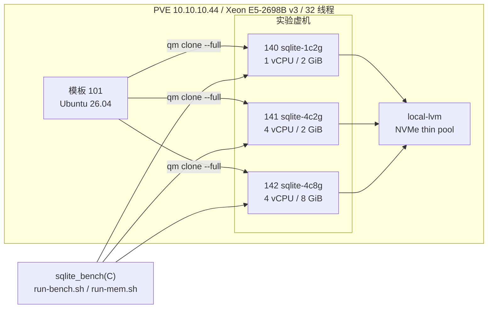
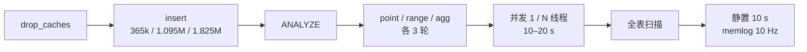

# 1. SQLite 单机压测与容量选型

2026-11-18,针对 IoT 测点场景做容量选型:1000 台设备 × 365 天 × 1 / 3 / 5 个指标,分别落到 365,000 / 1,095,000 / 1,825,000 行。同一份数据模型与同一套压测程序,在 1C2G、4C2G、4C8G 三种虚机上各跑一遍,记录写入、查询、并发、内存使用率与空闲内存。

## 实测环境与口径

| 项 | 配置 |
| --- | --- |
| 宿主 | PVE 9.2.2,Intel Xeon E5-2698B v3(16C32T,2.0GHz),251 GiB 内存,local-lvm 落 NVMe |
| 虚机 | `sqlite-1c2g` 140(1 vCPU / 2 GiB)、`sqlite-4c2g` 141(4 vCPU / 2 GiB)、`sqlite-4c8g` 142(4 vCPU / 8 GiB),IP 10.10.12.140/141/142 |
| 系统 | Ubuntu 26.04 LTS,kernel 7.0.0-27-generic,gcc 15.2.0 |
| SQLite | 3.46.1(2024-08-13),系统 `libsqlite3`,默认编译选项 `DEFAULT_SYNCHRONOUS=2`、`DEFAULT_CACHE_SIZE=-2000`、`DEFAULT_PAGE_SIZE=4096`、`DEFAULT_MMAP_SIZE=0` |
| 存储 | local-lvm thin volume,virtio-scsi-single,`cache=none`、`discard=on` |
| 内存可见量 | 1642 / 1641 / 7424 MiB。2 GiB 机型被 `crashkernel=2G-4G:320M` 预留 320 MiB,8 GiB 机型预留 512 MiB |
| swap | 模板自带 4 GB swap(3.8 GiB) 文件,全部测试中零使用 |



| 阶段 | 组件 | 端口/协议 | 关键点 |
| --- | --- | --- | --- |
| 克隆 | 模板 101 + `qm clone` | 无网络 | 三台均 full clone 到 local-lvm,避免 hddvm 的磁盘延迟盖过 CPU 差异 |
| 准备 | `qemu-nbd` + netplan | 离线块设备 | 改静态 IP、hostname、`/etc/hosts`,清空 `machine-id`,mask `unattended-upgrades` |
| 装载 | `sqlite3` / `libsqlite3-dev` | 本地文件 | 系统默认 pragma:rollback journal、`synchronous=FULL`、2 MB page cache |
| 压测 | `sqlite_bench`(C,直连 libsqlite3) | 无网络 | 每阶段独立进程,`clock_gettime` 取墙钟、`getrusage` 取 CPU、`VmHWM` 取峰值 RSS |
| 内存采样 | `memlog.sh` | `/proc/meminfo` | 10 Hz,按阶段标记汇总峰值 |

压测协议:

1. 每档数据量重建数据库,`drop_caches` 后连续插入 3 次,取中位数;第 3 次的库保留用于后续查询。
2. 插入完成后执行 `ANALYZE`,再用 `SELECT count(*)` 核对行数。
3. 点查、单设备范围查、30 天聚合各跑 3 轮,取中位数。
4. 并发按 95% 点查 + 5% 范围查混合,1 线程与 4 线程各跑 20 秒。
5. 内存另起一轮:重建库,10 Hz 采样覆盖插入、查询、4 线程并发、全表扫描与 10 秒静置。



| 阶段 | 命令 | 采样 | 判据 |
| --- | --- | --- | --- |
| 插入 | `sqlite_bench insert` | 墙钟、user/sys、`VmHWM` | 行/s 与单次 CPU 时间 |
| 查询 | `sqlite_bench point/range/agg` | 每轮独立进程 | qps、单次延迟、CPU% |
| 并发 | `sqlite_bench conc` | `getrusage` 汇总 | 总 ops/s 与 `cores_busy` |
| 内存 | `run-mem.sh` + `memlog.sh` | `/proc/meminfo` 10 Hz | 可用口径使用率、最低 available、page cache、Dirty |

宿主还跑着 11 台业务虚机,插入墙钟受共享 NVMe 与 CPU 调度影响,1.825M 行同配置三次插入在 20.5–32.7 秒之间摆动。表内一律取中位数;跨机型比较看 CPU 时间与行/s,不看单次墙钟。

## 数据模型与库大小

```sql
CREATE TABLE metrics(
    device_id INTEGER NOT NULL,
    ts        INTEGER NOT NULL,   -- epoch 秒,基准 2025-01-01,步长 86400
    metric_id INTEGER NOT NULL,
    value     REAL    NOT NULL
);
CREATE INDEX idx_dev_ts ON metrics(device_id, ts);
CREATE INDEX idx_metric_ts ON metrics(metric_id, ts);
```

测点值由确定式哈希生成,三台机器使用同一生成顺序与同一份查询序列,三个数据集的 point / range / agg 校验和逐项一致。每 5000 行一个事务,插入时两个索引已存在——这是持续写入的在线形态,不是先灌数后建索引的离线形态。

| 数据量 | 行数 | 库文件 | 每行均摊 | 索引 |
| --- | ---: | ---: | ---: | --- |
| 1000 × 365 × 1 | 365,000 | 20.5 MiB | 58.8 B | 2 个二级索引 |
| 1000 × 365 × 3 | 1,095,000 | 63.5 MiB | 60.8 B | 2 个二级索引 |
| 1000 × 365 × 5 | 1,825,000 | 106.1 MiB | 61.0 B | 2 个二级索引 |

库文件不到内存的十分之一,2 GiB 机型在查询阶段可以把整库放进 OS page cache。

## 批量写入

| 数据量 | 行数 | 1C2G | 4C2G | 4C8G | 单次 CPU 时间 |
| --- | ---: | --- | --- | --- | ---: |
| ×1 | 365,000 | 3.04 s / 120,066 行/s | 3.11 s / 117,363 行/s | 3.17 s / 115,287 行/s | 2.3 s |
| ×3 | 1,095,000 | 12.19 s / 89,820 行/s | 12.44 s / 88,058 行/s | 12.16 s / 90,079 行/s | 8.2–8.7 s |
| ×5 | 1,825,000 | 24.09 s / 75,754 行/s | 22.31 s / 81,795 行/s | 24.19 s / 75,451 行/s | 14.0–14.6 s |

三档的峰值 RSS 都在 6.0–6.2 MiB。插入阶段 CPU 占用 59–76%,其余时间在等 fsync:`synchronous=FULL` 下每个 5000 行事务提交一次,1.825M 行共 365 次提交。CPU 时间在 1C 与 4C 上一致,4C8G 没有更快;墙钟差异来自宿主 I/O 抖动。

在这套默认配置下,写入吞吐的边界由提交频率和磁盘决定,不由核数或内存决定。要提速,调 `synchronous`、改 WAL、加大批大小,比加 CPU/内存直接。

## 单连接查询

| 数据量 | 查询 | 1C2G | 4C2G | 4C8G |
| --- | --- | ---: | ---: | ---: |
| ×1 | 点查 qps | 76,706 | 79,796 | 79,092 |
| ×1 | 单设备范围查 qps(365 行/次) | 1,214 | 1,369 | 1,356 |
| ×1 | 30 天聚合(30,000 行/次) | 8.0 ms | 8.1 ms | 8.3 ms |
| ×3 | 点查 qps | 72,051 | 69,480 | 72,025 |
| ×3 | 单设备范围查 qps(1095 行/次) | 885 | 896 | 877 |
| ×3 | 30 天聚合(90,000 行/次) | 50.7 ms | 51.4 ms | 50.2 ms |
| ×5 | 点查 qps | 67,761 | 67,542 | 68,509 |
| ×5 | 单设备范围查 qps(1825 行/次) | 709 | 705 | 697 |
| ×5 | 30 天聚合(150,000 行/次) | 90.0 ms | 90.4 ms | 89.5 ms |

单连接查询是单线程:`sqlite3_step` 在调用方线程里执行,三台机型的数字在噪声内一致,1C2G 查询阶段也是单核 100%。聚合吞吐随数据量从 3.6M 行/s(×1)降到 1.66M 行/s(×5);范围查单次 0.7–1.5 ms,单行成本 0.8–2.2 µs,扫描行数越多摊得越薄。

点查 qps 随指标数从 76k 降到 68k:索引 `(device_id, ts)` 每个键下有 N 条记录,`metric_id` 不在索引里,需要逐条回表过滤。把 `(device_id, ts, metric_id)` 做成覆盖索引可以再快一截,代价是更大的库文件与更慢的写入,本次未改。

### ANALYZE 不能省

第一次 smoke test 的点查只有 4,009 qps,执行计划选了指标索引:

| 状态 | 执行计划 | 点查 qps |
| --- | --- | ---: |
| 未 ANALYZE | `SEARCH metrics USING INDEX idx_metric_ts (metric_id=? AND ts=?)` | 4,009 |
| ANALYZE 后 | `SEARCH metrics USING INDEX idx_dev_ts (device_id=? AND ts=?)` | 70,526 |

`sqlite_stat1` 给出了原因:

```text
metrics|idx_metric_ts|1825000 365000 1000
metrics|idx_dev_ts|1825000 1825 5
```

`idx_metric_ts` 平均每个 `(metric_id, ts)` 键有 1000 行,`idx_dev_ts` 平均每个 `(device_id, ts)` 键只有 5 行。没有统计信息时,规划器按默认代价估,选了前者;`ANALYZE` 后改走设备索引,点查快了 17.6 倍。1.825M 行的 `ANALYZE` 耗时 0.39–0.47 秒,批量导入后必须执行。

## 并发查询

| 数据量 | 1C2G 1 线程 | 4C 1 线程 | 4C 4 线程 | 4 线程扩展比 |
| --- | ---: | ---: | ---: | ---: |
| ×1 | 18.6k ops/s | 17.1–19.5k | 75–80k | 4.0–4.4× |
| ×3 | 12.7k | 12.4–12.6k | 50–55k | 4.0–4.4× |
| ×5 | 10.3k | 10.0–10.3k | 41–43k | 4.0–4.3× |

并发负载是 95% 点查 + 5% 范围查。1 线程时三台机型仍是同一水平;4 线程在 4 vCPU 上跑到接近 4 倍,`cores_busy` 3.99–4.00。1C2G 只有一个核,并发只能排队。

表中 4C 四线程取稳定轮;141 上的 m1 有两轮只有 46.5k / 53.2k,把 141 临时改 8 GiB、142 改 2 GiB 后交替复测:141 两轮 79.5k / 75.2k,142 第一轮 49.8k、第二轮 78.7k。内存配置互换不改变结论,2G 与 8G 在这套只读负载上没有性能差异。

SQLite 的并发模型是单写多读,本次只测读并发;WAL 模式下的读写混合未覆盖。

## 内存使用率

### 三个口径

`/proc/meminfo` 的读数按三种方式折算,避免把可回收缓存当成真实占用:

- **可用口径**:`(MemTotal - MemAvailable) / MemTotal`。Ubuntu 26.04 的 `free`(procps-ng 4.0.4)已把 `used` 定义成 `MemTotal - MemAvailable`,屏幕上看到的 used% 就是这个数。
- **非空闲占比**:`(MemTotal - MemFree) / MemTotal`。包含 page cache,数字偏大,但能看出缓存吃掉了多少空闲页。
- **不可回收占用**:`(MemTotal - MemFree - Buffers - Cached) / MemTotal`。匿名页、内核栈、slab 等,接近老版本 `free` 的 used。

### 峰值

| 数据量 | 机型 | 可用口径 | 非空闲 | 不可回收 | 最低 available | DB 缓存峰值 | SQLite RSS 峰值 | swap |
| --- | --- | ---: | ---: | ---: | ---: | ---: | ---: | ---: |
| ×1 | 1C2G | 19.0% | 18.2% | 11.5% | 1330 MiB | 116 MiB | 6.1 MiB | 0 |
| ×3 | 1C2G | 19.2% | 21.3% | 11.7% | 1327 MiB | 160 MiB | 6.2 MiB | 0 |
| ×5 | 1C2G | 19.0% | 24.3% | 11.4% | 1331 MiB | 204 MiB | 6.2 MiB | 0 |
| ×5 | 4C2G | 21.2% | 24.6% | 13.1% | 1294 MiB | 177 MiB | 6.2 MiB | 0 |
| ×5 | 4C8G | 5.9% | 5.5% | 3.0% | 6985 MiB | 177 MiB | 6.2 MiB | 0 |
| ×5 | 1C1G(探底) | 37.9% | 41.2% | 25.2% | 593 MiB | 204 MiB | 6.1 MiB | 0 |

4 线程并发时 SQLite 单进程 RSS 为 12.1–12.2 MiB(每线程一个连接、各自 2 MB page cache)。1G 探底是补充实验:只跑最大数据量一轮,插入峰值 37.9%,跑完全部负载后 available 仍有 657 MiB,swap 零使用,无 OOM。

### 1.825M 行、1C2G 分阶段

| 阶段 | 可用口径 | 非空闲 | 不可回收 | 最低 available | Cached | Anon | Slab | Dirty 峰值 | SQLite RSS |
| --- | ---: | ---: | ---: | ---: | ---: | ---: | ---: | ---: | ---: |
| 空闲基线 | 18.9% | 17.6% | 11.4% | 1332 MiB | 92 MiB | 65 MiB | 54 MiB | 0.4 MiB | 0 |
| 插入 | 19.0% | 24.3% | 11.4% | 1331 MiB | 204 MiB | 67 MiB | 57 MiB | 7.1 MiB | 6.2 MiB |
| 点查 | 18.8% | 24.3% | 10.7% | 1334 MiB | 199 MiB | 66 MiB | 57 MiB | 0.6 MiB | 5.7 MiB |
| 范围查 | 18.8% | 24.3% | 10.7% | 1334 MiB | 199 MiB | 66 MiB | 57 MiB | 0.6 MiB | 5.6 MiB |
| 30 天聚合 | 18.8% | 24.3% | 10.7% | 1335 MiB | 199 MiB | 66 MiB | 57 MiB | 0.1 MiB | 5.7 MiB |
| 4 线程并发 | 18.8% | 24.3% | 10.8% | 1334 MiB | 199 MiB | 73 MiB | 57 MiB | 0.1 MiB | 12.1 MiB |
| 静置 10 秒 | 18.8% | 24.4% | 10.8% | 1334 MiB | 199 MiB | 65 MiB | 57 MiB | 0.1 MiB | 0 |

插入阶段 Dirty 峰值只有 7.1 MiB、Writeback 1.6 MiB,写回跟得上;SQLite 进程跑批时 5.6–6.2 MiB,4 线程才到 12 MiB。整机内存使用率的上涨全部来自 DB 文件的 page cache:92 MiB 基线缓存 → 199–204 MiB,正好对应 106 MiB 的库文件。

### free 快照

1C2G 跑完 1.825M 行后的稳态:

```text
               total        used        free      shared  buff/cache   available
Mem:            1642         309        1242           4         238        1333
Swap:           3909           0        3909
```

- `used` 309 MiB(18.8%):系统基线 + slab,SQLite 只占 6 MiB。
- `buff/cache` 238 MiB:Cached 从基线 92 MiB 涨到 204 MiB,增量约 112 MiB,对应 106 MiB 的库文件,可回收。
- `available` 1333 MiB(81.2%):三档数据量跑完后分别为 1332 / 1333 / 1333 MiB,不随库变大而下降。
- swap 3.8 GiB 未使用,`SwapFree` 全程不变。

### 空闲内存

| 场景 | 进程 RSS | SQLite 堆(`sqlite3_memory_used`) |
| --- | ---: | ---: |
| 打开库、不执行查询 | 3.8–3.9 MiB | 147 KiB |
| 跑过点查与全表扫描(默认 2 MB cache) | 5.8–5.9 MiB | 2.1 MiB |
| 静置 10 秒 | 5.8–5.9 MiB | 2.1 MiB |
| `PRAGMA shrink_memory` | 5.0 MiB | 64 KiB |
| 关闭连接 | 4.0–4.1 MiB | 0 |
| `cache_size=64 MB` 后扫全表 | 59.1 MiB | 55.2 MiB |
| 同上再 `shrink_memory` | 4.1 MiB | 188 KiB |

SQLite 没有后台线程或守护进程,静置时不会自行增长,也不会自行回收:内存停留在最后一次分配的页缓存上。没有进程打开库时,内存占用为 0;库文件只以 page cache 形式存在,压力大时由内核回收。

### cache_size 是主要的内存杠杆

默认 2 MB 时,扫完 106 MiB 的全表,RSS 仍只有 5.8 MiB。把 `PRAGMA cache_size=-65536` 设为 64 MB 后,30 天范围扫描只把 SQLite 堆推到 14.9 MiB(按需分配,没扫到的页不占内存);再扫一遍全表,堆涨到 55.2 MiB、RSS 59.1 MiB,才接近上限。`shrink_memory` 后堆回到 188 KiB,RSS 回到 4.1 MiB。

64 MB 缓存对 2 GiB 机型仍很宽松(峰值 59 MiB),但要清楚它是按连接计的:4 个并发连接各配 64 MB,合计上限约 256 MiB。小机器上不要照搬大机器的缓存参数。

### 1G 探底

把 1C2G 临时降到 1 GiB(`MemTotal` 956 MiB,无 crashkernel 预留)跑最大档:

- 插入峰值可用口径 37.9%,最低 available 593 MiB;
- 跑完全部负载后 available 657 MiB,Cached 200 MiB,swap 0,无 OOM;
- SQLite RSS 6.1 MiB,4 线程 12.2 MiB;
- 该轮点查 55k qps,低于 2G 机型的 68k,但 available 全程 >590 MiB,瓶颈是单核与宿主噪声,不是内存。

1 GiB 能跑,系统基线(约 300 MiB)占比明显上升;2 GiB 是舒适档,512 MiB 未测,不建议作为该数据量的基线。

### crashkernel 与 swap

2 GiB 机型实际可用 1642 MiB,其中 320 MiB 是 Ubuntu 默认 `crashkernel=2G-4G:320M` 的预留,其余为内核占用;8 GiB 机型预留 512 MiB。不做 kdump 的话,内核参数改 `crashkernel=0` 可以把这部分拿回来。

模板自带 4 GB swap(3.8 GiB),本次所有阶段零换出。内存紧张时 swap 会把延迟放大,小机器上建议保持低 swappiness 或直接关闭,前提是先确认 available 有余量。

## 容量选型结论

1. **1C2G 是这套数据量的可行基线**:1.825M 行库 106 MiB,插入 75k 行/s,点查 68k qps,30 天聚合 90 ms;整机使用率 19%,available 1.33 GiB。
2. **4C2G 的价值只在并发读**:单连接与 1C2G 相同,4 线程并发约 4.0–4.4 倍;应用若多进程/多线程各开连接,选 4C。
3. **4C8G 对本数据量没有增量**:8 GiB 只用到 5.9%,绝对占用与 2 GiB 机型一致;8 GiB 留给更大的 `cache_size`、更多连接或明显更大的库。
4. **内存下限**:SQLite 进程 4–6 MiB(默认缓存),4 连接 12 MiB;2 GiB 足够,1 GiB 可行,512 MiB 不建议。真正的内存大头是库文件的 page cache,可回收。
5. **写吞吐不要靠加硬件**:默认 `synchronous=FULL` 下 CPU 只占 59–76%,其余时间在等 fsync;要提速优先调提交策略(WAL、`synchronous=NORMAL`、批大小)。
6. **批量导入后必须 ANALYZE**:缺统计信息时点查慢 17.6 倍,`ANALYZE` 只需 0.4 秒。

## 复现步骤

克隆与规格设置:

```bash
qm clone 101 140 --name sqlite-1c2g --full --storage local-lvm
qm set 140 --cores 1 --memory 2048
qm clone 101 141 --name sqlite-4c2g --full --storage local-lvm
qm set 141 --cores 4 --memory 2048
qm clone 101 142 --name sqlite-4c8g --full --storage local-lvm
qm set 142 --cores 4 --memory 8192
```

克隆后按 [PVE 笔记](../pve/README.md)的 `qemu-nbd` 流程离线改静态 IP、hostname,清 `machine-id`,并 mask `unattended-upgrades`。装依赖并编译:

```bash
apt-get install -y sqlite3 libsqlite3-dev gcc
gcc -O2 -Wall -Wextra -pthread -o sqlite_bench sqlite_bench.c -lsqlite3
```

复现文件:

| 文件 | 用途 |
| --- | --- |
| [conf/schema.sql](conf/schema.sql) | 表结构与两个索引 |
| [conf/sqlite_bench.c](conf/sqlite_bench.c) | 压测程序:insert / point / range / agg / conc / idle / verify |
| [conf/run-bench.sh](conf/run-bench.sh) | 三档数据量的写入、查询、并发协议 |
| [conf/run-mem.sh](conf/run-mem.sh) | 分阶段内存采样协议 |
| [conf/memlog.sh](conf/memlog.sh) | 10 Hz `/proc/meminfo` 采样器 |

脚本默认工作目录 `/root/sqlite-bench`,把 `conf/` 下的文件拷进去后执行:

```bash
bash run-bench.sh    # 写入/查询/并发,结果含 RESULT 行
bash run-mem.sh      # 重建三档数据,按阶段采样内存
```

原始日志留在台架:`/root/sqlite-bench/res-*.txt`、`/root/sqlite-bench/mem-m*.log`;三台虚机 140/141/142 在 2026-11-18 仍保留运行。

## 踩坑记录

| 现象 | 根因 | 处理 |
| --- | --- | --- |
| 点查只有 4,009 qps | 未 `ANALYZE`,规划器选了 `idx_metric_ts`,每次扫 1000 行 | 导入后执行 `ANALYZE`,点查回到 70,526 qps |
| 2 GiB 虚机 `MemTotal` 只有 1642 MiB | Ubuntu 默认 `crashkernel=2G-4G:320M` | 不用 kdump 时改 `crashkernel=0` |
| 同配置插入墙钟 20.5–32.7 秒 | 宿主另有 11 台业务虚机,共享 NVMe 与 CPU | 取三次中位数,横向比较看 CPU 时间 |
| 4C2G 的 m1 四线程只有 46–53k | 宿主瞬时争用,不是 2 GiB 内存不足 | 141/142 内存互换后交替复测,141 回到 79.5k |
| 64 MB cache 在 30 天扫描后只到 14.9 MiB | page cache 按需分配,没访问的页不占内存 | 用全表扫描打满,或直接看 `sqlite3_memory_used` 上限 |
| `free` 的 used 309 MiB,`total - free - buff/cache` 只有 162 MiB | procps-ng 4.0.4 把 `used` 改成 `total - available` | 以 `available` 为准,或直接读 `/proc/meminfo` 分项 |
