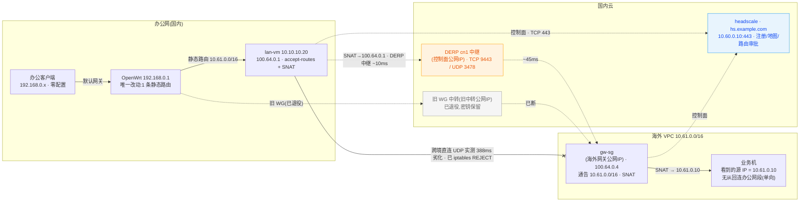

# 办公网到 10.61 组网迁移:WireGuard 转 tailscale

2026-10-20 一天之内,办公网单向访问海外 VPC(10.61.0.0/16)的通道从裸 WireGuard 迁到自建 headscale tailnet,中途换了方案、断了一次直连、改了一次 DERP 地图,最终落在"常开虚拟机收路由 + 路由器一条静态路由"的形态:端到端 55.6ms、0% 丢包,SSH 完整握手 0.756s。文中公网地址一律以尖括号占位符表示,替换成自己的即可复用。

## 1. 断链

旧通道是 OpenWrt 的 `sg` 接口(10.0.8.10/32)对海外网关机 wg0(10.0.8.1,监听 50814)。endpoint 填国内中转 `<旧中转公网IP>:50814`(DNAT 保源转发到海外网关),OpenWrt 专门配了主机路由把该地址钉到 WAN2——挂中转的原因后面会再次遇到:跨境直连 UDP 被路径劣化,直连质量不可用,这是从旧 WG 时代就确认过的前提。

这条 WG 同时承载 10.61.0.0/16、10.40.0.0/16、10.41.0.0/16 三个 allowed_ips;海外侧 `POSTROUTING -o eth0 MASQUERADE` 把流量源统一成网关机内网地址 10.61.0.10,VPC 内无需回程路由。

2026-10-20 上午实测:OpenWrt 侧收到 0 字节、只发不收;海外侧最后握手停在 15 小时前,累计 492.9 MiB 下行 / 6.38 GiB 上行。单路径中转,任一段抖动即全断,修复只能人工逐段排查。

## 2. 原计划:路由器直接当网关(方案 A)

tailnet 是现成资产:控制面 headscale 0.29.2(Docker)+ 独立 derper 都在国内云(10.60.0.10,`hs.example.com`),实验室常开虚拟机 lan-vm(10.10.10.20)、笔记本、另一台 Windows 设备已在网,节点永不过期。补齐的只是两端各一台子网路由器。

计划表很短:安全组放行(海外网关入站 UDP 41641、控制面 443/9443/3478 维持)、headscale 发一把长期 reusable 预授权密钥、海外网关装 tailscale 通告 10.61/16、OpenWrt 装 tailscale 收路由并加 lan→tailscale 的转发。迁移前查了控制面的可用命令,发现 0.29.2 已经没有 `routes` 子命令,批路由要用 `headscale nodes approve-routes -i <节点ID> -r 10.61.0.0/16`——这条先记下,后面要用。

先动海外的机器,不碰办公网。

## 3. 第一颗雷:海外网关 DNS 全坏

`tailscale up` 还没敲,就发现这台机器解析任何域名都超时,连控制面的域名都出不来。分层排查:iptables OUTPUT 是空策略 ACCEPT;用裸 socket 发最小 DNS 查询(不带 EDNS0)到 VPC 内网 DNS,秒回;TCP 53 到同一服务器,通。结论:systemd-resolved 发的 EDNS0/带选项查询在路径上被丢弃,根因落在安全组或 VPC DNS 的行为上,当时不深究,绕过:`/etc/resolv.conf` 从 stub 改指真实上游(`ln -sf /run/systemd/resolve/resolv.conf /etc/resolv.conf`),glibc 直发最小查询。解析立刻恢复,这个绕过沿用至今,回滚只需指回 `stub-resolv.conf`。

装 tailscale 1.104.1,注册 `--hostname=gw-sg --advertise-routes=10.61.0.0/16 --snat-subnet-routes --accept-dns=false`(100.64.0.4),控制面 `approve-routes` 批准。海外侧到此就绪。

## 4. 事故:OpenWrt 上的操作被叫停

轮到 OpenWrt。第一步必须先停旧 WG 接口:`route_allowed_ips` 会生成 10.61.0.0/16 的同前缀路由,与新路由在内核里形成 ECMP,一半流量进死隧道。`ifdown sg`、`auto='0'`,然后 `opkg update` 拉软件源索引。

索引下载出乎意料地慢,期间办公网出现波动,连续两次被中断;第二次之后网络被感知为"挂了",我们收到明确指令:OpenWrt 上的调整全部停掉。

停,并全量回滚:WG 接口恢复原状(`auto='1'` + `ifup sg`),tailscale 安装确认未落盘(opkg 在解包前被杀,二进制、init 脚本、状态目录、进程全不存在),opkg 残锁清掉。同时取证:路由器 DNS 配置从头到尾未动过(resolv.conf 还是去年 12 月的 symlink,dnsmasq 存活),wan 口连续在线 16 小时、wan2 27 天,期间无接口翻动;从办公客户端实测,ping、DNS、国内、国际访问全部正常。波动根因没有定论,但教训清楚:办公网关是生产设备,在它上面装包、改防火墙、反复 reload,每一次动作都是全办公室的风险敞口——哪怕事后证明无害,感知已经造成。方案 A 就地封存。

## 5. 换方案 B:路由器上只留一条静态路由

等价接法:让 tailnet 里现成的常开虚拟机 lan-vm 收路由,OpenWrt 只加一条静态路由指向它,不装任何包、不动防火墙。

lan-vm(10.10.10.20,100.64.0.1)`tailscale set --accept-routes=true`;ip_forward 固化进 sysctl.d;SNAT 与放行做成 `/usr/local/sbin/ts-office-path.sh` + `tailscale-snat.service`(oneshot 开机执行),三条规则:出 tailscale0 到 10.61/16 的 POSTROUTING MASQUERADE、同流量的 FORWARD 放行、以及一条当时还没意识到用处的 OUTPUT 规则(见下节)。

OpenWrt 侧重复第 4 节的第一步(停 `sg`,这次留下了),然后加唯一一条配置:

```
uci add network route
uci set network.@route[-1].interface='lan'
uci set network.@route[-1].target='10.61.0.0'
uci set network.@route[-1].netmask='255.255.0.0'
uci set network.@route[-1].gateway='10.10.10.20'
uci commit network && /etc/init.d/network reload
```

生效为 `10.61.0.0/16 via 10.10.10.20 dev br-lan`。流量 lan→lan,原 zone 策略即 ACCEPT,防火墙零改动。办公客户端零配置,默认网关自动走到新链路。



单向性由双重 SNAT 保证:tailnet 里没有 192.168.0.0/24 的任何通告,海外侧无从发起回连。要双向,给办公侧加 `--advertise-routes=192.168.0.0/24` 再批一次路由即可。这套架构同样适用于个人设备在外网进内网、多区域服务器互访;大流量跨区域同步不在此列,中继吞吐受 derper 单机限制,同步走同厂商内网或专线。

## 6. 388ms 的直连,403ms 的中继

链路通了,数字难看:办公客户端 ping 海外网关 380ms 起。查 `tailscale status`,lan-vm 到 gw-sg 的**直连已经建立**(`via <海外网关公网IP>:41641`)——打洞成功,链路本身劣化,RTT 稳定 388ms,和旧 WG 的病根同源。这一步修正一个常见预期:打洞成功等于链路可用,实测不成立。

处理即 lan-vm 上那条 OUTPUT 规则的本意:iptables 拒绝到 `<海外网关公网IP>` 的全部 UDP,断掉直连,固定走自建中继(国内 derper)。删规则即可恢复直连,留作线路改善后的开关。

改完复测,延迟仍在 400ms 档——`tailscale ping` 显示走了 `DERP(sin)`:新加坡官方中继。中继段的选择规则是**应答方的家庭 DERP**:两端各连自己延迟最低的 DERP,一对节点通信时走应答方的家庭区域;海外网关的物理最近点必然是海外官方节点,跨境劣化段原样保留。要让这条链路吃到国内中继的 56ms(办公→国内 derper 约 10ms,derper→海外约 45ms),只能让地图里没有别的选项:headscale 配置里 `urls:` 清空,只留自建 derper 的 map 文件——与 [README.md](README.md) 2.1 节 HK 部署的既定做法一致。`docker restart headscale` 后全客户端家庭 DERP 收敛到自建区域。代价记下:自建 derper 成为唯一中继,它宕机则无中继兜底,直连不受影响。

收敛后:lan-vm↔gw-sg 经 DERP(cn1)70–86ms,办公客户端 ping 89ms,链路稳定后进一步落到 55.6ms;SSH 完整握手从劣化期的 4.8s 降到 0.756s。验收口径从此定为看 TCP 握手,ICMP 对中继排队敏感,波动大。`tailscale ping` 判读:`via <海外网关公网IP>:41641` 为直连,`via DERP(cn1)` 为自建中继(本环境预期形态),`via DERP(海外)` 说明地图里混进了官方节点。

## 7. 退役旧 WG

稳定复测通过后退役。海外侧 `systemctl disable --now wg-quick@wg0`;停止单元后 wg0 接口残留了一次(systemd 报 inactive 但 link 还在),`ip link del wg0` 补刀,接口与路由(10.0.8.x、办公两个网段)全部消失。PostDown 顺带移除了 wg0.conf 里那条全局 `POSTROUTING -o eth0 MASQUERADE`,tailscale 的 SNAT 独立在 ts-postrouting 链,不受影响——复测通过。

OpenWrt 侧清理中转主机路由时出过一次岔子:按地址匹配 uci 段,第一条命中的是 WG peer 段里的 `endpoint_host`,把 peer 配置误删了。好在巡检时记录过全部字段(公钥、endpoint、allowed_ips、route_allowed_ips),逐字段恢复,`network.sg` 接口段与私钥未受影响。另有一条遗留认知:peer 的 endpoint 会让 netifd 自动生成两条到中转地址的主机路由(主备 WAN 各一),peer 配置在即在、ifdown 不清,目标已无流量,无害;彻底清除需删 WG 接口与 peer 段,连带私钥不可逆,故保留配置作回滚。

## 8. 变更实录(留底)

**headscale(10.60.0.10,Docker 容器 headscale)**
- `preauthkeys create -u 1 -e 100y --reusable`:长期密钥,只在注册那一刻消费,本体存密码管理器,作废 `preauthkeys expire -i <ID>`。
- 批路由:`headscale nodes approve-routes -i <节点ID> -r 10.61.0.0/16`(0.29.2 无 `routes` 子命令)。
- DERP map 删官方源:config.yaml 的 `urls:` 清空,只留自建 derper 的 map 文件(原配置备份同目录),restart 后全客户端收敛。

**gw-sg(海外网关机,EIP <海外网关公网IP>,内网 10.61.0.10)**
- DNS 绕过:resolv.conf 指真实上游(根因见第 3 节,未深究)。
- tailscale 1.104.1;`/etc/sysctl.d/99-tailscale.conf` 固化 ip_forward;`tailscale-gro.service` 开 `rx-udp-gro-forwarding`(子网转发吞吐);监听 UDP 41641(安全组放行)。
- 注册:`tailscale up --login-server=https://hs.example.com --hostname=gw-sg --advertise-routes=10.61.0.0/16 --snat-subnet-routes --accept-dns=false`。
- 旧 `wg-quick@wg0` disable+stop,`/etc/wireguard/` 配置与密钥保留。

**lan-vm(10.10.10.20,100.64.0.1)**
- `tailscale set --accept-routes=true`;ip_forward 固化。
- `/usr/local/sbin/ts-office-path.sh` + `tailscale-snat.service`:SNAT、FORWARD 放行、拒绝到 <海外网关公网IP> 的 UDP(强制走中继)。

**OpenWrt(192.168.0.1)**
- 旧 WG 接口 `sg`:`auto='0'` 停用,配置与私钥保留。
- 静态路由一条(见第 5 节)。防火墙未动,未安装任何软件包。

## 9. 排障速查(本环境实测踩过)

| 症状 | 原因 | 动作 |
| --- | --- | --- |
| 客户端 ping 不通对端网段,tailscale ping 却通 | 子网路由没批 / 接收端没带 accept-routes | `docker exec headscale headscale nodes list-routes` 看 Approved;接收端 `tailscale set --accept-routes=true` |
| 一半流量通一半不通 | 旧 WG 接口的 allowed_ips 路由与新路由同前缀形成 ECMP | 停旧 WG 接口(`ifdown sg`) |
| 服务器 `tailscale up` 卡在连控制面 | 系统 DNS 故障(tailscaled 走 glibc/resolved) | 修解析;临时 `/etc/hosts` 钉住控制面域名 |
| resolved 一切超时,裸 socket UDP 查同一 DNS 正常 | resolved 发的 EDNS0 查询被中间设备丢弃 | `/etc/resolv.conf` 指向真实上游绕过 stub |
| 直连已建立但延迟数百毫秒 | 跨境 UDP 被路径劣化,打洞成功不等于可用 | 办公侧节点 REJECT 对端公网 UDP,固定走中继 |
| `via DERP(海外)` 且延迟差 | 地图里官方节点吸走海外侧家庭 DERP | headscale `urls:` 清空,只留自建 derper |
| 云主机完全无直连、STUN 学不到映射 | 安全组禁 UDP 出站 | 放行 UDP egress,至少 3478 |
| 大包卡死而 ping 正常 | tailscale0 MTU 1280 与路径不匹配 | 中间网关 MSS clamp(OpenWrt zone `mtu_fix '1'`) |
| systemctl 停了 wg-quick 但 wg 接口还在 | systemd 单元停止未删净 link | `ip link del wg0` 手动清理 |

## 10. 验证数字与遗留

| 路径 | 结果 |
| --- | --- |
| 办公客户端 ping 海外网关内网地址 | 验收时 89ms,链路收敛后 55.6ms,全程 0% 丢包 |
| 办公客户端 SSH 该机完整握手 | 0.756s(劣化直连期 4.8s) |
| lan-vm ↔ gw-sg(tailscale ping) | DERP(cn1) 70–86ms |
| gw-sg netcheck | 唯一 DERP=cn1 51.6ms,UDP 出站正常,EIP 端口映射稳定 |

个人设备临时接入(不经办公网链路、直接进 tailnet):`tailscale up --accept-routes --accept-dns=false`,控制面域名已在本机 prefs 里。

回滚逐台独立:OpenWrt 删 route 段 + `network.sg.auto='1'` + `ifup sg`;lan-vm 停 `tailscale-snat` + `tailscale set --accept-routes=false`;gw-sg `systemctl stop tailscaled`(复活 WG 则 `systemctl start wg-quick@wg0`);headscale 恢复 derp 配置备份并 restart。

遗留:headplane 面板公网明文(`0.0.0.0:3000`,HTTP + API key 登录),建议套 443 子域或安全组限源;headscale 的 sqlite/lib 目录是整套网络的全部状态,纳入常规备份;安全组收口——gw-sg 入站 UDP 50814(旧 WG 端口)可关,旧中转的 DNAT 转发可下线;10.40.0.0/16、10.41.0.0/16 随旧 WG 退役不再可达,如需要 gw-sg `tailscale set --advertise-routes=10.61.0.0/16,10.40.0.0/16,10.41.0.0/16` 再批一次路由;海外网关 resolved 的 EDNS0 丢包根因待查。
