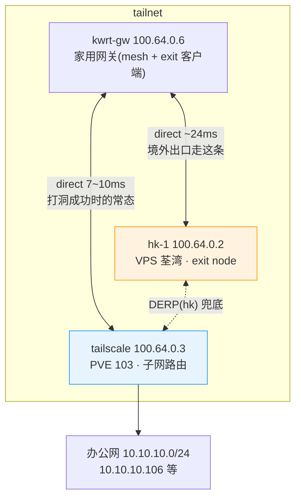

# Tailscale 自组网(tailscale)

> - **形态**:不依赖官方控制面,自托管 headscale(控制面)+ derper(中继/STUN)+ headplane(网页面板),客户端仍用官方 tailscale。
> - **实测环境**:HK 服务器跑 headscale 0.29.1 与 derper v1.102.4;子网路由节点为 PVE VM 103(Ubuntu 24.04,tailscale 1.102.4);家用网关 kwrt-gw(kwrt 25.12,tailscale 1.104.1,兼 exit 客户端)于 2026-10-29 接入。2026-10。
> - **适用场景**:异地组网、外网访问内网网段、家用网关借 tailnet 出境。办公网到海外 VPC 的迁移实录单独成篇,自建组件的部署与使用在第 2 篇,家用网关接入与 exit 出口在第 3 篇。

## 文章索引

| 编号 | 文章 | 内容 | 状态 |
| --- | --- | --- | --- |
| 1 | [办公网到10.61组网迁移](1.办公网到10.61组网迁移(WG转tailscale).md) | 从裸 WireGuard 迁到自建 headscale tailnet:方案对比、跨境直连劣化实测、DERP 应答方选址 | ✅ 已实测 |
| 2 | [自建headscale与derper中继部署](2.自建headscale与derper中继部署.md) | 整体架构与组件职责、打洞与 DERP 兜底机制、headscale/derper/headplane 部署、子网路由、客户端接入与密钥轮换 | ✅ 已实测 |
| 3 | [家用路由器接入headscale与exit出口迁移](3.家用路由器接入headscale与exit出口迁移.md) | kwrt 接入(luci-app 坏配置、注册)、device zone 避 pbr 纳管、CGNAT 打洞分析与 7~10ms 直连恢复、exit node 出口、二级子网路由为何走不通、双层自愈 | ✅ 已实测 |

## 阅读路径

- **想理解为什么自建**:2 的第一章(架构与机制),尤其是 STUN 映射被污染那段;
- **照着搭一套**:2 的第二章,资产与端口总览 → headscale → derper → headplane;
- **只关心办公网怎么迁的**:1,含跨境直连的延迟数字与失败回退;
- **家用网关要进来 / 境外出口要走 tailnet**:3,含 kwrt 侧的包坑、打洞根因与 exit 迁移,网关分流配合在 [openwrt 目录](../openwrt/README.md)的第 3 篇;
- **客户端连不上**:2 的 3.2 节末尾诊断速查,`tailscale ping` 看走直连还是中继。

## 当前拓扑

- 家⇄hk-1 是公网 IP 对单侧 NAT,直连恒定;家⇄PVE 的直连依赖家里 CGNAT 的映射新鲜窗口,退化时回落 DERP(hk) 兜底,恢复机制见第 3 篇的双层自愈;
- 家用网段的出口方向只有 kwrt-gw 自己知道(未广播),tailnet 侧进不了家。

## 这个目录在讲什么

Tailscale 官方控制面在境外,国内网络环境下打洞成功率不稳,DERP 中继又绕远。自建的价值在两处:控制面在近端,网络地图下发快;中继节点在 HK,兜底延迟 10~40ms。

derper 不可解密流量,它只转发加密包,这点决定了自建中继在合规上没有特殊负担。真正难缠的是 STUN:探测到的公网映射由网络路径决定,边界设备对 UDP 有代理时学到的就是假身份,打洞必败——所以中继必须有,且要近。
