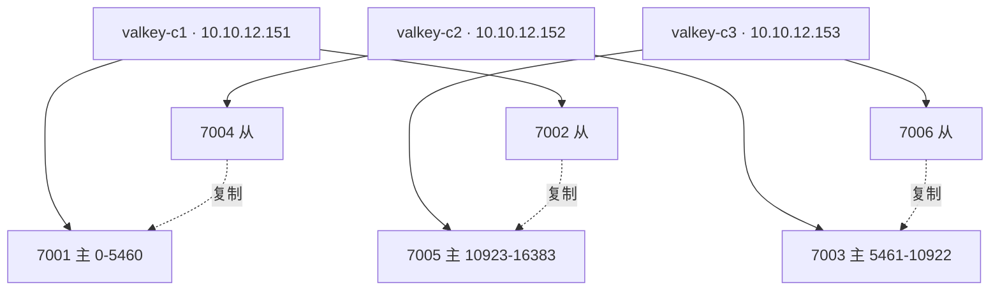

# 4. Cluster 与哨兵实测

第 3 篇留下的口径是「哨兵、Cluster 机制与 Redis 完全一致,把 redis-server/redis-cli 换名照抄 [../redis/5.主从与哨兵.md](../redis/5.主从与哨兵.md) 与 [../redis/6.Cluster集群.md](../redis/6.Cluster集群.md)」——本篇把这条断言逐项实测收口:2026-11-23 在 PVE 虚机 valkey-c1/2/3(10.10.12.151/152/153,2C/4G,Ubuntu 26.04,docker,`valkey/valkey:8.1` 镜像,实测二进制 8.1.12)上,`--cluster` 管理器、MOVED/ASK、杀主接管、两轮在线迁槽、add-node/del-node、哨兵切换全部复用成功;唯一实测出的行为差异在**镜像 entrypoint**——redis 镜像整容器以 redis 用户跑,宿主机目录属主不对直接 crash;valkey 镜像以 root 起容器,entrypoint 先兜底 chown 再降权,该坑结构性不复现(见文末)。

## 拓扑(建群初始态)



| 组件 | 端口 | 协议 / 说明 |
| --- | --- | --- |
| cluster 实例 ×6 | 7001~7006,总线 17001~17006 | RESP;`--net=host` + announce 三件套,总线端口 = 实例端口 + 10000 |
| 哨兵实测的 HA 主从 | 6379 ×3 | 151 主 + 152/153 从,与 cluster 实例共存不冲突 |
| 哨兵 ×3 | 26379 | quorum 2,down-after 5s(与 redis 基线同参数) |

`--cluster create --cluster-replicas 1` 把每个从库编到**别台机器**的主上(7004→7001、7002→7005、7006→7003),跨机冗余比 redis 实验当时的同机主从更接近生产口径。

## 部署

配置与 redis 完全同法拼接:[conf/common.conf](conf/common.conf) + [conf/role-cluster.conf](conf/role-cluster.conf),实例差异(端口与 announce 三件套)部署时注入。每实例一个容器:

```bash
PORT=7001
docker run -d --name valkey-c-$PORT --restart=always --net=host \
  --health-cmd="valkey-cli -p $PORT ping | grep -q PONG" \
  --health-interval=10s --health-timeout=5s --health-retries=6 \
  -e REDISCLI_AUTH=Valkey@2026 \
  -v /data/valkey-cluster/$PORT:/data \
  -v /data/valkey-cluster/$PORT/valkey-$PORT.conf:/conf/valkey.conf \
  valkey/valkey:8.1 valkey-server /conf/valkey.conf
```

目录属主不用预处理(镜像 entrypoint 兜底,见文末「镜像 entrypoint 差异」);哨兵侧的部署片段见 [conf/role-sentinel.conf](conf/role-sentinel.conf)。

## 建群

```bash
docker exec valkey-c-7001 valkey-cli --cluster create \
  10.10.12.151:7001 10.10.12.151:7002 10.10.12.152:7003 \
  10.10.12.152:7004 10.10.12.153:7005 10.10.12.153:7006 \
  --cluster-replicas 1 -a Valkey@2026 --no-auth-warning --cluster-yes
```

实测输出(节选):

```
>>> Performing hash slots allocation on 6 node(s)...
Primary[0] -> Slots 0 - 5460
Primary[1] -> Slots 5461 - 10922
Primary[2] -> Slots 10923 - 16383
Adding replica 10.10.12.152:7004 to 10.10.12.151:7001
Adding replica 10.10.12.153:7006 to 10.10.12.152:7003
Adding replica 10.10.12.151:7002 to 10.10.12.153:7005
[OK] All nodes agree about slots configuration.
>>> Check slots coverage...
[OK] All 16384 slots covered.
```

`CLUSTER INFO` 复核:`cluster_state:ok / cluster_slots_assigned:16384 / cluster_known_nodes:6 / cluster_size:3`。`valkey-cli --cluster` 管理器(create / reshard / check / add-node / del-node)完整移植——「换名即可」最大的不确定点(cli 内置工具而非服务端命令,单机实测覆盖不到)就此收口。

## 客户端语义(报文原文与 redis 逐字一致)

```bash
valkey-cli -p 7001 SET user:1001 bob        # (error) MOVED 5712 10.10.12.152:7003
valkey-cli -c -p 7001 SET user:1001 alice   # OK(集群客户端自动跟随)
CLUSTER KEYSLOT user:1001                   # (integer) 5712 —— 与 redis 篇同 key 同槽号
CLUSTER KEYSLOT {user:1001}.tags           # (integer) 5712 —— hash tag 强制同槽
valkey-cli -p 7003 GET user:1001            # "alice"(重定向后键落在正确节点)
MSET k1 v1 k2 v2                           # (error) CROSSSLOT Keys in request don't hash to the same slot
MSET {u:1}.name x {u:1}.tags y             # OK
```

跨客户端:官方 `redis:8.0` 镜像的 redis-cli `-c` 直连 valkey 集群,SET/GET 全通——第 2 篇的协议矩阵延伸到了 cluster 模式。

## 杀主接管(停库 → 20s 恢复写)

`docker stop valkey-c-7001`(初始主,槽 0-5460),2 秒一轮探测,实测时间线:

| 时刻 | 现象 |
| --- | --- |
| 15:33:05 | docker stop 7001 |
| 15:33:05~21 | 该分片写全部 Connection refused;`cluster_size:3` 不动、`cluster_state` 保持 ok |
| 15:33:23 | `cluster_state` 短暂 fail,写报 `CLUSTERDOWN`(主被判死、提升未完成) |
| 15:33:25 | SET OK——7004 完成提升,首次写成功,距停库 **20s** |

20s = `cluster-node-timeout` 15s 判死 + ~5s 选举提升。旧主 7001 重启后自动降从(实测):

```
7001: role:slave / master_host:10.10.12.152 / master_port:7004 / master_link_status:up
7004: role:master / connected_slaves:1 / slave0:ip=10.10.12.151,port=7001,state=online
```

`--cluster check` 复核 `[OK] All 16384 slots covered`。

## 在线迁槽(两轮,写入零中断)

第一轮 7005 → 7003 迁 200 槽(10923~11122,约 5s):迁移全程后台持续 SET,67 次写**零失败**;预埋键随槽走(`dbsize` 7005 3→2、7003 1→2),迁完 `-c` 即读即得。

第二轮反向 7003 → 7005 迁 100 槽(5461~5560,约 2s):40 个预埋键(槽号按 CRC16 本地预计算,与服务端 KEYSLOT 实测一致)`dbsize` 7003 42→2、7005 2→42 **精确对调**,写循环 ok=40 err=0。

两轮 `--cluster check` 全槽覆盖;`-c` 客户端对迁移中键的读写由 ASK/MOVED 透明承接——与 redis 第 6 篇在线迁槽结论一致。

## add-node / del-node

7007 以空主入群(`cluster_known_nodes` 6→7,`--cluster add-node` 还带 FUNCTION LIST/RESTORE 预检)→ reshard 10 槽给它 → 迁回 → `--cluster del-node` 退群(known_nodes 回 6,五个成员节点全部收敛到 6,check 全槽)。

**实测坑**:add 后立即 del,未收到 gossip 的节点会回 `ERR Unknown node <id>`(本次 7006 报过一次);add/del 间隔留几秒,终态以 `--cluster check` 为准。

## 哨兵切换(停库 → 7.8s 切主)

拓扑:151:6379 主 + 152/153 从,三台各一个 26379 哨兵,quorum 2、down-after 5s——与 redis 第 5 篇同参数。`docker stop` 主库,151 侧哨兵日志原文:

```
+sdown master mymaster 10.10.12.151 6379      ← 停库后 5.4s 主观下线
+odown master mymaster 10.10.12.151 6379 #quorum 2/2
+vote-for-leader 32d630e6... 1
+switch-master mymaster 10.10.12.151 6379 10.10.12.152 6379   ← 距停库 7.8s
```


切主后新主立即可写(`SET ha:t1 → OK / GET → from-failover`);重启旧主 151:6379,被哨兵改配为 152 的从库(`role:slave / master_link_status:up`),153 同步指向 152。redis 同参数基线是 18s([../redis/5.主从与哨兵.md](../redis/5.主从与哨兵.md)),7.8s 与 18s 的差距来自选举轮次抖动,单次实测不构成性能结论。

## 镜像 entrypoint 差异(root 兜底 chown)

redis 镜像整容器 `USER redis`,宿主机目录 root 属主直接 crash 循环([../redis/6.Cluster集群.md](../redis/6.Cluster集群.md) 已知坑第一条)。valkey 镜像(`valkey/valkey:8.1`)是另一套机制:

```
docker inspect:Entrypoint=[tini -- docker-entrypoint.sh],镜像 USER 为空(root 起容器)
entrypoint 关键段(镜像内原文):
  find . \! -user valkey -exec chown valkey '{}' +     ← Workdir=/data,挂载目录兜底改属主
  exec setpriv --reuid=valkey --regid=valkey ...      ← 再降权 exec
```

受控复测(宿主机目录 uid 0、不做任何手工 chown):实例正常启动、0 条权限报错、目录内容被自动 chown 成 999,server 进程实际 uid 999(`docker top` 在宿主机侧把 999 解析成账号名 dnsmasq)。**redis 的 root 属主 crash 坑在 valkey 镜像上结构性不复现**——第 1 篇的 chown 999 纪律降级为「写了也无害」;`--user` 显式指定用户启动时没有兜底,redis 式纪律才重新有意义。

同一个 entrypoint 只对 `valkey-server` 特判,**`valkey-sentinel` 不走降权分支**,哨兵容器以 root 跑(`docker top` 实测);介意就 `--user 999` 显式指定并自行保证目录可写。

## 已知坑(实测)

| 坑 | 现象 | 解 |
| --- | --- | --- |
| del-node 紧跟 add-node | 个别节点回 `ERR Unknown node`(gossip 未及) | 间隔几秒或重试;终态以 `--cluster check` 为准 |
| 哨兵容器 root 跑 | `docker top` 显示 valkey-sentinel uid 0 | `--user 999` + 目录可写;或接受 root(内网实验口径) |
| reshard 进度行带 \r | 脚本管道 grep "^Moving slot" 计数失真 | 用 `--cluster check` 复核,别信管道计数 |

## 互链

兼容矩阵 → [第 2 篇](2.与Redis兼容性实测.md);迁移 → [第 3 篇](3.主从复制与迁移路径.md);MOVED/ASK、槽迁移、哨兵选举的机制详解 → [../redis/6.Cluster集群.md](../redis/6.Cluster集群.md) 与 [../redis/5.主从与哨兵.md](../redis/5.主从与哨兵.md)。
